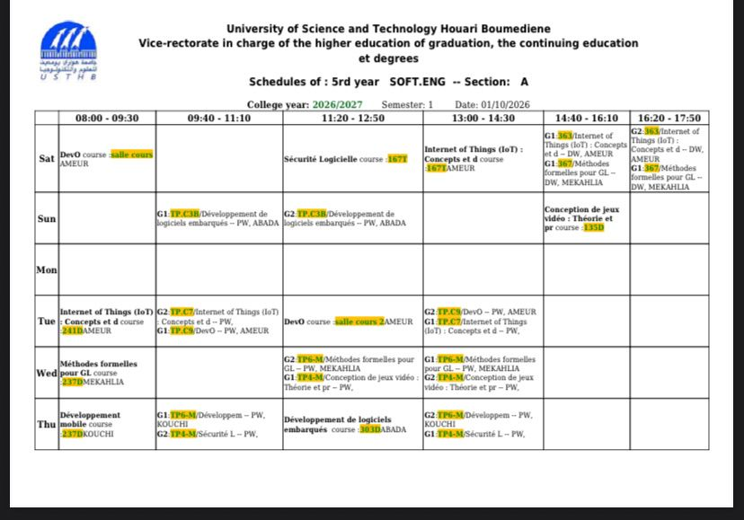

# noussour-s9

## Modules

| Folder | Module | Content |
| --- | --- | --- |
| `devops` | DevOps | COURS, TP |
| `secu-log` | Sécurité Logicielle | COURS, TP |
| `iot` | Internet of Things (IoT) : Concepts et développement | COURS, TD, TP |
| `embedded` | Développement de logiciels embarqués | COURS, TP |
| `game-dev` | Conception de jeux vidéo : Théorie et pratique | COURS, TP |
| `methodes-formelles` | Méthodes formelles pour GL | COURS, TD, TP |
| `dev-mobile` | Développement mobile | COURS, TP |

## Structure

Each module folder follows the same layout:

- `COURS`: course chapters, named `Chapter<N>-<Topic>.pdf` (`Course<N>-<Topic>.pdf` when the teacher numbers courses), plus `LINKS.md` for recordings and online slides
- `TD`: exercise sheets `TD<N>.pdf`, teacher solutions `TD<N>-sol.pdf`
- `TP`: practical work `TP<N>.pdf`, supporting files `TP<N>-<topic>.<ext>`
- `adel-solution`: our own solutions, inside the `TD` or `TP` folder
- `RESUME`: summaries (added as we go)

## Résumés de révision

| Module | Cours | TD et TP |
| --- | --- | --- |
| Développement mobile | [resumer.pdf](dev-mobile/RESUME/resumer.pdf) | [resumer-tp.pdf](dev-mobile/RESUME/resumer-tp.pdf) |
| DevOps et Cloud Computing | [resumer.pdf](devops/RESUME/resumer.pdf) | [resumer-tp.pdf](devops/RESUME/resumer-tp.pdf) |
| Logiciels embarqués | [resumer.pdf](embedded/RESUME/resumer.pdf) | [resumer-tp.pdf](embedded/RESUME/resumer-tp.pdf) |
| Conception de jeux vidéo | [resumer.pdf](game-dev/RESUME/resumer.pdf) | [resumer-tp.pdf](game-dev/RESUME/resumer-tp.pdf) |
| Internet of Things | [resumer.pdf](iot/RESUME/resumer.pdf) | [resumer-tp.pdf](iot/RESUME/resumer-tp.pdf) |
| Méthodes formelles pour GL | [resumer.pdf](methodes-formelles/RESUME/resumer.pdf) | [resumer-tp.pdf](methodes-formelles/RESUME/resumer-tp.pdf) |

Les résumés individuels sont rangés dans le dossier `RESUME` de chaque module : un résumé des cours et un résumé séparé des TD et TP, avec des schémas explicatifs dans `RESUME/figures/`.
Sécurité Logicielle reste en attente des supports de cours.

Chaque dossier contient aussi les versions Markdown modifiables et les listes des
sources (`sources.json`, `sources-tp.json`). Pour redessiner les schémas puis régénérer
les PDF : `python scripts/figures-resumes.py` puis `python scripts/generer-resumes.py`
(Python, ReportLab, PyMuPDF et polices DejaVu ou Arial/Consolas nécessaires).

Pour actualiser certains modules avec une nouvelle date :
`python scripts/generer-resumes.py --modules embedded dev-mobile devops iot --date 2026-11-07`.
