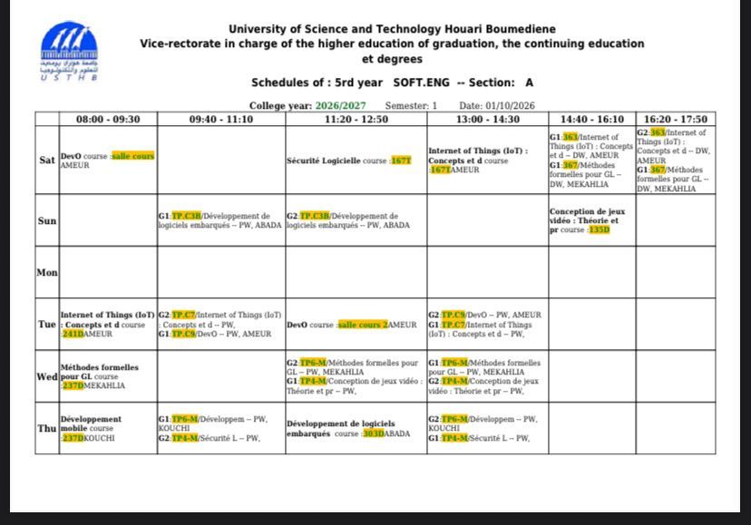

# noussour-s10

## Modules

| Folder | Module | Content |
| --- | --- | --- |
| `devops` | DevOps | COURS, TP |
| `secu-log` | Sécurité Logicielle | COURS, TP |
| `iot` | Internet of Things (IoT) : Concepts et développement | COURS, TD, TP |
| `embedded` | Développement de logiciels embarqués | COURS, TP |
| `game-dev` | Conception de jeux vidéo : Théorie et pratique | COURS, TP |
| `methodes-formelles` | Méthodes formelles pour GL | COURS, TD, TP |
| `dev-mobile` | Développement mobile | COURS, TP |

## Structure

Each module folder follows the same layout:

- `COURS`: course chapters, named `Chapter<N>_<Module>.pdf`
- `TD`: exercise sheets and solutions, one folder per TD
- `TP`: practical work
- `RESUME`: summaries (added as we go)
