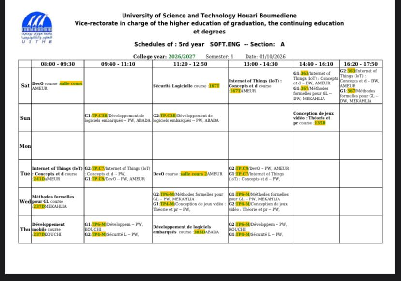

# noussour-s9

## Modules

| Folder | Module | Content |
| --- | --- | --- |
| `devops` | DevOps | COURS, TP |
| `secu-log` | Sécurité Logicielle | COURS, TP |
| `iot` | Internet of Things (IoT) : Concepts et développement | COURS, TD, TP |
| `embedded` | Développement de logiciels embarqués | COURS, TP |
| `game-dev` | Conception de jeux vidéo : Théorie et pratique | COURS, TP |
| `methodes-formelles` | Méthodes formelles pour GL | COURS, TD, TP |
| `dev-mobile` | Développement mobile | COURS, TP |

## Structure

Each module folder follows the same layout:

- `COURS`: course chapters, named `Chapter<N>_<Module>.pdf`
- `TD`: exercise sheets and solutions, one folder per TD
- `TP`: practical work
- `RESUME`: summaries (added as we go)

## Résumés de révision

| Module | Résumé PDF |
| --- | --- |
| Développement mobile | [resumer.pdf](dev-mobile/RESUME/resumer.pdf) |
| DevOps et Cloud Computing | [resumer.pdf](devops/RESUME/resumer.pdf) |
| Logiciels embarqués | [resumer.pdf](embedded/RESUME/resumer.pdf) |
| Conception de jeux vidéo | [resumer.pdf](game-dev/RESUME/resumer.pdf) |
| Internet of Things | [resumer.pdf](iot/RESUME/resumer.pdf) |
| Méthodes formelles pour GL | [resumer.pdf](methodes-formelles/RESUME/resumer.pdf) |

Les résumés individuels sont rangés dans le dossier `RESUME` de chaque module.
Sécurité Logicielle reste en attente des supports de cours.

Chaque dossier contient aussi la version Markdown modifiable et la liste des
sources. Pour régénérer les PDF séparés : `python scripts/generer-resumes.py`
(Python, ReportLab, PyMuPDF et polices DejaVu ou Arial/Consolas nécessaires).

Pour actualiser certains modules avec une nouvelle date :
`python scripts/generer-resumes.py --modules embedded dev-mobile devops iot --date 2026-11-07`.
