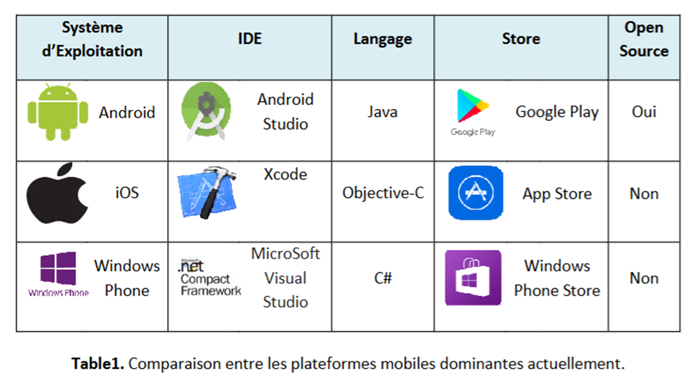
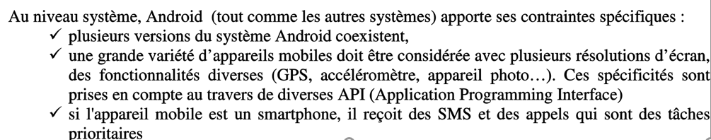
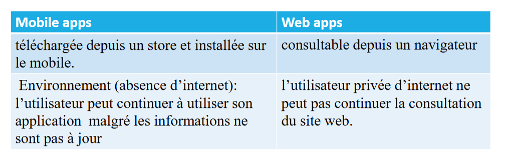
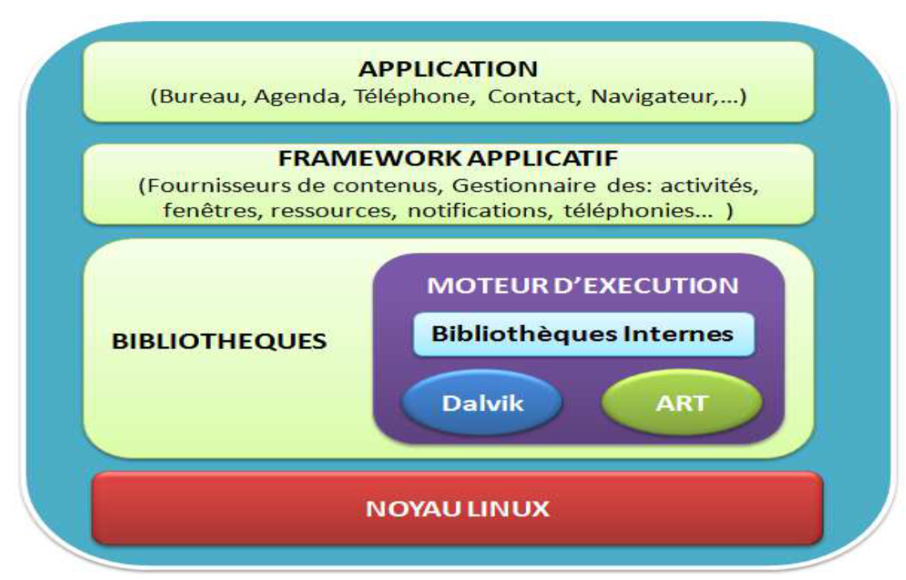
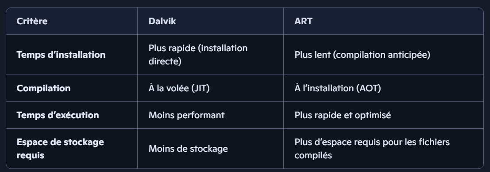
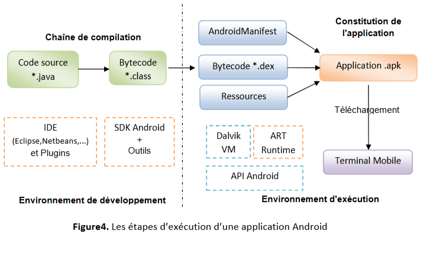
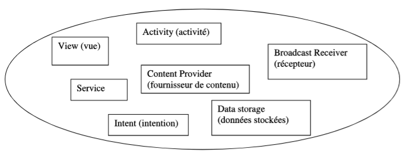
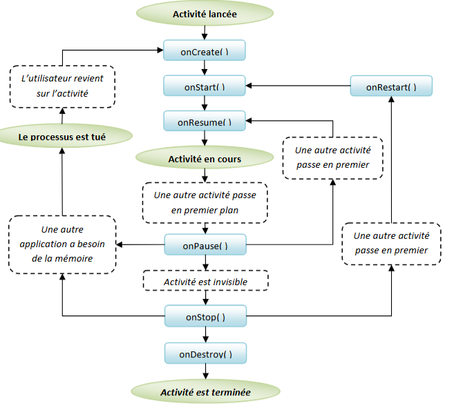

# Applications mobiles ? Lecture du support Prezi

Source : https://prezi.com/view/JxcDHTUoboVC0lidHzZp/ ? Consult? le 24 novembre 2026.

Transcription des blocs textuels dans l?ordre du parcours Prezi. Le support contient ?galement des d?veloppements sur la plateforme Android et le cycle de vie ; les passages de mod?le et r?p?titions sont conserv?s ici, mais ?cart?s du r?sum?. Les images sans texte ne sont pas transcrites automatiquement. Les notes de correction figurent s?par?ment dans le r?sum?.

## ?tape 1

Cours destiné aux étudiants de 5eme Année

Filière Informatique.

Préparé par Dr. KOUCHI Sanaa. Année Universitaire 2026-2027.

Applications Mobiles (AM)

## ?tape 2

DÉVELOPPEMENT ANDROID

Exploration des fondements du développement d'applications Android.

PLATEFORME ANDROID

Présentation des fonctionnalités et des caractéristiques de la plateforme Android pour les développeurs.

CYCLE DE VIE

Examen des étapes essentielles dans le cycle de vie d'une application Android, de sa création à son retrait.

INTERFACES UTILISATEUR

Introduction aux principes de base pour la conception d'interfaces utilisateur dynamiques et engageantes sur Android.

PERSISTANCE DES DONNÉES

Analyse des méthodes utilisées pour stocker et récupérer les données dans une application Android.

## ?tape 3

PLATEFORME ANDROID

Présentation des fonctionnalités et des caractéristiques de la plateforme Android pour les développeurs.

## ?tape 4

CYCLE DE VIE

Examen des étapes essentielles dans le cycle de vie d'une application Android, de sa création à son retrait.

## ?tape 5

INTERFACES UTILISATEUR

Introduction aux principes de base pour la conception d'interfaces utilisateur dynamiques et engageantes sur Android.

## ?tape 6

PERSISTANCE DES DONNÉES

Analyse des méthodes utilisées pour stocker et récupérer les données dans une application Android.

## ?tape 7

DÉVELOPPEMENT ANDROID

Exploration des fondements du développement d'applications Android.

PLATEFORME ANDROID

Présentation des fonctionnalités et des caractéristiques de la plateforme Android pour les développeurs.

CYCLE DE VIE

Examen des étapes essentielles dans le cycle de vie d'une application Android, de sa création à son retrait.

INTERFACES UTILISATEUR

Introduction aux principes de base pour la conception d'interfaces utilisateur dynamiques et engageantes sur Android.

PERSISTANCE DES DONNÉES

Analyse des méthodes utilisées pour stocker et récupérer les données dans une application Android.

## ?tape 8

Chapitre I : Approches de Développement Mobiles

Introduction générale et contexte.

Panorama des systèmes d'exploitation mobiles.

Contraintes spécifiques au développement d'applications mobiles.

Analyse des différentes approches de développement (Web, Natif, Cross-Platform).

## ?tape 9

L'Ère des Applications Mobiles

Les applications mobiles sont devenues essentielles, transformant la manière dont nous interagissons avec notre environnement.

Elles facilitent la communication, le travail, le divertissement et l'accès à l'information, jouant un rôle central dans notre vie quotidienne.

Introduction à l'application mobile

## ?tape 10

Historique du développement des applications mobiles

Lancement de la première application mobile sur un téléphone portable, marquant le début de l'ère des applications.

1992

Introduction de l'iPhone, révolutionnant le marché des smartphones et des applications mobiles.

2007

App Store d'Apple et Google Play Store sont lancés, permettant aux utilisateurs de télécharger et d'installer des applications facilement.

2010

L'essor des applications de réalité augmentée, intégrant des technologies avancées dans les applications mobiles.

2015

Émergence des applications basées sur l'intelligence artificielle, transformant l'expérience mobile.

2023

Une rétrospective des étapes marquantes dans l'évolution des applications mobiles.

## ?tape 11

1992

Sortie de l'IBM Simon, considéré comme le premier smartphone de l'histoire. Il intègre des applications de base : calendrier, carnet d'adresses, calculatrice et bloc-notes

Lancement de la première application mobile sur un téléphone portable, marquant le début de l'ère des applications.

## ?tape 12

2000

L'essor des assistants personnels et des appareils BlackBerry marque l'arrivée d'outils de messagerie et de productivité mobile.

Les téléphones basiques intègrent aussi de petits jeux (comme Snake sur Nokia) et des éditeurs de sonneries.

## ?tape 13

2003

Création d'Android par Andy Rubin et ses associés, initialement prévu pour les appareils photo avant d'être réorienté vers les smartphones. Google rachète l'entreprise en 2005.

## ?tape 14

2007

L'arrivée de l'iPhone d'Apple révolutionne l'ergonomie tactile et l'accès au web mobile.

## ?tape 15

2010

App Store d'Apple et Google Play Store sont lancés, permettant aux utilisateurs de télécharger et d'installer des applications facilement.

## ?tape 16

L'essor des applications de réalité augmentée, intégrant des technologies avancées dans les applications mobiles.

2015

## ?tape 17

Émergence des applications basées sur l'intelligence artificielle, transformant l'expérience mobile.

2023

## ?tape 18

Historique du développement des applications mobiles

Lancement de la première application mobile sur un téléphone portable, marquant le début de l'ère des applications.

1992

Introduction de l'iPhone, révolutionnant le marché des smartphones et des applications mobiles.

2007

App Store d'Apple et Google Play Store sont lancés, permettant aux utilisateurs de télécharger et d'installer des applications facilement.

2010

2015

L'essor des applications de réalité augmentée, intégrant des technologies avancées dans les applications mobiles.

Émergence des applications basées sur l'intelligence artificielle, transformant l'expérience mobile.

2023

Une rétrospective des étapes marquantes dans l'évolution des applications mobiles.

## ?tape 19

Types d'applications mobiles

Applications natives perform optimally

Applications web accessibles facilement

Applications hybrides combinent les meilleurs aspects

Applications de réalité augmentée enrichissent l'expérience

## ?tape 20

Architecture Client-Serveur

L'architecture client-serveur repose sur une séparation claire entre le client et le serveur.

Dans ce modèle, le client envoie des requêtes au serveur, qui traite les demandes et renvoie les réponses.

Cela permet un contrôle centralisé des données et des ressources, mais peut entraîner des limitations en termes de scalabilité et de disponibilité.

Un exemple classique est une application de messagerie où les messages sont stockés sur un serveur central.

Architecture Basée sur le Cloud

L'architecture basée sur le cloud permet un accès aux ressources et aux données via Internet.

Ce modèle est particulièrement flexible, favorisant la scalabilité et la résilience.

Les données sont souvent stockées dans des services cloud comme AWS ou Azure, ce qui permet une utilisation optimale des ressources.

Un exemple serait une application de streaming multimédia qui s'appuie sur des serveurs cloud pour diffuser du contenu à la demande.

Architecture des applications mobiles

## ?tape 21

Systèmes d'Exploitation Mobiles (OSM)

un système d'exploitation mobile est un système conçu pour fonctionner sur un dispositif mobile. Ce genre de système d'exploitation se focalise sur la gestion de : la connectivité sans fil, les différents types d'interface, la navigation internet et les appels téléphoniques et bien sur, la gestion de mémoire embarquée et des processus.

## ?tape 22

Type des Systèmes d'Exploitation Mobiles (OSM)

iOS: Développé par Apple pour iPhone, iPad, iPod. Connu pour son écosystème fermé et sa fluidité.

Android: Système open source de Google, basé sur kernel de Linux et de Java. Très fragmenté et personnalisable.

Windows Phone: OS de Microsoft, interface similaire à Windows 8. Moins de parts de marché actuellement.

Autres OS: SymbianOS de Nokia, Blackberry OS, Bada de Samsung ont eu du mal à rivaliser avec iOS et Android sur le marché.

## ?tape 23

L'évolution technologique et les langages

(2010 à nos jours)

iOS : Le développement natif s'appuyait sur Objective-C avant l'introduction de Swift par Apple en 2014 pour moderniser le code.

Android : D'abord dominé par Java et le C++, Google a promu Kotlin comme langage moderne principal à partir de 2017.Système open source de Google, basé sur kernel de Linux et de Java. Très fragmenté et personnalisable.

Applications Hybrides et Web : L'émergence de frameworks multiplateformes (comme React Native, Flutter ou Ionic) a permis de simplifier la création d'applications compatibles à la fois sur iOS et Android à partir d'un code unique

## ?tape 24

Technologies de développement utilisées

Les technologies évolutives sont essentielles pour répondre aux besoins variés des utilisateurs et aux exigences du marché.

Swift, un langage moderne et puissant, est utilisé pour développer des applications iOS, permettant une performance optimale et une interface utilisateur fluide.

Langage pour iOS

Kotlin, langage officiel pour Android, offre une syntaxe concise et des fonctionnalités avancées, facilitant le développement d'applications robustes.

Langage pour Android

React Native permet de créer des applications multiplateformes avec une seule base de code, optimisant ainsi le temps et les coûts de développement.

Framework multiplateforme

## ?tape 25

Swift, un langage moderne et puissant, est utilisé pour développer des applications iOS, permettant une performance optimale et une interface utilisateur fluide.

Langage pour iOS

## ?tape 26

Kotlin, langage officiel pour Android, offre une syntaxe concise et des fonctionnalités avancées, facilitant le développement d'applications robustes.

Langage pour Android

## ?tape 27

React Native permet de créer des applications multiplateformes avec une seule base de code, optimisant ainsi le temps et les coûts de développement.

Framework multiplateforme

## ?tape 28

## ?tape 29

Statistiques des Systèmes d'Exploitation Mobiles (OSM)

Android domine le marché mondial des systèmes d'exploitation mobiles avec environ 75 % à 80 % des parts de marché, tandis qu'iOS d'Apple détient environ 20 % à 25 %

## ?tape 30

Application Mobile: Définition et Contraintes

Définition: Programme conçu pour fonctionner sur les dispositifs mobiles, adapté à leurs environnements techniques et ergonomiques.

les plateformes de distribution (Stores) les plus populaires pour les applications mobiles sont App Store, Google Play, et Windows Phone Store.

1. Contraintes des dispositifs:  Consommation d'énergie, capacité de calcul, bande passante, capacité de stockage, hétérogénéité des OS.

2. Contraintes marché: Réduire le 'Time to Market' (TTM) est crucial,  qui est le temp qu'il faut entre la comception d'un produit et sa mise en forme.

3. Contraintes techniques: Choix de la plateforme depend des caractericaractéristique de l'app, fragmentation du parc mobile (taille d'ecran, type et version des SEM, performance...), intégration des fonctionnalités natives.

## ?tape 31

D’autres contraintes peuvent être citéessous formes de questions :

Quel est le public cible de l‘application mobile ?

À quoi va-t-elle servir ?

Par quel dispositif mobile et sur quel système d'exploitation ?

Est-ce que l’application à besoin d’intégrer des fonctionnalités natives ?

## ?tape 32

Contraintes a prendre en compte dans

les applications Android

## ?tape 33

Choisir la Bonne Approche de Développement

Avec la diversité des systèmes d'exploitation et des dispositifs, le choix de l'approche de développement est essentiel pour toucher un large public. Nous explorerons le développement Web, Natif et Cross-Platform.

## ?tape 34

L'Approche Web Mobile (Developpement Générique)

Un site web mobile est une application développée en HTML, CSS, JavaScript, accessible via le navigateur du dispositif.

Site classique adapté aux ecran mobile via CSS

Offre une portée universelle et  SEO (Search Engine Optimization) friendly, et pas d'installation, mais peut présenter des limites ergonomiques tel que aplications web ont une mauvaise résolution sur certains mobiles.

## ?tape 35

Web Mobile: Avantages et Inconvénients

Avantages: Adapté aux écrans mobiles, portée universelle, SEO friendly, pas d'installation.

Inconvénients: Ergonomie limitée, mauvaise résolution sur certains mobiles.

## ?tape 36

mobiles apps vs Web apps

## ?tape 37

L'Approche Native

Le développement natif utilise les langages spécifiques à chaque OS (Java pour Android, Objective-C/Swift pour iOS). Il permet d'exploiter pleinement les fonctionnalités matérielles du dispositif, offrant performance et fluidité optimales.

En principe, une application native Android ne pourra pas fonctionner sur un téléphone iPhone et vis versa.

Les applications natives permettent l'utilisation de la mémoire de l'appareil mobile ainsi que toutes les fonctions associées à son système d'exploitation (GPS, appareil photo, etc.). Ce type d’applications est distribué à travers les magasins (stores) d’applications propres à chaque platforme tel que Play Store de google, app Store d’apple, Windows Phone Store de Windows phone.

## ?tape 38

Développement Natif: Points Forts et Faibles

Avantages: Performance élevée, simplicité d'implémentation, flexibilité et accès total aux ressources (GPS, contacts, caméra).

Inconvénients: Nécessite une version distincte pour chaque OS, impliquant un coût de développement et de maintenance plus élevé.

## ?tape 39

Cette approche permet de générer des applications pour différents OS à partir d'un code source unique. Elle réduit les coûts en évitant le recrutement de développeurs spécialisés et simplifie la maintenance et la mise a jour.

Le développement « Cross-platform » permet de concevoir deux types d’applications mobiles: les applications hybrides et les applications natives générées.

Le Cross-Platform: Une Solution Multi-platformes

## ?tape 40

Les applications hybrides combinent 80%  des technologies web (HTML, CSS, JS) avec 20%  des fonctionnalités natives. Elles sont téléchargeables via les stores et fonctionnent sur plusieurs OS, mais leur performance peut être limitée.

Plusieurs framework permettent la création et le déploiement des application hybrid : Apache Cordova, VoltBuilder.

Cross-Platform: Applications Hybrides

## ?tape 41

Développement Hybride: Avantages et Inconvénients

Avantages: Téléchargeable via stores, opérationnel sur plusieurs SEM.

Inconvénients: Performance et qualité limitées pour les projets complexes.

## ?tape 42

Cross-Platform: Applications Natives Générées

Ces frameworks compilent un code source unique en code natif pour différents systèmes d'exploitation. Ils offrent une performance proche du natif mais exigent des connaissances spécifiques aux frameworks (Xamarin, React Native, Flutter).

## ?tape 43

Natives Générées: Défis

Nécessite une connaissance approfondie du langage du framework et l'adaptation aux SDK natifs.

Complexité de maintenir et faire évoluer ces applications en raison des étapes de compilation et du contenu moins natif du code.

## ?tape 44

Questions Clés pour le Développement Mobile

Comment déterminer l'approche de développement la plus adaptée à un projet mobile spécifique ?

Quelle est l'importance du 'Time to Market' (TTM) dans le succès d'une application mobile ?

Pourquoi la perception de la qualité de conception des applications iPhone est-elle souvent supérieure à celle d'Android ?

## ?tape 45

Comment déterminer l'approche de développement la plus adaptée à un projet mobile spécifique ?

1. Identifier les besoins du projet :

Type d’application : e-commerce, réseau social, application bancaire, IoT, etc.

Systèmes ciblés : Android, iOS ou les deux.

Fonctionnalités nécessaires : GPS, caméra, Bluetooth, notifications, NFC, capteurs, etc.

Niveau de performance attendu.

Besoin d’accès aux fonctionnalités natives.

2. Prendre en compte les contraintes

Budget et temps de développement

Compétences de l'équipe

Maintenance et évolution

Performance

Expérience utilisateur (UX) et ergonomie

Sécurité

Facilité d'accès aux API natives

Exemple

application de réservation avec des formulaires, comptes utilisateurs et notifications==> une approche cross-platform

application nécessitant beaucoup de calculs, de traitement graphique ou un accès avancé aux capteurs==>une approche native

## ?tape 46

Quelle est l'importance du 'Time to Market' (TTM) dans le succès d'une application mobile ?

Réagir rapidement au marché : une application peut être lancée avant que les besoins des utilisateurs ou les tendances ne changent.

Obtenir rapidement des retours utilisateurs

Accélérer l'amélioration du pro

Faire face à la concurrence

## ?tape 47

Pourquoi la perception de la qualité de conception des applications iPhone est-elle souvent supérieure à celle d'Android ?

Écosystème plus contrôlé : Apple maîtrise à la fois le matériel et le système iOS. Les développeurs doivent travailler avec un nombre plus limité de configurations matérielles.

Cohérence de l'interface : les recommandations de conception d'Apple encouragent une certaine cohérence dans la navigation, les icônes, les interactions et les composants graphiques.

Moins de fragmentation : Android fonctionne sur un très grand nombre de modèles, de tailles d'écran et de versions du système. Les développeurs doivent donc gérer davantage de configurations.

Optimisation : sur iOS, le nombre limité d'appareils facilite généralement les tests et l'optimisation des applications.

Perception de marque : l'image de qualité et de finition associée à l'écosystème Apple peut également influencer la perception des utilisateurs

## ?tape 48

Platforme Android

Composants de la plate-forme Android

Outils de developpement

Architecture

Chapitre 2 :

Les composants de la plate-forme

Android

## ?tape 49

Android plate-forme

Android est une plate-forme open-source innovante qui support les dernières technologies de téléphonie (écran, GPS, appareil photo, etc.).

## ?tape 50

Composants de la plate-forme Android

Accessible à l’utilisateur, elle lui fournit un ensemble

d’applications (implémentées en Java) offrant un accès aux fonctionnalités de base

Elle contient tous les services auquel il sera possible de faire appel pour récupérer des informations des couches inférieures.

Dalvik et ART (Android RunTim)  sont des machines virtuelles qui permettent aux applications de s’exécuter sur un dispositif mobile Android, indépendamment des différences matérielles et quelque soit le modèle.

la différence majeure entre Dalvik et ART se situe sur le moment

d’interprétation du code. Dalvik interprète le bytecode à la volée pour être exécuté (JIT : Just in Time). Alors que ART compile le bytecode en avance (au moment d’installation) une fois pour toutes, avant son utilisation (AOT : Ahead-Of-time).

Android est fondé sur un noyau Linux (version 2.6), ce noyau permet de gérer divers services du système tels que la gestion des processus, des threads, de la mémoire, des drivers, de la sécurité, et du réseau. Il acte en tant qu’une couche d'abstraction entre le matériel et la pile logicielle

## ?tape 51

Tableau comparatif entre Dalvik et ART

JIT (Just-In-Time) : au moment de l'exécution.

AOT (Ahead-Of-Time) : lors de l'installation.

ART est aujourd’hui le standard sur Android, car il offre une meilleure expérience utilisateur globale.

## ?tape 52

L’environnement Eclipse

Android Studio

IntelliJ IDEA

NetBeans (avec plugin Android)

Flutter

Environnement de développement IDE

## ?tape 53

Langages

Depuis la création d’Android, JAVA était le langage officiel bien qu’il support d’autres langages tels que HTML, CSS, JavaScript et C/C++ en natif. Cependant en 2017, Google annonce que Kotlin devient officiellement le second langage de programmation.

## ?tape 54

SDK ET AVD MANAGER

Un autre outil important est le SDK (Standard Development Kit) et emulateur AVD  (Android Virtual Device) Manager qui permet de telecherger les composants specifiques aux versions de la platformes Android sur lesquelles nous souhaitons faire tourner les applications developpees.

SDK: fournit aux développeurs un environnement de travail pour implémenter, tester et débuguer des applications Android.

SDK Manager :Le SDK Manager permet de télécharger les plateformes, les outils, et

de connaître la version du SDK installée et permet aussi d’installer de

nouvelles lorsqu'elles deviennent disponibles.

- Android versions xx

- Google API versions xx

- Outils (tools et platform-tools)

AVD Manager: Cet outil sert à créer et gérer les terminaux virtuels (AVD) qui accueilleront les instances de

l’émulateur. Il permet de configurer un AVD par l’attribution d’un nom, d’une version

d'Android (disponible dans le SDK), d’une capacité de carte SD et d’une résolution d'écran.

## ?tape 55

## ?tape 56

Quel est l’outil d’Android SDK qui permet de faire la liaison entre un IDE et un

dispositif mobile ?

le ADB (Android Debug Bridge), C'est un outil de ligne de commande polyvalent qui agit comme un pont de communication

## ?tape 57

Cliquez pour éditer le texte

Chapitre 3 :

Les composants d’une application Android

Platforme Android

Composants de la plate-forme Android

Outils de developpement

Architecture

## ?tape 58

Application Android

Une application Android est un montage de composants (activités, vues, ressources) liés par

un fichier de configuration (manifeste).

## ?tape 59

## ?tape 60

Activité

Une activité est l’unité de base pour une application Android. Elle possède le code (java ou kotlin) de l’application, et garantit la gestion de l’ensemble des vues et ressources.

Chaque écran (interface) est hérité de la classe mère Activity. Les activités utilisent les vues (Views) pour former les interfaces utilisateur graphiques qui afficheront l’information et répondront aux actions.

Une application peut inclure plusieurs activités à la fois, ces activités peuvent ne pas avoir interface utilisateur.

## ?tape 61

Cycle de vie d’une activité

## ?tape 62

Une activité a principalement quatre états:

1- Une activité est active ou en cours d'exécution si elle est au premier plan de l'écran.

2- Une activité est mise en pause si elle n’est plus en premier plan mais reste visible. Par exemple, quand un utilisateur reçoit un appel téléphonique pendant qu’il regarde un vidéo.  Le processus de lecture de vidéo est mis en pause (mais il reste visible). Une activité en pause est entièrement vivante, mais elle peut être détruite si le système aura besoin de plus de mémoire.

3- Une activité est arrêtée si elle est entièrement cachée (masquée) par une autre activité. Elle garde toutes les informations d’état, mais elle peut être détruite par le système s’il aura besoin de la mémoire.

4- Quand une activité est mise en pause ou arrêtée, elle doit être redémarrée et restaurée à son état précédent afin d’être à nouveau affichée à l'utilisateur.

En général, le passage entre les états de cycle de vie d’une activité est assuré par les

méthodes de callback suivantes:

## ?tape 63

• onCreate() / onDestroy(): ces méthodes permettent la gestion des opérations à

effectuer avant l'affichage de l'activité, et pendant la destruction de l'activité de la

mémoire.

La méthode onCreate() est invoquée lorsque l’activité est créée. Elle permet d’associer une vue à l’activité, initialiser ou récupérer les données persistantes.

• onStart() / onStop(): ces méthodes sont invoquées lorsque l'activité devient

visible/invisible pour l'utilisateur.

• onPause() / onResume(): une activité peut être mise en pause (mais reste visible) lorsqu’une autre activité est en train de démarrer.

• onRestart(): cette méthode est appelée quand l’activité qui est passée par onStrop()est relancée. Par la suite, la méthode onStart() est appelée afin de différencier le

premier lancement de re-lancement de la même activité

## ?tape 64

onCreate() — Création de l’Activity

Lorsque l’Activity est créée pour la première fois.

Ex: L'utilisateur clique sur l'icône de l'application → Android crée MainActivity → onCreate() est exécutée.

onStart() — Activity visible

L'utilisateur ouvre l'application. L'Activity devient visible.

onResume() — Activity interactive

Lorsque l'utilisateur peut réellement interagir avec l'Activity.

Ex:L'application est ouverte et l'utilisateur peut cliquer sur les boutons, écrire dans un champ, faire défiler une liste, etc.

## ?tape 65

onPause() — Activity partiellement masquée

Lorsque l'Activity perd temporairement le premier plan.

Exemple: L'utilisateur reçoit une interruption ou ouvre une interface qui prend temporairement le focus.

onStop() — Activity n’est plus visible

Lorsque l'Activity n'est plus visible à l'utilisateur.

Exemple: L'utilisateur ouvre complètement une autre Activity

onRestart() — Retour vers une Activity arrêtée

Lorsque l'Activity était arrêtée (onStop()) et que l'utilisateur revient dessus.

onDestroy() — Destruction de l’Activity

Lorsque l'Activity est détruite.

Exemple: L'utilisateur quitte l'Activity et celle-ci est détruite par le système, ou l'Activity est explicitement terminée.

## ?tape 66

Méthodes de la classe Activityimport android.app.Activity

## Images du support

Images originales référencées par la présentation, classées selon son parcours. Les images complètent les étapes dont le texte est absent.

### Étape 28

### Étape 32

### Étape 36

### Étape 50

### Étape 51

### Étape 55

### Étape 55

### Étape 59

### Étape 61

