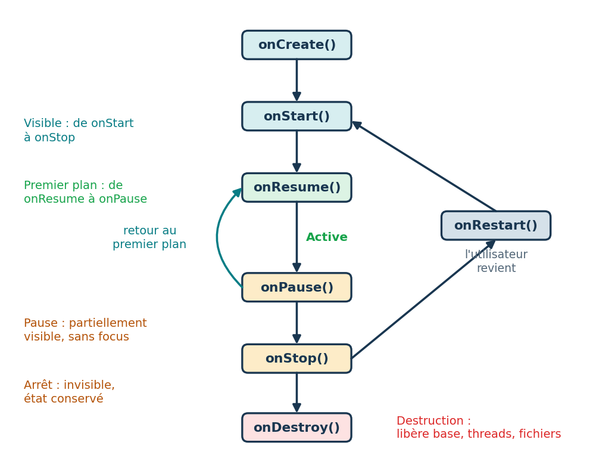
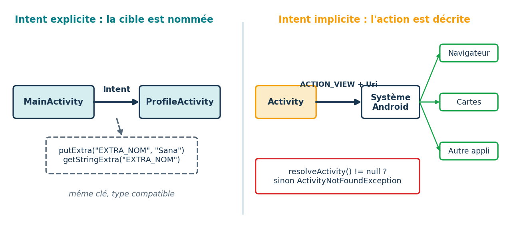

# Développement mobile — Résumé des TD et TP

Mise à jour du 24 novembre 2026. Méthodes de résolution, étapes pratiques et pièges des travaux dirigés et pratiques. Le [résumé des cours](resumer.md) conserve les chapitres théoriques. Les ajouts pédagogiques sont distingués des observations présentes dans les supports.

## TD1 — Méthode de résolution des exercices

### Procédure

1. Identifier les données : résolution, diagonale, dimensions physiques ou densité.
2. Garder la même orientation pour largeur et hauteur dans toutes les unités.
3. Calculer la densité manquante, puis convertir chaque dimension.
4. Vérifier les unités et arrondir seulement à la fin.
5. Distinguer une densité exacte calculée d'une classe Android approximative.

### Exemples calculés

| Énoncé | Calcul | Résultat |
| --- | --- | --- |
| 200 px à 320 dpi | 200 × 160 / 320 | 100 dp |
| 120 dp à 240 dpi | 120 × 240 / 160 | 180 px |
| 480 × 800 px et 600 × 1000 dp | 480 × 160 / 600, confirmé par l'autre dimension | 128 dpi |
| dp = 4 × px | 4 = 160 / dpi | 40 dpi, cas théorique |
| 720 × 1280 px et 360 × 640 dp | 720 × 160 / 360 | 320 dpi |
| 1280 × 720 px, diagonale 4 pouces | sqrt(1280² + 720²) / 4 | Environ 367,15 PPI |

Pour le dernier exemple, les dimensions logiques obtenues en assimilant dpi et PPI sont environ **557,81 × 313,77 dp**. Le corrigé local indique une diagonale de 1452,67 px, mais le calcul donne environ **1468,60 px** ; les résultats qui en dépendent ont été rectifiés ici.

Pour une icône de 0,5 pouce dans le modèle de l'exercice : taille_px = 0,5 × dpi. On obtient 60, 80, 120, 160, 240 et 320 px dans l'ordre ldpi à xxxhdpi, soit 80 dp dans ce modèle de référence.

Si les dimensions physiques horizontale et verticale sont données séparément, vérifier la cohérence des rapports pixels/pouces sur les deux axes. Un simple quotient de diagonales peut masquer des données incompatibles. Le corrigé du TD contient aussi une variante d'énoncé et des inversions d'orientation : toujours repartir de la question originale.

## TP1 — Projet Android et cycle de vie

### Organisation du projet

Le TP crée un projet **Empty Views Activity**, en Java ou Kotlin, avec une interface XML. Gradle construit le projet et résout ses dépendances ; le SDK fournit les outils et API Android ciblés.

| Élément | Rôle |
| --- | --- |
| AndroidManifest.xml | Déclarations de l'application et de ses composants, dont les activités |
| MainActivity.java | Comportement de l'activité |
| res/layout | Description XML des vues |
| res/drawable | Images et ressources graphiques |
| res/mipmap | Icônes de lancement |
| res/values | Chaînes, couleurs, styles et autres valeurs |
| res/xml | Configurations XML selon leur usage |

`setContentView(R.layout.activity_main)` associe l'activité à son interface. L'intent-filter avec MAIN et LAUNCHER désigne l'activité de lancement. Les ressources audio ne sont pas toutes à placer dans drawable : des fichiers bruts peuvent relever de res/raw. Référence : [Android — organisation des ressources](https://developer.android.com/guide/topics/resources/providing-resources).

### Cycle de vie à mémoriser




```text
Premier affichage : onCreate → onStart → onResume
Perte du premier plan : onPause
Activité devenue invisible : onStop
Retour après arrêt : onRestart → onStart → onResume
Destruction normale de l'instance : onDestroy
```

`onCreate` initialise l'activité ; `onStart` correspond à sa visibilité ; `onResume` à son interaction au premier plan. `onPause` et `onStop` permettent d'adapter les traitements au changement d'état. `onDestroy` n'est pas garanti si le processus est tué : ce n'est pas un point fiable unique pour enregistrer des données importantes. Une notification n'entraîne pas systématiquement onPause ; le comportement dépend de l'interaction et de la visibilité. Référence : [Android — cycle de vie](https://developer.android.com/guide/components/activities/activity-lifecycle).

Le TP observe ces transitions via `Log.d` et Logcat. Un émulateur exige une configuration compatible ; un téléphone réel avec débogage USB autorisé constitue une autre voie d'exécution. Les observations d'un appareil ne remplacent pas les règles générales du cycle de vie.

## TP2 — Interface XML et calcul du double

### Éléments d'interface

Le TP construit une application qui lit un nombre et affiche son double. Le layout XML décrit les vues ; l'activité Java définit le comportement.

| Élément | Fonction dans le TP |
| --- | --- |
| LinearLayout / LinearLayoutCompat | Organiser les enfants verticalement ou horizontalement |
| TextView | Afficher titre, libellé ou résultat |
| EditText | Recueillir la saisie |
| Button | Déclencher le calcul |
| Identifiant XML | Relier une vue à `R.id...` dans Java |
| colors.xml | Centraliser une couleur réutilisable par `@color/result` |

`match_parent` occupe l'espace offert par le parent ; `wrap_content` dimensionne selon le contenu. Garder dp pour les dimensions et sp pour le texte. Le champ `inputType="numberDecimal"` oriente la saisie, mais ne remplace pas toutes les validations de la valeur.

### Du clic au résultat

Après `setContentView`, `findViewById` récupère les vues du layout. Le TP associe le clic à `public void computeDouble(View view)` via `android:onClick="computeDouble"`.

```text
Clic → lire getText().toString().trim()
     → refuser une chaîne vide
     → convertir en double
     → calculer 2 × valeur
     → afficher avec TextView.setText
```

Un `Toast` informe l'utilisateur d'une saisie manquante. Le code fourni vérifie le vide ; une conversion peut encore lever `NumberFormatException` pour une chaîne invalide. Une application robuste doit aussi vérifier la conversion et les résultats numériques. Cet ajout est un point de vigilance, pas une fonctionnalité déjà présente dans le PDF.

## TP3 — Deux activités, Intent et transmission de données

### Organisation

L'application d'exercice « My Health Coach » contient une activité de saisie et une activité de résultat. La première lit une masse en kg et une taille en cm ; elle calcule un indice puis le transmet à l'autre activité. Le mot « width » du document doit être compris ici comme **weight**, la masse, et non une largeur.

```text
taille_m = taille_cm / 100
indice = masse_kg / (taille_m × taille_m)
```

Exemple purement numérique : 75 kg et 180 cm donnent 75 / 1,8² ≈ **23,15**. Cet exemple sert à étudier les conversions et le transfert de données dans l'application ; il ne constitue pas une interprétation médicale.

### Écouteur et Intent explicite




Le TP2 reliait le clic dans XML ; le TP3 utilise aussi un écouteur Java : `computeButton.setOnClickListener(this::compute)`. Les vues doivent être initialisées avant l'installation de l'écouteur.

```java
Intent intent = new Intent(this, ResultActivity.class);
intent.putExtra("EXTRA_BMI", indice);
startActivity(intent);
```

`Intent` désigne ici explicitement l'activité à ouvrir. L'extra associe une clé à une valeur ; la même clé et un type compatible doivent être utilisés à la réception.

```java
double indice = getIntent().getDoubleExtra("EXTRA_BMI", 0.0);
```

Le TP lit cet extra dans `onStart`, après l'initialisation des TextView dans `onCreate`, puis formate l'affichage à deux décimales. La valeur par défaut 0,0 ne démontre pas qu'un extra était présent : il faut prévoir le comportement si la donnée manque.

### Validation, suppression et navigation

Le bouton Delete vide les champs avec `setText("")`. Avant de calculer, vérifier des chaînes non vides, une conversion correcte et des valeurs strictement positives, notamment la taille pour éviter une division par zéro.

Le bouton Back du PDF démarre une nouvelle MainActivity. Cela peut empiler une autre instance ; pour simplement revenir à l'activité de saisie déjà présente sous l'activité résultat, `finish()` correspond au comportement de fermeture de l'écran courant.

Le sujet annonce un affichage d'interprétation, mais le code visible de ResultActivity met seulement à jour le texte numérique : `interpretationText` est initialisé sans règle d'interprétation dans l'extrait fourni. Il ne faut pas présenter cette fonctionnalité comme déjà implémentée.

## Révision active — Pratique

1. **Pourquoi compléter les logs du TP avec la documentation ?** Certaines transitions dépendent du scénario ; onDestroy n'est notamment pas garanti à la mort du processus.
2. **Quand utiliser findViewById ?** Après avoir chargé le layout contenant la vue avec setContentView.
3. **Pourquoi la taille est-elle divisée par 100 dans le TP3 ?** Pour convertir les centimètres en mètres avant le carré.
4. **Le code du TP3 calcule-t-il l'interprétation annoncée ?** Pas dans l'extrait fourni : seul l'indice numérique est affiché.
