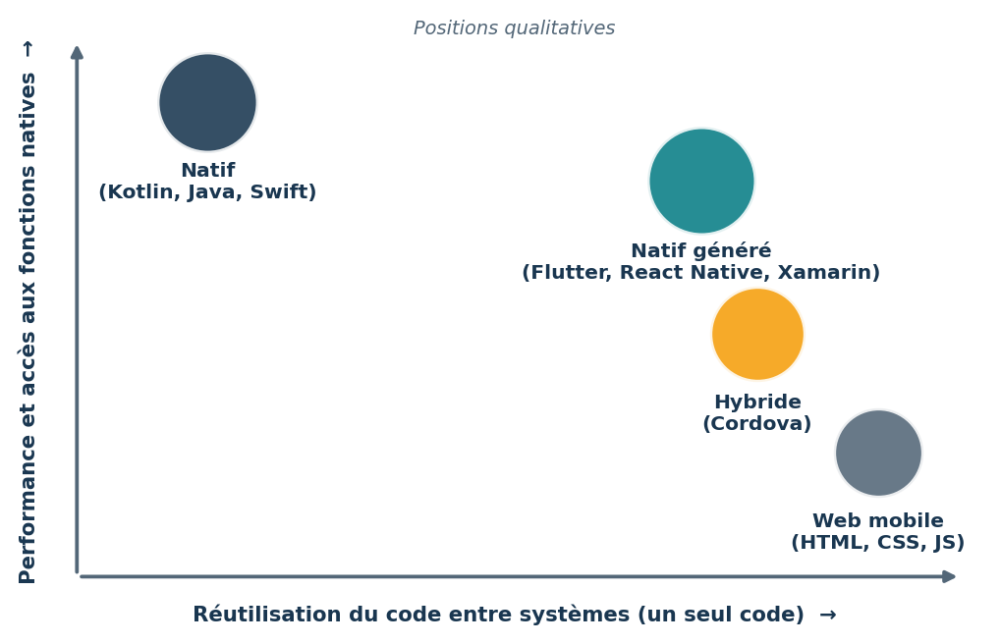
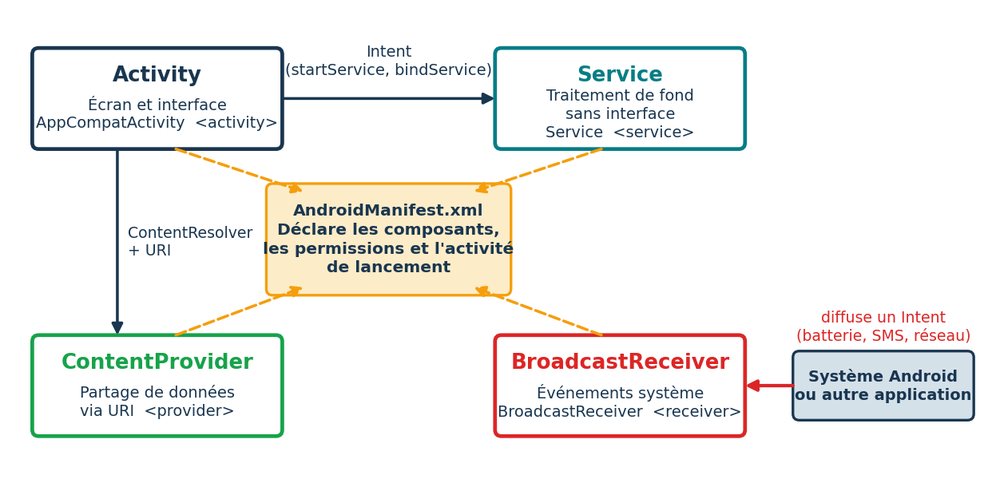
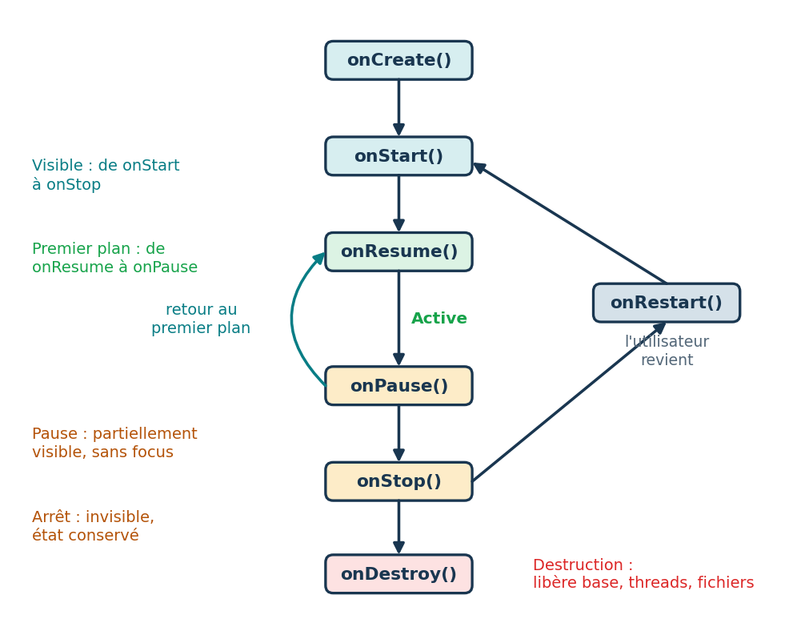
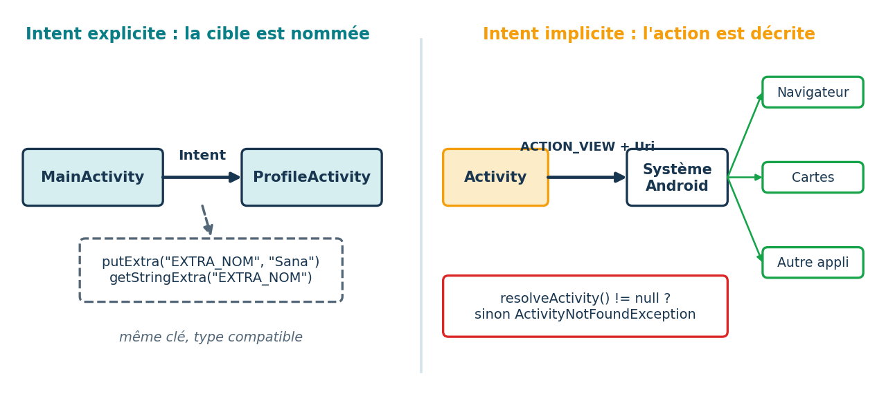
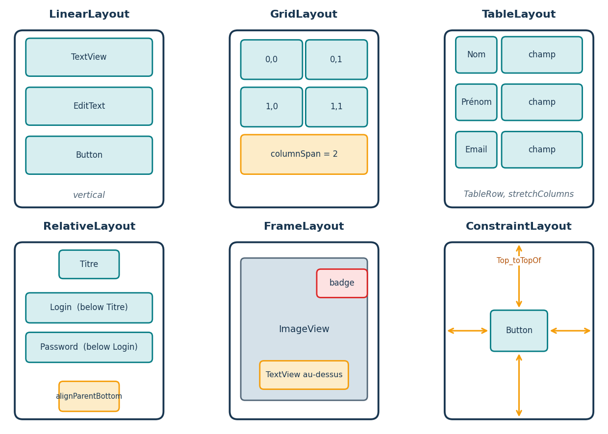

# Développement mobile — Résumé des cours

Mise à jour du 24 novembre 2026. Définitions, raisonnements et exemples des cours (approches de développement, plateforme, résolution et densité, composants, Intent, XML et layouts). Les exercices, commandes et comptes rendus pratiques sont réunis dans [le résumé TD/TP](resumer-tp.md).

## Chapitre 2 — Appareils mobiles et architecture matérielle

### Appareil mobile et SoC

Un appareil mobile est un système portable fonctionnant avec une alimentation autonome. L'évolution PDA → téléphone multifonction → smartphone rassemble téléphonie, applications, capteurs et communications dans un même appareil.

Le **SoC, System on Chip**, intègre de nombreuses fonctions de calcul et de communication sur une puce. Il favorise la compacité, les échanges rapides et la maîtrise de la consommation. Attention : toutes les mémoires et tous les capteurs d'un téléphone ne sont pas nécessairement intégrés physiquement au SoC.

| Élément | Fonction essentielle | À distinguer |
| --- | --- | --- |
| CPU | Exécuter les instructions et la logique générale | Nombre de cœurs et fréquence ne suffisent pas à mesurer toute la performance |
| GPU | Traiter le rendu graphique et des calculs parallèles | Ne remplace pas le CPU pour toutes les tâches |
| DSP | Effectuer des traitements spécialisés de signaux | Audio, image ou communications selon le matériel |
| RAM | Conserver temporairement les données des programmes actifs | Volatile : contenu perdu à l'arrêt |
| Stockage flash | Conserver OS, applications et fichiers | Non volatile ; souvent appelé « ROM » par abus de langage |
| Modem / interfaces radio | Assurer les communications | Distincts des fonctions de calcul général |

Une mémoire externe, par exemple microSD, est optionnelle. Le cours présente aussi les processeurs spécialisés pour l'IA : il faut retenir leur fonction plutôt que mémoriser des noms commerciaux ou des performances rapidement périmées.

### Contraintes à relier au logiciel

La batterie, la mémoire disponible, la puissance de calcul et la diversité des écrans influencent la conception. Une application doit rester lisible sur différentes densités et éviter de conserver inutilement des ressources lorsque son activité n'est plus utilisée.

## Chapitre 2 — Écrans, résolution, densité et unités Android

### Les notions à ne pas confondre

| Notion | Signification | Exemple |
| --- | --- | --- |
| Pixel, px | Point de l'image affichée | Un élément de 200 px |
| Résolution | Largeur × hauteur en pixels | 1080 × 1920 px |
| Diagonale physique | Taille de l'écran en pouces | 4 pouces ; 1 pouce = 2,54 cm |
| PPI | Nombre physique de pixels par pouce | Densité calculée à partir de la résolution et de la diagonale |
| dp / dip | Unité logique indépendante de la densité | Largeur, hauteur et marges d'une vue |
| sp | Unité de taille de texte adaptée aux préférences utilisateur | Texte à 16 sp |

Une résolution plus élevée n'implique pas une surface physique plus grande. À nombre de pixels identique, une forte densité réduit la longueur physique occupée. Android utilise une densité logique pour convertir les dp ; elle peut différer du PPI physique mesuré. Dans les exercices, on assimile ces valeurs lorsque l'énoncé le demande.

### Formules indispensables

```text
Diagonale_pixels = sqrt(largeur_px² + hauteur_px²)
PPI = Diagonale_pixels / diagonale_pouces
px = dp × dpi / 160
dp = px × 160 / dpi
diagonale_pouces = Diagonale_pixels / PPI
```

À la densité de référence de 160 dpi, 1 dp correspond à 1 px. Le dp conserve une taille visuelle approximativement cohérente ; il ne promet pas une longueur physique absolument identique sur tous les appareils.

| Classe | Densité de référence | Multiplicateur px / dp |
| --- | --- | --- |
| ldpi | 120 dpi | 0,75 |
| mdpi | 160 dpi | 1 |
| hdpi | 240 dpi | 1,5 |
| xhdpi | 320 dpi | 2 |
| xxhdpi | 480 dpi | 3 |
| xxxhdpi | 640 dpi | 4 |

Ces classes sont des références de ressources ; un PPI physique calculé n'est pas forcément égal à l'une d'elles. Pour du code réel, employer les unités XML et les fonctions Android de conversion. Référence complémentaire : [Android — densités et unités](https://developer.android.com/training/multiscreen/screendensities).

### Exemple de mise en page

```xml
<Button
    android:layout_width="120dp"
    android:layout_height="48dp"
    android:text="Valider"
    android:textSize="16sp" />
```

La largeur occupe 120 px à 160 dpi, 240 px à 320 dpi et 360 px à 480 dpi. Le texte est en sp pour respecter les préférences de taille de police.

## Chapitre 1 — Applications mobiles : contexte et contraintes

### Repères historiques

| Date (selon le support) | Événement |
| --- | --- |
| 1992 | IBM Simon, considéré comme le premier smartphone : calendrier, carnet d'adresses, calculatrice, bloc-notes |
| 2000 | assistants personnels et BlackBerry : messagerie et productivité mobiles ; petits jeux sur téléphones basiques (Snake sur Nokia) |
| 2003 | création d'Android par Andy Rubin, d'abord pour des appareils photo, puis réorienté vers les smartphones ; rachat par Google en 2005 |
| 2007 | iPhone d'Apple : ergonomie tactile et web mobile |
| 2010 | App Store et Google Play : installation facile d'applications |
| 2015 puis 2023 | réalité augmentée, puis applications fondées sur l'intelligence artificielle |

Précision : le support date les boutiques d'applications de 2010. L'App Store d'Apple ouvre en 2008 et Android Market, devenu Google Play, la même année ; le nom « Google Play » date de 2012. L'IBM Simon est présenté en 1992 et commercialisé plus tard.

### Systèmes d'exploitation mobiles

Un système d'exploitation mobile gère la connectivité sans fil, les types d'interface, la navigation internet, les appels et l'énergie. Les applications se distribuent par des **magasins** (App Store, Google Play, Windows Phone Store).

| Système | Éditeur et nature | Langage natif |
| --- | --- | --- |
| iOS | Apple ; écosystème fermé, interface fluide | Objective-C, puis Swift (2014) |
| Android | Google ; open source, fondé sur le noyau Linux ; très fragmenté et personnalisable | Java et C++ ; Kotlin promu à partir de 2017 |
| Windows Phone | Microsoft ; interface proche de Windows 8 ; faible diffusion | — |

Android domine avec environ 75 à 80 % des parts de marché mondial, iOS environ 20 à 25 %. **React Native** est cité comme framework multiplateforme à code unique.

### Définition et contraintes

Une **application mobile** est un programme conçu pour un dispositif mobile, adapté à son environnement technique et ergonomique. Trois familles de contraintes :

| Famille | Contenu |
| --- | --- |
| Dispositif | consommation d'énergie, capacité de calcul, bande passante, stockage, hétérogénéité des systèmes |
| Marché | réduire le **Time to Market** (TTM) : durée entre la conception d'un produit et sa mise sur le marché |
| Technique | le choix de la plateforme dépend des caractéristiques du projet |

Autres questions à se poser : quel public cible ? à quoi sert l'application ? sur quel appareil et quel système ? a-t-elle besoin de fonctions natives (GPS, caméra, capteurs) ?

## Chapitre 1 — Choisir une approche de développement



| Approche | Principe | Avantages | Inconvénients |
| --- | --- | --- | --- |
| Web mobile | site HTML, CSS, JavaScript lu dans le navigateur | portée universelle, adapté aux écrans mobiles, référencement (SEO), aucune installation | ergonomie limitée, résolution parfois mauvaise, pas de boutique |
| Native | langage propre à chaque système, accès complet au matériel (GPS, caméra, contacts, mémoire) | performance et fluidité optimales, accès total aux ressources | une version par système : coût de développement et de maintenance plus élevé |
| Hybride (cross-platform) | environ 80 % de technologies web et 20 % de fonctions natives dans une coque ; Apache Cordova, VoltBuilder | un code source, installable par les boutiques, plusieurs systèmes | performance et qualité limitées pour les projets complexes |
| Native générée (cross-platform) | un code source compilé en code natif : Xamarin, React Native, Flutter | performance proche du natif, un seul code | connaissance approfondie du framework, adaptation aux SDK natifs, maintenance plus complexe |

Une application native Android ne fonctionne pas sur iPhone, et inversement. Le cross-platform réduit les coûts en évitant de recruter des spécialistes de chaque système.

### Comment décider

1. **Besoins du projet** : type d'application (commerce, réseau social, banque, IoT), systèmes visés, fonctions natives nécessaires (GPS, caméra, Bluetooth, notifications, NFC, capteurs), performance attendue.
2. **Contraintes** : budget et délais, compétences de l'équipe, maintenance, performance, expérience utilisateur, sécurité, facilité d'accès aux API natives.

Une application de réservation avec formulaires et comptes, sans fonction matérielle exigeante, peut se contenter d'une approche web ou hybride ; un jeu ou une application qui exploite fortement la caméra et les capteurs justifie du natif.

**Pourquoi le TTM est-il décisif ?** Il permet de réagir au marché avant que les besoins ou les tendances changent, d'obtenir vite des retours utilisateurs, d'améliorer le produit plus tôt et de faire face à la concurrence.

**Pourquoi la qualité de conception d'iOS est-elle souvent perçue comme meilleure ?** Apple contrôle le matériel et le système (peu de configurations à gérer) ; ses recommandations donnent une interface cohérente (navigation, icônes, interactions) ; il y a moins de fragmentation que sous Android, qui tourne sur de très nombreux modèles, tailles d'écran et versions. L'optimisation est donc plus simple sur iOS.

## Chapitre 1 — La plateforme Android et ses outils

| Élément | Rôle |
| --- | --- |
| Applications | couche visible par l'utilisateur, fonctions de base |
| Framework et services | services auxquels les applications font appel pour atteindre les couches inférieures |
| Machine virtuelle | Dalvik puis ART : exécutent les applications indépendamment du matériel |
| IDE | Android Studio (officiel), IntelliJ IDEA, Eclipse (ancien), NetBeans avec plugin ; Flutter |
| Langages | Java (historique), Kotlin, C/C++ en natif ; Kotlin devient officiel en 2017 |
| SDK Manager | télécharge plateformes, outils (tools, platform-tools), versions d'API |
| AVD Manager | gère les émulateurs (Android Virtual Device) |
| ADB | Android Debug Bridge : outil en ligne de commande qui relie l'IDE et l'appareil |

| Critère | Dalvik | ART (Android Runtime) |
| --- | --- | --- |
| Compilation | **JIT** (Just-In-Time) : à l'exécution | **AOT** (Ahead-Of-Time) : à l'installation |
| Conséquence | démarrage et exécution plus lents | meilleure expérience globale ; standard actuel |

## Chapitre 3 — Les quatre composants fondamentaux d'une application Android

Une application Android est un assemblage de **composants** liés par le fichier de configuration `AndroidManifest.xml`. Tout composant doit y être déclaré pour pouvoir fonctionner ; c'est le premier fichier lu au démarrage de l'application.



| Composant | Rôle | Classe de base | Balise du manifeste | Interface ? | Exemple |
| --- | --- | --- | --- | --- | --- |
| Activity | un écran avec interface | `AppCompatActivity` | `<activity>` | oui | afficher une liste de contacts |
| Service | traitement de fond | `Service` | `<service>` | non | télécharger un fichier |
| ContentProvider | partage de données entre applications | `ContentProvider` | `<provider>` | non | accéder aux contacts du système |
| BroadcastReceiver | réception d'événements | `BroadcastReceiver` | `<receiver>` | non | détecter une batterie faible |

### Activity et sa pile

Une activité représente un écran ; elle relie l'interface (layouts et vues) à la logique, et porte le **contexte**, lien avec le système et les autres activités. Une seule activité est au premier plan. Les activités s'empilent dans la **pile (back stack)** : la nouvelle se place au sommet, et l'ancienne ne réapparaît que lorsque celles qui la recouvrent sont terminées.

| État | Visibilité | Remarque |
| --- | --- | --- |
| Active (Resumed) | totalement visible, au sommet, détient le focus | l'utilisateur interagit |
| Suspendue (Paused) | partiellement visible (SMS reçu), sans focus | reste en mémoire ; peut être tuée si la mémoire manque |
| Arrêtée (Stopped) | complètement cachée | état conservé, mais peut être détruite |



| Callback | Moment | À y faire |
| --- | --- | --- |
| `onCreate()` | création ; reçoit un `Bundle` | `setContentView`, initialiser vues et variables |
| `onStart()` | l'activité devient visible (appelée aussi après `onRestart()`) | |
| `onResume()` | l'utilisateur peut interagir | démarrer threads, animations, écouteurs |
| `onPause()` | perte partielle du focus | sauvegarder (`onSaveInstanceState`) |
| `onStop()` | plus visible | arrêter les traitements inutiles |
| `onRestart()` | retour depuis l'état arrêté | |
| `onDestroy()` | destruction | fermer base, threads, fichiers |

### Service

Un service s'exécute en arrière-plan **sans interface**, pour de longues tâches (musique, téléchargement, réseau).

| Critère | Started Service (local) | Bound Service (distant) |
| --- | --- | --- |
| Démarrage | `startService()` | `bindService()` |
| Objectif | exécuter une tâche | permettre l'interaction avec un client |
| Communication | pas nécessairement d'interface | interface `IBinder`, `onBind()` puis `ServiceConnection` |
| Durée de vie | continue après la fermeture de l'activité, jusqu'à `stopSelf()` ou `stopService()` | tant que des clients sont liés (`unbindService()`) |
| Exemple | lecture audio lancée par l'utilisateur | météo fournie par une autre application |

Cycle du service démarré : `startService()`, `onCreate()`, `onStartCommand()`, service en fonctionnement, `stopSelf()` ou `stopService()`, `onDestroy()`. Cycle du service lié : `bindService()`, `onCreate()`, `onBind()`, client lié, `unbindService()`, `onUnbind()`, `onDestroy()`. Un service **hybride** peut être démarré et lié (suivi GPS : `startService()` lance le suivi, `bindService()` lit la position). Sur les versions récentes d'Android, les tâches longues (GPS, audio) exigent souvent un **Foreground Service** avec notification, et le respect des restrictions du système. Dans le code, un travail long se fait dans un thread, pas dans le thread principal. `START_STICKY` demande au système de relancer le service s'il est tué.

### ContentProvider

Il partage des données de façon contrôlée entre applications. Le client passe par un **ContentResolver**, qui envoie une **URI** au fournisseur et reçoit un **Cursor**.

```text
content://com.example.provider/contacts/42
schéma     autorité                chemin    identifiant
```

| Méthode du ContentResolver | Équivalent |
| --- | --- |
| `query()` | lecture (SELECT) |
| `insert()` | insertion |
| `update()` | mise à jour |
| `delete()` | suppression |

### BroadcastReceiver

Il reçoit des événements du système (`BOOT_COMPLETED`, `BATTERY_LOW`, mode avion, SMS reçu, changement de connectivité) ou de l'application. Chaque message est un `Intent` ; le code se place dans `onReceive(Context, Intent)`.

| Enregistrement | Où | Effet |
| --- | --- | --- |
| Statique | `AndroidManifest.xml` | reçoit même si l'application est fermée |
| Dynamique | code (`registerReceiver` dans `onResume`, `unregisterReceiver` dans `onPause`) | actif tant que l'activité est en vie |

## Chapitre 4 — Intent, Bundle et interfaces XML

### Intent

Un **Intent** est un objet qui décrit une action à réaliser : démarrer une activité, démarrer un service, envoyer une demande à une autre application, transmettre des données sous forme d'extras. Il ne montre pas l'écran lui-même.



| Critère | Explicite | Implicite |
| --- | --- | --- |
| Destination | un composant nommé | une action décrite, Android choisit l'application |
| Usage | navigation interne | action externe ou inter-applications |
| Exemple | `MainActivity` vers `DetailsActivity` | ouvrir une URL dans le navigateur |
| Précaution | l'activité doit être déclarée dans le manifeste | vérifier `resolveActivity()` avant de lancer |

```kotlin
val intent = Intent(this, ProfileActivity::class.java)   // explicite
startActivity(intent)

val web = Intent(Intent.ACTION_VIEW, Uri.parse("https://www.android.com"))   // implicite
if (web.resolveActivity(packageManager) != null) startActivity(web)
```

| Action implicite | Rôle |
| --- | --- |
| `ACTION_VIEW` | afficher une ressource (URL vers navigateur, `geo:` vers cartes) |
| `ACTION_SEND` | partager du texte (`type = "text/plain"`, `EXTRA_TEXT`, `createChooser`) |
| `ACTION_SENDTO` | écrire à un destinataire (`mailto:`, `smsto:`) |
| `ACTION_DIAL` | ouvrir le composeur avec un numéro (`tel:`), l'utilisateur valide l'appel |
| `ACTION_PICK` | choisir un élément (image, contact) |
| `ACTION_MAIN` | point d'entrée, avec `CATEGORY_LAUNCHER` |

Sans application compatible, `startActivity` lève `ActivityNotFoundException`.

### Extras et Bundle

L'Intent transporte la demande, les **extras** transportent les informations : des paires **clé-valeur**.

```kotlin
// envoi
intent.putExtra("EXTRA_NOM", "Sana")
intent.putExtra("EXTRA_AGE", 24)
// réception, même clé et type compatible
val nom = intent.getStringExtra("EXTRA_NOM") ?: "Inconnu"
val age = intent.getIntExtra("EXTRA_AGE", 0)
```

Un **Bundle** regroupe plusieurs valeurs (`putString`, `putInt`), s'attache avec `putExtras(bundle)` et se lit avec `intent.extras`. Types courants : String, Int, Boolean, Long, Double, Parcelable. On ne transmet pas d'image volumineuse ni de fichier entier : on envoie une **URI**.

Sécurité : toute activité est déclarée dans le manifeste ; `android:exported="true"` seulement si une autre application doit pouvoir l'ouvrir ; vérifier les données reçues (absentes ou invalides) ; ne pas envoyer de données sensibles à une application externe sans précaution.

### Layout XML et accès depuis le code

Les layouts sont dans `res/layout/`, un fichier par activité. Le namespace `xmlns:android="http://schemas.android.com/apk/res/android"` est obligatoire sur la racine.

| Notion | Rôle |
| --- | --- |
| `match_parent` | occupe tout l'espace du parent |
| `wrap_content` | s'adapte au contenu |
| `dp` | dimensions et marges (indépendant de la densité) |
| `sp` | taille du texte (suit les préférences de police) |
| `android:id="@+id/btnValider"` | `@+id/` crée un identifiant |
| `setContentView(R.layout.x)` | charge le layout dans l'activité |
| `findViewById<T>(R.id.x)` | retrouve une vue par son identifiant |
| View Binding | classe générée (`ActivityMainBinding`) : accès direct, sans `findViewById`, sans crash sur identifiant erroné |

`View` désigne un composant (TextView, EditText, Button, ImageView, CheckBox, RadioButton, Switch, ProgressBar, Spinner) ; `ViewGroup` un conteneur (LinearLayout, ConstraintLayout, FrameLayout, ScrollView, RecyclerView). TextView affiche un texte non éditable (`text`, `textSize` en sp, `textColor`, `gravity`) ; EditText permet la saisie (`hint`, `inputType`, `maxLines`) ; un clic se traite avec `setOnClickListener { ... }`.

Bonnes pratiques : textes dans `res/values/strings.xml`, dp pour les dimensions, sp pour les textes, identifiants explicites (`btnValider`, `txtTitre`, `editNom`), ConstraintLayout pour éviter les imbrications. XML décrit l'interface, Kotlin gère la logique.

**Application multi-écrans** : XML (interface) + Kotlin (logique) + Intent (navigation) + Bundle ou extras (données).

## Chapitre 5 — Les layouts, conteneurs d'interface

Un **layout** organise, positionne et dimensionne les composants graphiques d'une interface, et les adapte à l'espace disponible.



### Attributs communs

| Attribut | Rôle |
| --- | --- |
| `layout_width`, `layout_height` | `match_parent`, `wrap_content` ou valeur en `dp` |
| `margin` | espace **extérieur** autour du composant |
| `padding` | espace **intérieur** entre le contenu et la bordure |
| `gravity` | positionne le **contenu** à l'intérieur du composant |
| `layout_gravity` | positionne le **composant** dans son parent (si le parent le permet) |

### Les layouts

| Layout | Organisation | Attributs clés | Usage |
| --- | --- | --- | --- |
| LinearLayout | une direction | `orientation` (vertical, horizontal), `layout_weight` | formulaires simples, boutons |
| GridLayout | grille de lignes et colonnes (indices depuis 0) | `rowCount`, `columnCount`, `layout_row`, `layout_column`, `layout_rowSpan`, `layout_columnSpan` | calculatrices, claviers |
| TableLayout | lignes `TableRow` | `stretchColumns`, `shrinkColumns`, `collapseColumns`, `layout_span` | formulaires, tableaux |
| RelativeLayout | positions relatives au parent ou à un voisin | `layout_alignParentTop`, `layout_centerInParent`, `layout_below`, `layout_toEndOf` | connexion, bouton en bas |
| FrameLayout | superposition (le dernier déclaré est au-dessus) | `layout_gravity`, `foreground` | texte sur image, indicateur de chargement |
| ConstraintLayout | contraintes entre côtés (top, bottom, start, end) | `layout_constraintTop_toTopOf`, `..._toBottomOf`, `..._toStartOf` | interfaces complexes et adaptables |

`layout_weight` répartit l'espace restant : avec deux boutons en `0dp` et des poids 1 et 2, le second occupe deux fois plus de largeur. Dans un GridLayout, `layout_columnSpan="2"` étend un bouton sur deux colonnes. Dans un TableLayout, `stretchColumns="1"` étire la deuxième colonne. Dans un RelativeLayout, le composant de référence est déclaré avant celui qui en dépend.

Centrer un bouton avec ConstraintLayout : quatre contraintes, `Top_toTopOf`, `Bottom_toBottomOf`, `Start_toStartOf` et `End_toEndOf`, toutes vers `parent`. Plusieurs LinearLayout imbriqués donnent une hiérarchie profonde ; un ConstraintLayout plat produit souvent la même interface avec un seul conteneur.

**GridLayout ou TableLayout ?** GridLayout place explicitement chaque composant (ligne et colonne) et gère rowSpan et columnSpan ; TableLayout organise des lignes `TableRow` dont les composants se suivent, avec `layout_span`, et convient aux formulaires.

## Révision active — Cours

1. **Pourquoi éviter px pour les dimensions d'une interface ?** La taille apparente varierait trop avec la densité ; utiliser dp.
2. **Une mémoire dite « ROM » de smartphone est-elle généralement une ROM immuable ?** Non : il s'agit habituellement de stockage flash réinscriptible.
3. **Que vaut 48 dp à 480 dpi ?** 144 px.
4. **Une activité peut-elle être invisible sans être détruite ?** Oui, elle peut être arrêtée et reprendre ensuite.
5. **Quel lien entre putExtra et getDoubleExtra ?** Ils transmettent puis récupèrent une valeur avec une clé commune et un type compatible.
6. **Quelles approches de développement mobile existe-t-il et quel est leur compromis ?** Web mobile (portée universelle, ergonomie limitée), natif (performance, un code par système), hybride (un code, performance limitée) et natif généré (performance proche du natif, framework à maîtriser).
7. **Pourquoi ART a-t-il remplacé Dalvik ?** ART compile à l'installation (AOT), alors que Dalvik interprète à l'exécution (JIT) : l'expérience utilisateur est meilleure.
8. **Quels sont les quatre composants fondamentaux et où se déclarent-ils ?** Activity, Service, ContentProvider, BroadcastReceiver ; tous dans `AndroidManifest.xml`.
9. **Différence entre un service démarré et un service lié ?** Le premier se lance avec `startService()` et continue seul ; le second se lie avec `bindService()` et s'arrête quand tous les clients se déconnectent.
10. **Quel enregistrement permet à un BroadcastReceiver de fonctionner application fermée ?** L'enregistrement statique dans le manifeste.
11. **Intent explicite ou implicite ?** Explicite : la cible est nommée. Implicite : on décrit l'action et Android choisit ; on vérifie `resolveActivity()` avant `startActivity()`.
12. **Comment passer le nom d'un écran à l'autre ?** `putExtra("cle", valeur)` côté émetteur, `getStringExtra("cle")` côté récepteur, avec la même clé et un type compatible.
13. **Différence entre `margin` et `padding`, `gravity` et `layout_gravity` ?** Margin : espace extérieur ; padding : espace intérieur. `gravity` place le contenu du composant ; `layout_gravity` place le composant dans son parent.
14. **Quel layout pour une calculatrice, un formulaire, une image avec texte, une interface adaptable ?** GridLayout, TableLayout, FrameLayout, ConstraintLayout.
