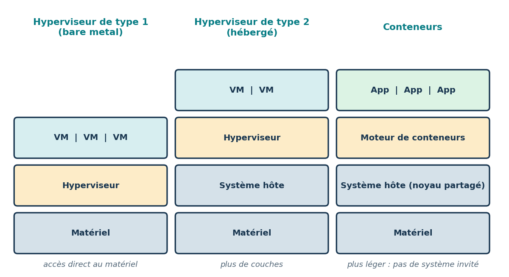
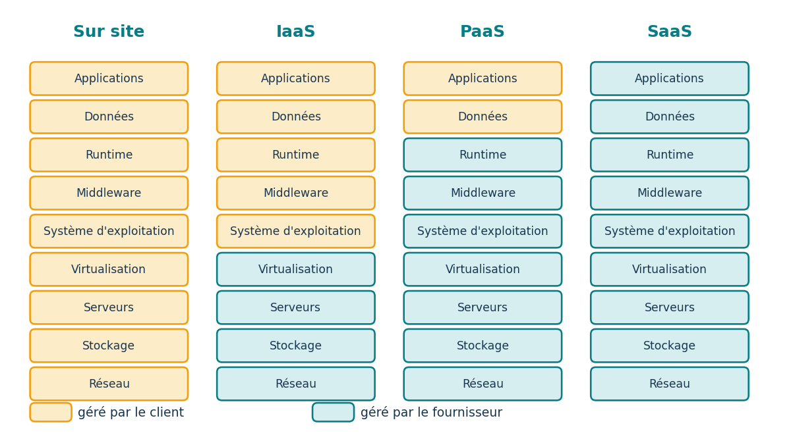

# DevOps et Cloud Computing — Résumé des cours

Mise à jour du 24 novembre 2026. Définitions, raisonnements et exemples des cours. Les exercices, commandes et comptes rendus pratiques sont réunis dans [le résumé TD/TP](resumer-tp.md).

## Chapitre 1 — Principes de virtualisation

### Définition et vocabulaire

La **virtualisation** représente une ressource informatique sous une forme logique, découplée de certains détails physiques. Un même hôte peut ainsi exécuter plusieurs machines virtuelles isolées, chacune avec son système invité.

| Terme | Signification |
| --- | --- |
| Hôte, host | Machine qui fournit les ressources physiques |
| Invité, guest | Système exécuté dans une VM |
| Hyperviseur | Couche qui crée, exécute et gère les VM et leurs ressources |
| vCPU | Ressource de processeur présentée à l'invité |
| Disque virtuel | Support logique de stockage de l'invité |
| Snapshot | État conservé à un instant, utile pour un retour en arrière |

Chaîne conceptuelle : **matériel → hyperviseur → matériel virtuel → OS invité → applications**. L'abstraction ne permet pas pour autant d'exécuter sans contrainte n'importe quel OS sur n'importe quelle architecture.

### Objectifs et limites

La consolidation augmente l'utilisation de serveurs auparavant peu chargés. Elle peut réduire matériel, énergie et espace, et facilite création d'environnements, tests, migration et reprise. Les gains chiffrés d'une présentation sont des illustrations, pas une garantie pour tout déploiement.

L'isolation réduit les interférences entre invités, mais plusieurs VM restent dépendantes d'un même hôte. Sa panne peut toucher toutes ses VM ; il faut une architecture adaptée pour la continuité de service. Un snapshot n'est pas une sauvegarde indépendante complète.

### Types d'hyperviseurs

| Critère | Type 1, bare metal | Type 2, hosted |
| --- | --- | --- |
| Position | Directement au niveau matériel / noyau de virtualisation | Application d'un OS hôte |
| Usage classique | Infrastructure de production et centres de données | Poste personnel, développement et laboratoire |
| Exemples du cours | ESXi, Hyper-V, Xen, KVM | VirtualBox, VMware Workstation |
| Point de vigilance | Administration et capacité de l'hôte | Couche hôte supplémentaire et concurrence avec ses applications |

Le classement décrit une architecture. Il ne faut pas conclure qu'un type 1 sera plus rapide pour toute charge dans toute configuration. Les détails d'intégration varient selon le produit.

## Chapitre 1 — Conteneurs, domaines et performance

### VM et conteneurs

| Aspect | Machine virtuelle | Conteneur |
| --- | --- | --- |
| Unité isolée | Matériel virtuel avec OS invité | Processus et environnement logiciel |
| Noyau | Propre à l'invité | Partagé avec l'hôte d'exécution |
| Poids et démarrage | Généralement plus importants | Généralement plus légers et rapides |
| Usage | OS différents, isolation de machines | Déploiement d'applications et dépendances |

Un conteneur n'est pas simplement une petite VM avec son propre noyau. Une VM peut aussi héberger un moteur de conteneurs. Le choix suit les contraintes de compatibilité, d'isolation, d'exploitation et de densité.

### Domaines de virtualisation

- **Serveur** : plusieurs rôles logiques partagent un matériel.
- **Bureau** : environnement de travail accessible à distance et administré centralement.
- **Réseau** : commutateurs, routeurs ou fonctions réseau logiques.
- **Stockage** : volumes logiques construits au-dessus de supports physiques.
- **Application** : environnement isolé et gestion des dépendances.

### Surcoûts et optimisation

Le surcoût vient notamment de l'ordonnancement des vCPU, des E/S, de la gestion mémoire et des changements de contexte. Il faut mesurer la charge réelle plutôt que multiplier arbitrairement les ressources virtuelles.

| Technique citée | But |
| --- | --- |
| Assistance matérielle VT-x / AMD-V | Faciliter l'exécution virtualisée |
| Pilotes paravirtualisés | Réduire le coût des E/S virtuelles |
| Ballooning | Ajuster la mémoire récupérable des invités |
| CPU pinning | Contrôler l'affectation aux cœurs |
| SR-IOV | Fournir un accès optimisé à certaines fonctions matérielles réseau |

La chronologie utile est mainframes → virtualisation x86 → plateformes d'entreprise et cloud → conteneurs. Les dates et conditions commerciales parfois contradictoires du support ne sont pas utilisées comme faits à apprendre.

## Chapitre 2 — Systèmes distribués et cloud

### Le cloud s'appuie sur la distribution

Un système distribué réunit des machines indépendantes qui coordonnent leurs actions par messages. On recherche partage, extension de capacité, proximité géographique et continuité de service. La distribution crée aussi des difficultés de coordination, cohérence des répliques et pannes partielles.

| Architecture | Principe | Limite à comprendre |
| --- | --- | --- |
| Client-serveur | Clients consommateurs, serveur fournisseur | Un serveur unique peut devenir un point de panne ou un goulot |
| Pair-à-pair | Un nœud peut fournir et consommer | Coordination et découverte plus complexes |
| SOA | Services exposés via des interfaces et protocoles | Contrats et dépendances doivent rester maîtrisés |

La SOA recherche couplage faible, réutilisation et interopérabilité. Dans le schéma du cours : le fournisseur publie, un registre permet la découverte, puis le consommateur invoque le service. Un objet expose des méthodes ; un composant regroupe des fonctions réutilisables ; un service expose une capacité accessible en réseau.

### Définition et cinq caractéristiques

Le **cloud computing** donne un accès réseau à un ensemble de ressources configurables, provisionnées et libérées à la demande avec un effort de gestion limité.

| Caractéristique | Sens | Exemple pédagogique |
| --- | --- | --- |
| Libre-service à la demande | Le client demande ses ressources par console ou API | Créer une VM |
| Accès réseau étendu | Accès par mécanismes réseau usuels | Utiliser HTTPS ou SSH |
| Mutualisation | Ressources physiques partagées entre clients | Infrastructure multi-tenant |
| Élasticité rapide | Adapter les ressources à la variation de charge | Ajouter puis retirer des instances |
| Service mesuré | Quantifier l'utilisation | Heures de VM, stockage ou trafic |

La **scalabilité** concerne la capacité à supporter une charge croissante ; l'**élasticité** adapte la capacité aux variations, dans les deux sens. L'automatisation nécessite une configuration : créer une VM ne prouve pas qu'un autoscaling est actif.

## Chapitre 2 — Déploiement et modèles de service

### Public, privé, hybride et communautaire

| Modèle | Organisation | Compromis principal |
| --- | --- | --- |
| Public | Services d'un fournisseur accessibles à une clientèle large | Facilité de provisionnement, dépendance au fournisseur |
| Privé | Usage exclusif d'une organisation | Contrôle, mais exploitation et capacité à financer |
| Hybride | Association de clouds distincts reliés pour des usages coordonnés | Flexibilité avec complexité d'intégration |
| Communautaire | Plusieurs organisations ayant des exigences communes | Partage des coûts et gouvernance commune |

Une infrastructure privée n'est pas automatiquement plus sûre ; l'exploitation, les identités et les configurations comptent. Un cloud n'est pas simplement un serveur distant : les caractéristiques de service doivent être considérées.

### Répartition des responsabilités

| Modèle | Le client gère surtout | Le fournisseur prend en charge surtout |
| --- | --- | --- |
| Sur site | Toute la pile | Pas de délégation cloud par défaut |
| IaaS | OS invité, mises à jour, applications, données et règles d'accès | Matériel, infrastructure physique et couche de virtualisation |
| PaaS | Code, données et configuration applicative | Infrastructure, OS et environnement de plateforme selon l'offre |
| SaaS | Usage, comptes, configuration et gouvernance des données | Application et pile de service selon le contrat |

Exemples du cours : VM cloud pour IaaS, plateforme d'hébergement applicatif pour PaaS, application collaborative en ligne pour SaaS. La délégation ne supprime pas toutes les responsabilités du client. La sauvegarde, l'accès et la récupération doivent être prévus explicitement.

Les avantages attendus sont rapidité de mise à disposition, souplesse et investissement initial réduit. Les contraintes incluent coûts récurrents, dépendance réseau, sécurité, localisation des données et difficulté de migration. Les prix et les offres gratuites doivent être vérifiés au moment d'un déploiement ; aucun tarif n'est supposé ici.

## Chapitre 2 — Edge, fog et infrastructure physique

### Où traiter les données ?

| Niveau | Emplacement | Utilité |
| --- | --- | --- |
| Edge | Objet ou ressource proche de la source | Réponse locale, réduction des transmissions |
| Fog | Nœuds intermédiaires et passerelles | Agrégation et coordination de proximité |
| Cloud | Infrastructure distante mutualisée | Stockage massif, analyses et vision globale |

Exemple : une caméra filtre localement, une passerelle agrège plusieurs flux, le cloud conserve des historiques. Les délais réels dépendent du réseau et de l'implémentation ; une appellation ne suffit pas à garantir une latence.

### Du serveur au centre de données

Un serveur est aussi un rôle de service, pas seulement un format de boîtier. Les tours conviennent à de petits environnements ; les serveurs rack favorisent la densité ; les blades partagent un châssis et certaines ressources.

Un rack standard se décrit notamment en unités U : **1 U = 1,75 pouce = 44,45 mm** de hauteur. Le châssis accueille des modules ; le cluster associe des nœuds ; le centre de données rassemble calcul, stockage, réseau et infrastructure d'exploitation.

| Infrastructure | Rôle |
| --- | --- |
| Réseau | Commutateurs, routeurs, pare-feu et interconnexion |
| Refroidissement | Maîtriser la température et les flux d'air |
| UPS | Maintenir temporairement l'alimentation lors d'une coupure |
| PDU | Distribuer l'énergie aux équipements |
| Exploitation | Surveillance, maintenance, remplacement et gestion des incidents |

Des centres géographiquement répartis peuvent rapprocher les services des utilisateurs et limiter certains risques de panne. Cette répartition nécessite une architecture de données et de reprise appropriée.

Le plan du chapitre annonce des thèmes supplémentaires sur adoption, SLA et multi-cloud ; le PDF présent développe surtout les sections résumées ci-dessus. Ces thèmes annoncés ne sont pas traités ici comme des chapitres détaillés déjà disponibles.

## Chapitre 3 — Architecture du cloud

### Front end et back end

| Partie | Contenu | Rôle |
| --- | --- | --- |
| Front end | Terminal client, navigateur ou application, interface (portail, SaaS) | Permettre à l'utilisateur d'accéder aux services |
| Back end | Infrastructure physique, hyperviseurs (VMware, KVM), plateforme de gestion (OpenStack), stockage, sécurité et sauvegarde | Gérer les ressources, exécuter la logique métier, protéger les données |

L'architecture vise des solutions évolutives, fiables, sécurisées et économiques : redondance et tolérance aux pannes pour la disponibilité, réduction des dépenses d'investissement en matériel.

### Quatre briques d'architecture

| Brique | Principe | Exemple cloud |
| --- | --- | --- |
| N-Tiers | Couches présentation, logique métier, données ; séparation des responsabilités | Front sur S3/CloudFront, logique sur Lambda/EC2, données sur RDS/BigQuery |
| Machines virtuelles | Émulation logicielle d'un ordinateur : OS hôte, hyperviseur, OS invité | Isolation, portabilité, mutualisation |
| Virtualisation de fichiers | Découpler l'accès aux fichiers du stockage physique ; vue unifiée (VFS) | Dropbox, Google Drive, S3 |
| SOA | Services indépendants, faiblement couplés, réutilisables, communiquant par API | Utilisateur, produit, commande, notification d'un site e-commerce |

Chaque niveau N-Tiers peut évoluer indépendamment, ce qui simplifie les mises à jour et isole les pannes.

### SOA : caractéristiques et protocoles

- **Couplage faible** : un service ne dépend pas de l'implémentation des autres.
- **Communication par API** : REST, gRPC, GraphQL, SOAP.
- **Réutilisabilité** et **indépendance technologique** : chaque service peut utiliser son propre langage.
- Avantages annoncés : déploiement rapide, mise à l'échelle ciblée, résilience, mise à jour d'un seul service.

### Serverless et FaaS

Le développeur écrit des **fonctions** exécutées seulement en réponse à un événement (dépôt de fichier, modification de base, requête HTTP, message en file). Le fournisseur crée, exécute, met à l'échelle et arrête les ressources. Facturation **pay-as-you-go** : seule la durée d'exécution du code est payée, contre la durée de fonctionnement d'un serveur classique.

| Fournisseur | Service |
| --- | --- |
| AWS | Lambda |
| Azure | Azure Functions |
| Google Cloud | Cloud Functions / Cloud Run |
| Open source | OpenFaaS, OpenWhisk, Knative |

Limite à connaître (TD1) : la latence de démarrage à froid ; la concurrence provisionnée garde des environnements prêts.

## Révision active — Cours

1. **Une VM suffit-elle à faire un cloud ?** Non, considérer aussi les caractéristiques de service.
2. **Quel modèle laisse l'OS invité au client ?** IaaS.
3. **Quel mode pour une VM directement adressable sur le LAN ?** Bridged, sous réserve du réseau et du filtrage.
4. **Pourquoi distinguer snapshot et sauvegarde ?** Un état de retour local ne couvre pas tous les scénarios de perte de l'hôte ou du stockage.
6. **Que signifie élasticité dans les deux sens ?** Ajouter des ressources puis les libérer lorsque la demande baisse.
7. **Une sauvegarde garantit-elle la continuité immédiate après une panne ?** Non : elle doit être distinguée de la redondance et du basculement.
8. **REST implique-t-il JSON ?** Non, c'est un style architectural ; plusieurs représentations sont possibles.
9. **Un service de notification en panne bloque-t-il toujours le paiement ?** Cela dépend des dépendances et de la gestion des erreurs.
