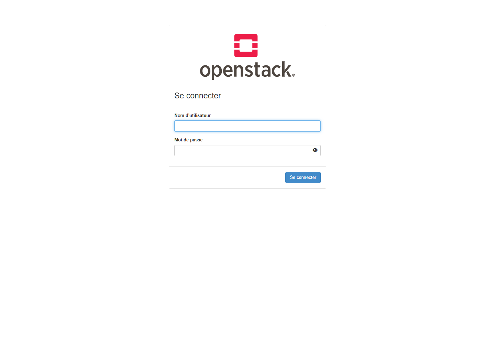
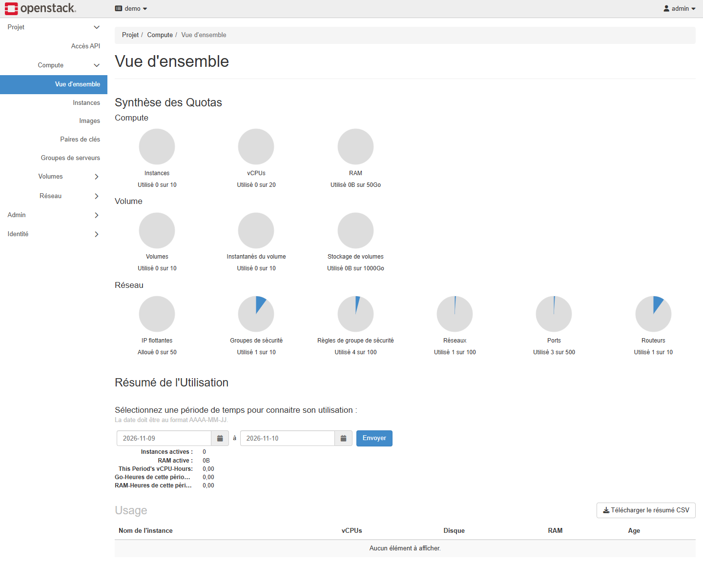
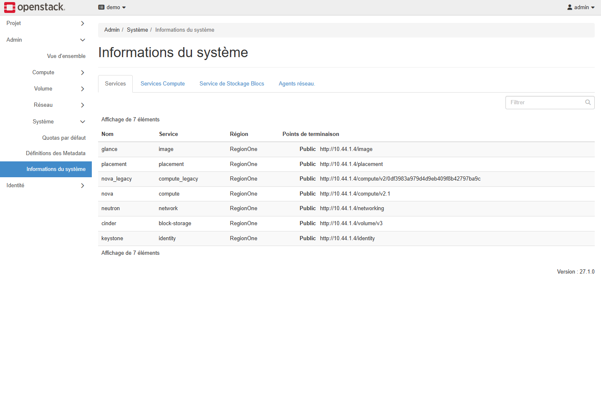
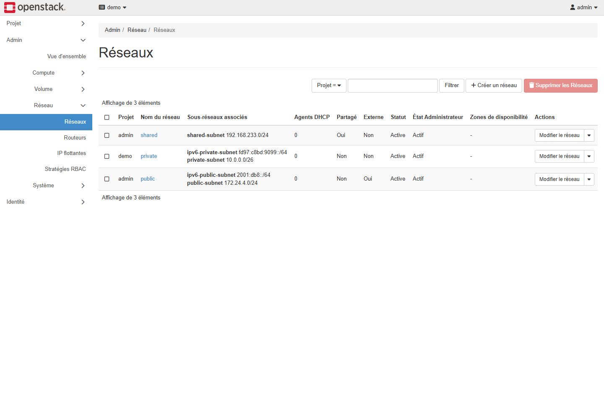

# TP4 — Installation et vérification d'OpenStack avec DevStack

Date d'exécution : 2026-11-10T14:31:14.162520+00:00. Le rapport décrit une installation réellement effectuée sur une VM Azure dédiée et les vérifications enregistrées. Les captures Horizon proviennent du navigateur ; les extraits CLI proviennent des journaux d'exécution. Aucune illustration de terminal simulé n'est utilisée.

## 1. Objectif et adaptation de l'environnement

Le sujet `TP4_Openstack.pdf` demande Ubuntu 24.04, la préparation d'un utilisateur stack, l'installation de DevStack, un accès authentifié à Horizon et des vérifications avec la CLI OpenStack. Le but est de disposer d'un environnement de laboratoire pour explorer les services et préparer les exercices de réseau et d'instances.

Azure héberge ici la VM Ubuntu ; OpenStack est installé à l'intérieur. Une VM Azure seule ne constitue donc pas la réalisation du TP. Le choix du cloud remplace uniquement l'hyperviseur local VMware/VirtualBox proposé par l'énoncé.

| Paramètre | Configuration effectivement retenue |
| --- | --- |
| Abonnement | Azure for Students, actif lors du déploiement |
| Groupe de ressources | rg-devops-tp4-20261110 |
| VM | tp4-openstack |
| Région | Poland Central |
| Taille | Standard_D2s_v3 : 2 vCPU, 8 Go de RAM |
| Système | Ubuntu Server 24.04.5 LTS |
| Disque système | 80 Gio demandés ; environ 77 Gio de système de fichiers |
| Swap | 4 Gio, ajouté pour les pointes de consommation |
| Virtualisation | KVM disponible dans la VM Azure |
| Accès d'administration | SSH par clé, limité à l'IPv4 du poste de travail |
| Accès Horizon | Tunnel SSH local ; aucune ouverture publique du port HTTP |

La recommandation de l'enseignante est 4+ vCPU, 16 Go et 80 Go. À la demande de réduction du coût, le laboratoire utilise 2 vCPU et 8 Go. Il s'agit d'un compromis pédagogique, adapté aux vérifications réalisées, avec moins de marge pour lancer plusieurs instances. Le swap est plus lent que la RAM.

## 2. Préparation d'Ubuntu et utilisateur stack

Les opérations sont automatisées par les scripts fournis. La préparation est exécutée avec sudo ; le déploiement DevStack est exécuté ensuite sous le compte ordinaire stack.

```sh
sudo apt update
sudo apt upgrade -y
sudo apt install -y git curl wget
sudo useradd -s /bin/bash -d /opt/stack -m stack
sudo chmod +x /opt/stack
echo "stack ALL=(ALL) NOPASSWD: ALL" | sudo tee /etc/sudoers.d/stack
sudo -u stack -i
```

Le compte stack possède le répertoire `/opt/stack` et les permissions sudo sans mot de passe requises par le TP sur cette machine jetable. `visudo` valide le fichier ajouté. Ces permissions concernent le compte de laboratoire ; elles ne sont pas appliquées au poste Windows.

Les contrôles de préparation ont relevé deux processeurs logiques, environ 7,7 Gio de RAM utilisable, 4 Gio de swap et la présence de `/dev/kvm`. Le commit DevStack retenu est :

```text
902e73e50c24ba7e470b8798c867985ccb754c9c
```

Extrait réel de préparation :

```text
2
               total        used        free      shared  buff/cache   available
Mem:           7.7Gi       642Mi       6.1Gi       4.0Mi       1.3Gi       7.1Gi
Swap:          4.0Gi          0B       4.0Gi
NAME          TYPE SIZE USED PRIO
/swapfile-tp4 file   4G   0B   -1
Filesystem      Size  Used Avail Use% Mounted on
/dev/root        77G  6.5G   70G   9% /
crw-rw---- 1 root kvm 10, 232 Nov 10 12:57 /dev/kvm
```

## 3. Téléchargement et configuration DevStack

Le dépôt officiel est cloné dans `/opt/stack/devstack`. Le fichier local.conf contient les paramètres ci-dessous ; la valeur du mot de passe a été générée aléatoirement et n'est pas publiée.

```ini
[[local|localrc]]
ADMIN_PASSWORD=<valeur_privee_generee>
DATABASE_PASSWORD=$ADMIN_PASSWORD
RABBIT_PASSWORD=$ADMIN_PASSWORD
SERVICE_PASSWORD=$ADMIN_PASSWORD
HOST_IP=10.44.1.4
LIBVIRT_TYPE=kvm
LOGFILE=/opt/stack/logs/stack.sh.log
LOG_COLOR=False
```

Le mot de passe est alphanumérique. Il est conservé sur la VM avec des permissions restrictives, et dans le dossier local privé exclu de Git. HOST_IP désigne l'adresse privée de la VM, pas son adresse publique Azure. Les réseaux Azure et OpenStack sont distincts.

La configuration minimale et l'usage d'un compte non-root suivent le sujet et le [guide officiel DevStack](https://docs.openstack.org/devstack/latest/). La documentation précise également que cet outil modifie fortement le système : cette installation utilise une VM dédiée.

## 4. Installation et preuve de fin d'exécution

```sh
cd /opt/stack/devstack
./stack.sh
```

L'installation tourne sous stack, avec journal conservé sur la VM. Le script ajoute un marqueur de fin uniquement si stack.sh se termine avec succès. Une simple présence de fichiers ou un écran de progression ne suffirait pas à conclure à une installation réussie.

Résultat de l'installation : **stack.sh terminé avec le code 0 ; marqueur de fin présent**.

```text
2026-11-10T12:57:47Z
Horizon is now available at http://10.44.1.4/dashboard
2026-11-10T13:22:35Z
```

## 5. Accès réel au tableau de bord Horizon

Le tableau de bord est consulté depuis Microsoft Edge à travers un tunnel SSH lié à 127.0.0.1. Le réseau Azure autorise l'administration SSH depuis le poste ; il n'expose pas Horizon à tout Internet.

```sh
ssh -i <cle_privee> -N -L 127.0.0.1:18080:127.0.0.1:80 azureuser@<IP_AZURE>
```

Ouvrir ensuite `http://127.0.0.1:18080/dashboard/`. La connexion utilise admin, le mot de passe généré et le domaine Default si celui-ci est demandé.

Résultat navigateur : **authentification admin réussie ; captures et métadonnées enregistrées**.









La présence du formulaire prouve l'accès HTTP ; la seconde capture et la vérification de navigation prouvent une authentification réussie. Les mots de passe ne sont pas capturés dans les images fournies.

## 6. Vérifications OpenStack en ligne de commande

L'environnement d'administration est chargé avec `source openrc admin admin`. La commande de jeton est exécutée en ne conservant que son expiration : l'identifiant secret du jeton est volontairement absent du rapport.

```sh
cd /opt/stack/devstack
source openrc admin admin
openstack token issue -c expires -f value
openstack service list
openstack image list
openstack flavor list
openstack network list
openstack server list
```

Le sujet autorise certaines listes vides. Un catalogue enregistré ne prouve pas à lui seul que chaque processus fonctionne : le script vérifie aussi les services compute et les agents réseau.

```text
=== Ubuntu and host ===
2026-11-10T14:31:47Z
PRETTY_NAME="Ubuntu 24.04.5 LTS"
NAME="Ubuntu"
VERSION_ID="24.04"
VERSION="24.04.5 LTS (Noble Numbat)"
VERSION_CODENAME=noble
ID=ubuntu
tp4-openstack
10.44.1.4 192.168.122.1 172.24.4.1 2001:db8::2 
2
               total        used        free      shared  buff/cache   available
Mem:           7.7Gi       5.5Gi       235Mi       156Mi       2.5Gi       2.3Gi
Swap:          4.0Gi       148Ki       4.0Gi
Filesystem      Size  Used Avail Use% Mounted on
/dev/root        77G   13G   65G  16% /
=== Dedicated installer account ===
uid=1001(stack) gid=1001(stack) groups=1001(stack),122(libvirt)
Passwordless sudo: OK
=== Virtualization ===
/dev/kvm available
=== DevStack version ===
902e73e50c24ba7e470b8798c867985ccb754c9c
stack.sh completion marker: PRESENT
=== Token issuance (ID omitted) ===
2026-11-10T15:31:48+0000
=== Service catalogue ===
+----------------------------------+-------------+----------------+
| ID                               | Name        | Type           |
+----------------------------------+-------------+----------------+
| [REDACTED] | glance      | image          |
| [REDACTED] | placement   | placement      |
| [REDACTED] | nova_legacy | compute_legacy |
| [REDACTED] | nova        | compute        |
| [REDACTED] | neutron     | network        |
| [REDACTED] | cinder      | block-storage  |
| [REDACTED] | keystone    | identity       |
+----------------------------------+-------------+----------------+
=== Images ===
+--------------------------------------+--------------------------+--------+
| ID                                   | Name                     | Status |
+--------------------------------------+--------------------------+--------+
| bcb36cac-dcff-4bc0-af0d-9d8af5a91922 | cirros-0.6.3-x86_64-disk | active |
+--------------------------------------+--------------------------+--------+
=== Flavors ===
+----+-----------+-------+------+-----------+-------+-----------+
| ID | Name      |   RAM | Disk | Ephemeral | VCPUs | Is Public |
+----+-----------+-------+------+-----------+-------+-----------+
| 1  | m1.tiny   |   512 |    1 |         0 |     1 | True      |
| 2  | m1.small  |  2048 |   20 |         0 |     1 | True      |
| 3  | m1.medium |  4096 |   40 |         0 |     2 | True      |
| 4  | m1.large  |  8192 |   80 |         0 |     4 | True      |
| 42 | m1.nano   |   192 |    1 |         0 |     1 | True      |
| 5  | m1.xlarge | 16384 |  160 |         0 |     8 | True      |
| 84 | m1.micro  |   256 |    1 |         0 |     1 | True      |
| c1 | cirros256 |   256 |    1 |         0 |     1 | True      |
| d1 | ds512M    |   512 |    5 |         0 |     1 | True      |
| d2 | ds1G      |  1024 |   10 |         0 |     1 | True      |
| d3 | ds2G      |  2048 |   10 |         0 |     2 | True      |
| d4 | ds4G      |  4096 |   20 |         0 |     4 | True      |
+----+-----------+-------+------+-----------+-------+-----------+
=== Networks ===
+--------------------------------------+---------+----------------------------------------------------------------------------+
| ID                                   | Name    | Subnets                                                                    |
+--------------------------------------+---------+----------------------------------------------------------------------------+
| 39f8435c-a711-4047-88d9-a0715cd01c7a | shared  | d8bbe1ed-2346-4935-9d85-1d200755ee95                                       |
| a282c33f-3319-4c8d-b523-2df9b58f1f9a | private | 9a2297f9-bcb4-47b0-b8ba-1b2d5499a864, c98c4f83-a058-4930-ae08-32102013976d |
| aca7b6be-fa1f-4402-a626-ebc234e40b11 | public  | 863646b5-8aaf-485c-b515-829535db4ba0, a93ffdc7-aa2e-45b8-8a75-ff8362497dd7 |
+--------------------------------------+---------+----------------------------------------------------------------------------+
=== Servers ===

=== Compute and network services ===
+--------------------------------------+----------------+---------------+----------+---------+-------+----------------------------+
| ID                                   | Binary         | Host          | Zone     | Status  | State | Updated At                 |
+--------------------------------------+----------------+---------------+----------+---------+-------+----------------------------+
| 1416d205-5f1e-48a4-888c-8027d6c92d52 | nova-scheduler | tp4-openstack | internal | enabled | up    | 2026-11-10T14:31:57.000000 |
| 240c36bb-b11f-48c3-95cb-e141dd35e94e | nova-conductor | tp4-openstack | internal | enabled | up    | 2026-11-10T14:30:09.000000 |
| 0a0021c8-8dcf-4ebf-9ddb-06d33d1b0280 | nova-conductor | tp4-openstack | internal | enabled | up    | 2026-11-10T14:31:51.000000 |
| 81d9819e-7f1a-4a02-87f6-aaf1ce326b12 | nova-compute   | tp4-openstack | nova     | enabled | up    | 2026-11-10T14:30:43.000000 |
+--------------------------------------+----------------+---------------+----------+---------+-------+----------------------------+
+--------------------------------------+------------------------------+---------------+-------------------+-------+-------+-------------------+
| ID                                   | Agent Type                   | Host          | Availability Zone | Alive | State | Binary            |
+--------------------------------------+------------------------------+---------------+-------------------+-------+-------+-------------------+
| ba1ee2de-4e9e-4100-86c6-d47ff3059852 | OVN Controller Gateway agent | tp4-openstack |                   | :-)   | UP    | ovn-controller    |
| 769a6597-afd9-5048-84f9-e7708053cba7 | OVN Neutron agent            | tp4-openstack |                   | :-)   | UP    | neutron-ovn-agent |
+--------------------------------------+------------------------------+---------------+-------------------+-------+-------+-------------------+
=== Horizon HTTP response ===
HTTP/1.1 302 Found
Date: Tue, 10 Nov 2026 14:32:01 GMT
Server: Apache/2.4.58 (Ubuntu)
Location: http://10.44.1.4/dashboard/auth/login/?next=/dashboard/
X-Frame-Options: DENY
Vary: Accept-Language,Cookie
Content-Language: en
Connection: close
Content-Type: text/html; charset=utf-8

TP4 CLI verification completed successfully.
```

Ces résultats proviennent de `scripts/verify-openstack.sh` exécuté sur la VM, et sont conservés dans `evidence/02-openstack-verification.txt`.

## 7. Rôle des composants identifiés dans le TP

| Composant | Rôle | Exemple de contrôle |
| --- | --- | --- |
| Keystone | Identités et authentification | Émission d'un jeton après chargement openrc |
| Nova | Gestion des instances de calcul | server list ; compute service list |
| Neutron | Réseaux, sous-réseaux, routage et règles | network list ; network agent list |
| Glance | Catalogue des images | image list |
| Cinder | Volumes bloc | Présence du service dans le catalogue ; usage dans les prochains labs |
| Horizon | Interface web | Connexion admin réelle dans Edge |
| Placement | Inventaire et allocation des ressources de calcul | Présence dans le catalogue |

Les contrôles du TP4 établissent l'installation et l'accès aux services. Ils ne constituent pas une campagne exhaustive de tests de toutes les fonctions OpenStack ni la réalisation anticipée des deux labs suivants.

## 8. Difficultés rencontrées et corrections

| Difficulté réelle | Diagnostic et correction |
| --- | --- |
| CLI Azure non authentifiée | Connexion par code appareil, validée par l'utilisateur |
| Résolution du service de connexion momentanément en échec | Contrôle DNS, puis nouvelle tentative de connexion réussie |
| Taille indisponible en France Central | Consultation des restrictions et quotas ; choix d'une région autorisée avec capacité disponible |
| Réduction du budget | Passage à 2 vCPU et 8 Go, complétés par du swap |
| Exposition du tableau de bord | Utilisation d'un tunnel SSH ; aucune ouverture HTTP publique |


Les premiers objets réseau sans VM de France Central restent dans le groupe de laboratoire. Ils ne représentent pas une seconde VM en fonctionnement. Aucune ressource n'a été supprimée, conformément à la consigne de l'utilisateur.

## 9. Coût, conservation et accès ultérieur

Tarifs publics indicatifs relevés pendant le travail, en USD, hors taxes et hors éventuels avantages de l'abonnement :

| Ressource | Tarif public relevé |
| --- | --- |
| Calcul Standard_D2s_v3 Linux, Poland Central | 0,115 USD par heure |
| Disque Standard SSD E10 LRS | 9,60 USD par mois ; 80 Gio demandés relèvent du palier 128 Gio |
| Adresse IPv4 publique Standard | 0,005 USD par heure |
| Transactions du disque | Facturation séparée selon les opérations |

Avec une approximation mensuelle de 730 heures, le total de base est d'environ **0,133 USD/heure**, soit **3,20 USD par jour** si la VM reste allumée. Ce n'est pas une facture ni une mesure du solde de crédit. Les opérations disque et transferts éventuels s'ajoutent selon l'usage.

Après la vérification complète (installation, Horizon, CLI), toutes les ressources Azure du TP (groupe `rg-devops-tp4-20261110` : VM, disque, IP publique, NIC, VNet, NSG) ont été supprimées ; `az group exists` retourne `false` (voir `evidence/08-azure-cleanup.txt`). L'environnement n'est plus accessible et ne génère plus de coût ; les journaux et captures du rapport font foi.

## 10. Checklist finale et pièces fournies

| Élément du sujet | Résultat observé |
| --- | --- |
| Ubuntu et accès Internet | Vérifiés : système, installation des paquets et dépôts |
| Utilisateur stack | Créé, sudo sans mot de passe contrôlé |
| Dépôt DevStack | Cloné ; commit enregistré |
| local.conf | Créé avec secrets générés et HOST_IP privé |
| stack.sh | Terminé avec code 0 et marqueur de succès |
| Horizon | Connexion admin réussie dans Edge |
| Catalogue et commandes CLI | Exécutés avec succès ; journaux fournis |
| Préparation des prochains labs | Environnement installé ; les scénarios des labs 1 et 2 restent à réaliser |

Le dossier fournit le rapport Markdown/PDF, les scripts de préparation et vérification, les journaux sélectionnés, les captures Horizon et un manifeste de provenance avec empreintes SHA-256. Les secrets et clés privées ne font pas partie des livrables.

Sources : sujet local `TP4_Openstack.pdf` (6 pages), [DevStack Quick Start](https://docs.openstack.org/devstack/latest/), [DevStack dans une VM](https://docs.openstack.org/devstack/latest/guides/single-vm.html), [CLI OpenStack](https://docs.openstack.org/python-openstackclient/latest/) et API publique Azure Retail Prices. Les captures et sorties observées sont datées dans les fichiers de preuve.
