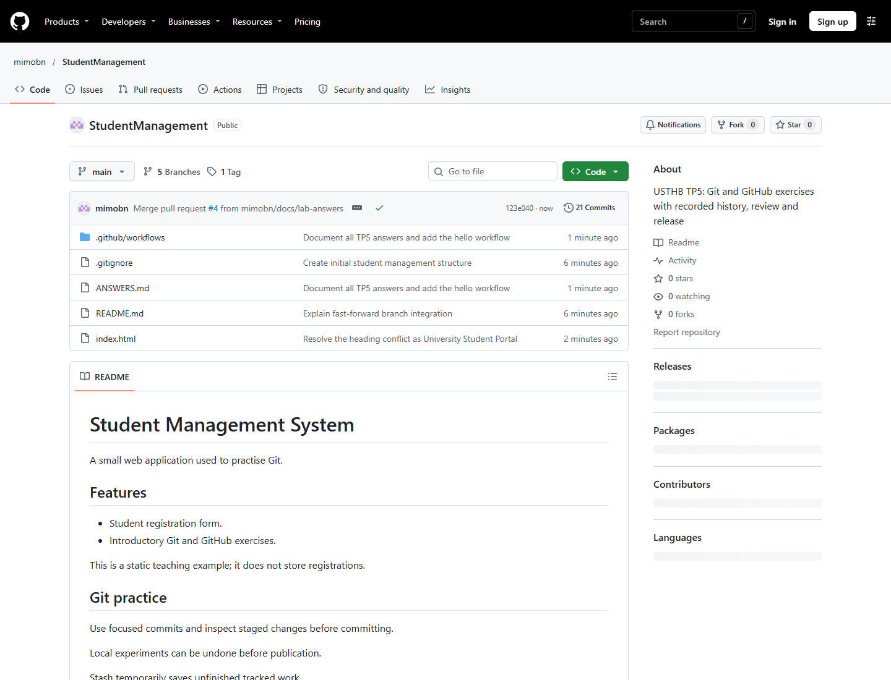
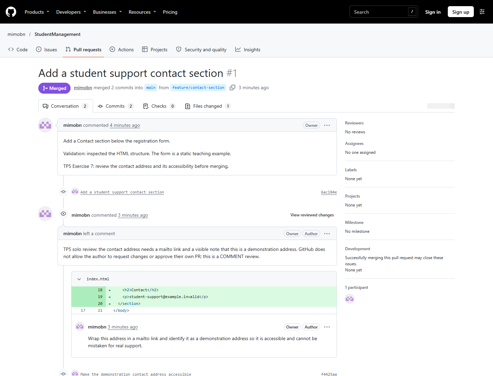
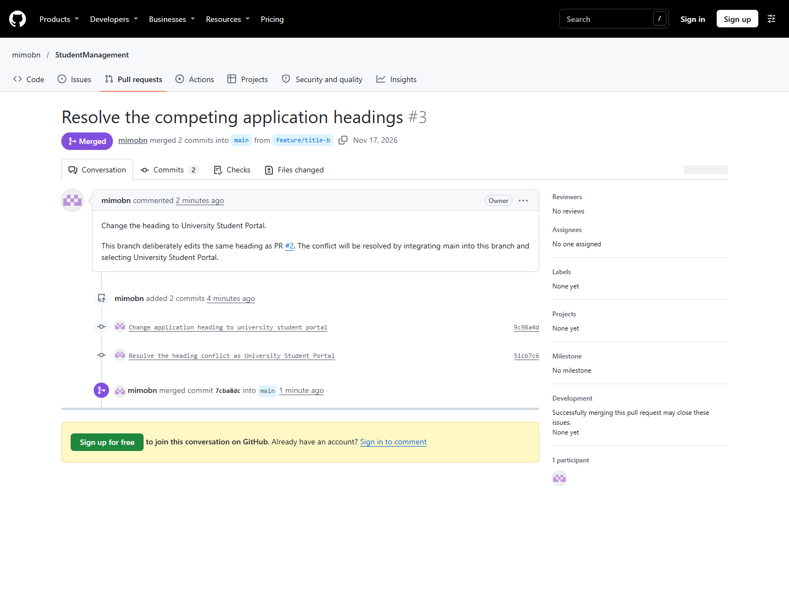
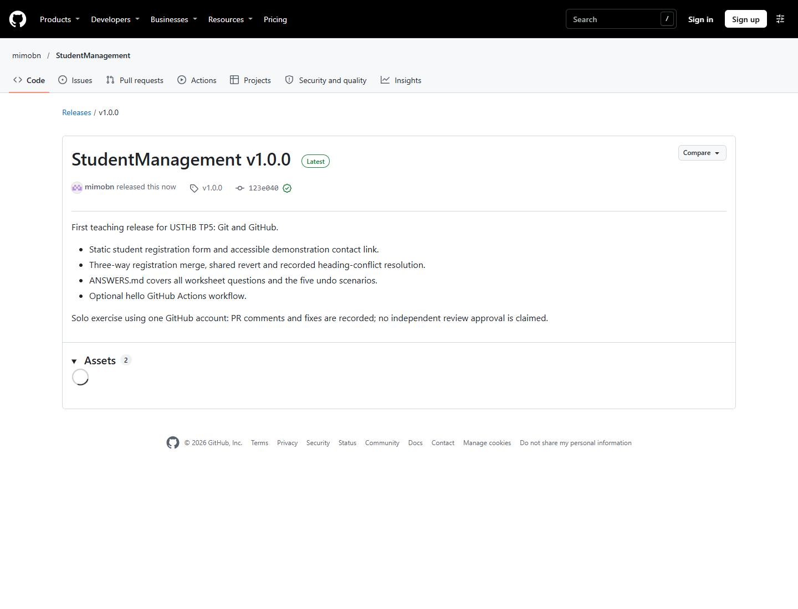
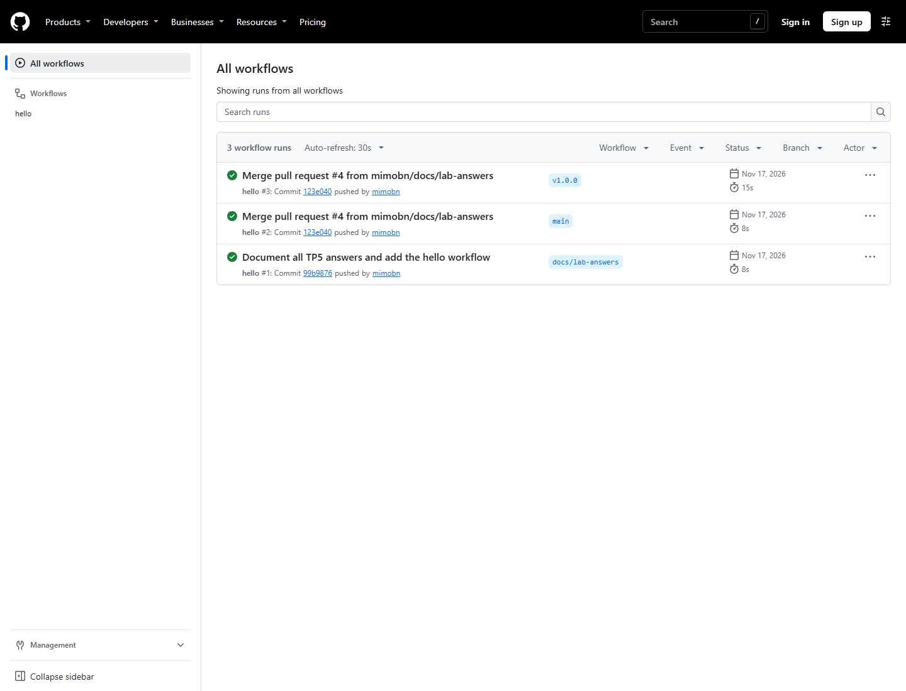
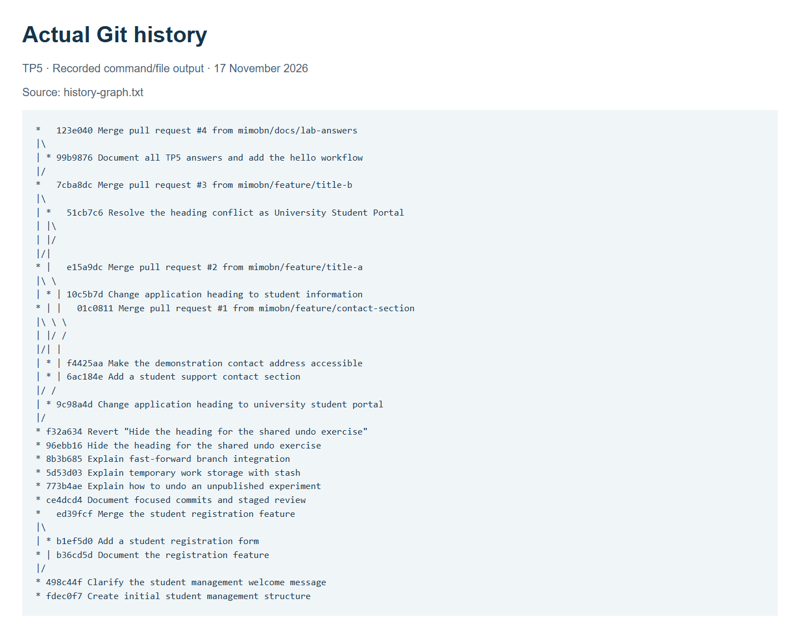
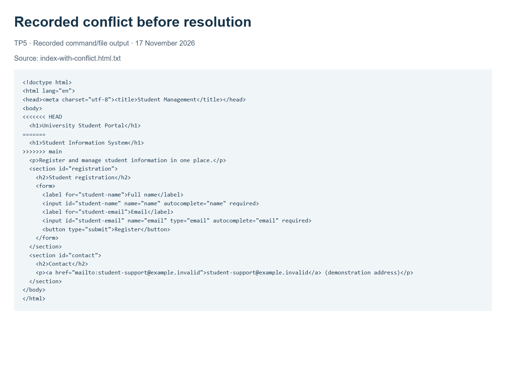
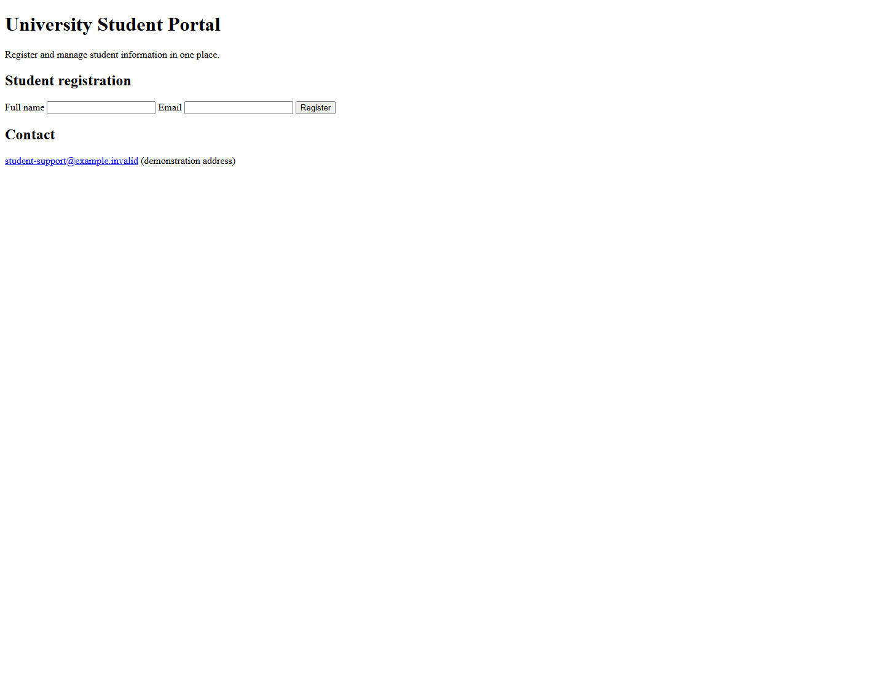

# TP5 — Git and GitHub

USTHB · 5th Year Software Engineering · 2026/2027

Module: DevOps and Cloud Computing · Instructor: Ameur Imane

GitHub account: mimobn · Execution date: 17 November 2026

Repository: [mimobn/StudentManagement](https://github.com/mimobn/StudentManagement)

Executed solution with real Git history, GitHub pull requests, a resolved conflict, an annotated tag and a published release. This report includes all worksheet answers and genuine Microsoft Edge captures.

## 1. Scope, environment and results

The six-page assignment TP5_Git.pdf was carried out in an isolated StudentManagement repository, separate from the course repository. Git 2.45.1.windows.1 ran on Windows through PowerShell/Python subprocesses; GitHub CLI used the existing mimobn login. Repository-local identity settings preserved the machine's existing global configuration.

**Single-account adaptation:** the user requested that no second account be used. Exercise 7 therefore has a real inline COMMENT review, a follow-up fix and a merged PR, but no independent approval or REQUEST_CHANGES review. The initial one-approval branch rule is preserved as evidence; the final rule requires a PR with zero approvals and applies to administrators. The two-person approval requirement is not claimed as completed. A second local clone, under the same account, demonstrates synchronization.

| Item | Verified outcome |
| --- | --- |
| Exercises 1–3 | Repository, ignore rules, staging/diffs and meaningful commits executed |
| Exercise 4 | Registration three-way merge ed39fcf, plus a separate fast-forward demonstration |
| Exercise 5 | restore, unstage, shared revert, mixed reset and stash executed |
| Exercise 6 | Public GitHub repository published over authenticated HTTPS |
| Exercise 7 | PR #1: inline comment, correction and merge; independent review omitted for solo use |
| Exercise 8 | PR #2 merged first; actual heading conflict resolved in merge 51cb7c6 and merged through PR #3 |
| Exercise 9 | Annotated tag v1.0.0 and GitHub Release published |
| Optional bonus | hello Actions workflow completed successfully on main |
| Final state | 21 reachable commits; clean worktree; tag, local main and remote main agree |

## 2. Recorded execution and evidence

The complete command transcript is in evidence/commands.txt. It includes the original staged and unstaged diffs, the three-way merge graph, the five undo operations and their before/after outputs, pushes and actual conflict output. API responses are preserved alongside the transcript. No passwords or access tokens were written to the repository or report.

The first two commits created the requested index.html, README.md and .gitignore, then improved the welcome paragraph. On feature/registration, the form was committed separately; an independent README commit on main forced the required three-way merge:

```text
*   ed39fcf Merge the student registration feature
|\
| * b1ef5d0 Add a student registration form
* | b36cd5d Document the registration feature
|/
* 498c44f Clarify the student management welcome message
* fdec0f7 Create initial student management structure
```

Scenario C was demonstrated with a truly shared change: commit 96ebb16 hid the heading and was pushed; revert f32a634 restored it and was then pushed. Neither published commit was removed. Scenario D's reset affected only an unpublished temporary commit. The stash scenario included a real branch switch and restoration before committing.

| Pull request | Purpose | Final state | Merge commit |
| --- | --- | --- | --- |
| #1 | Add a student support contact section | MERGED | 01c0811 |
| #2 | Change the heading to Student Information System | MERGED | e15a9dc |
| #3 | Resolve the competing application headings | MERGED | 7cba8dc |
| #4 | Document TP5 answers and demonstrate GitHub Actions | MERGED | 123e040 |

PR #1's inline comment asked for a clickable mailto link and a visible demonstration-address note. Commit f4425aa added both. The contact address uses example.invalid and is illustrative; the form is static and does not store registrations.

Both title branches started from the same main commit. After PR #2 integrated Student Information System, merging main into feature/title-b produced this actual conflict, saved before resolution:

```text
<<<<<<< HEAD
  <h1>University Student Portal</h1>
=======
  <h1>Student Information System</h1>
>>>>>>> main
```

The resolution selected University Student Portal, removed the conflict markers and retained the merged contact section. It was staged and committed as 51cb7c6, which has two parents, then pushed and merged through PR #3. Both local clones synchronized using git pull --ff-only origin main. The complete final graph is preserved in evidence/history-graph.txt.

The annotated tag resolves to 123e04084ead89549ec790d7ee28ee53c62f2a5a. The [v1.0.0 release](https://github.com/mimobn/StudentManagement/releases/tag/v1.0.0) includes release notes. The [main Actions run](https://github.com/mimobn/StudentManagement/actions/runs/44085306522) completed successfully after a push event; its saved log includes Hello from CI. This hello workflow demonstrates CI execution and does not validate application behavior.

## 3. Answers to all worksheet questions

### Exercise 1 — Install and configure Git

1. `--global` applies a setting to the current operating-system user across repositories. Git normally stores it in `~/.gitconfig`, or the XDG user configuration at `~/.config/git/config`. On this Windows machine, `~` is the Windows user profile. Repository settings in `.git/config` override the user setting. We inspected the existing identity and set a repository-local identity rather than changing the identity used by other projects. Use `git config --show-origin --get user.name` to see the effective source. The worksheet's equivalent global commands are `git config --global user.name "Your Name"` and `git config --global user.email "you@example.com"`; use actual values when configuring your own machine.
2. No GitHub account is required for a local commit. Git records a snapshot and author identity in the local object database; a hosting account is needed only for authenticated operations on GitHub. The name/email stored in a commit do not prove that a hosting account authenticated it.

### Exercise 2 — Create a local repository

1. The three new files are untracked because they exist in the working tree but have never been added to Git's index. `git add` starts tracking their contents and stages a snapshot for the next commit.
2. `.env` ignores environment configuration files of that name; `*.log` ignores log files; `__pycache__/` ignores Python cache directories; `.DS_Store` ignores macOS Finder metadata. Patterns without a slash apply in nested directories too. Ignore rules affect untracked files, not files already committed. No real `.env` file was created; `git check-ignore --no-index` verified all four patterns using path names only.

### Exercise 3 — Stage, commit and inspect

1. The working tree contains checked-out files and edits. The staging area (index) contains the proposed next snapshot. The repository (`.git`) stores committed objects, references and history. `git diff` compares the working tree with the index; `git diff --staged` compares the index with HEAD.
2. A commit uses the index, not every edit in the working tree. Stage selected files with `git add index.html`, or selected hunks with `git add -p`, to keep commits focused.
3. Good: `Add a student registration form` — imperative, specific and under 72 characters. Bad: `stuff` — it does not explain the change. The actual initial commit is `Create initial student management structure`.

### Exercise 4 — Branching and merging

1. Registration uses a three-way merge. Both main and feature/registration advanced after their common ancestor; main changed README.md and the feature changed index.html. Git used the common ancestor and both branch tips and created merge commit `ed39fcf`, with two parents. The graph visibly forks and rejoins. The command reported `Merge made by the 'ort' strategy`.
2. Without the intervening main commit, main would be an ancestor of the feature tip. The default merge could fast-forward main to that tip without creating a merge commit. We also demonstrated an actual `git merge --ff-only demo/fast-forward`, which printed `Fast-forward`.
3. Deleting a merged feature branch removes an obsolete branch pointer and reduces clutter. It does not delete the commits reachable through main. We executed `git branch -d feature/registration`; `-d` checks that the branch has been merged.

### Exercise 5 — Undoing changes

All five scenarios were executed against disposable changes in the separate TP5 repository. See `evidence/commands.txt` for before/after output.

| Scenario | Command used | Observed result |
| --- | --- | --- |
| A: discard an unstaged edit | `git restore index.html` | The disposable comment disappeared; `git diff` became empty. |
| B: unstage without losing edits | `git restore --staged README.md` | Status changed from `M ` to ` M`; the README edits remained in `git diff`. |
| C: cancel an already shared commit | `git revert --no-edit 96ebb1614beb1283b40e35b809fe3bebade0023c` | A new inverse commit restored the visible heading. Both the bad commit and its revert were pushed. |
| D: undo one unpublished commit, retaining edits | `git reset --mixed HEAD~1` | main moved to its parent; the README edit remained unstaged and was recommitted with a better message. |
| E: set unfinished work aside and restore it | `git stash push -m "TP5 unfinished documentation"`, switch branches, then `git stash pop` | The worktree was clean while away, and the README edit returned on main. |

1. `revert` adds a new commit that reverses an earlier commit, preserving shared history; this is appropriate for a shared branch. `reset` moves the current branch tip and optionally resets the index and working tree. Moving back over published commits rewrites that branch's history, so it must not be used casually on shared work.
2. `git reset --soft <commit>` moves HEAD and retains both the index and working tree. `--mixed` also resets the index to the target, leaving worktree edits unstaged; it is the default mode. `--hard` resets HEAD, index and tracked working-tree files, discarding local tracked edits; untracked files that obstruct checkout can also be removed. We used mixed reset only on an unpublished lab commit, and did not run a hard reset.

### Exercise 6 — Publish to GitHub

1. `commit` creates a snapshot locally. `push` transfers objects and updates remote references, subject to authentication and branch rules. `git push -u origin main` also establishes the upstream used by later status/pull/push operations.
2. Authentication used the existing GitHub CLI login for `mimobn`, over HTTPS with `gh auth git-credential` as the per-command credential helper. No token was inserted into a URL, command argument, report or tracked file. A token can grant account access; storing it in a command can expose it through history, process listings and logs, while committing it preserves it in Git history.
3. Deleting a secret in a later commit is insufficient: older commits, clones and caches can retain it. Revoke or rotate the credential immediately, assess access/use, then remove it from all affected history using an appropriate history-rewriting tool (for example git-filter-repo), coordinate updates to clones and forks, and follow GitHub's sensitive-data removal guidance. Enable secret scanning where available. Rewriting history cannot make a leaked credential trustworthy again.

### Exercise 7 — Pull Request and review

1. Protecting main prevents accidental direct pushes, deletion or force pushes and can require review and passing checks. We initially configured one required approval with administrator enforcement. At the user's request to use one account only, the rule was changed to zero approvals while retaining the requirement to merge through a PR and enforcement for administrators. This is an explicitly documented solo exception, not completion of the two-person approval requirement.
2. Check correctness and edge cases; clarity, maintainability and scope; and tests/security/accessibility. On PR #1, an inline comment requested a `mailto:` link and a demonstration-address note. A subsequent commit made both changes. The review state is COMMENTED. GitHub forbids the PR author from approving or requesting changes on their own PR.
3. CI complements human review by running repeatable checks when code is pushed or a PR changes. Required status checks can prevent merging failing changes. The optional `hello` workflow demonstrates execution and logs; it does not test application correctness. A useful TP6 workflow would also run suitable validation/tests and trigger on `pull_request`.

### Exercise 8 — Create and resolve a conflict

1. `<<<<<<< HEAD` begins the current branch's conflicting content; `=======` separates the alternatives; `>>>>>>> main` ends the incoming main version. In our actual merge on feature/title-b, HEAD contained `University Student Portal` and main contained `Student Information System`.
2. Both branches replaced the same original `<h1>` line with different text. Git cannot infer the intended final wording. We chose `University Student Portal`, removed all three marker lines, staged index.html and committed the resolution. The conflict merge has two parents and remains in the history.
3. Keep branches short-lived and synchronize frequently; coordinate ownership of nearby edits and make small, focused changes. These reduce conflicts without eliminating the need for human decisions.

### Exercise 9 — Tags and releases

1. A branch is a movable reference that normally advances with new commits. A tag names a particular point, typically a release; it should remain stable. An annotated tag also stores a message, tagger and date in a tag object. `git tag -a v1.0.0 -m "Release StudentManagement 1.0.0"` creates the local tag; `git push origin v1.0.0` publishes it. A GitHub Release attaches release notes/assets to the tag; pushing a tag alone does not create those notes.
2. In MAJOR.MINOR.PATCH, increment MAJOR for incompatible public API changes, MINOR for backward-compatible functionality, and PATCH for backward-compatible bug fixes. A small compatible bug fix changes 1.0.0 to 1.0.1. This static exercise uses v1.0.0 as its first release.

### Bonus — GitHub Actions

The worksheet's `on: push` event triggers the `hello` workflow when matching pushes occur after the workflow exists. Its Ubuntu runner checks out the repository using actions/checkout@v4 and runs `echo "Hello from CI"`. Read the run under the repository's Actions tab, open the hello job and expand the run step. Successful execution proves that this workflow ran, not that the application was tested.

### References

- Assignment: `../TP5_Git.pdf`, all six pages.
- [Git configuration](https://git-scm.com/docs/git-config), [restore](https://git-scm.com/docs/git-restore), [reset](https://git-scm.com/docs/git-reset), [revert](https://git-scm.com/docs/git-revert), [stash](https://git-scm.com/docs/git-stash).
- [GitHub protected branches](https://docs.github.com/en/repositories/configuring-branches-and-merges-in-your-repository/managing-protected-branches/about-protected-branches).
- [Removing sensitive data](https://docs.github.com/en/authentication/keeping-your-account-and-data-secure/removing-sensitive-data-from-a-repository).
- [Semantic Versioning](https://semver.org/).


## 4. Screenshots and capture provenance

Eight screenshots were captured using Microsoft Edge controlled by Playwright. The GitHub captures show real public pages and need no browser login to view. The history and conflict captures show clearly labeled local evidence viewers containing actual recorded output; they are not terminal-screen simulations. Capture URLs and UTC timestamps are listed in evidence/screenshots.json. Original full-resolution PNGs are supplied with the submission.

















## 5. Deliverables and final checks

The submission includes rapport.pdf and rapport.md, ANSWERS.md, the StudentManagement source snapshot, the complete StudentManagement.bundle Git archive, original screenshots and execution evidence. The bundle preserves the branches, annotated tag and history without embedding a nested .git directory in the course repository.

To inspect the repository online:

```sh
git clone https://github.com/mimobn/StudentManagement.git
cd StudentManagement
git log --oneline --graph --all
git show v1.0.0 --no-patch
```

To recover the submitted history offline, run git clone StudentManagement.bundle StudentManagement-restored from the submission directory. Use git bundle verify StudentManagement.bundle inside a Git repository to inspect the bundle's integrity and references.

Verification checked the two-parent registration and conflict merge commits, all four merged PRs, the annotated tag object, agreement between tag/local main/remote main, a clean worktree, the successful main CI run and the absence of conflict markers in the final HTML. git fsck and git bundle verify completed successfully. evidence/manifest-sha256.json records file hashes at report generation; it is an integrity manifest, not an original capture timestamp.

The only worksheet limitation is the independent two-person review/approval in Exercise 7, explicitly replaced by the requested single-account demonstration. All nine exercises have answers in both this report and the repository's ANSWERS.md.
