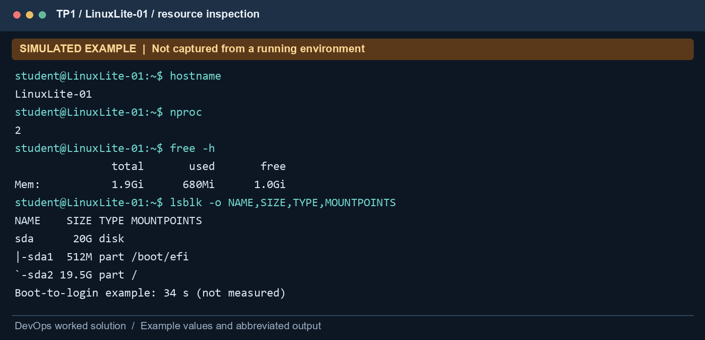
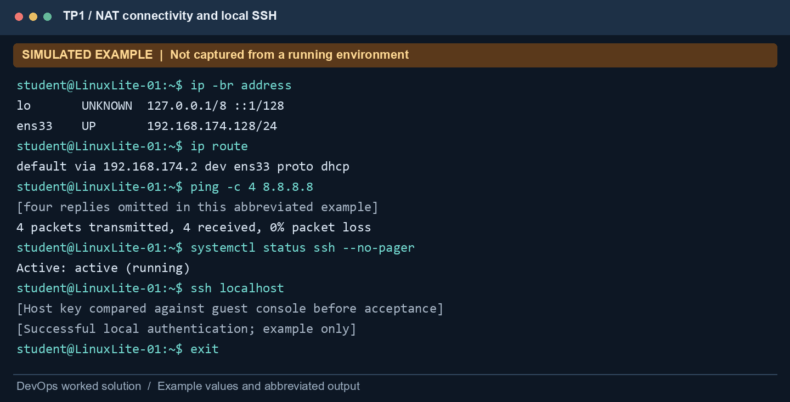
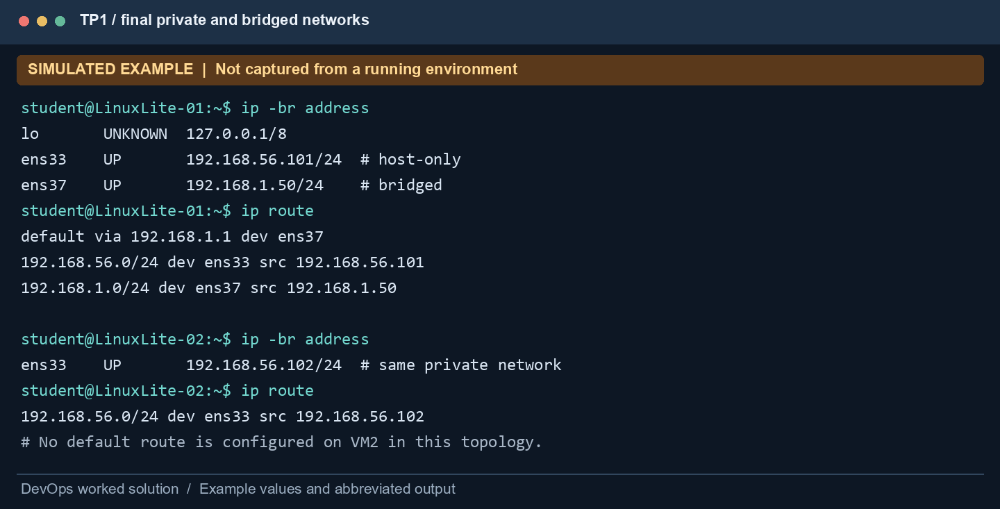
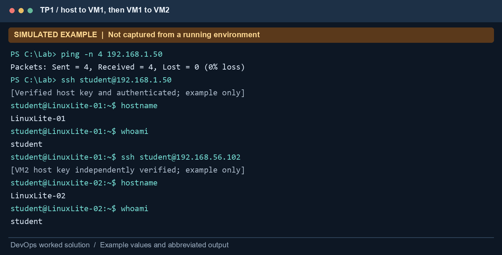
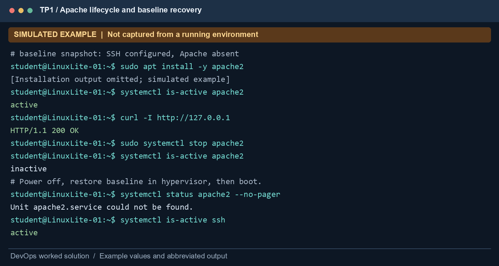
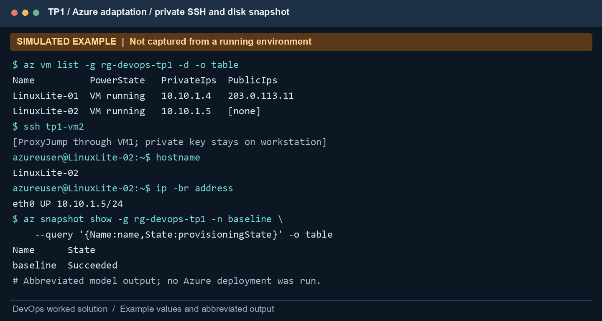

# TP1 — Virtual machines, networking, SSH and recovery

USTHB · Computer Science · 5th Year Software Engineering · 2026/2027

Module: DevOps and Cloud Computing · Instructor: Ameur Imane

Prepared: 3 November 2026 · Student name: ____________________

## Scope and evidence status

This is a complete worked solution to `TP1.pdf`, using `TP1-support-network-modes.pdf` for the network concepts. It covers Parts A–E and Q1–Q11, then supplies an Azure CLI adaptation. Commands are reproducible instructions. All illustrated outputs, IP addresses, elapsed times and terminal captures are SIMULATED EXAMPLES, not measured results. No VMware VM or Azure resource was provisioned while writing this report.

The original exercise is a local hypervisor exercise. Azure can demonstrate VM administration, private networking, SSH and disk recovery, but does not reproduce a local Linux Lite ISO installation, an OVA appliance workflow, or bridged/host-only adapters. Those tasks remain documented in their original form. The Azure appendix explicitly identifies substitutions.

## 1. Objectives, design and acceptance criteria

The target is two independently identifiable Linux machines. LinuxLite-01 first uses NAT to install SSH, is exported and imported as LinuxLite-02, and then uses two interfaces: a shared host-only network and a bridged interface. LinuxLite-02 only needs the shared host-only interface. A baseline snapshot of LinuxLite-01 is taken before Apache is installed; restoring it should remove the later installation.

| Item | Original local lab plan |
| --- | --- |
| Hypervisor | VMware Workstation; VirtualBox is an allowed alternative |
| Guest | Instructor-approved Linux Lite ISO |
| VM1 and VM2 resources | Each: 2 vCPUs, 2 GB RAM, 20 GB virtual disk |
| Guest account | Your surname in lowercase; `student` is a placeholder here |
| NAT example | VM1: 192.168.174.128/24, gateway 192.168.174.2 |
| Host-only example | Host: 192.168.56.1; VM1: .101; VM2: .102; prefix /24 |
| Bridged example | Host: 192.168.1.10; VM1: 192.168.1.50/24; router: .1 |
| Snapshot | `baseline`, before installing Apache |

All networks in the table are planning examples. Do not copy addresses that collide with your LAN, VPN or DHCP pool. Check actual adapters, masks and routes before assigning addresses.

The lab specifies 2 GB RAM and 20 GB disk. Linux Lite release requirements change: use an instructor-approved release that supports those resources, or document approval for a larger allocation. The Linux Lite 7.4 manual documents a 20 GB disk requirement; the newer download page lists larger requirements. Do not assume the newest ISO will fit the worksheet configuration. Sources: [Linux Lite manual](https://www.linuxliteos.com/manual/start.html), [Linux Lite download](https://www.linuxliteos.com/download.php).

Success means: both VMs boot; SSH is active on both; the host reaches VM1 through the bridged interface; VM1 reaches VM2 on the private interface; identities differ; and Apache is absent again after baseline recovery.

## 2. Part A — Verify virtualization and install Linux Lite

### Step 1: hardware and hypervisor

On Windows, open Task Manager, select Performance → CPU, and inspect “Virtualization”. If disabled, enable Intel VT-x or AMD-V/SVM in BIOS/UEFI and restart. Capture the actual status. An optional PowerShell inventory is:

```powershell
Get-CimInstance Win32_Processor |
  Select-Object Name,VirtualizationFirmwareEnabled,
    SecondLevelAddressTranslationExtensions
systeminfo
```

When Windows is already running a hypervisor, `systeminfo` may report that a hypervisor has been detected instead of displaying individual Hyper-V requirements. That message must be interpreted with the Task Manager result and whether the chosen hypervisor can actually start a 64-bit guest. Windows security/Hyper-V coexistence can affect the hypervisor's execution mode and performance.

Install VMware Workstation or VirtualBox from the vendor. Launch it and verify that a new 64-bit Linux VM can be configured. Do not describe the Windows host itself as a guest VM.

**Q1 — Verification and role of the hypervisor.** The required observation is “Virtualization: Enabled” in Task Manager, corroborated by a successfully started 64-bit guest. In this worked solution that observation has not been collected. A Type 2 hypervisor runs above the host OS, presents virtual CPUs, RAM, disks and NICs to Linux, and mediates their use of physical resources. It allows the two Linux environments to remain separate while sharing the physical computer.

### Step 2: create LinuxLite-01

1. Download the approved ISO and compare its SHA-256 digest with the vendor's published digest using `Get-FileHash <ISO_PATH> -Algorithm SHA256`.
2. Create LinuxLite-01 with 2 vCPUs, 2048 MB RAM, a 20 GB dynamically growing virtual disk, and one NAT adapter. Reserve enough real host memory for Windows and for both VMs later.
3. Attach the ISO as virtual optical media, boot it, and install to the VM's virtual disk. Use your surname as the account name. The disk visible in the guest is virtual; do not select physical host disks.
4. Set LinuxLite-01 as the hostname, reboot, and detach the ISO so the installed system boots.
5. Record elapsed wall-clock time from power-on to usable login/desktop. Distinguish this from the guest's internal boot timing.

```bash
sudo hostnamectl set-hostname LinuxLite-01
hostname
hostnamectl
nproc
free -h
lsblk -o NAME,SIZE,TYPE,MOUNTPOINTS
systemd-analyze time
```

**Q2 — Allocations and purpose.** The original configuration is 2 vCPUs, 2 GB RAM and a 20 GB virtual disk for each VM. CPU allocation controls guest scheduling capacity, RAM holds active processes and cached data, and disk space stores the OS, packages and user files across reboots. A dynamically growing disk has a configured capacity but initially consumes less physical host space. Guest-visible RAM and free disk space will be lower than the nominal allocation because the OS and filesystem use some resources.

**Boot time:** not measured. Example only: power-on to login = 34 seconds. `systemd-analyze` reports guest initialization stages and may not include firmware time or the delay to an interactive desktop. Record at least three cold boots if comparing performance; report the median and the measurement boundary.



## 3. Part B — NAT and SSH

### Step 3: inspect addressing and Internet access

Keep adapter 1 in NAT mode for this initial stage. Discover the actual NIC name; `ens33` below is an example, not a guaranteed Linux name.

```bash
ip -br address
ip a
ip route
ping -c 4 8.8.8.8
getent hosts archive.ubuntu.com
curl -I --max-time 15 https://archive.ubuntu.com
```

The sample address is 192.168.174.128/24. The guest route points to the virtual NAT gateway. An external ping tests IP reachability when ICMP is permitted; a successful HTTPS request is a useful independent test. A blocked ping does not by itself prove that Internet access is unavailable. If numeric-IP access works but name lookup fails, investigate DNS rather than changing the NAT mode.

**Q3 — Address and NAT explanation.** The illustrated guest address is 192.168.174.128/24; replace it with the actual `ip a` observation. NAT translates a connection from the guest's private source address/port to an address/port used by the host-side NAT service. State tracking directs replies back to the originating guest. Unsolicited connections from another LAN machine normally require forwarding or a different network mode. Host-to-guest NAT reachability varies between products; VMware NAT and VirtualBox's per-VM NAT should not be assumed identical.

### Step 4: install and test OpenSSH

```bash
sudo apt update
sudo apt install -y openssh-server
sudo systemctl enable --now ssh
sudo systemctl status ssh --no-pager
sudo ss -lntp | grep ':22'
ssh localhost
# In the SSH session:
hostname
whoami
exit
```

For the first connection, compare the presented host-key fingerprint with one displayed directly in the guest console, for example `ssh-keygen -lf /etc/ssh/ssh_host_ed25519_key.pub`. Accept it only after comparison. If that key type is unavailable, inspect another existing host public key.

**Q4 — Running status and localhost.** `Active: active (running)` indicates the service is active. A listening TCP 22 socket supports that observation. Depending on the distribution, socket activation can also be involved; inspect `ssh.socket` if the listener and service states differ. `ssh localhost` starts an encrypted connection from the guest to its own loopback interface and authenticates a Linux user. It tests the local server/client but does not validate the host-to-guest network or any external firewall. `exit` closes the nested SSH shell and returns to the original shell.



## 4. Part C — Export, import and independent identity

Shut down LinuxLite-01 cleanly with `sudo poweroff`. In VMware, use the available OVF/OVA export workflow and OVF Tool if required by the installed version. Import/open the exported appliance as LinuxLite-02. Choose new identifiers and MAC addresses when prompted. VirtualBox's alternative is File → Export Appliance, then File → Import Appliance. The exact OVA capability depends on the hypervisor/version; do not claim that copying a directory is the same as exporting an appliance.

Optional VirtualBox CLI equivalents, run on the host with the first VM powered off, are shown below. Substitute your own export path. Check `VBoxManage --help` for your installed version. Source: [Oracle VBoxManage reference](https://docs.oracle.com/en/virtualization/virtualbox/7.1/user/vboxmanage.html).

```bash
VBoxManage export LinuxLite-01 --output LinuxLite-01.ova
VBoxManage import LinuxLite-01.ova --vsys 0 --vmname LinuxLite-02
```

Start VM2 and set its internal identity:

```bash
sudo hostnamectl set-hostname LinuxLite-02
hostname
ip -br link
sudo systemctl enable --now ssh
```

Check `/etc/hosts` and update any old hostname mapping to match LinuxLite-02. Verify that VM1 and VM2 have different NIC MAC addresses. A cloned installation can also retain SSH server host keys and `/etc/machine-id`; these are separate from VM UUIDs and MACs. For a reusable Linux template, use a supported image-generalization process. For this controlled lab clone, regenerate VM2's SSH host keys from its own console and verify their new fingerprints before reconnecting. Do not remove keys on VM1.

```bash
# On VM2 only, from its console:
sudo rm -f /etc/ssh/ssh_host_*key /etc/ssh/ssh_host_*key.pub
sudo ssh-keygen -A
sudo systemctl restart ssh
ssh-keygen -lf /etc/ssh/ssh_host_ed25519_key.pub
```

**Q5 — Display name versus hostname.** The VM name is the hypervisor's inventory label. The hostname is stored/configured within the guest and appears in prompts, logs and name resolution. Importing a VM under a new inventory name does not necessarily change its Linux hostname. Distinct hostnames reduce administration mistakes and ambiguous logs; distinct IP/MAC addresses prevent address conflicts, while independent machine IDs and host keys prevent cloned machine identity from being reused unintentionally.

## 5. Part D — Two-network configuration

### Step 6: final adapters and addresses

Shut down both VMs. Configure one shared custom/host-only network. In VMware, use the Virtual Network Editor to select the same host-only VMnet for both first adapters and enable a host adapter if host access is required. Add a second, bridged adapter to VM1, bound to the actual Ethernet/Wi-Fi uplink. VM2 has only the private adapter. Enable “connected at power on”. A VMware LAN segment/internal network does not automatically provide host access or DHCP; that is different from a host-only network.

| Machine | Example interface | Mode | Example address | Gateway |
| --- | --- | --- | --- | --- |
| Host | host-only adapter | Host-only | 192.168.56.1/24 | None on this adapter |
| LinuxLite-01 | ens33 | Shared host-only | 192.168.56.101/24 | None |
| LinuxLite-01 | ens37 | Bridged | 192.168.1.50/24 | 192.168.1.1 |
| LinuxLite-02 | ens33 | Shared host-only | 192.168.56.102/24 | None |

Use DHCP if the virtual network provides it. Otherwise assign static private addresses outside its DHCP pool. Linux Lite commonly uses NetworkManager; discover connection/profile names before modifying them. The following changes apply to the private NIC only:

```bash
nmcli device status
nmcli connection show
# Replace PRIVATE_PROFILE with the real connection name.
# VM1:
sudo nmcli con mod "PRIVATE_PROFILE" ipv4.method manual \
  ipv4.addresses 192.168.56.101/24 ipv4.gateway "" \
  ipv4.dns "" ipv4.never-default yes
sudo nmcli con up "PRIVATE_PROFILE"
# On VM2, use 192.168.56.102/24 instead.
# Keep the bridged profile on DHCP if the LAN supplies DHCP.
ip -br address
ip route
```

Do not set the host-only interface as the default route. VM1 should use its bridged NIC for external access. VM2 has no external access in the final topology unless a gateway is deliberately added. Install its required packages before removing NAT. A subnet alone is not a router, and VM1 does not route VM2's traffic unless forwarding/NAT is explicitly configured.

**Q6 — NAT, bridged and host-only.** NAT permits guest-initiated external traffic through address translation. Bridging places the guest on the physical LAN with its own LAN address. Host-only creates an isolated host/guest network that has no external route by default. The two VMs communicate on the shared host-only subnet, 192.168.56.0/24 in this example. Different IP address ranges do not define the mode; the hypervisor attachment and routing do.



### Step 7: host-to-VM1 reachability

On Windows, use:

```powershell
ping -n 4 192.168.1.50
Test-NetConnection 192.168.1.50 -Port 22
```

**Q7 — Command and result.** The example command is `ping -n 4 192.168.1.50`. The simulated result is four replies with 0% packet loss; the actual result has not been measured. Verify subnet membership, the bridged uplink selection, VM power state and firewall rules if it fails. LAN client isolation or Wi-Fi bridging limitations can block reachability. A failed ICMP test with a successful TCP 22 test may indicate ICMP filtering rather than loss of SSH connectivity.

### Step 8: host-to-VM1 SSH

```bash
# From the host terminal:
ssh student@192.168.1.50
# Inside VM1:
hostname
whoami
ip a
exit
```

**Q8 — Confirm the remote machine.** The expected hostname is LinuxLite-01, the account is the guest account `student` (replace with your surname), and `ip a` should show the VM1 private and bridged addresses. Compare the server's host-key fingerprint against the VM console. A prompt alone can be customized; the combined fingerprint, hostname, user, addressing and hypervisor inventory provide stronger confirmation that the session reached VM1.

### Step 9: VM1-to-VM2 SSH

```bash
# In VM1:
ping -c 4 192.168.56.102
ssh student@192.168.56.102
# In VM2:
hostname
whoami
ip -br address
exit
```

Use the account password for the local lab or install a dedicated public key using `ssh-copy-id` after verifying the host fingerprint. A private key should not be copied from the host to VM1 merely to demonstrate a second connection.

**Q9 — Command and confirming output.** `ssh student@192.168.56.102` should reach LinuxLite-02. The model output is `hostname` → `LinuxLite-02`, `whoami` → `student`, and the private NIC → `192.168.56.102/24`. This tests guest-to-guest private networking independently of VM1's bridged path. VM2's SSH server must be active and any enabled guest firewall must allow TCP 22 from the private subnet.



## 6. Part E — Baseline snapshot and recovery

### Step 10: define a baseline before changing packages

Verify that SSH works and Apache is absent. Use both package and service checks:

```bash
dpkg-query -W -f='${db:Status-Abbrev}\n' apache2 2>/dev/null || true
systemctl status apache2 --no-pager
```

If Apache is already installed, the worksheet's predicted result “Apache absent after restore” will not apply. Either use a clean VM where it is absent or record the existing state and compare like for like. The baseline must be taken before the experiment, not after installation.

Power off LinuxLite-01 and take a hypervisor snapshot named `baseline`. A powered-off baseline avoids ambiguity about an in-memory service state. In VMware, use VM → Snapshot → Take Snapshot. VirtualBox equivalents on the host are:

```bash
VBoxManage snapshot LinuxLite-01 take baseline \
  --description "SSH configured; Apache absent"
VBoxManage snapshot LinuxLite-01 list
```

**Q10 — Why baseline snapshots help.** The snapshot provides a return point for a known configuration before an experiment. It shortens recovery from package or configuration mistakes and allows repeatable tests. It is not a complete backup: local snapshots can depend on the original disk chain and remain vulnerable to host/disk loss. Snapshots also consume storage and should not be kept indefinitely without a retention plan.

### Step 11: install, stop and restore Apache

Boot VM1, then run:

```bash
sudo apt update
sudo apt install -y apache2
sudo systemctl enable --now apache2
sudo systemctl status apache2 --no-pager
curl -I http://127.0.0.1
sudo systemctl stop apache2
sudo systemctl status apache2 --no-pager
curl --max-time 5 -I http://127.0.0.1
```

Expected model sequence: service active and local HTTP 200; after stopping, service inactive and the local HTTP request fails. `systemctl status` commonly returns a nonzero exit status for an inactive/missing service. That expected negative result is useful evidence and should not be hidden by treating the whole lab as a failed script.

Shut down VM1, restore `baseline` through the hypervisor, and boot it again. If using VirtualBox, run `VBoxManage snapshot LinuxLite-01 restore baseline` while the VM is powered off. Restoring discards the experiment's subsequent guest disk changes; preserve required notes outside the VM first.

```bash
hostname
sudo systemctl status ssh --no-pager
systemctl status apache2 --no-pager
dpkg-query -W -f='${db:Status-Abbrev}\n' apache2 2>/dev/null || true
curl --max-time 5 -I http://127.0.0.1
```

**Q11 — What should change after restore?** If Apache was absent in the baseline, it should again be absent: systemd reports no Apache unit, and the package query should not report it as installed. SSH and the baseline network settings should still work. A stopped Apache service before restoration and an absent Apache installation after restoration are different states; show both. Any guest files created after the snapshot should also be rolled back, while external files and other VMs are unaffected. No actual rollback has been performed for this document.



## 7. Azure CLI adaptation — two VMs, private SSH and disk rollback

### 7.1 Mapping and limitations

| Original task | Azure adaptation | Important difference |
| --- | --- | --- |
| Type 2 hypervisor | Azure-managed virtualization | No local hypervisor installation or BIOS test is demonstrated |
| Linux Lite from ISO | Ubuntu 24.04 LTS Marketplace image | LinuxLite-01/02 are resource names; the OS is Ubuntu |
| 2 vCPUs, 2 GB, 20 GB | Example B1ms, 1 vCPU, 2 GiB, 30 GiB disk | Different sizing; check supported size/image and obtain approval |
| NAT adapter | Explicit Standard public IP on VM1 | Cloud address translation is not VMware NAT configuration |
| Bridged NIC | Public IP mapped to VM1's private NIC | No bridged LAN NIC; public IP does not appear in `ip a` |
| Shared host-only | VNet/subnet 10.10.1.0/24 | Host needs SSH jump, VPN or Bastion; no local host-only adapter |
| OVA export/import | Disk snapshot copied to another managed disk | Specialized disk clone, not an OVA export/import |
| Hypervisor snapshot | Managed OS-disk snapshot and replacement disk | Disk state only; no RAM state or automatic NIC rollback |

The initial VM1 has private IP 10.10.1.4 and one Standard public IPv4; VM2 has private IP 10.10.1.5 and no public IP. An NSG permits TCP 22 from your workstation /32 and private-subnet SSH, then denies other inbound traffic. A direct VM public IP is an explicit outbound path for VM1. VM2 does not rely on implicit outbound connectivity. See [Azure outbound connectivity](https://learn.microsoft.com/en-us/azure/virtual-network/ip-services/default-outbound-access).

### 7.2 Provision VM1 and validate SSH

Use Bash in WSL/Linux, with Azure CLI, Python 3 and OpenSSH installed. Authenticate using `az login` and select the correct subscription with `az account set --subscription <YOUR_SUBSCRIPTION>`. Never place subscription credentials or private keys in the repository.

```bash
export CLIENT_IP="YOUR_REAL_PUBLIC_IPV4"
export LOCATION=francecentral
export ADMIN=azureuser
bash scripts/tp1-azure.sh
# In the SAME host Bash terminal, initialize variables for later steps:
RG=rg-devops-tp1
VM1=LinuxLite-01
VM2=LinuxLite-02
KEY="$HOME/.ssh/devops-tp1"
ADMIN=${ADMIN:-azureuser}
SIZE=${SIZE:-Standard_B1ms}
PUBLIC_IP=$(az network public-ip show -g "$RG" -n pip-tp1 \
  --query ipAddress -o tsv)
```

Before SSH, retrieve VM1's host public-key fingerprint through the authenticated Azure management channel and compare it with the SSH prompt:

```bash
az vm run-command invoke -g "$RG" -n "$VM1" \
  --command-id RunShellScript \
  --scripts 'ssh-keygen -lf /etc/ssh/ssh_host_ed25519_key.pub' \
  --query 'value[].message' -o tsv
ssh -i "$KEY" "$ADMIN@$PUBLIC_IP"
# Inside VM1:
sudo hostnamectl set-hostname LinuxLite-01
hostname
whoami
ip -br address
sudo systemctl enable --now ssh
sudo systemctl status ssh --no-pager
# Confirm Apache is absent, then return to the host:
systemctl status apache2 --no-pager
exit
```

The stock Ubuntu image already provides OpenSSH. Run `sudo apt update` and `sudo apt install -y openssh-server` if required; do not clone before its SSH service is working. Check hostname persistence through a reboot; if cloud-init resets it, set `preserve_hostname: true` in `/etc/cloud/cloud.cfg.d/99-lab-hostname.cfg` and apply the desired hostname again. Source for connection and fingerprint workflow: [Connect to a Linux VM](https://learn.microsoft.com/en-us/azure/virtual-machines/linux-vm-connect).

### 7.3 Create a baseline disk snapshot and clone VM2

After all baseline VM1 changes are complete, save external evidence and deallocate the VM. The following host commands create a disk snapshot and a separate disk for VM2:

```bash
az vm deallocate -g "$RG" -n "$VM1"
OS_ID=$(az vm show -g "$RG" -n "$VM1" \
  --query storageProfile.osDisk.managedDisk.id -o tsv)
az snapshot create -g "$RG" -n baseline \
  --source "$OS_ID" --sku Standard_LRS -o none
SNAP_ID=$(az snapshot show -g "$RG" -n baseline --query id -o tsv)
az disk create -g "$RG" -n disk-tp1-02 \
  --source "$SNAP_ID" --sku Standard_LRS -o none
DISK2_ID=$(az disk show -g "$RG" -n disk-tp1-02 --query id -o tsv)
az network nic create -g "$RG" -n nic-tp1-02 --vnet-name vnet-tp1 \
  --subnet private --network-security-group nsg-tp1 \
  --private-ip-address 10.10.1.5 -o none
az vm create -g "$RG" -n "$VM2" --nics nic-tp1-02 \
  --attach-os-disk "$DISK2_ID" --os-type Linux --size "$SIZE" -o none
az vm start -g "$RG" -n "$VM1"
```

The attached OS disk is specialized: user accounts and authorized keys come from the source. Do not add `--image`, a new admin username or `--ssh-key-values` to this specialized-disk creation command. Match disk generation, size, region, encryption and security type; if Azure requires an explicit `--security-type` for your environment, use the source VM's compatible security type. This workflow is a lab clone, not a generalized image pipeline. Sources: [managed disk snapshots](https://learn.microsoft.com/en-us/azure/virtual-machines/snapshot-copy-managed-disk), [disk management tutorial](https://learn.microsoft.com/en-us/azure/virtual-machines/linux/tutorial-manage-disks).

Regenerate VM2's machine and SSH server identity via Azure Run Command before using its SSH connection. This targets VM2 only. Preserve its authorized user public key, and avoid placing any private client key on either VM.

```bash
az vm run-command invoke -g "$RG" -n "$VM2" \
  --command-id RunShellScript --scripts \
  'set -eu
printf "preserve_hostname: true\n" > /etc/cloud/cloud.cfg.d/99-lab-hostname.cfg
hostnamectl set-hostname LinuxLite-02
sed -i "s/LinuxLite-01/LinuxLite-02/g" /etc/hosts
rm -f /etc/machine-id /var/lib/dbus/machine-id
systemd-machine-id-setup
ln -s /etc/machine-id /var/lib/dbus/machine-id
rm -f /etc/ssh/ssh_host_*key /etc/ssh/ssh_host_*key.pub
ssh-keygen -A
systemctl restart ssh
hostname
ssh-keygen -lf /etc/ssh/ssh_host_ed25519_key.pub' \
  --query 'value[].message' -o tsv
az vm restart -g "$RG" -n "$VM2"
```

Do not run `waagent -deprovision+user` against VM1 merely to copy this specialized disk; that is a different image-preparation process and can remove accounts. VM2's agent/status and SSH listener must be checked after restart; a booted specialized clone is not automatically a verified reusable image.

### 7.4 Reach VM2 through VM1

An SSH ProxyJump allows the workstation to authenticate to VM2 through VM1 without copying a private key to VM1. Create a local SSH configuration with the actual allocated VM1 public IP:

```text
Host tp1-vm1
    HostName REPLACE_WITH_VM1_PUBLIC_IP
    User azureuser
    IdentityFile ~/.ssh/devops-tp1
    IdentitiesOnly yes

Host tp1-vm2
    HostName 10.10.1.5
    User azureuser
    IdentityFile ~/.ssh/devops-tp1
    IdentitiesOnly yes
    ProxyJump tp1-vm1
```

Replace `User` if you chose another admin name. Connect with `ssh tp1-vm2`, verify the independently retrieved VM2 host fingerprint, and run `hostname; whoami; ip -br address`. For a literal SSH session initiated inside VM1, generate a separate key there, copy only its public key into VM2's authorized_keys via an authenticated management operation, and then run `ssh azureuser@10.10.1.5`. ProxyJump demonstrates the private network transport but is not an interactive SSH command executed in VM1's shell.

Azure public IPs are translated at the platform boundary, so `ip a` should show 10.10.1.4 or 10.10.1.5, not the public address. Public ICMP ping is not the acceptance test for this adaptation; use SSH/TCP and NSG verification.



### 7.5 Perform the Apache experiment and restore the Azure disk

SSH to VM1, install Apache, confirm active status and HTTP 200 locally, then stop it and confirm inactive status using the exact commands from Part E. Do not open public HTTP just for this experiment. Return to the host and restore the baseline into a NEW managed disk:

```bash
az vm deallocate -g "$RG" -n "$VM1"
az disk create -g "$RG" -n disk-tp1-restored \
  --source "$SNAP_ID" --sku Standard_LRS -o none
RESTORED_ID=$(az disk show -g "$RG" -n disk-tp1-restored --query id -o tsv)
az vm update -g "$RG" -n "$VM1" --os-disk "$RESTORED_ID" -o none
az vm start -g "$RG" -n "$VM1"
az vm show -g "$RG" -n "$VM1" \
  --query storageProfile.osDisk.managedDisk.id -o tsv
ssh -i "$KEY" "$ADMIN@$PUBLIC_IP"
# In restored VM1:
hostname
systemctl status apache2 --no-pager
dpkg-query -W -f='${db:Status-Abbrev}\n' apache2 2>/dev/null || true
exit
```

The restored disk should match the baseline; the previous OS disk remains a separate resource. The NIC, NSG and public IP are not rolled back by the disk swap. Verify compatibility and the attached disk ID rather than assuming a successful start proves restoration. Source: [Azure OS disk swap](https://learn.microsoft.com/en-us/azure/virtual-machines/linux/os-disk-swap).

### 7.6 Cleanup

Preserve required outputs outside the VMs, then run `RG=rg-devops-tp1 bash scripts/cleanup.sh`. The inventory should include both VMs, three OS disks if all steps were run, the baseline snapshot, NICs, public IP, NSG and VNet. Exact counts depend on successfully completed steps. Group deletion removes the lab-owned resources together; retain nothing by accident. No actual deletion was performed for this report.

## 8. Troubleshooting and observations to record

| Symptom | Check | Corrective action |
| --- | --- | --- |
| 64-bit guest will not start | BIOS virtualization; host hypervisor compatibility | Enable virtualization; use the vendor-supported host configuration |
| NAT access fails | NIC connected; address; default route; DNS | Repair the specific layer; test HTTPS as well as ICMP |
| Duplicate addresses after cloning | VM MACs; DHCP leases; static assignments | Generate new MACs and choose unique addresses |
| Host cannot reach bridged VM | LAN subnet; correct uplink; Wi-Fi isolation | Fix bridging or document network limitations |
| VM1 cannot reach VM2 | Same VMnet; masks; firewall; SSH listener | Correct private network and allow only needed traffic |
| SSH host key changed | Clone identity or restored disk | Verify in console/Run Command before changing known_hosts |
| Apache remains after rollback | Baseline timing; selected snapshot/disk | Compare package state and verify restored disk identity |
| Azure VM2 cannot run apt | No explicit outbound path | Install before cloning or deliberately add managed egress; do not assume Internet access |

Record actual screenshots for virtualization status, VM hardware, export/import, final adapter settings, guest addresses, SSH sessions, baseline selection and post-restore checks. For Azure, also save redacted resource configuration and disk IDs. Keep passwords, private keys and access tokens out of every capture.

## 9. Completion checklist

- Q1–Q2: explain virtualization and allocations; record real boot time.
- Q3–Q4: record NAT addressing and a working local SSH service.
- Q5: establish VM2's distinct guest and virtual hardware identity.
- Q6–Q9: record final topology and both remote SSH paths.
- Q10–Q11: capture pre-baseline, active Apache, stopped Apache, and restored package state.
- Azure adaptation: label OS/resource/network substitutions and verify disk recovery separately.
- Preserve observations externally before rollback and remove lab cloud resources after use.

The worked procedure and answers are complete. Actual execution, measured boot times, screenshots and instructor acceptance of the Azure substitution remain to be supplied by a real lab run.
