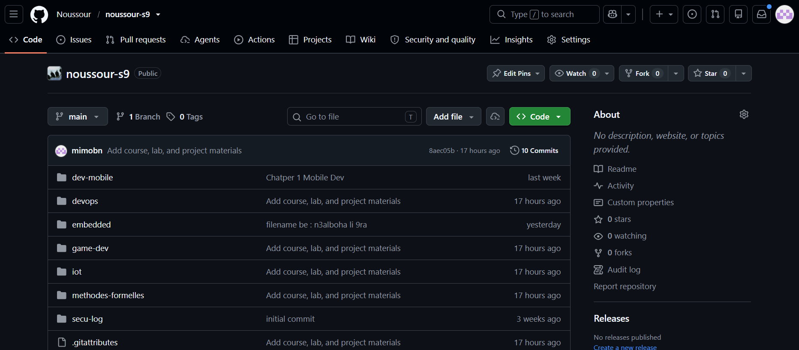
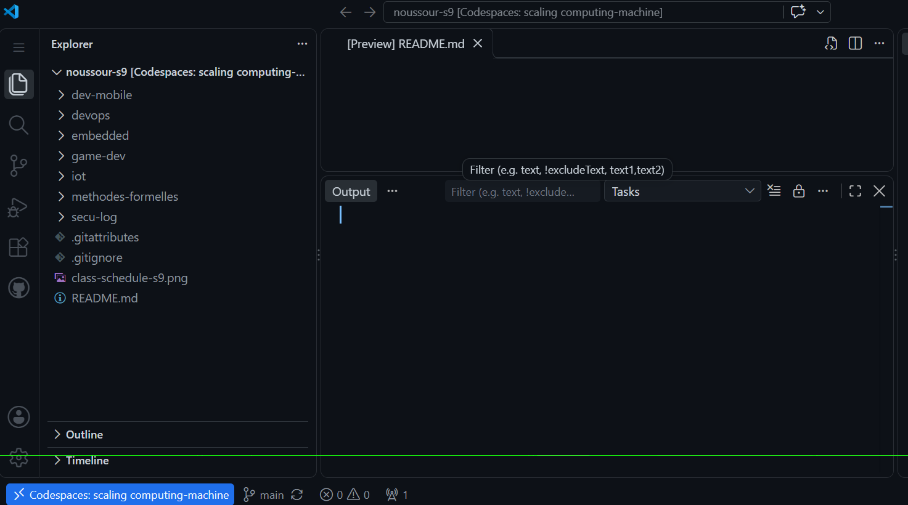
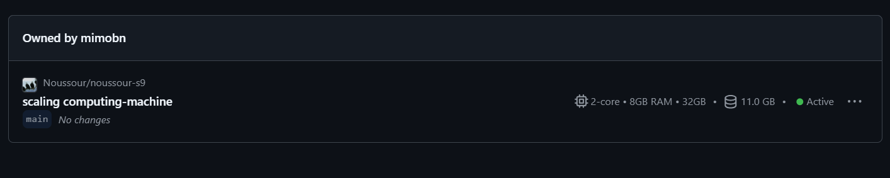
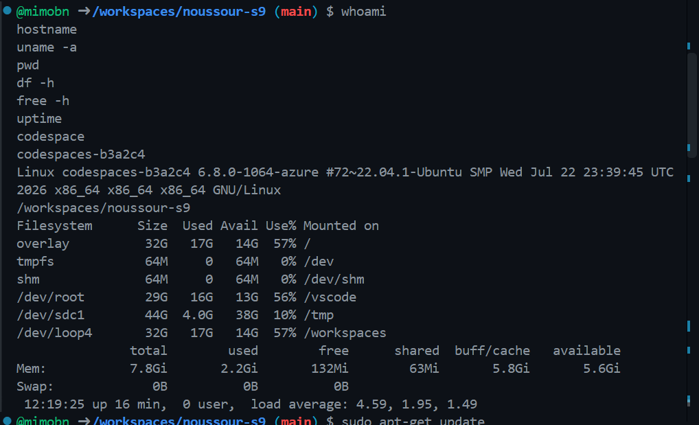
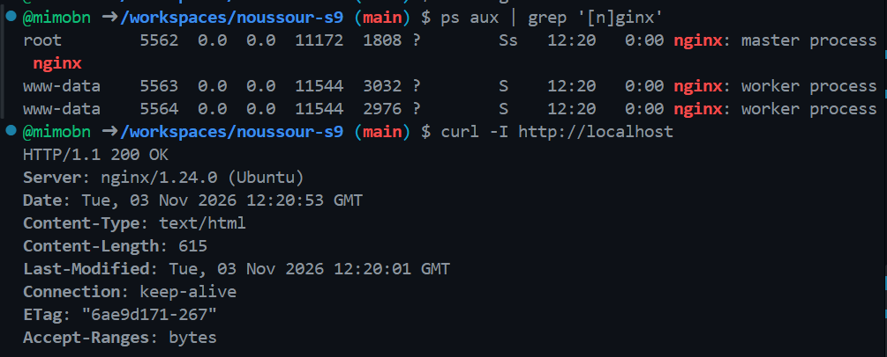
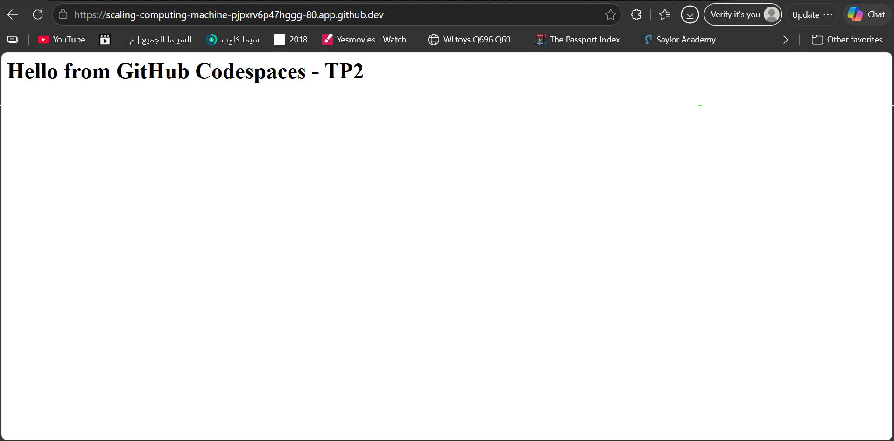
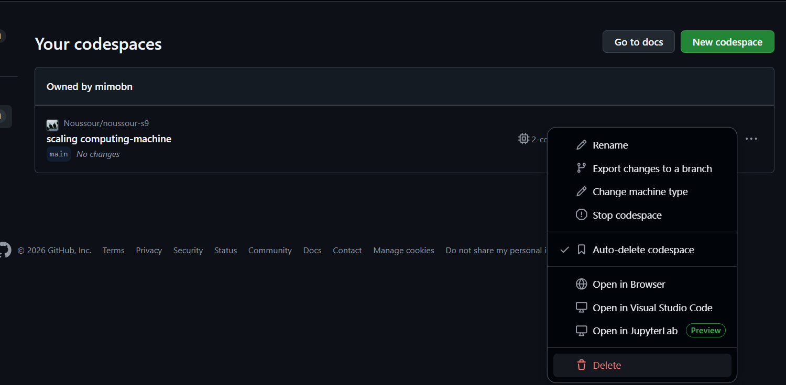
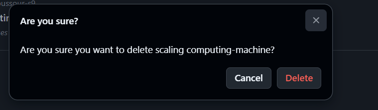
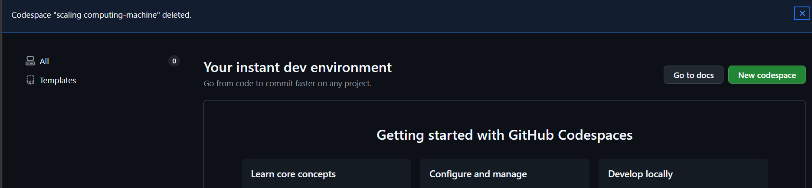

# TP2 — Cloud development environment with GitHub Codespaces

USTHB · Computer Science Department · 5th Year Software Engineering · 2026/2027

Module: DevOps and Cloud Computing · Instructor: Ameur Imane

Execution date: 3 November 2026 · GitHub account shown: mimobn

Student name: ____________________

## 1. Purpose, worksheet and evidence

This report addresses `TP2_Lab Cloud Environment Pr.pdf`: “Launch and Secure a Cloud Development Environment with GitHub Codespaces”. It documents the user's actual execution using nine screenshots recovered, with permission, from Windows clipboard history. The screenshots show the repository, the Codespaces editor, Linux inspection, a running Nginx server, a browser response and deletion. They are genuine supplied captures, not the simulated Azure examples in the separate reports.

The report distinguishes results visible in the captures from explanatory commands and unverified settings. No Azure CLI deployment is claimed: the execution shown is GitHub Codespaces. An `azure` suffix in the kernel version does not mean the student provisioned an Azure VM using Azure CLI.

The original clipboard bitmaps are preserved unchanged and are embedded in this report; lossless PNG convenience copies are also supplied. `evidence/evidence-manifest.json` records dimensions, clipboard timestamps and SHA-256 hashes. Clipboard timestamps identify copy/history events, not necessarily the time a Codespace was created. No billing/usage-page screenshot or explicit port-visibility setting appears in the supplied material, so those values are not invented.

## 2. Part A — Repository and environment creation

### 2.1 Repository used

The practical used the existing public repository `Noussour/noussour-s9`, on branch `main`. The worksheet allows an existing/instructor-provided repository instead of creating a repository named `tp2-codespaces`. The repository page and the Codespaces editor both identify the same project. The GitHub account shown as the Codespace owner is `mimobn`; the repository owner/organization is `Noussour`. Those are different roles.



### 2.2 Codespace opened in the browser

The Codespace was opened through GitHub's repository workflow: Code → Codespaces → create/open the environment on `main`. The actual editor capture shows the project tree, an editor tab, and an integrated terminal in the browser-based VS Code environment. The Explorer contains the repository's module folders, including `devops`, and the status bar identifies the Codespace `scaling computing-machine`.

The Explorer lists the remote workspace files, the editor opens project content, and Terminal → New Terminal provides the Linux shell used for the remaining steps. The Ports panel, normally in the bottom panel beside Terminal, manages forwarded service ports. Its visibility column must be checked directly; it is not shown in this editor capture.



### 2.3 Recorded machine configuration

The Codespaces inventory capture shows the following real configuration:

| Property | Value visible in the execution evidence |
| --- | --- |
| Repository | Noussour/noussour-s9 |
| Branch | main |
| Owner of the Codespace | mimobn |
| Display name | scaling computing-machine |
| Deletion-confirmation name | scaling-computing-machine |
| Machine type | 2-core |
| Configured RAM | 8 GB |
| Configured storage | 32 GB |
| Storage indicator on the inventory card | 11.0 GB at that moment |
| State before cleanup | Active |
| Creation date/time | Not displayed in the supplied screenshots |
| Execution date | 3 November 2026, supported by terminal HTTP Date header |

The display name with spaces and the hyphenated name in the delete dialog refer to the same Codespace as shown by the sequence. An internal CLI/API identifier can be longer; it is not inferred from the display name. The machine card is stronger evidence of the selected allocation than guessing the machine type from `free` or `df` alone.



GitHub describes a Codespace as a cloud-hosted development environment implemented using a development container on a VM. This explains why it supplies Linux tools while hiding management of the underlying physical host. Source: [What are GitHub Codespaces?](https://docs.github.com/en/codespaces/about-codespaces/what-are-codespaces).

## 3. Part B — Inspect the remote Linux environment

The captured terminal runs the worksheet's inspection commands in this order:

```bash
whoami
hostname
uname -a
pwd
df -h
free -h
uptime
```



### 3.1 Identity and operating system

| Command | Observed result | Meaning |
| --- | --- | --- |
| `whoami` | `codespace` | The effective Linux user in the development environment |
| `hostname` | `codespaces-b3a2c4` | Linux hostname of the environment |
| `uname -a` | Linux; kernel `6.8.0-1064-azure`; x86_64 | Kernel/build/architecture information, not a complete OS-image identifier |
| `pwd` | `/workspaces/noussour-s9` | Current directory containing the checked-out repository |

The prompt includes the GitHub identity `@mimobn`, but `whoami` returns `codespace`. The prompt's GitHub account and the operating system account must not be conflated. The kernel suffix `azure` describes a kernel build; it does not provide the complete container distribution version. `cat /etc/os-release` would be the appropriate additional command to record that version, but its output is not included in the evidence.

### 3.2 Filesystem space

The captured `df -h` output includes these mounts:

| Filesystem / mount | Size | Used | Available | Use |
| --- | --- | --- | --- | --- |
| overlay mounted at `/` | 32G | 17G | 14G | 57% |
| `/dev/root` mounted at `/vscode` | 29G | 16G | 13G | 56% |
| `/dev/sdc1` mounted at `/tmp` | 44G | 4.0G | 38G | 10% |
| `/dev/loop4` mounted at `/workspaces` | 32G | 17G | 14G | 57% |

`df` reports mounted filesystem capacity and use, not monthly billed storage. The `/` overlay and `/workspaces` entries can describe related storage layers, so adding all displayed capacities would overstate the allocation. The screenshot's 11.0-GB inventory indicator and the terminal's filesystem values also measure different views and need not match exactly. None is a substitute for the account's billing report.

### 3.3 Memory and uptime

The captured memory line shows 7.8 GiB total RAM, 2.2 GiB used, 132 MiB free, 5.6 GiB in buffer/cache and 5.6 GiB available. The shared-memory column is 63 MiB and swap is 0 B. The distinction between “free” and “available” matters: Linux uses otherwise idle memory for caches, and available memory includes memory that can be reclaimed. The small free column therefore does not mean the Codespace had only 132 MiB usable memory left.

The recorded uptime line is:

```text
12:19:25 up 16 min, 0 user, load average: 4.59, 1.95, 1.49
```

The three averages summarize roughly 1-, 5- and 15-minute system load. They are not CPU-use percentages and do not independently prove a sustained bottleneck. The user counter reflects recorded login sessions, so `0 user` does not mean no interactive Codespaces terminal existed. Uptime is the running time of the system visible to the container; it is not a reliable creation stopwatch or billing measurement for the user's particular session.

## 4. Part C — Install, run and test Nginx

### 4.1 Installation and startup procedure

Nginx is a web server and reverse proxy. For this lab it serves an HTML page on port 80 inside the development environment. The worksheet's commands are:

```bash
sudo apt-get update
sudo apt-get install -y nginx
sudo nginx
```

`apt-get update` refreshes package metadata. `apt-get install -y nginx` installs the package and accepts package-manager confirmation. `sudo nginx` starts the daemon if it is not already running. The provided Linux inspection capture shows the beginning of an `apt-get update` command, while the next capture proves that Nginx was running; a complete installation transcript is not present.

A development container may not run systemd as PID 1, so the Azure VM procedure using `systemctl` should not be copied into this Codespaces report as if it were the executed method. If Nginx has already started, launching another copy can report a port-bind error. Check the existing process rather than repeatedly starting it.

### 4.2 Observed processes and HTTP response

The actual validation commands visible in the screenshot are:

```bash
ps aux | grep '[n]ginx'
curl -I http://localhost
```



The process list shows a root-owned master process, PID 5562, and two `www-data` worker processes, PIDs 5563 and 5564. The `[n]ginx` expression matches Nginx without normally matching the `grep` command itself. The response includes:

```text
HTTP/1.1 200 OK
Server: nginx/1.24.0 (Ubuntu)
Date: Tue, 03 Nov 2026 12:20:53 GMT
Content-Type: text/html
Content-Length: 615
```

Together, the process list and a successful HTTP response establish that the service was running and serving HTTP locally at the time of the capture. `curl -I` issues a HEAD request: it shows response headers rather than the HTML body. The 615-byte content length belongs to the page served at that moment, before or independently of the later custom-page screenshot. It should not be presented as the measured size of the custom page.

### 4.3 Custom page and forwarding

The worksheet's page-creation command is:

```bash
echo '<h1>Hello from GitHub Codespaces - TP2</h1>' | \
  sudo tee /var/www/html/index.html
```

`tee` writes the supplied HTML with elevated permissions, because a normal user may not own the web root. A shell redirection placed outside `sudo` would still be performed by the unprivileged shell, so `sudo tee` is the reliable form here.

To reach the service from the workstation, open the Codespaces Ports panel, add port 80 if necessary, and use Open in Browser on its forwarded address. The GitHub endpoint follows the `https://<codespace-name>-80.app.github.dev` pattern. This is a forwarded development-service URL, not an Azure VM public IP. GitHub's HTTPS endpoint can forward to the Nginx HTTP service inside the environment. Source: [Codespaces port forwarding](https://docs.github.com/en/codespaces/developing-in-a-codespace/forwarding-ports-in-your-codespace?tool=vscode).

The supplied real browser capture displays “Hello from GitHub Codespaces - TP2”. This confirms that the custom page reached the browser through the Codespaces forwarding route at the time of capture, extending the earlier localhost test beyond the container itself.



### 4.4 Private visibility and security

Keep the forwarded port Private, unless the instructor explicitly requires a public demonstration. GitHub documents authentication for private forwarded ports; a public forwarded port can be reached without that authentication. A public repository does not automatically imply that its forwarded service should be public. Source: [Codespaces security and forwarded ports](https://docs.github.com/en/codespaces/reference/security-in-github-codespaces).

The provided screenshots do not show the Ports panel's visibility field. Consequently, this report does not assert that Private was verified. To complete that evidence, open Ports → Port Visibility → Private and capture the setting. From an authenticated local GitHub CLI session, an optional explicit setting is `gh codespace ports visibility 80:private -c <ACTUAL_CODESPACE_ID>`; obtain the real ID from `gh codespace list`, not from a guessed display name. Source: [CLI visibility command](https://cli.github.com/manual/gh_codespace_ports_visibility).

Do not paste a GitHub token into report commands or screenshots to access the forwarded page. Use the normal authenticated browser. An inaccessible private URL in a signed-out browser does not mean Nginx is down.

## 5. Part D — Cloud characteristics demonstrated

| Characteristic | Connection to the actual execution | Evidence / limit |
| --- | --- | --- |
| On-demand self-service | A repository-backed Linux development environment was available through GitHub's UI | Editor and active Codespace card; the initial create-click timestamp was not captured |
| Broad network access | The editor and custom web page were accessed through a browser | Actual editor and Nginx browser captures |
| Resource pooling | GitHub supplies a container and virtual resources without exposing physical host administration | 2-core/8-GB/32-GB allocation; provider-management conclusion follows from the documented service model |
| Rapid provisioning / capacity change | GitHub manages creation and offers selectable machine types | Existing environment is demonstrated; provisioning duration and an actual resize were not measured |
| Measured service | Allocated configuration and a storage indicator are visible; GitHub meters compute and retained storage | Actual card shows 11.0 GB; no account usage/billing page was captured |

If more resources were needed, save work and use the Codespace's Change machine type action, subject to available types, organization policy, budget and any required restart. The supplied menu includes that action; no resize is claimed. For a reproducible project environment, a future improvement is a reviewed `.devcontainer/devcontainer.json` that specifies dependencies. This report does not modify the repository's Codespaces configuration automatically.

## 6. Part E — Usage, quota and cost awareness

The evidence shows a 2-core machine and an 11.0-GB storage indicator. It does not show a personal billing dashboard, account plan, included balance, total compute hours or invoice. Therefore actual monthly usage, remaining allowance and charges cannot be determined from these captures.

GitHub's current documentation lists 120 monthly Codespaces core-hours and 15 GB of monthly storage allowance for personal GitHub Free accounts. The worksheet expresses the storage allowance as GB-month; storage is accumulated over time. The user's actual account plan is not established by a username or the machine card, so these documented Free-plan allowances must not be substituted for a verified account balance. Source: [Included usage by GitHub plan](https://docs.github.com/en/billing/reference/product-usage-included).

For the worksheet's calculation, a 2-core Codespace active for one clock hour consumes 2 core-hours. A 120-core-hour allowance corresponds to 60 active clock hours on that machine type if the full allowance is available and no other usage draws from it. A hypothetical 20-minute active session is `2 × 20/60 = 0.667` core-hours; this is arithmetic, not an assertion that the captured session was billed for 20 minutes.

Compute is associated with active usage; retained storage can continue to count after stopping. Multiple Codespaces and prebuilds can affect account totals. `df -h`, the machine's RAM allocation and a point-in-time storage indicator are not monthly quota counters. Source: [Codespaces billing concepts](https://docs.github.com/en/billing/concepts/product-billing/github-codespaces).

To complete the missing usage observation, open GitHub account Settings → Billing and licensing (or the current billing interface), filter for Codespaces, and record the billing account, date range, included quota, compute usage and storage usage. Mask private details in the screenshot. If the account is organization-billed or access is restricted, state that rather than inventing a personal quota reading.

## 7. Part F — Stop/delete and verify cleanup

### 7.1 Review the exact environment

Save screenshots and any uncommitted work before deleting a Codespace. A filesystem change in `/var/www/html` is outside the repository; it does not become a Git commit automatically. The active card shows the correct repository, branch and Codespace, so cleanup can target that environment instead of an unrelated project.

The actual context menu offers Stop codespace and Delete. Closing the browser tab alone is not a reliable stop/delete action. The inventory also includes machine-type and retention controls, which are separate from Git repository deletion.



### 7.2 Delete confirmation

The actual confirmation dialog asks whether to delete `scaling-computing-machine`. This establishes the target selected for deletion. A dialog alone does not prove that the deletion completed, so a second observation is necessary.



### 7.3 Completion observed

The final screenshot shows the notification `Codespace "scaling computing-machine" deleted.` and an All count of 0. This is direct evidence that GitHub reported successful deletion and the current listing contained no Codespaces. It is stronger than the earlier confirmation dialog or a disconnected editor tab.



Deleting the Codespace removes that remote working environment, while the GitHub repository is a separate resource. The lab does not require deleting `Noussour/noussour-s9`; it contains shared course materials. The screenshots do not show repository deletion, and none is claimed. Deletion ends further retained storage for that Codespace, but it does not erase usage already accrued or guarantee that other billable products have no charges.

Optional CLI checks for a future run, using the actual environment ID returned by GitHub, are:

```bash
gh codespace list -R Noussour/noussour-s9 \
  --json name,displayName,state,machineName
# Before deleting, save your work. Target only the intended Codespace.
gh codespace stop -c ACTUAL_CODESPACE_ID
gh codespace delete -c ACTUAL_CODESPACE_ID
gh codespace list -R Noussour/noussour-s9 --json name,state
```

These commands are supporting instructions; the supplied cleanup was evidenced in the UI. Do not use `--all` or `--force` for this lab. Sources: [CLI list](https://cli.github.com/manual/gh_codespace_list), [CLI stop](https://cli.github.com/manual/gh_codespace_stop), [CLI delete](https://cli.github.com/manual/gh_codespace_delete).

## 8. Answers to Q1–Q9

### Q1 — What is GitHub Codespaces? Two differences from VMware

GitHub Codespaces is a cloud-hosted development environment connected to a repository and accessed through a browser or supported editor. Its development container runs on GitHub-managed virtual infrastructure. Compared with the TP1 VMware environment, the student does not install/manage the underlying local hypervisor or physical hardware. Networking also differs: a development web service is opened through Codespaces port forwarding rather than a VMware bridged or host-only NIC. Access depends on the network/GitHub service and usage quotas, whereas a local VM primarily consumes the student's own hardware resources.

### Q2 — Repository and machine type used

The actual repository was `Noussour/noussour-s9`, branch `main`. The Codespace was `scaling computing-machine`, owned by `mimobn`. The actual card shows a 2-core machine with 8 GB RAM and 32 GB storage, and the state Active before cleanup. The worksheet permits an existing repository, so creating `tp2-codespaces` was unnecessary. The screenshots do not establish the exact creation time.

### Q3 — Meaning of the inspection commands

`whoami` identifies the effective Linux account, here `codespace`. `hostname` reports `codespaces-b3a2c4`. `uname -a` reports the Linux kernel/build and x86_64 architecture. `df -h` reports mounted filesystem capacity/use in readable units; the workspace view shows 32G total, 17G used and 14G available. `free -h` reports RAM/swap, including 7.8 GiB total and 5.6 GiB available in this capture. These are runtime observations, not account billing counters.

### Q4 — Nginx and commands used to install/start it

Nginx is the web server used to serve the TP2 page. The installation/startup procedure is `sudo apt-get update`, `sudo apt-get install -y nginx`, then `sudo nginx` if it is not already running. The provided screenshots do not include every installation line, but they show the running master and workers with `ps aux | grep '[n]ginx'` and `curl -I http://localhost` returning HTTP/1.1 200 OK and `nginx/1.24.0 (Ubuntu)`. Thus actual service operation is established even without a complete install transcript.

### Q5 — Browser access and the role of port forwarding

Port 80 inside the Codespace was made available through GitHub's forwarded service address. The actual browser screenshot shows the custom message “Hello from GitHub Codespaces - TP2”. Forwarding connects a browser-accessible GitHub endpoint to the application listening inside the remote development environment. The workstation's own localhost is different from the Codespace's localhost; the browser must use the forwarded URL or an explicitly configured local tunnel.

### Q6 — Why Private? When would Public be justified?

Private visibility limits access to the authenticated Codespace owner, which is sufficient for an individual lab. A public forwarded port exposes the service to unauthenticated Internet visitors and should be used only for an explicit, controlled demonstration without sensitive content. Organization policies may restrict the available choices. The screenshots do not reveal the selected visibility, so its actual value is not confirmed here; a Ports-panel screenshot would complete that check.

### Q7 — Two observed cloud characteristics

Broad network access is evidenced by the remote browser-based editor and the forwarded Nginx page. On-demand self-service is evidenced by the available user-owned environment and the UI actions to manage/delete it; the initial provisioning click was not captured. The 2-core/8-GB/32-GB card illustrates a provider-managed allocation. No exact provisioning duration or actual resizing event is claimed.

### Q8 — Usage inspection and compute versus storage

The Codespaces card displayed 11.0 GB, but no billing/usage-page screenshot was supplied. Therefore this report cannot assert that account quota or monthly compute usage was inspected. The appropriate page is account Settings → Billing and licensing → Codespaces usage, or the corresponding organizational billing scope. Compute accumulates with active machine usage and core count; storage accumulates with retained data over time, including while stopped. Documented GitHub Free allowances are contextual information, not verified values for this user's account.

### Q9 — Why stop/delete unused Codespaces?

Stopping prevents unnecessary active compute consumption. Deleting an unneeded Codespace also removes retained storage for that environment, after required work has been saved. The real execution ended with GitHub reporting the Codespace deleted and displaying 0 in the listing. The shared repository was not a cleanup target. Closing a browser tab is insufficient evidence that compute stopped.

## 9. Submission evidence checklist

| Required screenshot in revised worksheet | Supplied evidence | Status |
| --- | --- | --- |
| 1: repository and open Codespaces environment | Figures 1–2 | Supplied |
| 2: whoami, hostname and uname -a | Figure 4 | Supplied |
| 3: Nginx processes and curl response | Figure 5 | Supplied |
| 4: Nginx/custom page through forwarded port | Figure 6 | Supplied |
| 5: usage page with quota/usage | No account billing screenshot in clipboard material | Not supplied; limitation explained in Q8 |
| 6: stopped/deleted Codespace | Figures 7–9; final confirmation in figure 9 | Supplied |

The only required screenshot missing from the recovered set is the account usage page. An additional Ports-panel capture would also confirm the private visibility setting. Neither gap prevents explaining the concepts, but both must remain explicit in a report based on evidence.

## 10. Result

The supplied captures demonstrate a real repository-backed Codespaces environment, Linux resource inspection, Nginx master/worker processes, a successful localhost HTTP response, a custom page reached in the browser, and successful deletion. All nine worksheet questions are answered with the observed values and their limits. The report does not claim an Azure CLI deployment, an unrecorded resize, a verified private-port setting, measured monthly costs or a billing-page visit.
