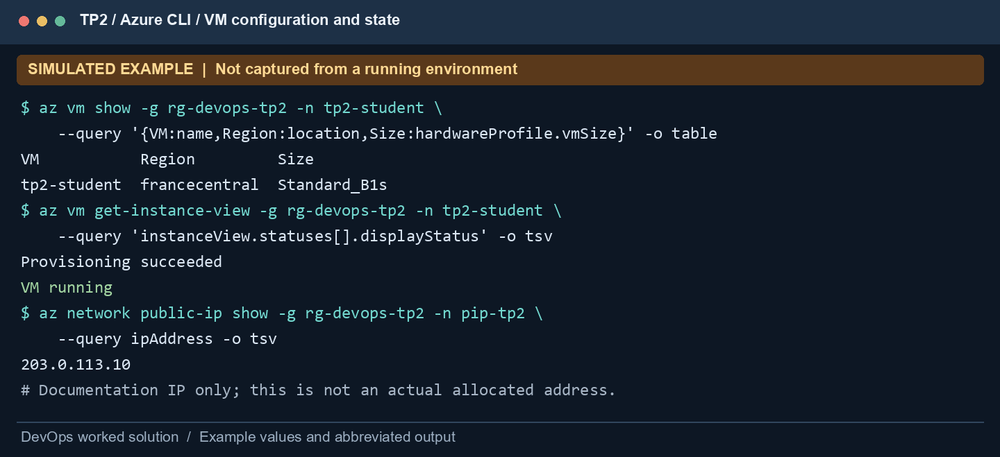
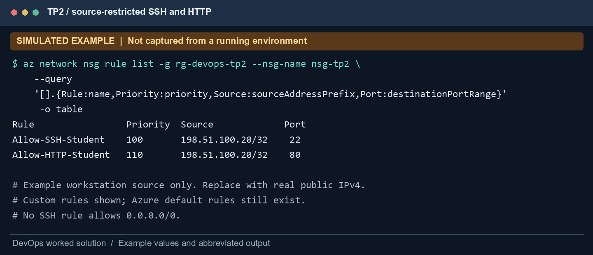
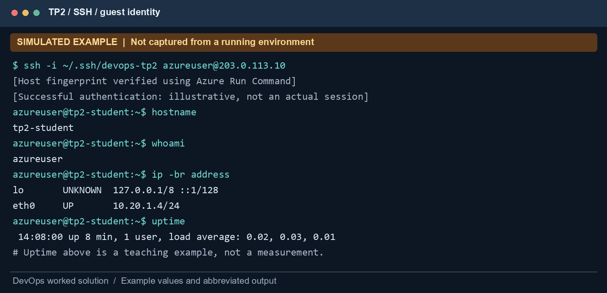
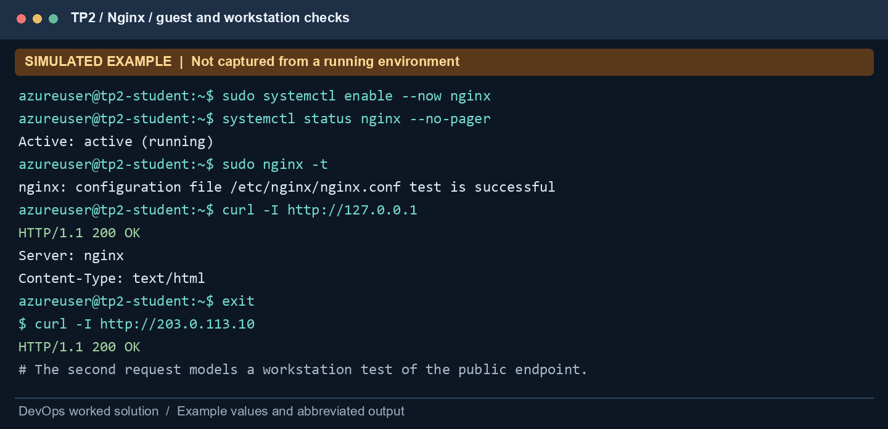
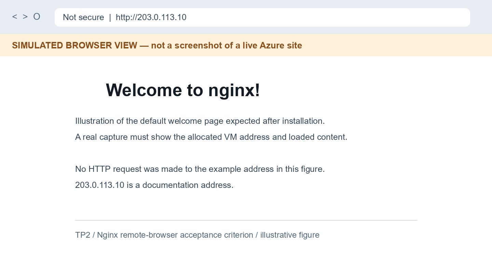
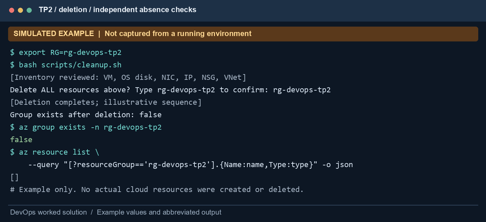

# TP2 — Launch and secure an Azure Linux VM

USTHB · Computer Science · 5th Year Software Engineering · 2026/2027

Module: DevOps and Cloud Computing · Instructor: Ameur Imane

Prepared: 3 November 2026 · Student name: ____________________

## Scope and evidence status

This report solves Parts A–E of `TP2.pdf`, including every question and all four requested evidence items. It uses Microsoft Azure and Azure CLI with Ubuntu Server and Nginx. The first printed question is labeled Q10 in the worksheet; it is treated as Q1 below so the answers cover Q1–Q9 without omitting the provider question.

This is a worked deployment plan, not a record of a completed cloud session. Every terminal/browser illustration is marked SIMULATED EXAMPLE. The addresses 203.0.113.10 and 198.51.100.20 are documentation examples, not usable cloud endpoints. No cloud resources, cost measurements, live browser checks or genuine Azure portal screenshots were produced. The short companion `TP2-short-report.pdf` provides concise answers; this document contains the detailed procedure and reasoning.

## 1. Deployment design

Use one small VM for an HTTP demonstration, with a dedicated lab resource group. Only the student's workstation may initiate SSH and HTTP connections through the public interface. Authentication uses an SSH public key; the private key remains on the student's computer. No load balancer, Bastion, database or public wildcard access is needed for this exercise.

| Setting | Planned value |
| --- | --- |
| Provider | Microsoft Azure |
| Region | France Central (`francecentral`), subject to subscription availability |
| Resource group | `rg-devops-tp2`, dedicated to this exercise |
| VM name / Linux hostname | `tp2-student` |
| Image | `Canonical:ubuntu-24_04-lts:server:latest` |
| Size | `Standard_B1s`: planned small burstable 1-vCPU / 1-GiB VM; verify availability |
| OS disk | 30 GiB, Standard HDD managed disk (`Standard_LRS`) |
| Network | VNet 10.20.0.0/16; subnet 10.20.1.0/24 |
| Private address | 10.20.1.4 |
| Public IP | Standard static IPv4; allocated by Azure during execution |
| Administrator | `azureuser`, explicitly created by the deployment |
| Inbound TCP 22 / 80 | Student's actual public IPv4 /32 only |
| Web service | Nginx default site on TCP 80 |
| Cleanup unit | Entire dedicated, tagged lab resource group |

France Central is a reasonable candidate for a student in Algeria, but no network latency was measured and no claim is made that it is the cheapest or closest available region. Use an instructor-approved alternative if policy, credits, SKU quota or capacity require it. `latest` is convenient for the first run but is not immutable: record the deployed exact image version for reproducibility.

A B1s may be unavailable for a particular subscription or region. Check SKU restrictions and regional/family quota before deployment. Do not silently select a larger, more expensive VM. The worksheet permits an instructor-approved size; it does not guarantee free usage. A free account, student subscription or credit balance is not proof that every component is free.

## 2. Part A — Prerequisites, network rules and VM creation

### 2.1 Host tools, account and private key

The supplied provisioning script targets Bash in WSL/Linux. Azure CLI is the cloud management client; `ssh` runs on the workstation, while `apt` and `systemctl` later run inside Ubuntu. Azure Cloud Shell also provides CLI tools, but its egress IP and private-key location differ from your workstation. Restrict rules to the client that will actually connect.

```bash
az version
ssh -V
az login
az account list --query '[].{Name:name,Default:isDefault,State:state}' -o table
az account set --subscription "YOUR_SUBSCRIPTION_NAME_OR_ID"
az account show --query '{Name:name,State:state}' -o table
```

Do not include access tokens, the login flow's temporary codes, private-key contents or subscription identifiers in public captures. The provisioning script creates a dedicated ED25519 key if one does not exist, prompts for its passphrase, and sets Unix permissions to 600. Store WSL keys in its Linux home directory rather than a shared Windows filesystem where Unix permission handling may differ. Sources: [Azure SSH keys](https://learn.microsoft.com/en-us/azure/virtual-machines/linux/create-ssh-keys-detailed), [SSH connection guidance](https://learn.microsoft.com/en-us/azure/virtual-machines/linux-vm-connect).

Find your current public IPv4 from a trusted network diagnostic service, or ask your network administrator. A possible workstation command is `curl -4 --fail --silent https://api.ipify.org`. The service sees your request IP; use an approved alternative if required. Your local address from `ip a` or `ipconfig` is often private and is not the correct source for a public-endpoint NSG rule. VPN changes can change the observed public address.

### 2.2 Review region, image, capacity and cost

```bash
LOCATION=francecentral
SIZE=Standard_B1s
az account list-locations --query '[].{Name:name,Display:displayName}' -o table
az vm list-skus -l "$LOCATION" --resource-type virtualMachines \
  --size "$SIZE" --all \
  --query '[].{Name:name,Restrictions:restrictions}' -o json
az vm list-usage -l "$LOCATION" -o table
az vm image show --location "$LOCATION" \
  --urn Canonical:ubuntu-24_04-lts:server:latest \
  --query '{urn:urn,name:name,version:version}' -o json
```

Empty SKU restrictions do not guarantee immediate capacity. A SKU listing is also not a complete quota check. Read any policy/capacity error, then select a supported region or approved size deliberately. Save the image reference and eventual exact image version. Review the VM, disk, Standard IPv4, data transfer and any extra services in the pricing calculator before executing the creation command.

### 2.3 Network rules before launch

The script creates the NSG and its restricted rules before creating the VM's NIC. This avoids opening a default SSH rule to the Internet. It uses the supplied NIC when creating the VM, so network configuration is explicit.

| Priority | Rule | Protocol / destination | Source | Access |
| --- | --- | --- | --- | --- |
| 100 | Allow-SSH-Student | TCP / 22 | Your public IPv4 /32 | Allow |
| 110 | Allow-HTTP-Student | TCP / 80 | Your public IPv4 /32 | Allow |
| Default | Azure default inbound rules | Platform defaults | See effective rules | Preserve |

Azure NSGs include default VNet and platform rules; the table's two custom rules describe public-client admission and do not claim to replace all defaults. A lower priority number is evaluated first. Source ports remain `*` because clients normally use ephemeral ports. Replies for permitted connections are statefully tracked. Source: [NSG rule CLI reference](https://learn.microsoft.com/en-us/cli/azure/network/nsg/rule?view=azure-cli-latest).

### 2.4 Run the provisioning script

```bash
# From reports/ in WSL/Linux:
export CLIENT_IP="YOUR_REAL_PUBLIC_IPV4"
export LOCATION=francecentral
export SIZE=Standard_B1s
export ADMIN=azureuser
bash scripts/tp2-azure.sh
```

Read the script first. It refuses to reuse an existing resource group, prints subscription information and SKU restrictions, and asks for `CREATE` before deploying. If it fails partway through, list the partial resources and decide whether to delete the dedicated group before retrying. The fixed names are intentionally easy to inspect; the script is not an idempotent production deployment tool.

The explicit Standard public IP supplies VM1's public endpoint and outbound path; the lab does not depend on implicit default outbound access. New private subnets may require explicit outbound connectivity. Source: [Azure default outbound behavior](https://learn.microsoft.com/en-us/azure/virtual-network/ip-services/default-outbound-access).

Initialize your observation variables in the same host terminal after the script exits:

```bash
RG=rg-devops-tp2
VM=tp2-student
KEY="$HOME/.ssh/devops-tp2"
ADMIN=${ADMIN:-azureuser}
PUBLIC_IP=$(az network public-ip show -g "$RG" -n pip-tp2 \
  --query ipAddress -o tsv)
az vm show -g "$RG" -n "$VM" \
  --query '{VM:name,Region:location,Size:hardwareProfile.vmSize,Image:storageProfile.imageReference}' \
  -o json
az vm get-instance-view -g "$RG" -n "$VM" \
  --query 'instanceView.statuses[].{Code:code,Status:displayStatus}' -o table
az vm get-instance-view -g "$RG" -n "$VM" \
  --query 'instanceView.vmAgent.statuses' -o json
```

Check provisioning success and `PowerState/running`, then inspect agent status, boot diagnostics and the forthcoming SSH test. A successful create call is not proof that SSH or Nginx is healthy. Azure does not use the exact EC2-style status-check presentation from another provider.



### 2.5 Inspect the applied NSG

```bash
az network nsg rule list -g "$RG" --nsg-name nsg-tp2 \
  --query '[].{Rule:name,Priority:priority,Source:sourceAddressPrefix,Port:destinationPortRange,Access:access}' \
  -o table
az network nic list-effective-nsg -g "$RG" -n nic-tp2 -o json
```

For augmented rules Azure may return plural address/port properties; inspect the full JSON if a compact table cell is empty. The effective NSG view helps reveal subnet and NIC rules that may both apply. Restricting the Azure firewall does not replace checking a guest OS firewall.



## 3. Part B — Secure SSH and verify the remote host

Retrieve the expected SSH server fingerprint through Azure's authenticated management channel, then compare it before accepting the first SSH connection:

```bash
az vm run-command invoke -g "$RG" -n "$VM" \
  --command-id RunShellScript \
  --scripts 'ssh-keygen -lf /etc/ssh/ssh_host_ed25519_key.pub' \
  --query 'value[].message' -o tsv
ssh -i "$KEY" -o IdentitiesOnly=yes "$ADMIN@$PUBLIC_IP"
```

The public key is already authorized for the user created during deployment. The example uses `azureuser`, rather than assuming `ubuntu`; Azure accepts the administrator name supplied at creation. Never fix an authentication issue by publishing the private key or opening SSH to `0.0.0.0/0`.

Inside the SSH session, execute:

```bash
hostname
whoami
ip a
ip route
uptime
cat /etc/os-release
```

Expected model identity: hostname `tp2-student`, user `azureuser`, private address `10.20.1.4/24`, and Ubuntu 24.04 LTS in the OS release file. Interface names may differ by image/version. The public IP is not normally configured directly on the guest NIC; Azure translates the public endpoint to the guest's private address.

Combine the verified host key, remote hostname, account, private IP and Azure inventory when establishing identity. `whoami` alone is insufficient: a local machine could use the same account name. `uptime` provides a running-time observation, not proof of cloud location. Source: [Connect to an Azure Linux VM](https://learn.microsoft.com/en-us/azure/virtual-machines/linux-vm-connect).



## 4. Part C — Install Nginx and verify both service and HTTP

Inside the remote Ubuntu VM:

```bash
sudo apt update
sudo apt install -y nginx
sudo systemctl enable --now nginx
sudo systemctl status nginx --no-pager
sudo nginx -t
sudo ss -lntp | grep ':80'
curl -I http://127.0.0.1
curl -fsS http://127.0.0.1 | head -n 12
```

`active (running)` indicates service state; `nginx -t` validates configuration syntax; the socket listing shows TCP 80 is listening; and `curl` checks an actual HTTP response. None alone proves the page is reachable from the student's workstation. Preserve the default welcome page for the worksheet's browser capture. Source: [Azure Ubuntu/Nginx quickstart](https://learn.microsoft.com/en-us/azure/virtual-machines/linux/quick-create-portal?tabs=ubuntu).

### 4.1 Guest firewall without disabling it

Check the actual firewall state:

```bash
sudo ufw status verbose
```

If UFW is active, insert precise inbound allows for your real workstation address. Set the variable inside the guest explicitly; variables in the host terminal are not automatically copied to the remote shell.

```bash
CLIENT_IP="YOUR_REAL_PUBLIC_IPV4"
sudo ufw allow from "$CLIENT_IP" to any port 22 proto tcp
sudo ufw allow from "$CLIENT_IP" to any port 80 proto tcp
sudo ufw status numbered
```

If UFW is inactive, record that fact. The Azure NSG is still the public-client filter. Enabling a new firewall is optional for this lab and should only be done after preserving an allowed SSH path and understanding the existing rules. Never use `ufw disable` or an “allow all” rule as a shortcut to make the test pass.

### 4.2 Workstation and browser tests

Return to the workstation with `exit`, then test from the same public source allowed by the NSG:

```bash
curl --connect-timeout 10 -I "http://$PUBLIC_IP"
curl --connect-timeout 10 -fsS "http://$PUBLIC_IP" | head -n 12
```

On Windows, `Test-NetConnection <PUBLIC_IP> -Port 80` offers a TCP check. Open `http://<PUBLIC_IP>` in the workstation browser. The correct result is the Nginx welcome page at the VM's actual allocated address. Verify the address bar; a localhost page is not evidence of remote access. Use HTTP explicitly for this lab because TLS has not been configured. A browser saying “Not secure” for HTTP does not by itself indicate that the test failed; do not send credentials through this HTTP site.





## 5. Part D — Observe the five cloud characteristics

The observations below describe what to record in a real deployment. They are scenario-based model answers, not claimed observations from this workspace.

| Characteristic | Lab action / observation to collect | Interpretation and limit |
| --- | --- | --- |
| On-demand self-service | Save the `az vm create` request and resulting resource state | User provisions compute through the provider API without manually obtaining a physical server |
| Broad network access | Save SSH hostname/whoami and the browser's remote HTTP page | Standard network clients reach the service over the network, subject to the NSG restrictions |
| Resource pooling | Record virtual CPU, managed disk and NIC abstractions in the VM configuration | Physical hosts/storage fabrics are provider-managed; this is an inference from the service model, not a measurement of other tenants |
| Rapid elasticity | List supported resize options and check quota/capacity | Resizing is possible under constraints; this single-VM exercise does not prove automatic scaling or that a resize occurred |
| Measured service | Record usage/cost view, meter units and the resources retained | Usage is metered; a pricing estimate is not an actual invoice |

Potential resize inspection, without actually resizing:

```bash
az vm list-vm-resize-options -g "$RG" -n "$VM" -o table
az vm list-usage -l francecentral -o table
```

Before resizing, check quota, target SKU availability, disk/NIC compatibility and expected downtime. A deallocation may be required and can affect temporary storage. Resizing changes capacity; autoscaling would require additional configuration such as a scale set. No resize is necessary to finish this lab.

## 6. Cost estimate, usage and billing

No Azure billing account was inspected for this report. Therefore actual cost, remaining credits and free-tier eligibility are unverified. In a real run, open Azure Portal → Cost Management + Billing → Cost analysis, select the subscription or permitted scope, filter by the dedicated resource group, and choose the lab dates. Record your permissions if the page is inaccessible. Usage reporting can lag; an immediate blank graph does not prove zero cost.

For an estimate, use [Azure Pricing Calculator](https://azure.microsoft.com/en-us/pricing/calculator/) and configure the selected region, Linux pay-as-you-go VM, expected running time, disk tier/capacity, Standard IPv4 duration and any chargeable transfer. Include snapshots if the procedure creates any; TP2 itself does not require one. The [Retail Prices API](https://learn.microsoft.com/en-us/rest/api/cost-management/retail-prices/azure-retail-prices) can supply public meter rates, but these may differ from a subscription's negotiated price and do not prove credit eligibility.

| Meter | Quantity to record | Estimate expression |
| --- | --- | --- |
| VM compute | Running/allocated hours | h_vm × r_vm_per_hour |
| Managed disk | Provisioned tier and retained duration | applicable tier price × time fraction under its billing model |
| Standard public IPv4 | Allocated hours | h_ip × r_ip_per_hour |
| Transfer | Chargeable outbound data | GB_egress × r_egress, allowing for applicable tiers |
| Extras | Actual extra resources, if any | Sum of their applicable charges |

Illustrative arithmetic ONLY, not Azure rates: if assumed compute is $0.020/hour, disk is $0.010/hour and public IPv4 is $0.006/hour, retaining all three for two hours would be `2 × (0.020 + 0.010 + 0.006) = $0.072`, before transfer/tax/other fees. Real disk tiers may use different billing units; substitute their actual model rather than treating this toy hourly disk rate as a quote. No actual expenditure is asserted.

Capture creation and deletion times in UTC for the real run. A guest shutdown can leave a VM allocated and compute-billable; deallocation stops compute billing for that allocation but retained disks/IPs can still cost money. Deleting only the VM can also leave independent resources. Source: [Azure VM states and billing](https://learn.microsoft.com/en-us/azure/virtual-machines/states-billing).

## 7. Part E — Inventory, delete and confirm cleanup

Save actual evidence outside the VM first. Ensure that the selected subscription is correct and that no unrelated resources have been placed in the dedicated lab group. Inventory both the VM and the group's independent objects:

```bash
RG=rg-devops-tp2
az account show --query '{Name:name,State:state}' -o table
az resource list -g "$RG" \
  --query '[].{Name:name,Type:type,Region:location}' -o table
az disk list -g "$RG" --query '[].{Name:name,State:diskState}' -o table
az snapshot list -g "$RG" --query '[].name' -o table
az network public-ip list -g "$RG" --query '[].{Name:name,IP:ipAddress}' -o table
az network lb list -g "$RG" --query '[].name' -o table
```

The normal TP2 inventory is one VM, one OS disk, one NIC, one public IP, one NSG and one VNet. This setup intentionally creates no snapshot or load balancer. Verify the actual inventory; failed creation attempts or changed defaults can produce a different set.

Delete the entire dedicated group using the guarded cleanup script:

```bash
export RG=rg-devops-tp2
bash scripts/cleanup.sh
# Independent final verification:
az group exists -n "$RG"
az resource list --query "[?resourceGroup=='rg-devops-tp2'].{Name:name,Type:type}" -o json
```

Expected model output: group exists → `false`; filtered resource inventory → `[]`. An authorization/network error is not the same as “not found”. Wait for deletion completion; do not claim success merely because a delete request was accepted. Recheck the portal's Resource groups and Virtual machines views. If no billable resources were created outside the group, group deletion should remove this lab's retained disks/IPs as well. Inspect Cost Management later for delayed charges already incurred.



## 8. Answers to all worksheet questions

### Q1 (printed Q10) — Provider, region, image, size and public IP

The chosen solution uses Microsoft Azure, France Central, Ubuntu Server 24.04 LTS from `Canonical:ubuntu-24_04-lts:server:latest`, and the planned `Standard_B1s` size. The private address is 10.20.1.4. The public address must be read from `az network public-ip show` after creation; 203.0.113.10 in the figures is a documentation placeholder. No real public IP, deployment or exact image version has been observed. Record the actual image version and resource properties from the CLI/portal during execution.

### Q2 — Two differences from the VMware VM

First, VMware's guest runs on a physical computer administered by the student, whereas Azure allocates virtual compute on provider-managed hardware; cloud CPU/RAM capacity is subject to subscription quota and regional availability. Second, VMware uses locally configured NAT/bridged/host-only networks, whereas Azure uses a VNet, NIC, public IP and NSG. The Azure guest receives a private IP even when accessible through a public endpoint. Cloud usage also introduces metered charges and independent resource lifetimes.

### Q3 — IaaS and responsibilities

Infrastructure as a Service exposes configurable virtual compute, networking and storage. Azure manages the datacenter, physical servers, physical network/storage and virtualization platform. The student remains responsible for the guest OS and package updates, application configuration, SSH keys, accounts, NSG/guest-firewall rules, data and resource lifecycle. Managed infrastructure does not make an insecure Nginx/SSH configuration safe automatically. Backups and application recovery still require planning.

### Q4 — Why restrict SSH to one source address?

TCP 22 is for remote administration, so it should be reachable only from the approved management source. A /32 rule limits exposure to a single public IPv4. Allowing every source increases scanning, password-guessing traffic and opportunities to exploit a misconfiguration or vulnerable SSH service. Key authentication, host-key verification and patching remain necessary even with a narrow NSG. Update the /32 when the workstation's public IP changes; do not solve that by opening all sources.

### Q5 — Evidence that SSH reached the cloud VM

Compare the server key fingerprint retrieved via Azure Run Command with the SSH prompt, then collect `hostname`, `whoami`, `ip a` and `uptime` inside the session. The expected model identity is tp2-student / azureuser / 10.20.1.4. Correlate this with the Azure VM/NIC inventory. A copied terminal prompt or username alone is insufficient. The accompanying terminal example is simulated; replace it with the real session output.

### Q6 — Verify Nginx and browser access

Inside Ubuntu, check active Nginx service state, configuration syntax, TCP 80 listening and a local HTTP 200 response. Then, from the allowed workstation, check the VM's public URL and load the welcome page in the browser. This separates service health from external network reachability. Both NSG and any active guest firewall must permit the source. No live external HTTP test has been performed for this solution.

### Q7 — Two cloud characteristics and observations

On-demand self-service would be observed by issuing the Azure CLI create request and receiving a provisioned VM without manual server installation. Broad network access would be observed by connecting through SSH and loading the HTTP site from a standard workstation client. The evidence to collect is the actual provisioned resource/status output and the remote session/browser capture. Section 5 additionally explains resource pooling, elasticity and metering, and distinguishes inferences from measured actions.

### Q8 — Cost estimate or usage page

No subscription billing page was accessed, so actual usage/charges and credits cannot be verified. The procedure is to inspect the configured resource group in Cost analysis and prepare a calculator estimate covering VM compute, disk, public IPv4 and transfer. Record the scope/date interval and any permission limitation. The arithmetic in section 6 uses explicitly invented teaching rates; it is not an Azure quote or bill.

### Q9 — Deleted resources and why stopping is insufficient

The planned cleanup deletes the dedicated group containing the VM, OS disk, NIC, NSG, public IPv4 and VNet. Check separately for snapshots, extra disks or load balancers if any were added. No deletion has actually occurred for this document. A guest shutdown may leave compute allocated; deallocation releases compute but can retain chargeable disks/IPs. Group deletion followed by an absence check provides a stronger cleanup result for a dedicated lab environment.

## 9. Required evidence and what the supplied figures demonstrate

| Worksheet evidence | Supplied worked example | Required real replacement |
| --- | --- | --- |
| 1: console, VM running, region and size | Simulated CLI inventory/status, figure 1 | Azure portal VM Overview screenshot with actual running state, size and region |
| 2: SSH hostname and whoami | Simulated terminal, figure 3 | Actual verified SSH session showing commands and outputs |
| 3: Nginx welcome page | Browser illustration, figure 5 | Real browser screenshot with the actual remote address and loaded page |
| 4: console, resources deleted | Simulated CLI absence checks, figure 6 | Actual Azure portal showing deleted group/no remaining lab VMs, plus inventory verification |

CLI outputs are useful additional verification, but they do not replace portal screenshots if the instructor explicitly requires the console. Do not relabel an illustration as a captured live portal. Hide account identifiers, keys, secrets and irrelevant personal information. For a public submission, mask the actual public IP if required by the instructor, while retaining a private original for verification.

## 10. Troubleshooting by layer

| Failure | Likely checks | Safe correction |
| --- | --- | --- |
| `az login` or create denied | Subscription selection, RBAC, policy | Use the authorized subscription; resolve the specific permission/policy issue |
| Size unavailable | SKU restrictions, regional/family quota, capacity | Choose an approved supported size/region; review changed cost |
| SSH timeout | Power state, public IP, current source /32, effective NSGs | Correct the source rule and endpoint; preserve least privilege |
| SSH permission denied | Explicit admin username, correct key, authorized public key | Use the matching user/key; never publish the private key |
| SSH host-key warning | Recreated/recovered VM or wrong endpoint | Retrieve trusted fingerprint and investigate before updating known_hosts |
| `apt update` fails | DNS, routes, explicit outbound path, repository access | Diagnose outbound/DNS; do not open inbound ports broadly |
| Local HTTP fails | Nginx service, `nginx -t`, listening socket | Fix application/configuration first |
| Local HTTP works, remote fails | Port 80 NSG source, guest firewall, browser VPN | Permit only the correct workstation /32 and verify remote endpoint |
| Empty cost graph | Scope, date, billing permissions, reporting delay | Record limitation; recheck later rather than claiming zero cost |
| Delete accepted but resources visible | Asynchronous deletion, locks, policy | Wait and inspect failure details; verify actual absence |

## 11. Outcome and validation boundary

This solution includes a complete Azure CLI procedure, security reasoning, service checks, all nine answers, a cost-estimation method and a cleanup plan. The companion script creates the planned resources only when a user deliberately executes it. The supplied reports and simulated captures were generated locally, and the PDF content was checked for completeness and rendering. Real resource provisioning, SSH/HTTP reachability, costs and deletion remain unexecuted and must be established with genuine evidence during the lab.
