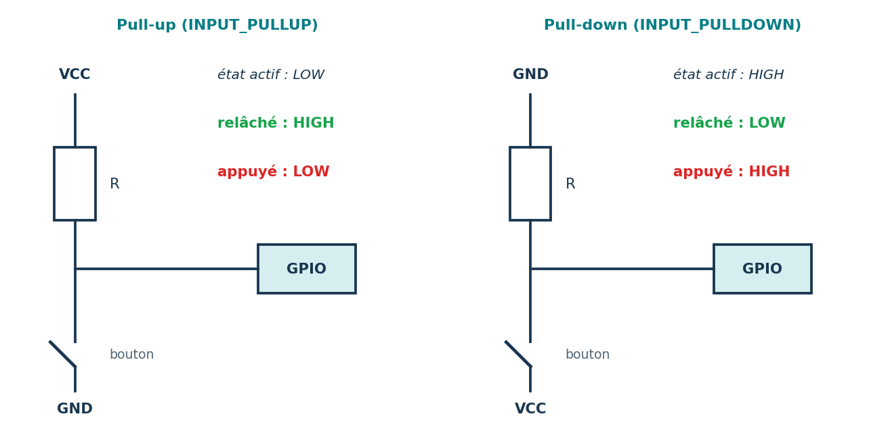
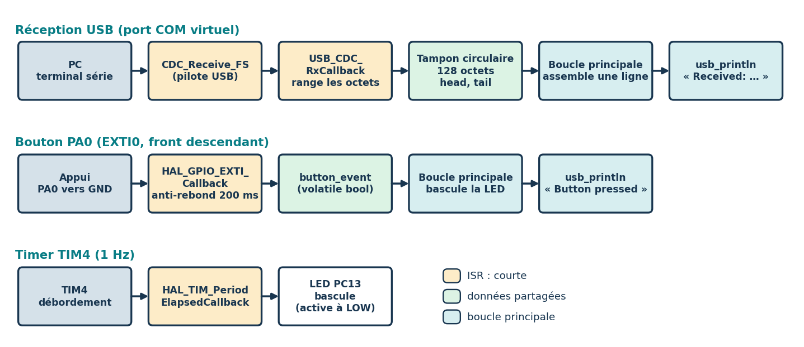

# Logiciels embarqués — Résumé des TD et TP

Mise à jour du 24 novembre 2026. Méthodes de résolution, étapes pratiques et pièges des travaux dirigés et pratiques. Le [résumé des cours](resumer.md) conserve les chapitres théoriques. Les ajouts pédagogiques sont distingués des observations présentes dans les supports.

## TP1 — STM32, LED, ST-LINK et breadboard

### Chaîne d'outils et téléversement

Le TP présente l'IDE Arduino avec le support des cartes STM32, STM32CubeProgrammer et une sonde ST-LINK V2. La carte et le mode de téléversement doivent correspondre au matériel employé. La liaison SWD repose notamment sur SWDIO, SWCLK, une masse commune et les connexions d'alimentation/référence prévues par le montage.

Il faut distinguer programmation du microcontrôleur, alimentation de la carte et liaison série. Le moniteur série doit utiliser le débit configuré par le programme, ici **115200** ; un câble USB ne garantit pas à lui seul que la sortie série choisie est correctement configurée.

### LED active à LOW

Dans la carte décrite par le TP, la LED intégrée sur **PC13** s'allume avec LOW et s'éteint avec HIGH. Il s'agit d'une propriété de ce câblage, pas d'une règle universelle des STM32.

| Montage | Chemin du courant quand la LED est allumée | Niveau actif |
| --- | --- | --- |
| Sinking | Alimentation → résistance → LED → GPIO | LOW |
| Sourcing | GPIO → LED → résistance → GND | HIGH |

Dans les deux cas, la résistance série limite le courant. Le niveau logique nécessaire dépend du montage ; il faut respecter les caractéristiques électriques de la broche et de la LED.

### Programme et période de clignotement

`setup()` initialise la broche en OUTPUT et la communication série ; `loop()` répète les actions. LOW pendant 500 ms puis HIGH pendant 500 ms donnent une période totale de **1 s**, soit **1 Hz** pour le cycle complet. Le TP utilise une attente bloquante ; le cours 3 montre comment l'éviter lorsqu'il faut aussi effectuer d'autres tâches.

Une attente `while (!Serial)` peut empêcher d'atteindre `loop()` si la liaison attendue n'est pas disponible. Si la LED ne démarre pas, vérifier cette attente, la sélection de carte, la broche et le téléversement avant de conclure à un défaut de LED.

### Breadboard

Les groupes de contacts internes assurent les connexions sans soudure. Le séparateur central isole les deux côtés ; les rails d'alimentation sont distincts des groupes de signaux et peuvent être coupés au milieu selon le modèle. Vérifier les continuités réelles plutôt que supposer que toute une ligne est reliée.

## TP2 — Bouton, pull-up/pull-down et anti-rebond

### Résistance de tirage




| Montage | Câblage | État actif |
| --- | --- | --- |
| Pull-up (`INPUT_PULLUP`) | Résistance vers VCC, bouton vers GND | LOW |
| Pull-down (`INPUT_PULLDOWN`) | Résistance vers GND, bouton vers VCC | HIGH |

Les broches du STM32F411 disposent de résistances internes dans les deux sens. Le bouton intégré de la carte est relié à GND : il fonctionne en pull-up mais pas en pull-down.

### Détection de front et anti-rebond

Le programme bascule la LED PC13 sur un **front** : passage HIGH → LOW en pull-up (LOW → HIGH en pull-down), en comparant l'état courant à `lastButtonState`. Un `delay(200)` absorbe le rebond mécanique du contact.

```cpp
bool current = digitalRead(BUTTON_PIN);
if (lastButtonState == HIGH && current == LOW) {
  ledState = !ledState;
  digitalWrite(LED_PIN, ledState);   // LOW = LED allumée
}
lastButtonState = current;
delay(200);
```

Sans bouton externe, un fil relié à A0 simule l'appui : vers GND en pull-up, vers 3,3 V en pull-down. Les exemples de code fournis par l'enseignant sont rangés dans `TP/code/` (LED, bouton, saisie série, lecture analogique, PWM pour ESC).

## TP3 — Interruptions et communication UART

Carte **Black Pill STM32F411CEUx** (cœur Cortex-M4). Objectifs du TP : interruption GPIO, détection d'événement bouton, interruption de timer, émission UART, réception UART, réception par interruption, petite application pilotée par événements.

| Fonction | Broche | Remarque |
| --- | --- | --- |
| LED utilisateur | PC13 | active à LOW : 0 allume, 1 éteint |
| Bouton (KEY) | PA0 | relie PA0 à GND : **pull-up interne**, **front descendant** |
| UART TX | PA9 (USART1_TX) | vers RX d'un adaptateur USB-UART |
| UART RX | PA10 (USART1_RX) | depuis TX de l'adaptateur |
| Masse | GND | commune entre carte et adaptateur |

### Du UART externe au port COM virtuel USB

Le support de la tâche 2 **barre USART1** et active `USB_OTG_FS` en mode **Device_Only** : la carte se comporte comme un port série virtuel (classe **CDC**, *Communication Device Class*) et il n'y a plus d'adaptateur USB-UART ni de câblage PA9/PA10. PA11 et PA12 portent alors D− et D+ (`USB_OTG_FS_DM`, `USB_OTG_FS_DP`).



Étapes de configuration dans STM32CubeIDE : activer `USB_OTG_FS` en Device_Only ; dans les *Middleware*, activer `USB_DEVICE` avec la classe *Communication Device Class (Virtual Port Com)* ; les tampons CDC font 2048 octets en réception et en émission ; régénérer le code. Dans `usbd_cdc_if.c`, la fonction `CDC_Receive_FS` appelle le **crochet** `USB_CDC_RxCallback(Buf, *Len)` à l'intérieur de la zone `USER CODE`, après avoir déclaré ce crochet en `extern` dans `usbd_cdc_if.h`.

### Architecture événementielle du programme

| Élément | Rôle |
| --- | --- |
| `button_event` (`volatile bool`) | drapeau posé par l'ISR du bouton, consommé par la boucle principale |
| `HAL_GPIO_EXTI_Callback` | ISR courte : anti-rebond de 200 ms avec `HAL_GetTick()`, puis `button_event = true` |
| `HAL_TIM_PeriodElapsedCallback` | ISR du timer TIM4 : inverse la LED |
| `USB_CDC_RxCallback` | appelée à la réception : range les octets dans un **tampon circulaire** |
| Boucle `while(1)` | traite le drapeau bouton (LED + message) et lit le tampon pour reconstituer des lignes |

La règle appliquée est celle du cours : **ISR courte, traitement dans la boucle principale**. Les variables partagées entre ISR et boucle sont `volatile`.

```c
// tampon circulaire : producteur = USB_CDC_RxCallback, consommateur = main
#define RX_BUF_SIZE 128
static volatile uint8_t  usb_rx_buf[RX_BUF_SIZE];
static volatile uint16_t usb_rx_head = 0, usb_rx_tail = 0;

uint16_t next = (usb_rx_head + 1) % RX_BUF_SIZE;
if (next != usb_rx_tail) {            // une case reste vide pour détecter « plein »
    usb_rx_buf[usb_rx_head] = data[i];
    usb_rx_head = next;
}
```

`head` est l'indice d'écriture, `tail` l'indice de lecture ; le tampon est vide si `head == tail`. Comme une case reste libre, il contient **127 octets** au maximum. Lorsqu'il est plein, les octets arrivants sont **perdus**.

### Lecture d'une ligne et émission

La boucle vide le tampon octet par octet : à la réception de `'\n'`, si au moins un caractère est présent, elle ferme la chaîne par `'\0'` et répond `Received: <texte>`. Les autres caractères s'ajoutent à un tampon local de 64 octets (63 utiles, le reste est ignoré). Le terminal série doit donc envoyer un **retour à la ligne** pour déclencher la réponse.

`usb_print` appelle `CDC_Transmit_FS` ; si l'USB est occupé (`USBD_BUSY`), il réessaie jusqu'à **100 ms** (`HAL_GetTick()`) pour ne jamais attendre indéfiniment ; `usb_println` ajoute `"\r\n"`. La tâche 1 (version provisoire) émettait `usb_println("Hello Embedded Systems!")` toutes les secondes avec `HAL_Delay(1000)` : cette attente **bloquante** est ensuite supprimée, car elle retarde le traitement des événements.

### Configuration de l'horloge et des timers

L'oscillateur externe HSE fournit 25 MHz.

```text
VCO     = 25 MHz / PLLM(25) × PLLN(192) = 192 MHz
SYSCLK  = VCO / PLLP(2) = 96 MHz
USB     = VCO / PLLQ(4) = 48 MHz        (l'USB exige exactement 48 MHz)
APB1    = HCLK / 2 = 48 MHz  ->  horloge des timers = 2 × 48 = 96 MHz
```

| Timer | PSC | ARR | Calcul | Résultat |
| --- | --- | --- | --- | --- |
| TIM4 (interruption périodique) | 9599 | 9999 | 96 MHz / 9600 = 10 kHz, puis / 10000 | **1 Hz** : un événement par seconde |
| TIM3 (PWM, canal 3, mode PWM1) | 95 | 999 | 96 MHz / 96 = 1 MHz, puis / 1000 | **1 kHz**, rapport cyclique initial 0 |

Vérification à faire : le commentaire du code annonce « toutes les 500 ms » pour TIM4, mais ces valeurs donnent **1 s** entre deux événements, soit une LED qui change d'état chaque seconde (période de clignotement de 2 s). Pour 500 ms, il faut `ARR = 4999`. Il faut aussi se souvenir que le bouton et le timer inversent la **même** LED.

### Erreurs et pièges

- Oublier `volatile` sur un drapeau partagé : le compilateur peut le garder dans un registre et la boucle ne voit jamais le changement.
- Faire de longs traitements ou des `HAL_Delay` dans une ISR : `HAL_GetTick()` dépend de SysTick, dont la priorité doit rester compatible.
- Confondre `USART1` (UART matériel sur PA9/PA10, adaptateur externe) et **USB CDC** (port série virtuel sur PA11/PA12).
- Ne pas envoyer `'\n'` depuis le terminal : aucune ligne n'est jamais complétée.
- Débordement du tampon local ou circulaire : les données sont ignorées ou perdues silencieusement.

## Révision active — Pratique

1. **Deux attentes de 500 ms donnent quelle fréquence de clignotement ?** Un cycle de 1 s, donc 1 Hz.
2. **Pourquoi l'ISR du bouton ne fait-elle que poser un drapeau ?** Une ISR doit être courte ; la LED et l'émission se traitent dans la boucle principale.
3. **À quoi sert `volatile` sur `button_event` ?** À obliger le compilateur à relire la variable en mémoire, car l'ISR la modifie hors du flux normal.
4. **Comment reconnaît-on un tampon circulaire vide, puis plein ?** Vide : `head == tail` ; plein : `(head + 1) % taille == tail`, avec une case sacrifiée.
5. **Pourquoi PLLQ = 4 dans la configuration d'horloge ?** Pour obtenir exactement 48 MHz pour l'USB à partir du VCO à 192 MHz.
6. **Quelle fréquence pour PSC = 9599 et ARR = 9999 avec une horloge de timer de 96 MHz ?** 96 MHz / 9600 / 10000 = 1 Hz.
