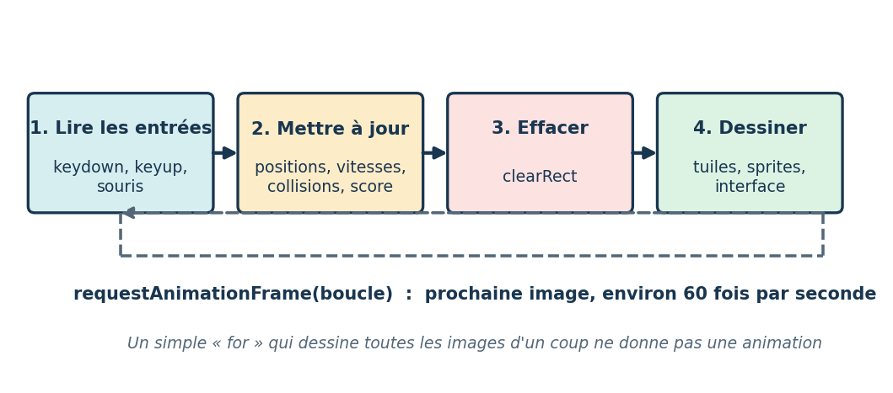
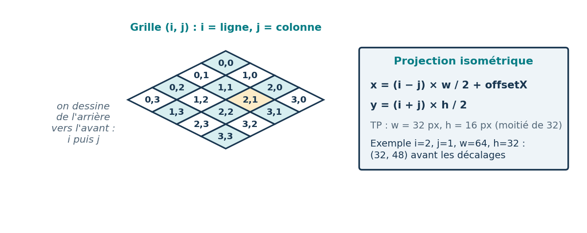
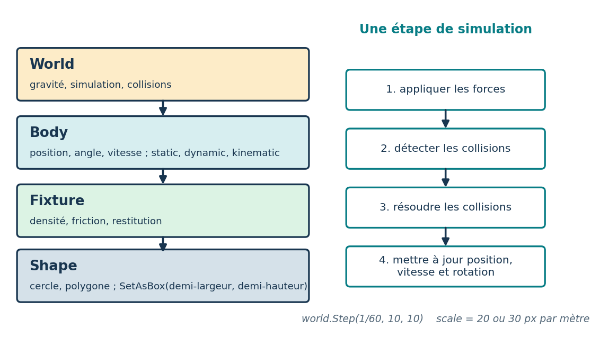
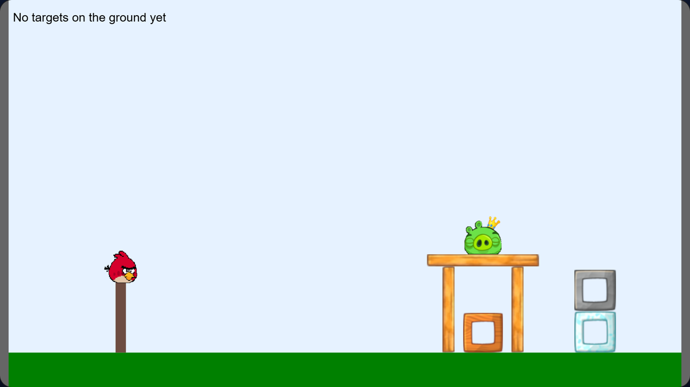

# Conception de jeux vidéo — Résumé des TD et TP

Mise à jour du 24 novembre 2026. Méthodes de résolution, étapes pratiques et pièges des travaux dirigés et pratiques. Le [résumé des cours](resumer.md) conserve les chapitres théoriques. Les ajouts pédagogiques sont distingués des observations présentes dans les supports.

## Pratique — Canvas, animation et travaux demandés

### Fonctions à comprendre

| API / opération | Utilité |
| --- | --- |
| canvas.getContext('2d') | Obtenir le contexte de dessin |
| fillRect / strokeRect | Rectangle rempli / contour |
| beginPath, arc, fill | Construire et remplir une forme circulaire |
| clearRect | Effacer une zone |
| drawImage | Dessiner une image ou un fragment |
| save / restore | Sauvegarder puis restaurer les paramètres graphiques |
| translate / rotate / scale | Transformer le repère de dessin |
| keydown / keyup | Suivre les actions clavier |
| requestAnimationFrame | Planifier un dessin avant un prochain rafraîchissement |

`save/restore` conserve l'état graphique, pas une copie des pixels du canvas. Le support mentionne `ctx.clear()` : pour effacer le canvas 2D dans ce contexte, retenir `clearRect(0,0,canvas.width,canvas.height)`.

### Boucle technique




```text
Lire les entrées → mettre à jour l'état → effacer → dessiner → recommencer
```

Une boucle for qui dessine toutes les frames immédiatement ne crée pas une animation visible dans le temps : elles se superposent, ou seule la dernière reste après effacement. La planification des rendus et le calcul du temps écoulé sont nécessaires.

**PW1** : créer plusieurs frames dans Piskel, exporter une sprite sheet, afficher la feuille puis une frame, et animer avec une boucle de rendu. **PW2** : produire des tiles, construire une carte avec Tiled, exporter en CSV, afficher une portion, ajouter le scrolling puis le déplacement clavier du personnage. **PW3** : construire une carte **isométrique** dans Tiled (orientation isométrique, hauteur de tile sur la carte égale à la moitié de sa hauteur réelle), l'afficher avec le tileset ou les tiles séparées à partir de `isometric_map.html` (carte en matrice 2D), réduire le canvas, ajouter le scrolling et animer le personnage isométrique de `Character0_Run.png` dans plusieurs directions (fichiers dans `TP/TP3/`).

Les conventions d'identifiants exportés et d'indexation doivent être vérifiées avant de relier CSV et tileset. Un identifiant de tile n'est pas directement une coordonnée en pixels.

## PW3 — Carte isométrique et personnage animé

Le TP demande une carte **isométrique** (Tiled en orientation isométrique, hauteur de tile sur la carte égale à la **moitié** de la hauteur réelle), son affichage à partir de `isometric_map.html` (la carte est une matrice 2D), un canvas réduit avec défilement, puis un personnage animé dans plusieurs directions (`Character0_Run.png`).



```text
x = (i - j) × tileW / 2 + offsetX          offsetX = (colonnes - 1) × tileW / 2
y = (i + j) × tileH / 2                    tileW = 32, tileH = 16 (moitié de 32)
```

- **Identifiants Tiled** : l'identifiant exporté vaut l'indice dans le tileset **plus 1** (0 = vide). Le morceau à découper est `sx = ((id-1) % colonnes) × 32` et `sy = floor((id-1) / colonnes) × 32` (11 colonnes pour un tileset de 352 px).
- **Ordre de dessin** : boucle sur `i` (ligne) puis `j` (colonne), de l'arrière vers l'avant. Le personnage se dessine **juste après sa propre tuile**, pour que les tuiles plus proches le recouvrent.
- **`fetch` bloqué sur `file://`** : le navigateur refuse de charger le CSV ; il faut intégrer la matrice dans le JavaScript ou lancer un serveur local.
- **Feuille du personnage** : 4 lignes de directions et 4 colonnes d'images ; ligne 0 bas-gauche, ligne 1 haut-gauche, ligne 2 bas-droite, ligne 3 haut-droite (à vérifier sur la feuille donnée). Les flèches changent `i` ou `j` : bas augmente `i`, haut le diminue, gauche augmente `j`, droite le diminue.
- **Défilement** : caméra bornée à la taille de la carte, `(cols + lignes) × tileW / 2` en largeur et `(cols + lignes) × tileH / 2 + (hauteur réelle − tileH)` en hauteur ; on soustrait la caméra de chaque position.

## PW4 — Box2DWeb : détection de collisions

Reprendre les démos du cours (`static_main`, `dynamic_main`, feuille de détection de collisions) : un sol **statique**, un corps **dynamique** circulaire, puis un `b2ContactListener`.



```js
var world = new b2World(new b2Vec2(0, 10), true);            // gravité vers le bas
groundDef.type = b2Body.b2_staticBody;
groundDef.position.Set(400 / scale, 280 / scale);             // CENTRE, en mètres
shape.SetAsBox(200 / scale, 20 / scale);                      // DEMI-largeur, DEMI-hauteur
listener.BeginContact = function (c) { contacts++; };
listener.EndContact   = function (c) { contacts--; };
world.SetContactListener(listener);
world.Step(1 / 60, 10, 10);                                   // à chaque image
```

- Le message de collision s'affiche tant que le **compteur** de contacts est supérieur à 0 ; un simple booléen mis à `false` par `EndContact` se trompe quand deux contacts se chevauchent.
- Compter **tous** les contacts (cercle, rectangle ou plateforme), pas seulement ceux du cercle principal.
- Les formes Box2D ne se « dessinent » pas : on dessine au même endroit des formes canvas avec `GetPosition()` (mètres × `scale`) et `GetAngle()`.
- Ne jamais créer ni détruire de corps **dans** un callback de contact : poser un indicateur, détruire après `Step`.
- Clic pour ajouter des formes : position souris moins `getBoundingClientRect()`, puis création d'un corps dynamique (cercle ou boîte).

## Examen pratique — Angry Birds avec Box2DWeb

Sujet : un jeu de type Angry Birds avec JavaScript, HTML5 Canvas, boucle de jeu et Box2DWeb, avec des **sprites** fournis sur les corps dynamiques ; durée 1 h 30 ; livrable : archive des sources et des ressources, avec des commentaires indiquant où l'IA a été utilisée et les prompts employés.



| Exigence | Réponse technique |
| --- | --- |
| 1. Monde physique | `b2World` avec gravité (0, 10) et un **sol statique** |
| 2. Joueur et cible | corps **dynamiques** ; oiseau et cochon **ronds**, donc `b2CircleShape` |
| 3. Obstacles (au moins 5) | boîtes dynamiques (`b2PolygonShape.SetAsBox`) : poteaux, planche, caisses |
| 4. Sprites | `drawImage` centré sur `GetPosition()`, après `translate` et `rotate(GetAngle())` |
| 5. Lancement | glisser-déposer : vitesse opposée au tirage, proportionnelle à sa longueur (`SetLinearVelocity`) |
| 6. Collision cible-sol | `BeginContact` compare les `UserData` des deux corps ; message « Bravo ! » |
| 7. Murs | corps statiques sur les côtés (et assez hauts) |

Points d'attention : le sprite suit la **position et la rotation** du corps ; une barre verticale se dessine avec une rotation supplémentaire de 90° ; on attend le chargement des images avant de démarrer la boucle ; l'oiseau qui attend sur le lance-pierre doit rester immobile jusqu'au lancement ; un oiseau rapide peut traverser une barre fine (**tunneling**), d'où `SetBullet(true)`. Pour détruire un obstacle, mesurer l'impulsion dans `PostSolve` et détruire le corps après `Step`. Le corrigé complet et ses versions améliorées sont dans `TP/test/solution/` ; le kit de révision est dans `TP/REVISION/`.

## Projet — Périmètre, révision active et sources

### Ce que demande le document de projet

Le projet prévoit une équipe de **2 à 4 étudiants**, un concept original, un GDD décrivant le jeu complet et **un seul niveau complet et jouable** à implémenter. Les formats proposés sont 2D, 2.5D ou 3D.

Le document demande GDD, code, rapport technique et démonstration ; sa présentation initiale mentionne aussi un poster. Le rapport explique outils, fonctionnalités, concepts techniques, difficultés et répartition du travail. Les ressources externes doivent être citées ; les prompts doivent être inclus si du code généré par IA est employé.

Dates inscrites dans le sujet : groupes le 08/11/2026, GDD le 22/11/2026, produit final en janvier sans date précise. Ce sont les indications du fichier local, à faire confirmer en cas de mise à jour de l'enseignante.

### Questions avec réponses courtes

1. **Gameplay loop ou game loop ?** Motivation et progression pour la première ; mise à jour et rendu pour la seconde.
2. **Combien de frames dans une ligne de 320 px avec des frames de 32 px ?** 10.
3. **Pourquoi séparer grille visuelle et logique ?** Changer une texture ne doit pas modifier involontairement les règles du monde.
4. **Pourquoi soustraire la caméra ?** Pour convertir une position du monde dans le repère de l'écran.
5. **Un GDD suffit-il à livrer le projet ?** Non : un niveau jouable, le code et les autres livrables demandés restent nécessaires.
6. **Que mesure le playtesting ?** La qualité de l'expérience et sa compréhension, en complément de la recherche de bugs.
