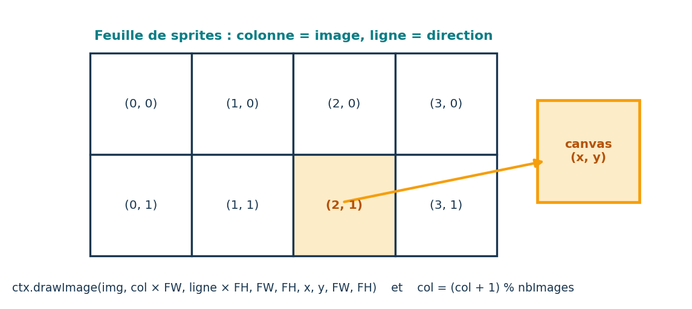
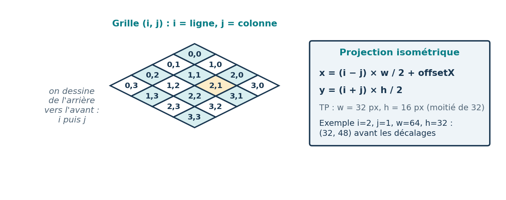
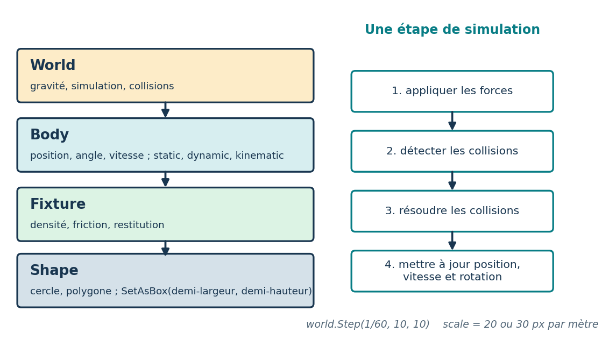

# Conception de jeux vidéo — Résumé des cours

Mise à jour du 24 novembre 2026. Définitions, raisonnements et exemples des cours. Les exercices, commandes et comptes rendus pratiques sont réunis dans [le résumé TD/TP](resumer-tp.md).

## Chapitre 1 — Game design et expérience du joueur

### Concevoir et développer

Le **game design** définit les règles, actions, objectifs, difficultés et expériences d'un jeu. Le **game development** réalise le jeu avec programmation, ressources visuelles et audio, moteur, intégration et tests.

| Décision de conception | Réalisation correspondante |
| --- | --- |
| Le joueur peut sauter | Implémenter entrée, mouvement et interaction avec le sol |
| Un objet récompense l'exploration | Créer collecte, score et retour visuel |
| La difficulté augmente | Construire niveaux, ennemis et progression |
| Une action doit être compréhensible | Concevoir commandes, animation et feedback |

Le designer travaille sur gameplay, mécaniques, règles, niveaux, personnages, histoire, difficulté et expérience utilisateur. Les graphismes seuls ne déterminent pas la qualité du jeu.

### Gameplay et boucle de jeu

Le **gameplay** décrit les interactions possibles et la manière dont le monde répond aux choix du joueur. Les **3C** sont Camera, Controls et Character : la caméra, les commandes et les capacités du personnage doivent fonctionner ensemble.

La **gameplay loop** est une boucle de motivation : objectif → défi/action → résultat/récompense → nouvel objectif. Elle diffère de la boucle technique update/draw du programme.

Exemple de conception : explorer pour trouver une ressource, surmonter un obstacle, obtenir une capacité, puis accéder à une nouvelle zone. Chaque étape doit donner un objectif compréhensible et un retour cohérent.

### Motivation, attentes et playtesting

Le joueur peut rechercher défi, histoire, découverte, exploration, interaction, coopération, compétition ou émotion. Les récompenses incluent objet, capacité, feedback sonore/visuel ou sentiment d'accomplissement.

Les attentes étudiées sont cohérence, règles compréhensibles, liberté maîtrisée, progression, immersion, difficulté équilibrée et participation active. Une difficulté élevée n'est pas automatiquement injuste ; le joueur doit comprendre ses possibilités et les raisons d'un échec.

Le **playtesting** évalue expérience, difficulté, compréhension et commandes auprès de joueurs variés. Le débogage recherche et corrige les défauts techniques. Les deux activités sont complémentaires. Un retour exploitable décrit précisément le problème observé, le contexte et son effet.

## Chapitre 1 — Idées, GDD et outils

### Brainstorming

Le brainstorming cherche d'abord plusieurs idées : différer le jugement, favoriser la quantité, accueillir les idées inhabituelles et construire à partir des propositions. La sélection vient ensuite selon l'expérience visée et les contraintes de temps, équipe et outils.

### Game Design Document

Le **GDD** est une référence de conception qui précise le jeu et permet à l'équipe de travailler dans une même direction. Sa structure est adaptable ; le cours propose les rubriques suivantes.

| Rubrique | Questions à traiter |
| --- | --- |
| Vue d'ensemble | Titre, genre, public, plateforme, objectif et originalité |
| Mécaniques | Actions, règles, ressources, victoire et défaite |
| Intelligence du jeu | Réactions des ennemis, PNJ et environnement |
| Éléments du jeu | Personnages, objets, niveaux, sons, animations et interface |
| Histoire | Univers, motivations, conflit et événements |
| Progression | Missions, difficulté, récompenses et déblocages |
| Menus et systèmes | Démarrer, pause, reprise, options et sauvegarde selon le jeu |

Un GDD ne doit pas seulement raconter une histoire : il décrit comment le joueur agit et comment le système réagit. La conception et l'implémentation doivent rester cohérentes pendant les itérations.

Les outils sont des catégories complémentaires : moteur de jeu, IDE, dessin et animation, modélisation, audio, gestion de versions, tests et profilage. Le choix dépend du projet ; une liste d'outils ne remplace pas la définition des mécaniques.

## Chapitre 2 — Sprites et animation

### Sprite et sprite sheet

Un **sprite** représente un objet visuel, souvent indépendant de la grille du décor. Une **frame** est une image de son animation ; une **sprite sheet** regroupe plusieurs frames dans une seule image.

Création : choisir les dimensions, dessiner une silhouette lisible, ajouter couleurs et détails, conserver un fond transparent et exporter dans un format adapté comme PNG. Des frames de taille cohérente simplifient le découpage et limitent les sauts visuels.

| Élément | Signification |
| --- | --- |
| Taille de frame | Largeur et hauteur de chaque image découpée |
| Colonne | Position horizontale de la frame dans la feuille |
| Ligne | Séquence ou direction choisie dans l'organisation du cours |
| Durée de frame | Temps pendant lequel l'image reste affichée |

Pour une feuille de 320 × 96 px avec des frames de 32 × 32, il y a 10 colonnes et 3 lignes. La deuxième ligne a l'indice 1 si le comptage commence à zéro.

```text
sourceX = indiceFrame × largeurFrame
sourceY = indiceLigne × hauteurFrame
indiceFrame = (indiceFrame + 1) modulo nombreFrames
```

Avec une frame toutes les 100 ms, l'animation avance à 10 frames/s ; ce rythme est indépendant du nombre de rafraîchissements de l'écran. Il faut gérer le temps, pas seulement incrémenter l'image à chaque appel de rendu.

### Dessiner un fragment dans Canvas




```javascript
ctx.drawImage(image,
  sourceX, sourceY, frameWidth, frameHeight,
  screenX, screenY, frameWidth, frameHeight);
```

Les coordonnées source choisissent le fragment de la feuille ; les coordonnées destination placent et dimensionnent ce fragment à l'écran. Attendre le chargement de l'image avant de l'utiliser.

## Chapitre 2 — Tiles, scène et caméra

### Construire un monde avec une grille

Une **tile** est une petite image réutilisable du décor. Un **tileset** réunit ces images ; une **tilemap** organise leurs identifiants dans une grille. Contrairement au sprite indépendant, une tile appartient souvent à la structure répétée d'un environnement.

Une scène définit dimensions des tiles, tileset, taille de la carte, grille visuelle et grille logique. La **grille visuelle** détermine le dessin ; la **grille logique** décrit obstacle, passage, danger ou autre propriété. Une apparence seule ne doit pas servir d'unique règle de collision.

### Défilement et coordonnées

La carte peut dépasser l'écran. La caméra définit le viewport visible et se déplace dans le monde. On conserve les positions du monde, puis on calcule leur représentation à l'écran.

```text
x_ecran = x_monde − x_camera
y_ecran = y_monde − y_camera
```

Exemple du cours : objet en (96,64), caméra en (64,32), donc affichage en (32,32). Déplacer la caméra change la vue, pas la position réelle de l'objet dans le monde.

Pour une tile de largeur tw et hauteur th, la cellule (colonne, ligne) a pour origine orthogonale (colonne × tw, ligne × th). Dessiner seulement les cellules qui rencontrent le viewport réduit le travail de rendu ; les bords partiellement visibles doivent rester inclus.

### Projection isométrique




Des tiles en losange donnent une impression de profondeur dans un rendu 2D. Pour les indices de grille (i,j) et une tile de largeur w, hauteur h :

```text
x = (i − j) × w / 2
y = (i + j) × h / 2
```

Ajouter ensuite l'origine de scène et retirer le décalage de caméra. Exemple : i=2, j=1, w=64, h=32 donne (32,48) avant ces décalages. Une projection isométrique ne transforme pas automatiquement le modèle en véritable scène 3D.

## Chapitre 3 — Physique des corps rigides

### Corps rigide et mouvement

Un corps rigide garde forme et taille sous l'effet des forces. Il se déplace par **translation** et **rotation**. Propriétés : dimensions, masse, position, vitesse, accélération, gravité, élasticité.

```text
p_new = p + v · Δt        F = m · a        F_g = m · g
```

En jeu, la gravité est souvent ajustée pour le gameplay plutôt que fixée à sa valeur réelle.

| Type de corps | Comportement | Usage |
| --- | --- | --- |
| Statique | Ne bouge pas sous la simulation | Sol, murs, plateformes fixes |
| Dynamique | Réagit aux forces, à la gravité et aux collisions | Caisses, balles |
| Cinématique | Mouvement piloté par le code, pas par les forces | Plateformes mobiles |

### Moteur physique

Bibliothèque qui simule la mécanique classique. 2D : Box2D, Box2DWeb, Matter.js. 3D : PhysX, Bullet. Cycle à chaque pas : **appliquer les forces → détecter les collisions → résoudre les collisions → mettre à jour position, vitesse, rotation**.

## Chapitre 3 — Détection de collisions

Tester toutes les paires de n objets coûte **O(n²)**. Approche en deux phases :

| Phase | Méthode | Résultat |
| --- | --- | --- |
| Large (broad) | Volumes englobants simples (AABB, OBB, cercle, sphère) ; grilles, quadtrees, BVH, Sweep and Prune | Paires candidates |
| Étroite (narrow) | Tests géométriques précis : SAT, GJK | Contact, normale, profondeur de pénétration |

La phase large réduit beaucoup de tests en pratique, mais le pire cas reste O(n²). **SAT** : deux objets convexes disjoints admettent un axe sur lequel leurs projections ne se chevauchent pas.

**Tunneling** : un objet rapide traverse un mur entre deux pas de simulation. La détection **continue** (CCD) analyse la trajectoire entre deux pas, au lieu des seules positions discrètes.

## Chapitre 3 — Box2DWeb




Hiérarchie : **World → Body → Fixture → Shape**.

| Élément | Rôle |
| --- | --- |
| Shape | Géométrie de collision (cercle, rectangle, polygone), sans propriétés physiques |
| Fixture | Lie la forme au corps : densité, friction, restitution, filtrage |
| Body | Position, rotation, vitesse ; type statique, dynamique ou cinématique |
| World | Gravité, collisions, mise à jour des corps |

```js
var world = new b2World(new b2Vec2(0, 9), true);
var fixDef = new b2FixtureDef();
fixDef.density = 1; fixDef.friction = 0.4; fixDef.restitution = 0.2;
var groundDef = new b2BodyDef();
groundDef.type = b2Body.b2_staticBody;
groundDef.position.Set(400 / scale, 280 / scale);
var shape = new b2PolygonShape();
shape.SetAsBox(200 / scale, 20 / scale);   // demi-largeur, demi-hauteur
fixDef.shape = shape;
world.CreateBody(groundDef).CreateFixture(fixDef);
```

Points pièges : Box2D travaille en unités **MKS** (mètres, kilogrammes, secondes) ; `scale` = pixels par mètre, choisi par le programmeur. La position désigne le **centre** du corps. `SetAsBox` prend les **demi**-dimensions. Une boucle de jeu reste nécessaire pour animer ; `b2DebugDraw` dessine les corps sur le canvas.

Un `b2ContactListener` déclenche du code sur `BeginContact`, `EndContact`, `PreSolve`, `PostSolve` (score, son, changement de couleur), puis s'enregistre par `world.SetContactListener(listener)`. Exemples dans `COURS/Chapter3-Demo/`.

## Révision active — Cours

1. **Gameplay loop ou game loop ?** Motivation et progression pour la première ; mise à jour et rendu pour la seconde.
2. **Combien de frames dans une ligne de 320 px avec des frames de 32 px ?** 10.
3. **Pourquoi séparer grille visuelle et logique ?** Changer une texture ne doit pas modifier involontairement les règles du monde.
4. **Pourquoi soustraire la caméra ?** Pour convertir une position du monde dans le repère de l'écran.
6. **Que mesure le playtesting ?** La qualité de l'expérience et sa compréhension, en complément de la recherche de bugs.
