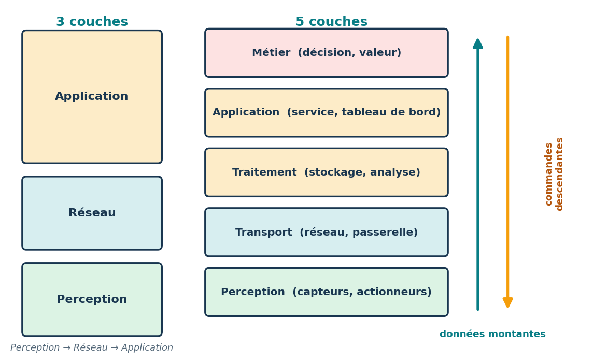
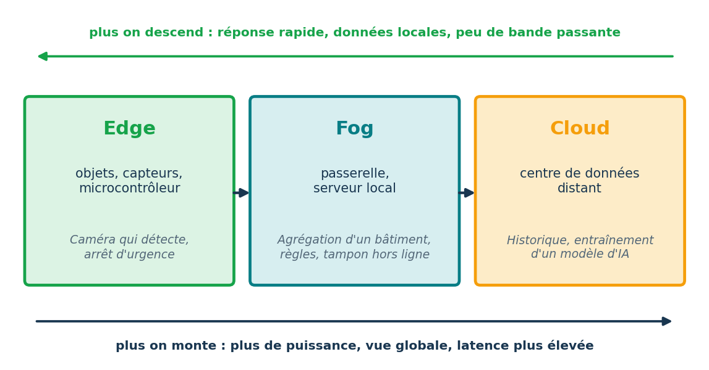
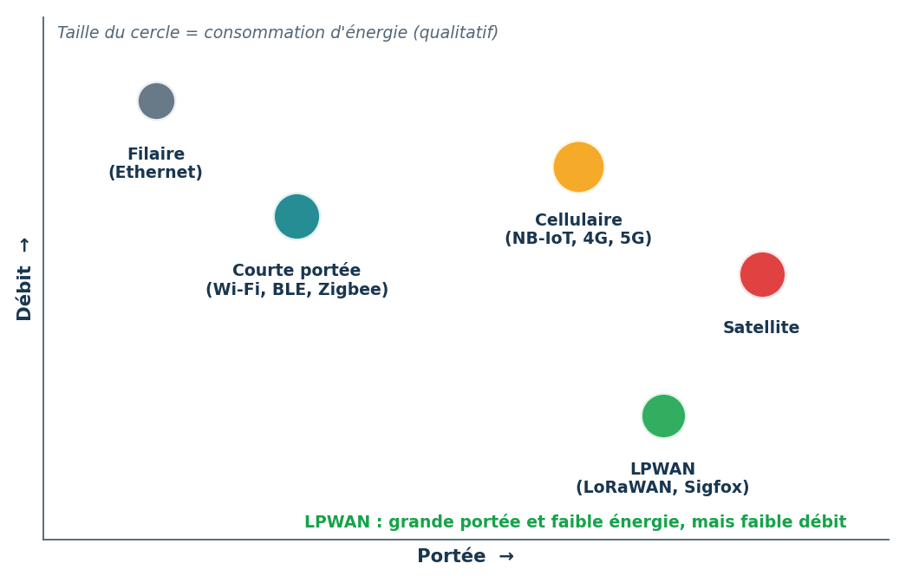

# Internet of Things — Résumé des TD et TP

Mise à jour du 24 novembre 2026. Méthodes de résolution, étapes pratiques et pièges des travaux dirigés et pratiques. Le [résumé des cours](resumer.md) conserve les chapitres théoriques. Les ajouts pédagogiques sont distingués des observations présentes dans les supports.

## TD1 — Méthodes de réponse et fiche de calcul

### Démarche pour un cas concret

1. Définir l'objet et le service attendu.
2. Identifier capteurs, actionneurs, calcul, communication et énergie.
3. Dessiner le parcours de la donnée et le retour de commande.
4. Justifier technologie et emplacement de traitement avec une contrainte dominante.
5. Expliquer sécurité, panne et évolution du nombre d'objets.

Une ampoule mesurant sa consommation possède une fonction de mesure électrique ; l'éclairage commandé est l'action. Une flotte de vélos alimentant plusieurs applications illustre l'écosystème IoT ; un distributeur envoyant une alerte au fournisseur illustre M2M et peut aussi appartenir à une plateforme IoT.

### Autonomie théorique de la station météo

```text
Capacité = 3 000 mAh
Courant moyen = 0,15 mA
Autonomie = capacité / courant = 20 000 h
Autonomie_années = 20 000 / 8 760 ≈ 2,28 ans
```

Le calcul suppose le courant moyen représentatif et toute la capacité utilisable. Vieillissement, température, autodécharge et pertes réduisent souvent l'autonomie réelle. Il faut distinguer courant actif, courant de veille et moyenne sur le cycle.

### Questions avec réponses courtes

1. **IoT impose-t-il du cloud ?** Non, des décisions peuvent être locales.
2. **Le sink est-il un capteur particulier de température ?** Non, c'est un rôle de collecte dans le réseau.
3. **Pourquoi MQTT et Wi-Fi ne sont-ils pas deux alternatives du même niveau ?** Le premier est applicatif, le second concerne l'accès réseau.
4. **Quelle contrainte pour un airbag ?** Temps réel dur dans le scénario étudié.
5. **Quel V concerne des mesures peu fiables ?** Veracity.
6. **Que faut-il justifier pour choisir LoRaWAN ?** Besoin de portée et d'autonomie, avec un débit compatible.
7. **Pourquoi la batterie seule ne donne-t-elle pas l'autonomie ?** Il faut connaître le courant moyen et les conditions d'utilisation.

## TD2 — Composants, acquisition et énergie

### Identifier les blocs d'un système

Pour ESP32 + DHT22 + LED + Wi-Fi : le DHT22 mesure température et humidité (entrée), l'ESP32 traite, la LED matérialise une sortie et le Wi-Fi assure la communication. L'alimentation fournit l'énergie à l'ensemble. Le schéma fonctionnel devient : capteur → MCU → décision → LED, avec échanges réseau vers le service.

| Composant | Grandeur / événement | Nature de l'information utile |
| --- | --- | --- |
| DHT22 | Température et humidité | Mesures codées numériquement |
| LDR | Éclairement | Variation de résistance, convertie en tension dans un montage analogique |
| PIR | Mouvement détecté par variation infrarouge | Signal de détection généralement numérique sur le module étudié |
| HC-SR04 | Distance | Durée d'une impulsion numérique à mesurer, pas directement un nombre de mètres |
| MQ-2 | Réponse à certains gaz / fumée | Sortie analogique, et éventuellement sortie à seuil sur un module équipé |

Le type de module et son interface doivent être identifiés avant de programmer l'acquisition. Un capteur de mouvement ne garantit pas la détection d'une présence immobile.

### Courant moyen sur un cycle

Le TD précise que les phases ne se recouvrent pas. Dans chaque minute : 10 mA pendant 2 s, 20 mA pendant 3 s, puis 0,1 mA pendant 55 s.

```text
I_moyen = somme(I_i × t_i) / T
        = (10 × 2 + 20 × 3 + 0,1 × 55) / 60
        = 1,425 mA
Autonomie = 3000 / 1,425 ≈ 2105,26 h ≈ 87,72 jours
```

Ce résultat théorique suppose les courants représentatifs, les phases exclusives et la capacité utilisable. Si plusieurs composants consomment simultanément, il faut calculer le courant total de chaque phase avant de pondérer. Réduire la consommation de veille, le temps actif et les transmissions peut améliorer l'autonomie.

### ADC 12 bits et tension d'entrée

Un potentiomètre produit une tension analogique variable ; l'ADC la code numériquement. Pour 12 bits : **4096 codes, de 0 à 4095**. Dans l'hypothèse idéale 0–3,3 V de l'énoncé :

```text
Code ≈ Vin / 3,3 × 4095
Vin = 1,65 V → 2047,5 → environ 2048 après arrondi
```

Cette approximation du TD n'est pas une calibration d'un ESP32 réel. Plage, atténuation, référence et erreurs de conversion doivent être considérées lors d'une mesure effective.

## TD2 — Réseaux, serrure, parking et actionneurs

### Topologies et panne

A : les capteurs parlent directement à une passerelle → **étoile**. B : des voisins relaient → organisation multi-saut, **maillage dans le scénario du TD**. C : deux appareils communiquent directement → **point à point**.

Le maillage peut offrir des chemins alternatifs si sa connectivité le permet ; avoir des relais ne garantit pas à lui seul une redondance. Une passerelle unique en panne interrompt le service central associé, même si certains capteurs continuent de mesurer localement.

### Serrure connectée

Le lecteur RFID lit un identifiant, le MCU applique une règle d'autorisation puis pilote le verrou via un driver adapté. Le logiciel doit gérer lecture, autorisation, commande et cas de refus. Une liste d'identifiants illustre la logique du TD ; lire un identifiant ne constitue pas à lui seul une authentification forte contre la copie.

Le driver ou relais commute la charge selon ses caractéristiques électriques. Son rôle ne tient pas seulement à une différence de tension : courant nécessaire et protection de la commande comptent aussi.

### Parking de 20 places

Architecture : détection par place → microcontrôleur / collecte → réseau adapté → serveur → tableau de bord. Un choix de capteur doit permettre de détecter un véhicule stationné, par exemple selon distance ou présence magnétique ; la réponse « capteur de mouvement » seule est insuffisante pour une voiture immobile.

Le tableau de bord doit distinguer **libre, occupé et inconnu / capteur en défaut**. Ne pas transformer automatiquement une absence de mesure en place libre. La portée Wi-Fi dépend du site réel ; sommeil et transmissions sur changement d'état sont des pistes de réduction énergétique.

### Choisir le composant de commande

| Besoin | Composant / principe |
| --- | --- |
| Ouvrir une arrivée d'eau | Électrovanne et commande électrique adaptée |
| Régler la vitesse d'un moteur DC | Driver moteur commandé en PWM |
| Commander une pompe ON/OFF | Relais ou dispositif de commutation adapté à la charge |
| Positionner un bras à un angle | Actionneur de position, par exemple servomoteur, avec commande adaptée |
| Faire varier la luminosité d'une LED | PWM et circuit de LED adapté |

Le corrigé écrit « DWM » pour la vitesse moteur : lire **PWM** dans ce contexte. Un relais commute une alimentation ; il n'est pas lui-même une vanne ni un dispositif de positionnement.

### Questions de révision du TD2

1. **Le HC-SR04 fournit-il directement une distance numérique en mètres ?** Non : le logiciel exploite la durée d'impulsion de la mesure.
2. **Pourquoi pondérer les courants par leur durée ?** Les phases n'occupent pas la même part du cycle.
3. **Que signifie absence de mesure d'une place de parking ?** État inconnu à traiter, pas preuve de disponibilité.
4. **PWM est-il un moteur ?** Non : c'est un principe de commande ; un driver et la charge restent nécessaires.

## TD3 — Architecture, connectivité et protocoles

Le TD3 traite neuf exercices : couches IoT, edge/fog/cloud, choix de connectivité, familles, IPv6 et transport, protocoles applicatifs, modèles de communication, déploiement et étude complète d'un système de qualité de l'air. Les réponses ci-dessous sont des **réponses types** fondées sur le cours ; justifier chaque choix avec les critères demandés (portée, débit, énergie, infrastructure, exigences de l'application).

### Exercice 1 — Surveillance de l'air d'une usine




| Couche (3 couches) | Composant ou fonction |
| --- | --- |
| Perception | capteurs de CO₂ |
| Réseau | liaison capteurs vers passerelle, passerelle vers serveur |
| Application | application mobile des responsables de sécurité |

| Couche (5 couches) | Composant ou fonction |
| --- | --- |
| Perception | capteurs de CO₂ |
| Transport | radio locale, passerelle, MQTT |
| Traitement | comparaison au seuil, stockage de l'historique |
| Application | tableau de bord et application mobile |
| Métier | sécurité des personnes, conformité, décisions de ventilation |

Le modèle à 5 couches **sépare le traitement des données** (stockage, analyse, règles) et la **valeur métier** (décision, objectifs), absents du modèle simple. Appareil : mesure ou agit, ressources limitées. Passerelle : relie les objets au réseau, traduit les protocoles, peut traiter localement. Plateforme cloud : stockage, calcul, analyse globale, accès distant.

**Alerte au seuil de CO₂** : à placer en **edge ou fog** (microcontrôleur ou passerelle) : latence minimale, fonctionnement même sans Internet. Sans connexion, l'acquisition, le seuil, l'alarme locale et la mémorisation temporaire doivent continuer, avec resynchronisation vers le cloud au retour du réseau.

### Exercice 2 — Edge, fog, cloud




| Besoin | Niveau | Justification |
| --- | --- | --- |
| Freinage d'urgence d'un véhicule | edge | temps réel strict, aucune dépendance réseau |
| Agrégation horaire de plusieurs bâtiments | fog | vue locale ou régionale, volume réduit avant envoi |
| Entraînement d'un modèle sur un an de données | cloud | calcul intensif, historique complet |
| Arrêt immédiat d'une machine en surchauffe | edge | réaction en millisecondes |
| Stockage de plusieurs années de mesures | cloud | capacité et durabilité |

Avantage d'un tout cloud : puissance élastique et gestion centralisée. Inconvénient : latence et dépendance à la connexion. Problèmes d'un passage total au cloud : latence inacceptable pour les actions urgentes, arrêt du système en cas de coupure, saturation et coût de la bande passante, confidentialité. Usine intelligente : **edge** (capteurs, automates, arrêt de sécurité), **fog** (passerelle d'atelier : agrégation, règles, tampon hors ligne), **cloud** (historique, analyses, entraînement, tableaux de bord distants).

### Exercice 3 — Choisir une connectivité

| Scénario | Choix | Raison |
| --- | --- | --- |
| Badge d'accès | RFID/NFC | très courte portée, passif, pas de batterie |
| Capteur d'humidité à 4 km, batterie 3 ans | LoRaWAN | longue portée, très basse consommation, petits messages |
| Caméra fixe sur secteur | Ethernet (ou Wi-Fi) | débit élevé, alimentation disponible |
| Bracelet sportif vers smartphone | BLE | courte portée, très basse consommation |
| Capteur sur camion en déplacement | 4G/5G | mobilité et grande couverture |
| Éclairages intelligents d'un bâtiment | Zigbee (IEEE 802.15.4) | maillage basse consommation |
| Appareils médicaux fixes, débit élevé, secteur | Ethernet | fiabilité et débit |

La portée seule est insuffisante : il faut aussi le débit, la consommation, l'infrastructure disponible, le coût, la latence, la sécurité et les exigences de l'application.

### Exercice 4 — Les cinq familles




Classement : Wi-Fi, BLE et Zigbee en **courte portée** ; LoRaWAN en **LPWAN** ; NB-IoT et 5G en **cellulaire** ; Ethernet en **filaire** ; Satellite IoT en **satellite**. **LoRaWAN** convient aux applications à longue portée et faible énergie car sa modulation donne plusieurs kilomètres avec une très faible consommation, au prix d'un faible débit. **Wi-Fi plutôt que BLE** pour une caméra haute résolution : débit bien plus élevé. **Satellite** : suivi de conteneurs en mer ou capteurs en zone sans couverture cellulaire. **Cellulaire contre LPWAN** : le cellulaire offre plus de débit et s'appuie sur l'infrastructure d'un opérateur (abonnement), le LPWAN consomme beaucoup moins, avec un faible débit. **Capteurs agricoles isolés** (quelques octets toutes les 15 minutes) : **LoRaWAN** est le choix usuel (faible coût, très basse consommation, passerelle privée) ; NB-IoT exige la couverture cellulaire et un abonnement ; le satellite est coûteux, réservé aux zones sans autre option.

### Exercice 5 — IPv6, 6LoWPAN et transport

- **IPv6** : le nombre d'objets dépasse l'espace d'adresses IPv4 ; le NAT casse la connexion de bout en bout et complique la gestion.
- **6LoWPAN** : un paquet IPv6 (MTU minimale de 1280 octets) ne tient pas dans une trame IEEE 802.15.4 (127 octets) ; 6LoWPAN apporte **fragmentation et compression des en-têtes**.
- **Mesure toutes les 10 s sur réseau instable** : **UDP**, car faible surcoût, aucune connexion à établir, économie d'énergie, et une mesure perdue est remplacée par la suivante ; protocole applicatif : **CoAP** (ou MQTT-SN).

| Critère | TCP | UDP |
| --- | --- | --- |
| Connexion | établie (poignée de main) | sans connexion |
| Fiabilité | accusés de réception, retransmission | aucune garantie |
| Ordre des données | garanti | non garanti |
| Surcoût | élevé | faible |
| Usage IoT | MQTT, HTTP | CoAP, flux de capteurs |

Pour une **alerte d'urgence**, la perte est inacceptable : on garde TCP, ou UDP avec fiabilité applicative (accusés de réception, retransmissions, numéros de séquence, messages CoAP « confirmables »). Un faible surcoût compte sur des objets contraints, car chaque octet émis coûte de l'énergie.

### Exercice 6 — Protocoles applicatifs

| Scénario | Protocole | Raison |
| --- | --- | --- |
| Tableau de bord web temps réel, bidirectionnel | WebSocket | connexion persistante, faible latence |
| Objet contraint, bande passante faible, UDP | CoAP | requêtes légères au-dessus d'UDP |
| Robot mobile, communication directe, QoS stricte, sans serveur central | DDS | publication-abonnement sans courtier, nombreux réglages de QoS |
| Centaines de capteurs vers un tableau de bord | MQTT | léger, publication-abonnement |

**Courtier MQTT** : le *publisher* envoie un message sur un **topic** au courtier ; le courtier le distribue à tous les *subscribers* abonnés à ce topic, ce qui **découple** émetteurs et récepteurs. Topics d'un bâtiment de quatre étages : `batiment/etage2/salle204/temperature`, `batiment/etage1/salle103/co2`, `batiment/+/+/temperature` (le joker `+` couvre une valeur).

| Protocole | Caractéristique | Application typique |
| --- | --- | --- |
| HTTP | requête-réponse, texte, surcoût élevé | API web, services cloud |
| CoAP | requête-réponse léger sur UDP | objets contraints |
| MQTT | publication-abonnement via un courtier, léger | télémétrie de nombreux capteurs |
| WebSocket | canal bidirectionnel persistant | tableaux de bord temps réel |
| XMPP | messagerie par présence et flux XML | messagerie, supervision |
| DDS | publication-abonnement sans courtier, QoS riche | robotique, systèmes critiques |
| AMQP | files de messages fiables, routage | intégration d'entreprise |

HTTP pour 500 capteurs sur batterie : surcoût d'en-têtes, connexions répétées, consommation et bande passante élevées, pas d'envoi spontané du serveur vers l'objet. Alternative : **MQTT** ou **CoAP**.

### Exercice 7 — Modèles de communication

| Modèle | Avantage | Limite | Exemple |
| --- | --- | --- | --- |
| Requête-réponse | simple, synchrone | interrogation répétée, couplage | lecture d'une ressource REST |
| Publication-abonnement | découplage, diffusion à plusieurs | nécessite un courtier, plus d'incertitude sur la livraison | télémétrie MQTT |

**REST est sans état** : chaque requête contient tout ce qu'il faut pour être traitée. Conséquence : le serveur ne garde pas de session, ce qui simplifie la montée en charge, mais le client renvoie ses informations à chaque requête. Device-to-Device : objets entre eux ; Device-to-Gateway : objet vers passerelle locale ; Device-to-Cloud : objet vers plateforme distante. Pour 200 capteurs sans lien direct avec l'application : **publication-abonnement** avec **MQTT** (le courtier s'interpose). Séparer logique applicative et couche de communication facilite la maintenance (on change de protocole sans toucher à la logique) et l'évolutivité.

### Exercice 8 — Déploiement de 5 000 capteurs agricoles

Défis : compatibilité et choix du matériel, gestion d'un parc de 5 000 appareils (configuration, mises à jour, supervision), compromis énergie et débit, couverture réseau en zone rurale, dépendance au fournisseur. Aucune technologie ne maximise **portée, consommation et débit** simultanément : augmenter la portée ou le débit coûte de l'énergie. Une couverture limitée se traite avec des **passerelles supplémentaires** (LoRaWAN privé) ou une **liaison satellite** pour les sites isolés. Le **vendor lock-in** enferme dans une plateforme propriétaire : si le prix augmente, la migration est coûteuse. Mesures : standards ouverts (MQTT, API ouvertes), couche d'abstraction, données exportables, architecture modulaire. Pour la montée en charge et la fiabilité : passerelles redondantes, traitement edge pour réduire le trafic, mises à jour à distance.

### Exercice 9 — Système de qualité de l'air complet

| Élément | Choix proposé |
| --- | --- |
| Capteur et traitement | capteur de CO₂ (NDIR) relié à un ESP32, avec seuil local |
| Connectivité capteurs vers passerelle | Zigbee, ou Wi-Fi si l'infrastructure existe ; Ethernet sur les postes fixes |
| Protocole vers la plateforme | MQTT (léger, publication-abonnement) |
| Détection de CO₂ dangereux | edge |
| Agrégation de plusieurs zones | fog |
| Historique et rapports | cloud |
| Accès distant des responsables | cloud (tableau de bord) |

Comportements attendus : **capteur muet** : alarme de supervision (aucune mesure pendant un délai) ; **passerelle sans Internet** : détection et alarmes locales, mesures stockées dans un tampon puis renvoyées ; **cloud indisponible** : le fog continue, remise en file d'attente ; **de 20 à 2 000 capteurs** : architecture modulaire, courtier évolutif, ajout de passerelles par zone. Risques de sécurité : interception des messages (chiffrement TLS), accès non autorisé aux objets (authentification, certificats), micrologiciel compromis (mises à jour signées). Le rapport final suit les couches, de la physique à l'application, en justifiant chaque choix.

### Questions de révision du TD3

1. **Pourquoi la portée seule ne suffit-elle pas pour choisir une connectivité ?** Il faut aussi débit, consommation, infrastructure, coût, latence, sécurité et exigences de l'application.
2. **UDP ou TCP pour une mesure toutes les 10 s sur un réseau instable ?** UDP : faible surcoût, économie d'énergie ; la mesure suivante remplace une perte. Pour une alerte critique, ajouter une fiabilité applicative ou garder TCP.
3. **Quel est le rôle du courtier MQTT ?** Recevoir les messages publiés sur un topic et les distribuer aux abonnés, ce qui découple émetteurs et récepteurs.
4. **Pourquoi un paquet IPv6 ne passe-t-il pas tel quel dans une trame IEEE 802.15.4 ?** 1280 octets de MTU contre 127 octets de trame ; 6LoWPAN fragmente et compresse les en-têtes.
5. **Qu'est-ce que le vendor lock-in et comment le limiter ?** Dépendance à une plateforme propriétaire ; standards ouverts, couche d'abstraction, données exportables, architecture modulaire.
