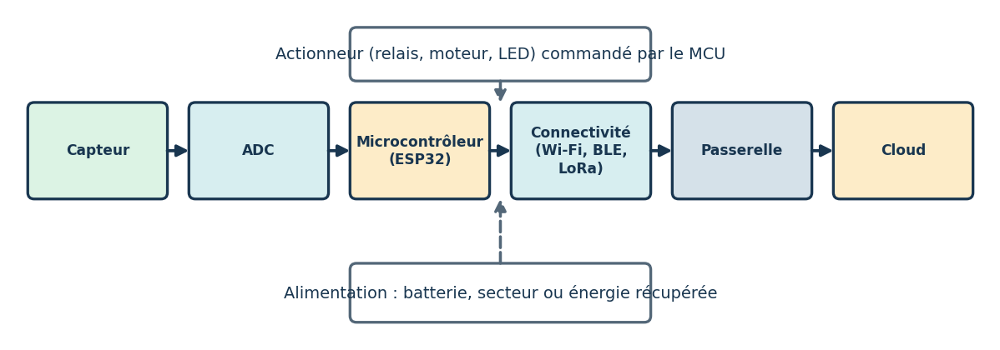
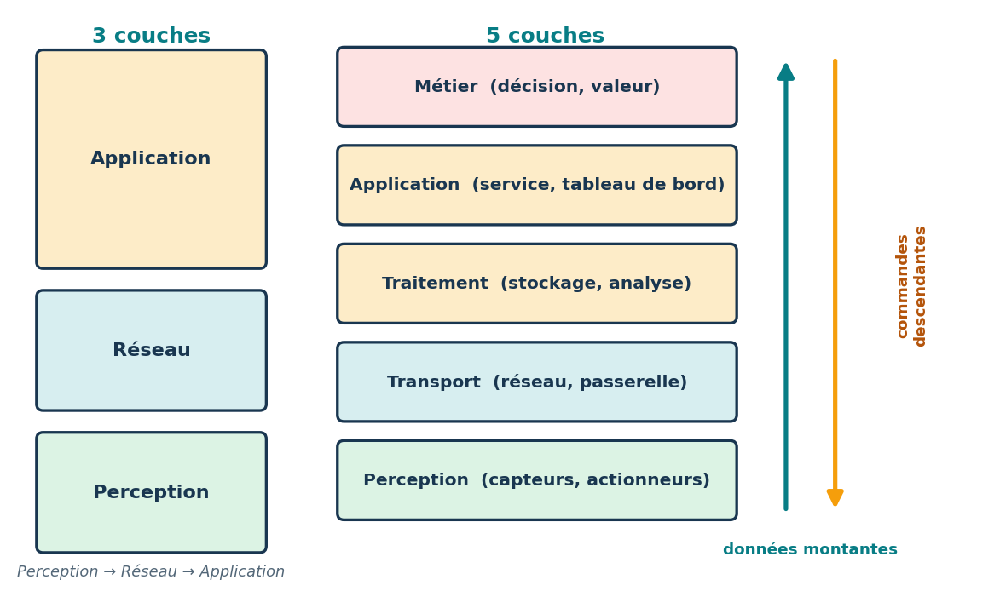
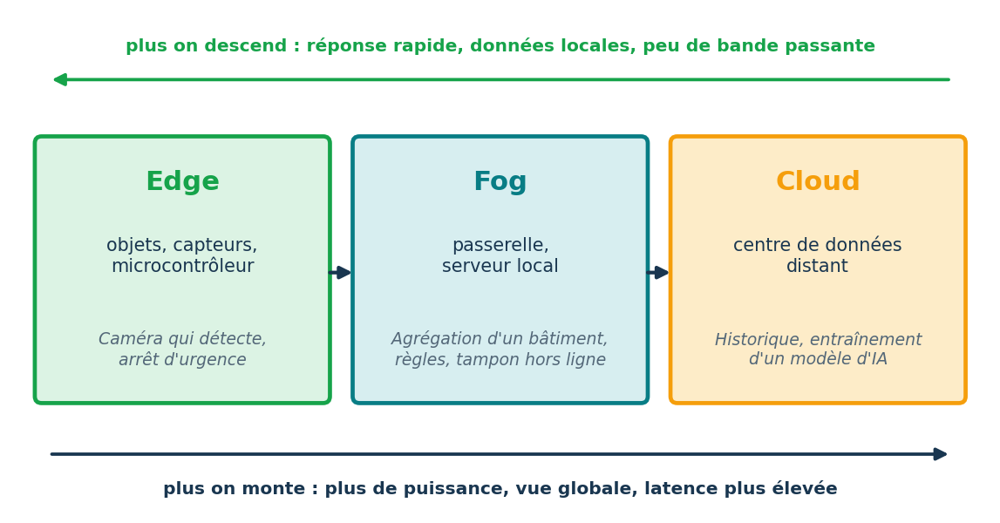
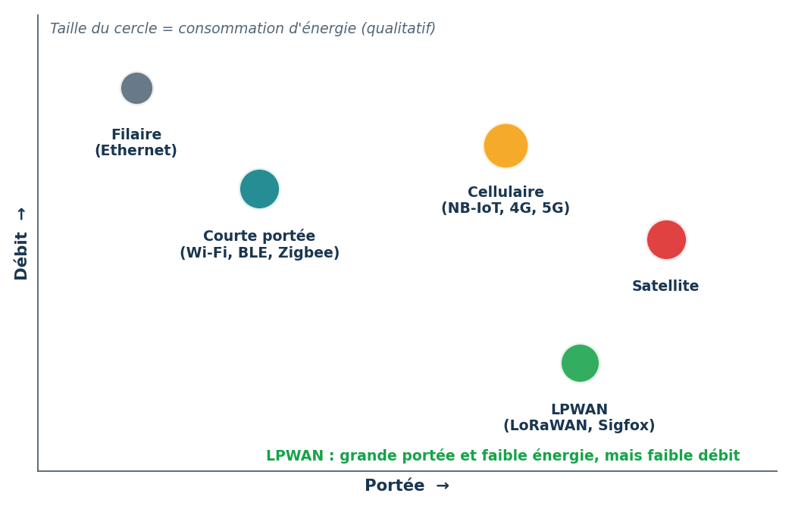

# Internet of Things — Résumé des cours

Mise à jour du 24 novembre 2026. Définitions, raisonnements et exemples des cours. Les exercices, commandes et comptes rendus pratiques sont réunis dans [le résumé TD/TP](resumer-tp.md).

## Chapitre 1 — Définition, objets et chaîne de valeur

### Définir l'IoT

L'**Internet des objets** relie des objets physiques identifiables, dotés de capacités de mesure, de traitement et de communication, à des services qui exploitent leurs données ou commandent leurs actions. L'IoT est un concept et un écosystème, pas un appareil ou une technologie radio unique.

Trois visions se complètent : **Things** identifie les objets, **Internet** les relie et **Semantic** donne un sens partagé à leurs données. Une mesure sans identité, unité ou contexte peut être difficile à interpréter.

| Bloc | Fonction | Exemple |
| --- | --- | --- |
| Capteur / actionneur | Mesurer / agir | Humidité du sol / vanne |
| Calcul et mémoire | Exécuter le firmware et traiter | Microcontrôleur |
| Communication | Échanger des données et commandes | Radio ou interface filaire |
| Alimentation | Fournir l'énergie | Batterie, secteur ou énergie récupérée |

Le firmware est le logiciel de l'objet. Un objet connecté peut échanger ; un objet dit intelligent ajoute une logique de traitement ou d'adaptation. Une intelligence peut être locale ou distante : ces deux notions ne sont donc pas synonymes.

### De la mesure à l'action

```text
Mesure → transmission → stockage / traitement → analyse → décision → action
```

Exemple d'irrigation : 32 % est une donnée ; « sol sec à cet endroit » est une information contextualisée ; « irrigation nécessaire » résulte d'une règle ou d'une analyse ; ouvrir la vanne est l'action. L'intérêt du système vient du service rendu, pas de l'accumulation de mesures seule.

Un identifiant peut être MAC, IP, EPC/RFID, URI ou identifiant applicatif selon la couche. Un objet derrière une passerelle n'a pas nécessairement sa propre adresse IP publique. Le cloud est une option d'architecture, pas une obligation pour toute décision IoT.

## Chapitre 1 — Huit caractéristiques et contraintes

| Caractéristique | Sens | Exemple : caméras urbaines |
| --- | --- | --- |
| Connectivité | Échanges réseau | Envoi d'événements à une plateforme |
| Identification | Reconnaître la source | Identifiant de chaque caméra |
| Perception | Mesure du monde | Capture d'image ou de mouvement |
| Intelligence | Traitement utile | Détection d'événements |
| Hétérogénéité | Matériels et protocoles variés | Marques et réseaux différents |
| Scalabilité | Gérer la croissance | Passer de 500 à davantage de caméras |
| Autonomie | Fonctionner sans intervention constante | Redémarrage ou configuration automatiques |
| Sécurité | Protéger objets et échanges | Contrôle d'accès et mises à jour |

La mobilité et les arrivées/départs d'objets rendent le système dynamique. Une passerelle peut agréger et traduire certains protocoles pour relier des équipements hétérogènes.

Les limites de CPU, RAM, énergie, débit et coût orientent le design. Elles favorisent protocoles légers, transmissions adaptées et périodes de sommeil. Les valeurs matérielles du cours sont des exemples, pas une définition de tous les objets connectés.

## Chapitre 1 — M2M et domaines d'application

### M2M ou IoT ?

Le **M2M** désigne des échanges entre machines, souvent organisés autour d'un service dédié. Dans la comparaison pédagogique du cours, l'IoT étend cette logique à un écosystème de services et de données réutilisées.

| Critère | M2M classique du cours | IoT |
| --- | --- | --- |
| Organisation | Solution verticale dédiée | Plateforme partageant des données et services |
| Interconnexion | Souvent propriétaire | Combinaison de réseaux et d'interfaces |
| Exploitation des données | Usage ciblé | Plusieurs applications et analyses |
| Exemple | Compteur vers serveur de facturation | Compteur vers plateforme et applications multiples |

Il s'agit de tendances d'architecture : les catégories peuvent se recouvrir. La présence d'une liaison cellulaire ne suffit pas à trancher ; examiner qui échange, avec quelle plateforme et pour quels usages.

### Domaines et contraintes dominantes

| Domaine | Scénario | Contrainte à justifier |
| --- | --- | --- |
| Maison | Présence → éclairage automatisé | Vie privée et compatibilité |
| Ville | Capteurs → disponibilité du stationnement | Déploiement à grande échelle |
| Santé connectée | Mesure → alerte et suivi | Fiabilité, confidentialité et délai |
| Agriculture | Humidité → irrigation | Portée radio et autonomie |
| Industrie | Vibrations → maintenance prédictive | Robustesse, continuité et temps de réponse |
| Transport / énergie | Suivi de flotte ou compteurs | Couverture, mobilité et volumes de données |

La même architecture ne convient pas à tous les domaines. Un dispositif sur batterie privilégie l'autonomie ; une commande industrielle peut d'abord exiger un délai maîtrisé.

## Chapitre 1 — WSN, cloud, edge et analyse

### Réseaux de capteurs sans fil

Un **WSN** regroupe des nœuds capteurs qui mesurent, traitent et transmettent. Un nœud peut aussi relayer les messages de ses voisins vers un collecteur, le **sink**, puis une passerelle vers d'autres services.

```text
Capteur → traitement local → un ou plusieurs sauts radio → sink → passerelle
```

| Topologie | Avantage | Limite |
| --- | --- | --- |
| Étoile | Simple, collecte directe | Dépendance au centre et à sa portée |
| Arbre | Organisation hiérarchique | Dépendance aux branches et relais |
| Maillage | Chemins alternatifs possibles | Routage et gestion énergétique plus complexes |

### IaaS, PaaS et SaaS

**IaaS** fournit des ressources d'infrastructure ; le client gère notamment OS et applications. **PaaS** fournit une plateforme pour le code ; **SaaS** fournit une application utilisable. Pour l'IoT, ces services peuvent faciliter stockage, calcul et tableaux de bord. Le choix ne supprime pas la responsabilité sur les accès et les données.

### Edge, fog et cloud

L'edge traite sur l'objet ou à proximité ; le fog organise des traitements intermédiaires ; le cloud apporte stockage et analyse globale. Traiter localement réduit certaines transmissions et peut permettre un service en cas de coupure. Cela demande aussi ressources locales, maintenance et cohérence de données.

### Big Data : les cinq V

| V | Sens | Exemple IoT |
| --- | --- | --- |
| Volume | Quantité | Historique de milliers de capteurs |
| Velocity | Vitesse d'arrivée | Flux continus de mesures |
| Variety | Diversité | Images, positions, températures et événements |
| Veracity | Fiabilité | Capteur mal calibré ou mesure manquante |
| Value | Utilité | Réduction d'une panne ou d'une consommation |

Les analyses sont **descriptives** (ce qui s'est passé), **diagnostiques** (pourquoi), **prédictives** (ce qui pourrait se passer) ou **prescriptives** (quelle action choisir).

## Chapitre 1 — Protocoles et conception embarquée

### Choisir une communication

Le choix combine portée, débit, énergie, mobilité, topologie et environnement. Les noms de technologies ne suffisent pas à déterminer la performance d'une installation.

| Besoin | Technologie évoquée par le cours |
| --- | --- |
| Proximité et basse consommation | Bluetooth LE |
| Débit élevé, alimentation adaptée | Wi-Fi ou Ethernet |
| Réseau domestique maillé | Zigbee ou Thread |
| Faible débit, longue portée, autonomie | LoRaWAN |
| Mobilité et couverture opérateur | Technologies cellulaires selon le besoin |

Le NFC correspond à une très courte portée. Toutes les communications BLE ne sont pas des réseaux maillés. Le choix d'une radio et celui du protocole applicatif sont deux décisions différentes.

Pile simplifiée : application **HTTP / MQTT / CoAP** → transport **TCP / UDP** → réseau **IP et adaptations** → liaison / support physique. Le support cite IPv6 et 6LoWPAN ; les détails des protocoles sont annoncés pour la suite, sans être développés ici.

### Système embarqué et temps réel

Un système embarqué réalise une fonction dédiée avec des contraintes de mémoire, calcul, énergie, taille ou délai. Il peut être bare metal ou utiliser un RTOS. Une exigence **temps réel dur** traite le retard comme une défaillance ; en **temps réel souple**, le retard dégrade le service. Temps réel ne veut pas seulement dire « rapide ».

### Top-down, bottom-up et codesign

Top-down part des besoins pour choisir architecture et composants ; bottom-up construit à partir de composants disponibles ; une approche mixte fait converger les deux. Le **codesign matériel/logiciel** partitionne les fonctions puis les développe et les intègre avec des itérations.

Pour un bracelet connecté : capteur et conversion en matériel ; filtrage, règles et protocole en logiciel ; accélération cryptographique matérielle si les contraintes le justifient. La répartition cherche un compromis de performance, consommation, coût et évolutivité ; elle n'impose pas toute fonction rapide en matériel.

## Chapitre 1 — Défis, fiabilité et protection

| Défi | Conséquence d'une mauvaise prise en compte | Réponse de conception évoquée |
| --- | --- | --- |
| Sécurité | Contrôle non autorisé ou compromission | Authentification, protection des échanges et mises à jour |
| Vie privée | Déduction d'habitudes ou exposition de données | Limiter la collecte et les accès |
| Interopérabilité | Silos et intégration difficile | Interfaces et sémantique partagées |
| Énergie | Batterie épuisée trop tôt | Veille et transmissions adaptées |
| Scalabilité | Saturation réseau, calcul ou stockage | Architecture et traitement de proximité |
| Fiabilité | Pertes de données ou d'actions | Reconnexion, surveillance et reprise |

Le cours utilise **Mirai, 2016**, comme exemple d'appareils insuffisamment protégés enrôlés pour un déni de service distribué. La leçon est de gérer les identifiants, les accès et la durée de maintenance du firmware ; le chiffrement seul ne corrige pas une authentification faible.

La fiabilité et la confidentialité doivent être examinées à chaque niveau : objet, liaison, passerelle, plateforme et application. Une passerelle commune peut aussi devenir une dépendance critique.

## Chapitre 2 — Architecture d'un nœud IoT

### Blocs matériels




| Bloc | Rôle | Exemples |
| --- | --- | --- |
| Capteurs | Mesurer l'environnement | Température, humidité, lumière, mouvement |
| Microcontrôleur | Lire, traiter, décider | CPU, Flash, RAM, GPIO, ADC |
| Actionneurs (via driver) | Agir sur le monde physique | Moteur, relais, pompe, buzzer |
| Connectivité | Relier à la passerelle et au cloud | Wi-Fi, BLE, LoRa, Zigbee |
| Alimentation | Alimenter tous les blocs | Batterie, secteur, solaire |

Modèle à retenir : **SENSE → PROCESS → COMMUNICATE → ACT**. Les données montent vers le cloud ; les commandes redescendent vers les actionneurs.

### Capteurs

Chaîne : grandeur physique → transducteur → conditionnement → ADC → valeur numérique.

| Analogique | Numérique |
| --- | --- |
| Tension continue (ex. 0–3,3 V), ADC nécessaire | Données discrètes, traitement interne |
| LM35, LDR, humidité du sol, MQ-2 | DHT22, BME280, DS18B20 (I²C, SPI, UART, 1-Wire) |

Caractéristiques : étendue, sensibilité, exactitude, résolution, temps de réponse, consommation. **Exactitude ≠ fidélité** : un capteur répétable peut rester faux et demander un étalonnage.

### Actionneurs

Ils convertissent une commande en effet physique : LED (lumière), moteur (rotation), relais (commutation), buzzer (son), pompe, vanne. Ne jamais piloter un moteur ou un relais directement par une broche GPIO : utiliser un driver et une diode de roue libre.

## Chapitre 2 — Microcontrôleurs et connectivité

| Carte | Cœur | Connectivité | Usage |
| --- | --- | --- | --- |
| Arduino Uno | ATmega328P, 8 bits, 16 MHz | Aucune | Apprentissage |
| ESP32 | Double cœur 32 bits, 240 MHz | Wi-Fi + Bluetooth | La plupart des projets IoT |
| Raspberry Pi Pico W | RP2040, 133 MHz | Wi-Fi | Bas coût, MicroPython |
| STM32 | ARM Cortex-M 32 bits | Par modules | Industriel, basse consommation |
| Raspberry Pi 4 | Microprocesseur, Linux | Wi-Fi, Ethernet, BT | Passerelle, vision, IA en périphérie |

Interfaces : **GPIO** (entrée/sortie numérique), **ADC** (tension → nombre), **PWM** (puissance moyenne : luminosité, vitesse moteur), **I²C** (SDA + SCL, bus partagé), **SPI** (MOSI, MISO, SCLK, CS, rapide), **UART** (TX/RX, point à point : GPS, GSM).

| Technologie | Profil | Cas typique |
| --- | --- | --- |
| Wi-Fi | Débit élevé, portée locale | Maison, caméra |
| BLE | Courte portée, très basse consommation | Montre, bracelet |
| Zigbee | Maillage basse consommation | Maison connectée, nombreux capteurs |
| LoRa / LoRaWAN | Longue portée, faible débit | Capteur agricole à plusieurs km |
| NB-IoT | Cellulaire basse consommation | Compteurs |
| 4G / 5G | Grande zone, débit élevé | Véhicules, vidéo |

Exemple fil rouge : capteur d'humidité du sol + ESP32 ; si humidité < 30 % alors relais → pompe ON, sinon OFF ; mesures envoyées par MQTT vers un tableau de bord. Le simulateur Wokwi permet de tester ESP32, Arduino et STM32 sans matériel.

## Chapitre 3 — Architecture d'un système IoT

### Pourquoi une architecture

L'architecture décrit **comment la solution est conçue et comment les composants coopèrent**, comme le plan d'un bâtiment : le chemin complet de la donnée (le capteur mesure, le réseau transporte, le système collecte et traite, puis une action ou une information est produite). Elle est indispensable à cause de contraintes fortes : très grand nombre d'objets, sécurité, matériel contraint, volumes de données, analyse, équipements anciens (*legacy*).

| Notion | Définition |
| --- | --- |
| Vertical | un secteur d'application avec ses objets, logiciels et protocoles propres : maison, ville, santé, automobile, énergie, industrie |
| Cadre horizontal | plateforme commune de services partagés (gestion des appareils, communication, sécurité, échange de données, API) ; exemple : le service commun **oneM2M** |

Le marché est fragmenté : chaque vertical a ses technologies, sans interopérabilité, d'où la recherche d'une architecture standard.

### Architecture en couches

Une architecture en couches apporte : **séparation** (chaque couche a un rôle précis), **modularité** (on remplace une couche sans tout refaire), **interopérabilité** (interfaces standard) et **évolutivité**. Il n'existe pas d'architecture IoT unique : les modèles à 3 et 5 couches sont les références.



| Couche (5 couches) | Rôle | Exemple (bâtiment intelligent) | Équivalent à 3 couches |
| --- | --- | --- | --- |
| Perception | mesurer, agir, identifier | capteurs de température, présence, CO₂ ; actionneur de climatisation | Perception |
| Transport | transmettre et router | Wi-Fi local, MQTT vers le serveur, passerelle | Réseau |
| Traitement (middleware) | stocker, analyser | base de données, analyse de la consommation, règles | Application (en partie) |
| Application | rendre le service | tableau de bord web, alertes mobiles | Application |
| Métier (Business) | décider et créer de la valeur | réduire la facture d'énergie | Application (en partie) |

| Critère | 3 couches | 5 couches |
| --- | --- | --- |
| Couches | Perception, Réseau, Application | + Traitement et Métier |
| Précision | vue simple | vue détaillée |
| Traitement des données | non explicite | couche dédiée |
| Usage | introduction, petits projets | projets industriels et Big Data |

Limites du modèle à 3 couches : sans stockage ni analyse explicites, et l'application mélange traitement et interface. Les **commandes suivent le chemin inverse**, de l'application vers les actionneurs. Un courtier MQTT se place en couche réseau ou application, selon son rôle.

### Cloud, fog et edge



| Critère | Edge | Fog | Cloud |
| --- | --- | --- | --- |
| Distance | très proche | proche | éloigné |
| Latence | très faible | faible | élevée |
| Puissance | limitée | moyenne | très élevée |
| Exemple | caméra qui détecte | passerelle de bâtiment | entraînement d'un modèle d'IA |

Une architecture **tout cloud** apporte puissance élastique, gestion centralisée et analyse globale, mais souffre de latence, de consommation de bande passante, de dépendance à la connexion et de coût : insuffisante pour le temps réel ou le fonctionnement hors ligne. **Règle : traiter localement ce qui est urgent, envoyer au cloud ce qui est global.**

## Chapitre 3 — Connectivité et protocoles

### Connectivité et défis

La **connectivité IoT** regroupe toutes les technologies par lesquelles les objets échangent des données avec les autres capteurs, applications et plateformes cloud. Chaque réseau a sa portée, sa consommation, sa sécurité et ses limites. Défis : ressources limitées (mémoire, processeur, batterie), réseaux à pertes et faible débit, très grand nombre d'objets, hétérogénéité des constructeurs et des normes, sécurité et vie privée. Le compromis porte sur **portée, débit et consommation**.

### Classification des protocoles

Les protocoles IoT adaptent les couches classiques pour réduire l'en-tête de plusieurs centaines d'octets à quelques octets.

| Couche | Rôle | Exemples |
| --- | --- | --- |
| Physique / liaison | accès au support radio | BLE, Zigbee, LoRa, Wi-Fi |
| Réseau | adressage et routage | IPv6, 6LoWPAN, RPL |
| Transport | acheminement | UDP, TCP, DTLS, TLS |
| Application | échange de messages | MQTT, CoAP, AMQP, HTTP |

| Protocole | Objectif principal |
| --- | --- |
| MQTT | messagerie légère entre objets et serveurs (publication et abonnement via un courtier) |
| CoAP | communication pour objets contraints, au-dessus d'UDP |
| HTTP/HTTPS | échanges avec des services web |
| BLE | courte portée, basse consommation |
| Zigbee | basse consommation entre plusieurs appareils |
| LoRaWAN | longue portée, basse consommation |
| Wi-Fi | débit relativement élevé |

### Cinq familles de connectivité



| Famille | Technologies | Convient à |
| --- | --- | --- |
| Cellulaire | 2G à 5G, NB-IoT, LTE-M, LTE Cat-1 | déploiements à grande échelle, grande couverture |
| Courte portée | Wi-Fi, BLE, Zigbee, Thread, NFC, RFID | maison connectée, objets portés |
| LPWAN | LoRaWAN, Sigfox, Wi-SUN | longue portée, très basse consommation, faible débit |
| Satellite | NB-IoT/NR par satellite, LoRaWAN par satellite | zones isolées ou maritimes |
| Filaire | Ethernet, RS-485 | industrie stable |

| Type | Portée | Débit | Consommation |
| --- | --- | --- | --- |
| Cellulaire | haute | haute | haute |
| Satellite | haute | haute | haute |
| Wi-Fi | faible | haut | faible |
| Bluetooth | faible | haut | faible |
| Ethernet | faible | haut | faible |
| LPWAN | haute | **faible** | faible |

Aucune technologie ne maximise à la fois portée, débit et économie d'énergie : c'est le compromis fondamental.

### Choisir la bonne connectivité

Il n'existe pas d'algorithme universel. Facteurs à examiner :

| Facteur | Critères et exemples |
| --- | --- |
| Portée | courte (< 30 à 50 m en intérieur) : BLE, Zigbee, Z-Wave, Thread ; moyenne (50 à 500 m) : Wi-Fi, Ethernet, TSCH industriel, LTE/5G privé ; longue (dizaines de km) : LoRaWAN, Wi-SUN FAN, cellulaire IoT ; mondiale : satellite |
| Débit et latence | petites charges rares : LoRaWAN, BLE ; petites mais fréquentes : Zigbee, Thread ; volumes moyens : Wi-Fi, LTE-M, Cat-1 ; flux continus : Ethernet, Wi-Fi, 4G/5G. Latence très faible : Ethernet, 5G privé ; élevée (> 1 s) : LoRaWAN ; très élevée : satellite |
| Énergie | objets sur batterie pendant des années : LPWAN, NB-IoT, LTE-M |
| Coût | **CAPEX** (modules, passerelles, installation) et **OPEX** (trafic, licences, maintenance) ; LoRaWAN privé : CAPEX élevé, OPEX faible ; satellite : OPEX le plus élevé |
| Sécurité et fiabilité | SIM ou eSIM pour le cellulaire ; pour plus de 99,9 % de disponibilité, une connectivité **hybride** (cellulaire plus Ethernet ou Wi-Fi) |
| Autres | environnement, densité d'objets, mobilité, réglementation |

| Cas d'usage | Connectivité | Protocole |
| --- | --- | --- |
| Maison connectée | Zigbee, Thread, Wi-Fi | MQTT, Matter |
| Agriculture, compteurs | LoRaWAN, NB-IoT | MQTT, CoAP |
| Industrie 4.0 | 5G, Ethernet | OPC UA, MQTT, DDS |
| Santé, objets portés | BLE | GATT, MQTT via passerelle |

### Cinq défis de déploiement

1. **Compatibilité matérielle.** 2. **Gestion d'un très grand parc d'appareils.** 3. **Compromis débit contre durée de la batterie.** 4. **Couverture multirégion**, spectre et normes variables. 5. **Dépendance au fournisseur** (*vendor lock-in*) et fragmentation. Tendances : IA et 5G, 5G privé, edge computing et IA en périphérie, optimisation de bande passante par IA, maintenance prédictive.

**À retenir :** le succès d'un projet IoT repose sur le meilleur compromis entre **portée radio, débit, consommation et sécurité**.

## Révision active — Cours

1. **Pourquoi le modèle à 5 couches est-il plus précis que celui à 3 couches ?** Il isole le traitement (stockage, analyse) et la couche métier (décision, valeur), que le modèle à 3 couches mélange dans l'application.
2. **Qu'est-ce qu'un vertical, qu'est-ce qu'un cadre horizontal ?** Un vertical est un secteur d'application (santé, énergie, ville) ; un cadre horizontal (oneM2M) fournit des services communs à tous les verticaux.
3. **Où traiter une alerte urgente, où entraîner un modèle d'IA ?** L'alerte à l'edge ou au fog (latence, fonctionnement hors ligne) ; l'entraînement au cloud (puissance, historique).
4. **Citer les cinq familles de connectivité.** Cellulaire, courte portée, LPWAN, satellite, filaire.
5. **Pourquoi aucune technologie n'est-elle parfaite ?** Portée, débit et consommation se contredisent : le LPWAN a portée et économie mais un faible débit, le Wi-Fi a du débit mais une faible portée.
6. **Différence entre CAPEX et OPEX ?** CAPEX : investissement initial (modules, passerelles, installation) ; OPEX : coûts d'exploitation (trafic, licences, maintenance).
7. **Quels sont les cinq défis de déploiement ?** Compatibilité matérielle, gestion d'un grand parc, compromis débit et batterie, couverture multirégion et réglementations, dépendance au fournisseur.
