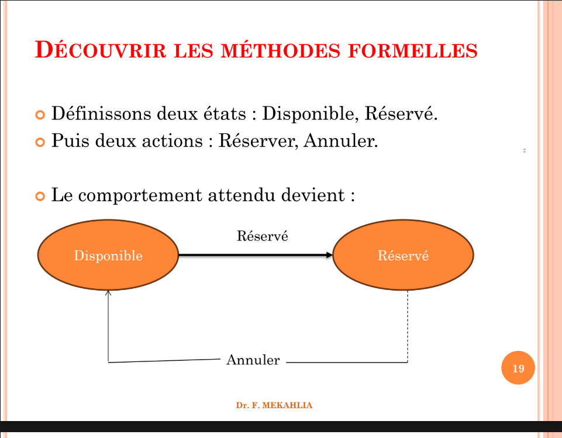
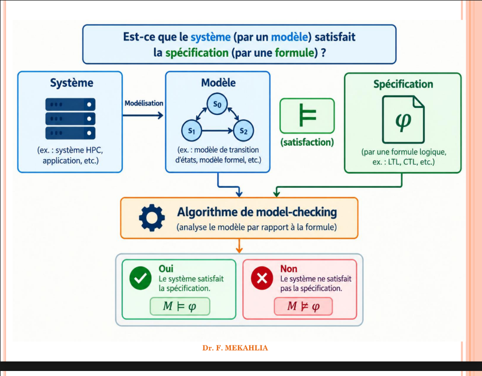
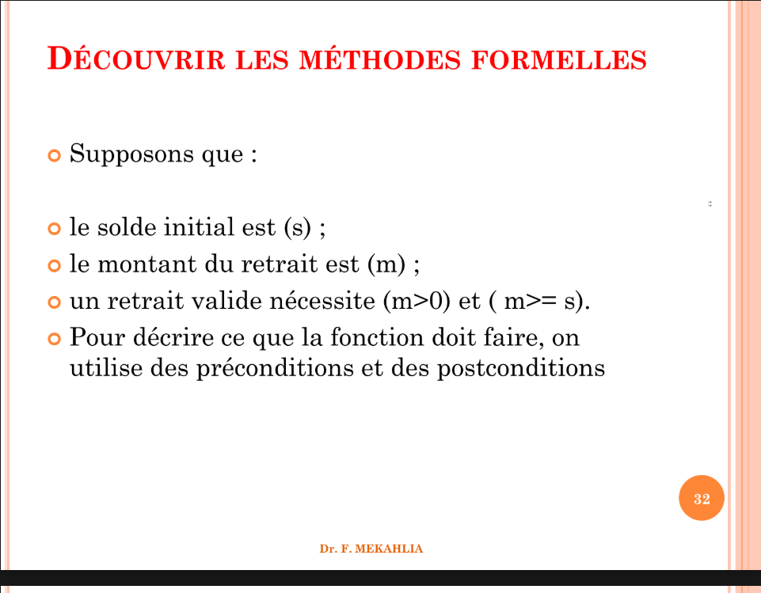
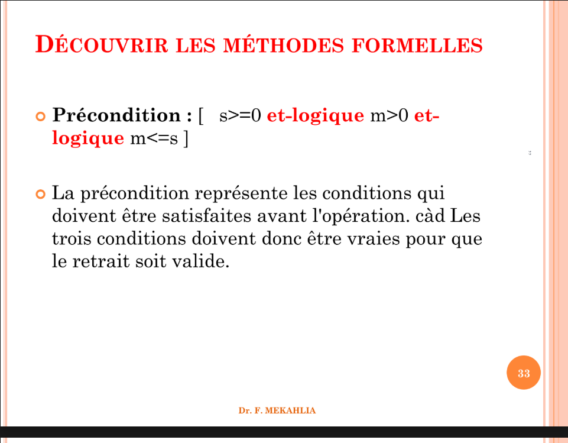

# Chapitre 1 — Introduction aux méthodes formelles

Support : Chapter 01_Introduction to Formal Methods - MFGL Mekahlia.pdf
Source : https://drive.google.com/file/d/1iWXYgF6gB52RN5QQfW-Qs4SzJJMboIfo/view?usp=classroom_web&authuser=0
Nombre de diapositives : 52

Le bloc « Texte du support » conserve la formulation de la diapositive. Les puces de police ont été remplacées par • et les notifications du lecteur ont été retirées. Les blocs complémentaires rendent les images/formules en texte ; les notes pédagogiques sont signalées séparément.

## Diapositive 1

**Texte du support :**

```text
UNIVERSITY OF SCIENCE AND TECHNOLOGY HOUARI BOUMEDIENE
FACULTY OF COMPUTER SCIENCE
Course
Méthodes formelles pour GL
ING 5 en Soft.Eng
Dr MEKAHLIA Fatma Zohra
Associate Professor
Laboratoire de Modélisation, Vérification et Evaluation des Performances des systèmes
complexes (MOVEP)
Bureau 123
1
,,
Chapter 1:
Introduction to Formal Methods
```

## Diapositive 2

**Texte du support :**

```text
INTRODUCTION AUX MÉTHODES FORMELLES
POUR LE GÉNIE LOGICIEL
Partons d'un exemple simple:
• Imaginons que nous devons développer une petite
application permettant de réserver des billets de
train. L'application doit permettre à un
utilisateur de:
- Consulter les billets disponibles,
- Réserver un billet,
- Annuler une réservation.
• Avant de commencer à programmer, il faut
penser a quoi ? 2
,,
Dr. F. MEKAHLIA
```

## Diapositive 3

**Texte du support :**

```text
INTRODUCTION AUX MÉTHODES FORMELLES
POUR LE GÉNIE LOGICIEL
• Que doit faire exactement l'application ?
• Peut-on réserver deux fois le même billet ?
• Que se passe-t-il si deux utilisateurs tentent de
réserver simultanément le dernier billet
disponible ?
• Comment savoir si le programme fonctionne
correctement ?
• Peut-on garantir que le système ne produira
jamais une réservation incorrecte ?
3
,,
Dr. F. MEKAHLIA
```

## Diapositive 4

**Texte du support :**

```text
INTRODUCTION AUX MÉTHODES FORMELLES
POUR LE GÉNIE LOGICIEL
• Les deux premières questions concernent les
besoins et les fonctionnalités.
• Les dernières nous conduisent vers un problème
plus général : comment vérifier la correction
d'un logiciel ?
• Supposons que le développeur programme
l'application, puis réalise dix tests. Les dix tests
réussissent..... Peut-on conclure que le
logiciel est correct ?
4
,,
Dr. F. MEKAHLIA
```

## Diapositive 5

**Texte du support :**

```text
INTRODUCTION AUX MÉTHODES FORMELLES
POUR LE GÉNIE LOGICIEL
• Pas nécessairement !!!!!
• Les tests peuvent avoir oublié certaines
situations, par exemple deux réservations
simultanées, une annulation tardive ou une
interruption pendant la réservation.
• Le logiciel peut donc réussir tous les tests
réalisés tout en présentant encore des défauts.
• C'est le problème fondamental auquel nous
allons nous intéresser. 5
,,
Dr. F. MEKAHLIA
```

## Diapositive 6

**Texte du support :**

```text
INTRODUCTION AUX MÉTHODES FORMELLES
POUR LE GÉNIE LOGICIEL
• “ Program testing can be used to show the presence of
bugs, but never show their absence ” ... Edsger W.
Dijkstra
• « Beware of bugs in the above code; I have only
proved it correct, not tried it. »...Donald E.
Knuth
6
,,
Dr. F. MEKAHLIA
```

## Diapositive 7

**Texte du support :**

```text
INTRODUCTION AUX MÉTHODES FORMELLES
POUR LE GÉNIE LOGICIEL
• Loi de Murphy: « Tout ce qui est susceptible de
mal tourner tournera nécessairement mal. »
« S'il existe au moins deux façons de faire quelque
chose et qu'au moins l'une de ces façons
peut entraîner une catastrophe, il se trouvera
forcément quelqu'un quelque part pour emprunter
cette voie. »
Edward A. Murphy Jr
7
,,
Dr. F. MEKAHLIA
```

## Diapositive 8

**Texte du support :**

```text
INTRODUCTION AUX MÉTHODES FORMELLES
POUR LE GÉNIE LOGICIEL
• 60 à 80% du coût total est la maintenance.
• 20 fois plus cher de gérer un bug en production
plutôt qu’en conception.
• Les techniques classiques de Vérification sont :
● La simulation
● Le test
• Inconvénients :
● Ne garantissent pas l’exhaustivité de la
vérification
● Sont encore très manuelles, donc très
coûteuses.
8
,,
Dr. F. MEKAHLIA
```

## Diapositive 9

**Texte du support :**

```text
TROIS NOTIONS À DISTINGUER : TEST,
VÉRIFICATION ET VALIDATION
Test logiciel
• Un test consiste généralement à exécuter un
logiciel dans des conditions données, à observer
son résultat et à le comparer au résultat attendu.
• Le test permet de vérifier le comportement du
programme pour ce scénario précis.
• Attention : un test réussi signifie que le résultat
observé est conforme au résultat attendu dans les
conditions du test. Il ne prouve pas que tous les
autres scénarios fonctionneront correctement.
9
,,
Dr. F. MEKAHLIA
```

## Diapositive 10

**Texte du support :**

```text
TROIS NOTIONS À DISTINGUER : TEST, VÉRIFICATION
ET VALIDATION
La vérification
• La vérification cherche à déterminer si le système respecte
les exigences ou la spécification qui lui est applicable.
• La question centrale est : « Construisons-nous
correctement le système par rapport à ce qui a été
spécifié ? »
• Dans notre application de réservation, la spécification peut
imposer la règle suivante :
• « Un billet déjà réservé ne doit pas être attribué à un autre
utilisateur. »
• La vérification cherche à déterminer si le système respecte
cette règle.
• Elle peut s'appuyer sur des revues, des analyses statiques,
des tests ou des méthodes formelles. Ces techniques
n'apportent pas toutes le même type de garantie. 10,,
Dr. F. MEKAHLIA
```

## Diapositive 11

**Texte du support :**

```text
TROIS NOTIONS À DISTINGUER : TEST,
VÉRIFICATION ET VALIDATION
La validation
• La validation cherche à déterminer si le système
développé répond réellement aux besoins de ses
utilisateurs.
• La question centrale est : « Construisons-nous le bon
système ? »
• Supposons que l'application respecte parfaitement sa
spécification, mais que cette spécification ne prévoit pas la
possibilité de modifier une réservation, alors que cette
fonctionnalité est indispensable aux utilisateurs.
• Le logiciel peut être conforme à sa spécification tout en
étant inadapté au besoin réel.
• La validation doit donc vérifier l'adéquation du système
aux besoins attendus.
11,,
Dr. F. MEKAHLIA
```

## Diapositive 12

**Texte du support :**

```text
TABLEAU COMPARATIF
Activité Question principale Exemple
Test Quel résultat obtient- on pour ce scénario ?
Réserver un billet
disponible
Vérification Le système respecte-t- il sa spécification ?
Un billet réservé ne
peut pas être attribué
une deuxième fois
Validation Le système répond-il
au besoin réel ?
Les utilisateurs
peuvent-ils accomplir
les opérations
nécessaires ?
12,,
Dr. F. MEKAHLIA
```

## Diapositive 13

**Texte du support :**

```text
DÉCOUVRIR LES MÉTHODES FORMELLES
• Une méthode formelle est une approche qui utilise des
concepts mathématiques et des langages formels pour
décrire, analyser ou vérifier un système logiciel.
• Les méthodes formelles sont des techniques alternatives,
fondées sur des bases mathématiques, permettant la
spécification et le développement de systèmes, ainsi que la
vérification automatique de propriétés.
• Un éventail de langages et de techniques formels existe
pour traiter différents types de propriétés à différents
niveaux de développement des systèmes.
• Avantage : non ambiguïté des mathématiques !
13,,
Dr. F. MEKAHLIA
```

## Diapositive 14

**Texte du support :**

```text
DÉCOUVRIR LES MÉTHODES FORMELLES
• Les méthodes formelles en informatique sont des
techniques rigoureuses basées sur la logique
mathématique pour concevoir, spécifier, développer
et vérifier des systèmes logiciels et matériels.
14,,
Dr. F. MEKAHLIA
```

## Diapositive 15

**Texte du support :**

```text
DÉCOUVRIR LES MÉTHODES FORMELLES
• Selon la méthode utilisée, elle peut servir à :
• préciser les exigences ;
• décrire le comportement d'un système ;
• exprimer des propriétés à respecter ;
• démontrer qu'un programme satisfait certaines
conditions ;
• explorer automatiquement les états d'un modèle ;
• détecter des comportements interdits.
15,,
Dr. F. MEKAHLIA
```

## Diapositive 16

**Texte du support :**

```text
DÉCOUVRIR LES MÉTHODES FORMELLES
• Principe des méthodes formelles: Utiliser les outils
mathématiques pour concevoir et si possible
réaliser des systèmes informatiques.
● Description formelle :
utilisation d’un modèle mathématique pour décrire le
comportement d’un système.
● Spécification formelle :
Exprimer des propriétés à l’aide d’un langage formel
● Vérification formelle :
Prouver formellement la satisfaction ou non d’une
propriété
16,,
Dr. F. MEKAHLIA
```

## Diapositive 17

**Texte du support :**

```text
DÉCOUVRIR LES MÉTHODES FORMELLES
• L'idée générale est de remplacer une description trop
ambiguë par une représentation suffisamment
précise pour permettre un raisonnement rigoureux.
• L'objectif des méthodes formelles est d'assurer la qualité des
logiciels en proposant une méthode alternative aux méthodes
de test traditionnelle. Cette méthode repose principalement
sur un traitement symbolique des programmes et de propriétés
logiques qui expriment ce que l'on attend de ces programmes:
les spécifications.
17,,
Dr. F. MEKAHLIA
```

## Diapositive 18

**Texte du support :**

```text
DÉCOUVRIR LES MÉTHODES FORMELLES
• Reprenons l'exemple du billet :
• Une phrase informelle indique : « Un billet déjà
réservé ne peut pas être réservé une deuxième
fois. »
• Cette phrase exprime une règle importante. Nous
pouvons maintenant chercher à la représenter de
manière plus précise !!
18,,
Dr. F. MEKAHLIA
```

## Diapositive 19

**Texte du support :**

```text
DÉCOUVRIR LES MÉTHODES FORMELLES
• Définissons deux états : Disponible, Réservé.
• Puis deux actions : Réserver, Annuler.
• Le comportement attendu devient :
19,,
Disponible Réservé
Réservé
Annuler
Dr. F. MEKAHLIA
```

**Transcription complémentaire des éléments visuels :**

Schéma : deux états « Disponible » et « Réservé ». Une flèche va de Disponible vers Réservé, avec l'étiquette « Réservé » telle qu'imprimée dans la figure. Une transition « Annuler » revient de Réservé vers Disponible.



**Note de lecture / correction :** Le texte de la diapositive nomme l'action « Réserver » ; la figure imprime « Réservé ». Il s'agit du nom de l'action de réservation, à distinguer du nom de l'état.

## Diapositive 20

**Texte du support :**

```text
DÉCOUVRIR LES MÉTHODES FORMELLES
• Nous pouvons alors examiner si une transition
permettrait de réserver directement un billet
déjà réservé. Si une telle transition existe dans le
modèle, elle doit être justifiée ou corrigée.
• Modéliser n'est pas encore tout vérifier: Le
dessin précédent représente le comportement
attendu. Il ne prouve pas automatiquement que
le programme respecte ce comportement.
20,,
Dr. F. MEKAHLIA
```

## Diapositive 21

**Texte du support :**

```text
DÉCOUVRIR LES MÉTHODES FORMELLES
• Pour vérifier la correction du système réel, il faut
notamment préciser :
• ce que signifie exactement chaque état ;
• quelles actions sont autorisées ;
• quelles propriétés doivent être respectées ;
• comment le modèle est relié à l'implémentation ;
• quelles hypothèses sont faites sur
l'environnement.
• Il est donc essentiel de distinguer le modèle du
programme réel.
21,,
Dr. F. MEKAHLIA
```

## Diapositive 22

**Texte du support :**

```text
DÉCOUVRIR LES MÉTHODES FORMELLES
• Du besoin à l'implémentation : cinq notions
essentielles !!
• 1-Le besoin: Le besoin décrit l'objectif de
l'utilisateur.
• Exemple :
-« Je veux réserver un billet de train. »
-Il répond principalement à la question : pourquoi
le système est-il nécessaire ?
22,,
Dr. F. MEKAHLIA
```

## Diapositive 23

**Texte du support :**

```text
DÉCOUVRIR LES MÉTHODES FORMELLES
• 2-L'exigence: L'exigence précise un
comportement ou une contrainte attendue.
• Exemple :
-« Un billet déjà réservé ne doit pas pouvoir être
attribué à un autre utilisateur. »
-Elle doit être suffisamment claire pour pouvoir
être évaluée.
23,,
Dr. F. MEKAHLIA
```

## Diapositive 24

**Texte du support :**

```text
DÉCOUVRIR LES MÉTHODES FORMELLES
• 3-La spécification: La spécification décrit de
manière structurée ce que le système doit faire et
les contraintes qu'il doit respecter.
• Elle peut être rédigée en langage naturel, avec
des tableaux, des diagrammes ou à l'aide d'un
langage formel.
• Une spécification formelle cherche à réduire
l'ambiguïté grâce à une notation mathématique
définie.
24,,
Dr. F. MEKAHLIA
```

## Diapositive 25

**Texte du support :**

```text
DÉCOUVRIR LES MÉTHODES FORMELLES
• Le modèle: Le modèle est une représentation
abstraite du système.
• Il peut décrire :
• les états possibles ;
• les actions ;
• les transitions ;
• les données ;
• les communications ;
• les propriétés pertinentes.
• Le modèle est construit pour répondre à une
question précise. Il ne doit pas nécessairement
reproduire tous les détails de l'implémentation.
25,,
Dr. F. MEKAHLIA
```

## Diapositive 26

**Texte du support :**

```text
DÉCOUVRIR LES MÉTHODES FORMELLES
• L'implémentation: L'implémentation est le
programme effectivement développé.
• Par exemple, le modèle du billet peut être traduit
en classes Java, en transactions de base de
données et en interfaces.
26,,
Dr. F. MEKAHLIA
```

## Diapositive 27

**Texte du support :**

```text
DÉCOUVRIR LES MÉTHODES FORMELLES
• Besoin →
• Exigences ->
• Spécification ->
• Modèle Formel ->
• Vérification de propriétés ->
• Conception et implémentation ->
• Test et autres vérifications ->
• Validation,
27,,
Dr. F. MEKAHLIA
```

## Diapositive 28

**Texte du support :**

```text
DÉCOUVRIR LES MÉTHODES FORMELLES
• Systèmes Critiques :
•
Un système critique est un système dont la
panne peut avoir des conséquences
dramatiques, des morts ou des blessés graves,
des dégâts matériels importants,
ou des conséquences graves pour
l'environnement.
28,,
Dr. F. MEKAHLIA
```

## Diapositive 29

**Texte du support :**

```text
DÉCOUVRIR LES MÉTHODES FORMELLES
• Domaines critiques :
● les systèmes de transport : pilotage des avions, des
trains, logiciels embarqués automobiles,
● la production d'énergie : contrôle des centrales
nucléaires,
;
● la santé : chaînes de production de médicaments,
appareil médicaux (à rayonnement ou contrôle de dosages) ;
● le système financier : paiement électronique ;
● les applications militaires. Etc,
29,,
Dr. F. MEKAHLIA
```

## Diapositive 30

**Texte du support :**

```text
30,,
Dr. F. MEKAHLIA
```

**Transcription complémentaire des éléments visuels :**

Est-ce que le système (par un modèle) satisfait la spécification (par une formule) ?
Système (ex. : système HPC, application, etc.) — Modélisation → Modèle (ex. : modèle de transition d'états, modèle formel, etc.).
Spécification : φ, exprimée par une formule logique, par exemple LTL ou CTL.
Le modèle et la spécification sont les deux entrées de l'algorithme de model-checking, qui analyse le modèle par rapport à la formule.
Oui : le système satisfait la spécification, M ⊨ φ.
Non : le système ne satisfait pas la spécification, M ⊭ φ.
Le symbole ⊨ représente la satisfaction.



## Diapositive 31

**Texte du support :**

```text
• Qu'est-ce qu'une spécification formelle ?
• Une spécification formelle décrit
mathématiquement certaines exigences ou
certains comportements attendus d'un système.
• Son intérêt est de rendre les règles suffisamment
précises pour permettre une analyse rigoureuse.
• Exemple:
• Nous souhaitons définir le comportement d'une
fonction qui retire un montant d'un compte.
• 31,,
DÉCOUVRIR LES MÉTHODES FORMELLES
Dr. F. MEKAHLIA
```

## Diapositive 32

**Texte du support :**

```text
• Supposons que :
• le solde initial est (s) ;
• le montant du retrait est (m) ;
• un retrait valide nécessite (m>0) et ( m>= s).
• Pour décrire ce que la fonction doit faire, on
utilise des préconditions et des postconditions
32,,
DÉCOUVRIR LES MÉTHODES FORMELLES
Dr. F. MEKAHLIA
```



**Note de lecture / correction :** Coquille confirmée visuellement dans le support : « m >= s » est imprimé ici. Pour un retrait sans découvert, il faut m <= s, comme l'indique correctement la précondition de la page 33.

## Diapositive 33

**Texte du support :**

```text
• Précondition : [ s>=0 et-logique m>0 et- logique m<=s ]
• La précondition représente les conditions qui
doivent être satisfaites avant l'opération. càd Les
trois conditions doivent donc être vraies pour que
le retrait soit valide.
33,,
DÉCOUVRIR LES MÉTHODES FORMELLES
Dr. F. MEKAHLIA
```



## Diapositive 34

**Texte du support :**

```text
• Postcondition : [ s’ =s-m ]
• La postcondition exprime le résultat attendu
après l'opération.
• Ici, (s') désigne le nouveau solde.
• Nous avons ainsi décrit une partie du contrat de
la fonction sans imposer un algorithme
particulier.
• Plusieurs implémentations peuvent respecter ce
contrat.
34,,
DÉCOUVRIR LES MÉTHODES FORMELLES
Dr. F. MEKAHLIA
```

## Diapositive 35

**Texte du support :**

```text
• Pourquoi utilise-t-on une précondition et une
postcondition ?
• La précondition indique ce qui doit être vrai avant
l'exécution de la fonction.
• La postcondition indique ce qui doit être vrai après
son exécution, si les conditions prévues sont
respectées.
• On peut résumer le contrat ainsi :
• {si précondition est vrai donc Le retrait est
valide} Exécution de la fonction du retrait { post
condition corrcet: Le nouveau solde correspond
au solde initial moins le retrait. }
35,,
DÉCOUVRIR LES MÉTHODES FORMELLES
Dr. F. MEKAHLIA
```

## Diapositive 36

**Texte du support :**

```text
DÉCOUVRIR LES MÉTHODES FORMELLES
• L'idée importante en méthodes formelles : nous
décrivons ce que la fonction doit respecter, sans
imposer la manière de programmer cette
fonction.
• Par exemple, deux programmeurs peuvent
utiliser des algorithmes différents, mais leurs
implémentations doivent toutes les deux
respecter le contrat.
• Petite précision : ce contrat décrit le
comportement d'un retrait valide. Pour couvrir
aussi les retraits invalides, il faudrait spécifier ce
que la fonction doit faire lorsqu'une précondition
n'est pas satisfaite, par exemple refuser le
retrait.
36,,
Dr. F. MEKAHLIA
```

## Diapositive 37

**Texte du support :**

```text
DÉCOUVRIR LES MÉTHODES FORMELLES
• Pourquoi est-ce utile ?
• Une description informelle comme « retirer un
montant du compte » ne précise pas
nécessairement :
• si un retrait nul est accepté ;
• si un montant négatif est interdit ;
• si le solde peut devenir négatif ;
• quel doit être le nouveau solde.
• La spécification rend ces conditions explicites.
• Elle permet ensuite de concevoir des tests et,
avec une technique adaptée, de raisonner
formellement sur le programme. 37,,
Dr. F. MEKAHLIA
```

## Diapositive 38

**Texte du support :**

```text
DÉCOUVRIR LES MÉTHODES FORMELLES
• Le rôle de l'abstraction:
• Un modèle formel ne représente pas forcément
tous les détails du système réel.
• Il retient les informations nécessaires à l'analyse.
• Prenons un feu de circulation.
• Pour vérifier que deux directions ne sont jamais
simultanément au vert, nous pouvons
représenter uniquement les états des feux :
38,,
Dr. F. MEKAHLIA
```

## Diapositive 39

**Texte du support :**

```text
DÉCOUVRIR LES MÉTHODES FORMELLES
• A_VERT
• A_orange
• A_ROUGE
;;;;;;;;;;;;;;;;;;;;;;;;;;;;;;;;;;;;;
• B_VERT
• B_orange
• B_ROUGE
• Nous n'avons pas besoin de représenter la forme du boîtier,
la couleur exacte des LED ou la température des
composants pour étudier cette propriété logique.
• Nous conservons les informations pertinentes et ignorons
les détails qui n'influencent pas la propriété étudiée.
• Cette démarche s'appelle l'abstraction.
39,,
Dr. F. MEKAHLIA
```

## Diapositive 40

**Texte du support :**

```text
DÉCOUVRIR LES MÉTHODES FORMELLES
• Pourquoi l'abstraction est-elle importante ?
• Sans abstraction, un système réel peut être trop
complexe à analyser.
• Avec une abstraction appropriée, on obtient un modèle
plus simple, que l'on peut étudier.
• Mais il existe un risque : si le modèle omet un élément
essentiel, une propriété vérifiée sur le modèle peut ne
pas être valable sur le système réel.
• Il faut donc justifier les choix de modélisation et les
hypothèses utilisées.
40,,
Dr. F. MEKAHLIA
```

## Diapositive 41

**Texte du support :**

```text
DÉCOUVRIR LES MÉTHODES FORMELLES
Quelles propriétés voulons-nous vérifier ?
• Jusqu'à présent, nous avons parlé de spécification et
de modèle. Il reste à définir précisément ce que l'on
veut vérifier.
• Il ne suffit pas de construire un modèle : il faut
formuler une question de correction.
• Les propriétés les plus usuelles (il est montré que
toute autre propriété peut être ramenée à une de ces
propriétés ou à une combinaison de plusieurs d’entre
elles)
41,,
Dr. F. MEKAHLIA
```

## Diapositive 42

**Texte du support :**

```text
DÉCOUVRIR LES MÉTHODES FORMELLES
● Accessibilité : un état donné est accessible depuis
l’état initial.
● Invariance : tous les états du système vérifient une
certaine propriété.
● Les propriétés de sécurité (Sûreté ) -
Safety: exprime qu'un événement ou un état
indésirable ne doit jamais se produire.
• On peut la résumer par :« Quelque chose de mauvais
ne doit jamais arriver. »
• Exemple : feu de circulation
• Deux directions A et B ne doivent jamais être
simultanément au vert.
42,,
Dr. F. MEKAHLIA
```

## Diapositive 43

**Texte du support :**

```text
DÉCOUVRIR LES MÉTHODES FORMELLES
• Accessibilité (Reachability) : un état donné est
accessible depuis l’état initial.
• Invariance (Invariance) : tous les états du système
vérifient une certaine propriété.
• Sécurité (Sûreté ) «Safety»: Quelque chose de mauvais
ne doit jamais arriver.
• Vivacité «Liveness»: Quelque chose de bon finira par
arriver.
• Équité (Fairness): Quelque chose se produira infiniment
souvent
43,,
Dr. F. MEKAHLIA
```

## Diapositive 44

**Texte du support :**

```text
DÉCOUVRIR LES MÉTHODES FORMELLES
• Accessibilité (Reachability) : une propriété
d'accessibilité indique qu'un état particulier du système
peut être atteint à partir de l'état initial en suivant une
suite de transitions.
• Question à se poser : Est-il possible d'atteindre cet état ?
• Exemple : feu de circulation
• Un feu de circulation possède trois états : Rouge, Vert et
Orange.
• Si le système démarre à l'état Rouge, l'état Vert est
accessible, car une transition permet de l'atteindre. En
revanche, si un état « Panne » n'est relié à aucune
transition accessible depuis l'état initial, cet état n'est pas
accessible.
À retenir : l'accessibilité concerne la possibilité d'atteindre
un état. 44,,
Dr. F. MEKAHLIA
```

## Diapositive 45

**Texte du support :**

```text
DÉCOUVRIR LES MÉTHODES FORMELLES
• Invariance (Invariance) : une propriété d'invariance est une
propriété qui doit rester vraie dans tous les états atteignables du
système, depuis l'état initial.
• Question à se poser : Cette propriété reste-t-elle toujours vraie
?
• Exemple : compte bancaire
• Supposons qu'un compte bancaire ne doit jamais avoir un solde
négatif. La propriété d'invariance est : s>=0
• Cette propriété doit être vraie à chaque étape de l'exécution.
• Solde initial : 1000 DA → propriété respectée.
• Après un retrait de 300 DA : 700 DA → propriété respectée.
• Après un retrait incorrect de 1200 DA : −200 DA → propriété
violée.
• Dans ce dernier cas, le système ne respecte pas l'invariance.
• À retenir : l'invariance est une propriété qui doit toujours rester
vraie. Elle constitue souvent une propriété de sûreté (Safety). 45,,
Dr. F. MEKAHLIA
```

## Diapositive 46

**Texte du support :**

```text
DÉCOUVRIR LES MÉTHODES FORMELLES
• Sécurité (Safety ): exprime qu'un événement ou
un état indésirable ne doit jamais se produire.
Exemple : feu de circulation ::: Deux directions A et B
ne doivent jamais être simultanément au vert.
Autres exemples
• un compte bancaire ne doit pas accepter des retraits
qui violent les règles de solde ;
• deux processus ne doivent pas entrer simultanément
dans une section critique exclusive ;
• un billet ne doit pas être attribué à deux utilisateurs ;
• un système ne doit pas autoriser une opération
interdite. 46,,
Dr. F. MEKAHLIA
```

## Diapositive 47

**Texte du support :**

```text
DÉCOUVRIR LES MÉTHODES FORMELLES
• Vivacité «Liveness»: Une propriété de vivacité exprime
qu'un événement souhaité finit par se produire.
• Exemple : traitement d'une demande
• Supposons qu'un utilisateur demande un service. Il ne
suffit pas que le système évite les erreurs. Il faut aussi que
la demande ne soit pas ignorée indéfiniment. Nous
souhaitons donc garantir que toute demande persistante
sera finalement traitée.
Autres exemples :
• une réservation valide finit par recevoir une réponse ;
• un processus qui attend son tour finit par accéder à la
ressource, sous les hypothèses de progression nécessaires ;
• un feu finit par autoriser le passage d'une direction qui
attend.
47,,
Dr. F. MEKAHLIA
```

## Diapositive 48

**Texte du support :**

```text
DÉCOUVRIR LES MÉTHODES FORMELLES
• Attention : une propriété de vivacité nécessite souvent
des hypothèses sur l'environnement ou
l'ordonnancement. Si un processus peut être
systématiquement privé de temps d'exécution, la
progression n'est pas automatiquement garantie.
48,,
Dr. F. MEKAHLIA
```

## Diapositive 49

**Texte du support :**

```text
DÉCOUVRIR LES MÉTHODES FORMELLES
• Équité (Fairness): l'équité est une condition qui
empêche certaines exécutions du système de négliger
indéfiniment une action ou un processus qui devrait
pouvoir progresser.
• Elle est particulièrement importante dans les
systèmes concurrents et les systèmes répartis.
• Question à se poser : Un processus risque-t-il
d'attendre indéfiniment alors qu'il devrait pouvoir
s'exécuter ?
• Exemple : accès à une imprimante partagée
49,,
Dr. F. MEKAHLIA
```

## Diapositive 50

**Texte du support :**

```text
DÉCOUVRIR LES MÉTHODES FORMELLES
• Deux processus, P_1 et P_2, souhaitent utiliser la
même imprimante.
• Si le système donne toujours la priorité à P_1, alors
P_2 peut attendre indéfiniment, même s'il demande
régulièrement l'accès à l'imprimante.
• Un mécanisme équitable peut garantir que P_2
obtiendra finalement son tour, sous les hypothèses
nécessaires sur le fonctionnement du système.
• À retenir : l'équité vise à éviter qu'un processus soit
continuellement défavorisé. Elle contribue à garantir
la progression des processus, mais ne garantit pas à
elle seule que toutes les opérations terminent.
50,,
Dr. F. MEKAHLIA
```

## Diapositive 51

**Texte du support :**

```text
DÉCOUVRIR LES MÉTHODES FORMELLES
• Synthèse des propriétés
51,,
Propriété Question principale Exemple
Safety (Sûreté) Quelque chose de mauvais peut-il arriver ? Deux utilisateurs ne réservent pas la
même place.
Liveness (Vivacité) Quelque chose de bon finit-il par arriver ? Une demande finit par être traitée.
Accessibilité Un état donné peut-il être atteint ? Le feu peut-il passer au vert ?
Invariance Une propriété reste-t-elle toujours vraie ? Le solde du compte reste positif ou
nul.
Équité (Fairness) Un processus risque-t-il d'être
indéfiniment négligé ?
Chaque processus obtient
éventuellement l'accès à
l'imprimante.
Dr. F. MEKAHLIA
```

## Diapositive 52

**Texte du support :**

```text
Merci ☺
52,,
```
