# Chapitre 3 — Logique de Hoare : spécification et vérification de programmes

Support : Chapitre 03 Logique de Hoare.pdf
Source : https://drive.google.com/file/d/1xhBbrrmuE7iUviFPHgyiGwUahMoIBhAi/view?usp=classroom_web&authuser=0
Nombre de diapositives : 29

Le bloc « Texte du support » conserve la formulation de la diapositive. Les puces de police ont été remplacées par • et les notifications du lecteur ont été retirées. Les blocs complémentaires rendent les images/formules en texte ; les notes pédagogiques sont signalées séparément.

## Diapositive 1

**Texte du support :**

```text
UNIVERSITY OF SCIENCE AND TECHNOLOGY HOUARI BOUMEDIENE
FACULTY OF COMPUTER SCIENCE
Course
Méthodes formelles pour GL
ING 5 en Soft.Eng
Dr MEKAHLIA Fatma Zohra
Associate Professor
Laboratoire de Modélisation, Vérification et Evaluation des Performances des systèmes
complexes (MOVEP)
Bureau 123
1
,,
Chapter 3:
Logique de Hoare: spécification et vérification de programme
```

## Diapositive 2

**Texte du support :**

```text
INTRODUCTION
• En génie logiciel, le développement d’un
programme ne consiste pas uniquement à écrire
du code qui semble fonctionner. Il faut également
s’assurer que le programme respecte les
exigences qui lui sont imposées.
2
,,
Dr. F. MEKAHLIA
```

## Diapositive 3

**Texte du support :**

```text
SYSTÈME DE RÉSERVATION DE PLACES POUR
UN ÉVÉNEMENT.
3
,,
Dr. F. MEKAHLIA
```

**Transcription complémentaire des éléments visuels :**

Le problème : système de réservation de places.
Événement : 10 places au total. Un utilisateur fait une demande de réservation.
Ce que doit faire le système :
1. Vérifier qu'une place est disponible.
2. Attribuer une place à l'utilisateur si possible.
3. Diminuer le nombre de places disponibles.
4. Confirmer la réservation.
5. Rejeter la demande si aucune place n'est disponible.
Organigramme : demande de réservation → une place disponible ?
Oui → attribuer la place + diminuer le compteur + confirmer.
Non → rejeter la demande.

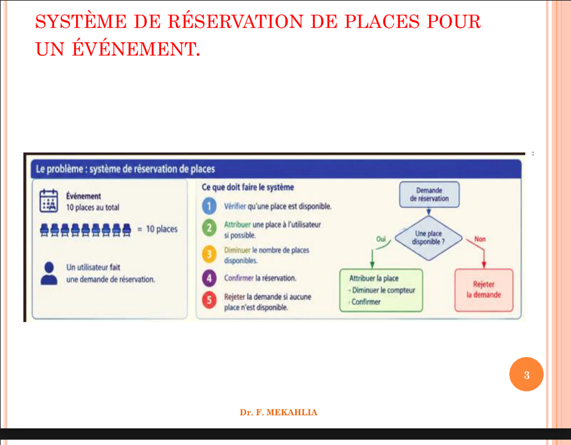

## Diapositive 4

**Texte du support :**

```text
SYSTÈME DE RÉSERVATION DE PLACES POUR
UN ÉVÉNEMENT
4
,,
Dr. F. MEKAHLIA
```

**Transcription complémentaire des éléments visuels :**

La diapositive reprend le système de réservation et ajoute quatre erreurs possibles :
1. Le nombre de places devient négatif : places disponibles = -1.
2. Le système confirme une réservation alors qu'il n'y a plus de place.
3. Le compteur n'est pas correctement mis à jour : il affiche 10 places disponibles alors qu'une place a été prise.
4. Une réservation est confirmée sans que la place ait réellement été attribuée.

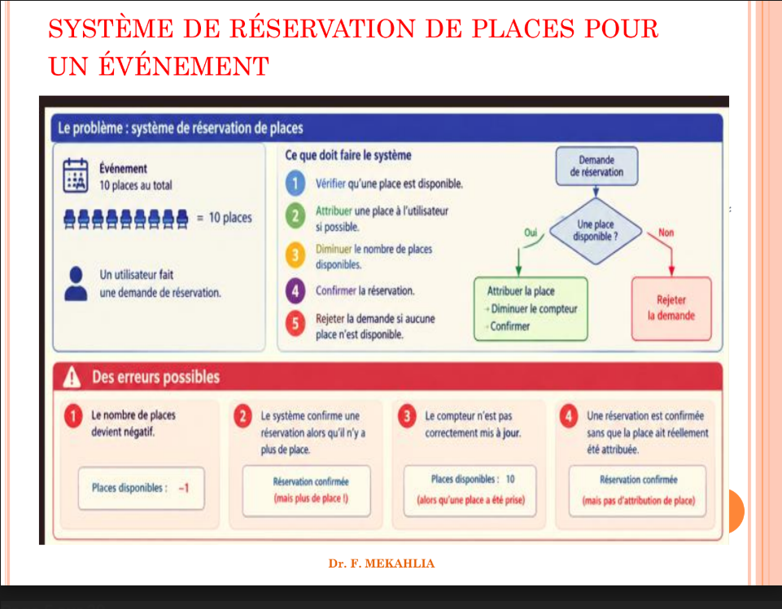

## Diapositive 5

**Texte du support :**

```text
SYSTÈME DE RÉSERVATION DE PLACES POUR
UN ÉVÉNEMENT
• La question fondamentale est donc la suivante :
• Comment démontrer que le programme
respecte les règles de réservation, et pas
seulement vérifier qu’il fonctionne pour
quelques exemples ?
5
,,
Dr. F. MEKAHLIA
```

## Diapositive 6

**Texte du support :**

```text
6
,,
Dr. F. MEKAHLIA
```

**Transcription complémentaire des éléments visuels :**

Comment Hoare aide à spécifier et à garantir la correction ?
La logique de Hoare permet de décrire, pour chaque étape, ce qui doit être vrai avant et après l'exécution d'une action.
Exemple de spécification avec Hoare :
1. Vérification de la disponibilité : {places >= 0} if places > 0 then ... {places >= 0}.
2. Attribution de la place : {places > 0 ∧ user ∉ reservations} attribuer_place(user) {user ∈ reservations}.
3. Mise à jour du compteur : {places > 0} places := places - 1 {places >= 0}.
4. Confirmation : {user ∈ reservations ∧ places >= 0} confirmer() {reservation_confirmée(user)}.
5. Rejet si aucune place : {places = 0} rejeter() {aucune réservation confirmée}.
Que garantit Hoare ? Le nombre de places ne devient jamais négatif ; une réservation n'est confirmée que si une place a réellement été attribuée ; le compteur est correctement mis à jour ; les branches succès/échec sont séparées et vérifiées.
En résumé : passer d'un programme qui « semble correct » à une spécification formelle prouvant le respect des règles, même dans les situations particulières.

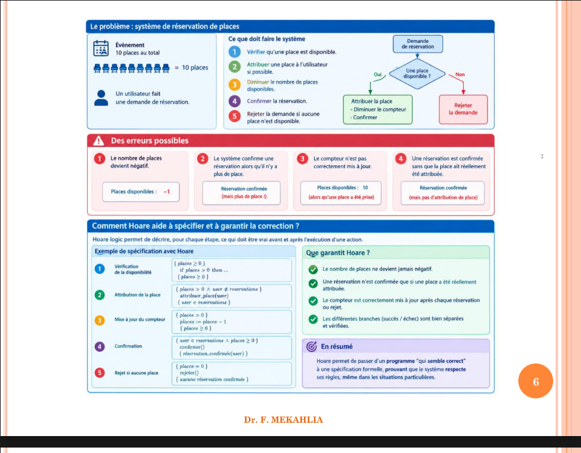

**Note de lecture / correction :** Il s'agit des contrats schématiques affichés dans l'infographie. Leur preuve exige aussi de préciser les effets des opérations comme attribuer_place et confirmer.

## Diapositive 7

**Texte du support :**

```text
DÉFINITION DE LA LOGIQUE DE HOARE
• La logique de Hoare est une méthode de
raisonnement formel permettant de spécifier et de
vérifier la correction d’un programme. Elle permet de
raisonner sur les effets des instructions à partir de
propriétés exprimées sous forme logique.
• Elle repose sur trois éléments :
• une précondition : ce qui doit être vrai avant
l’exécution ;
• une instruction ou un programme : ce qui est exécuté ;
• une postcondition : ce qui doit être vrai après
l’exécution.
• Ces trois éléments forment un triplet de Hoare. 7
,,
Dr. F. MEKAHLIA
```

## Diapositive 8

**Texte du support :**

```text
DÉFINITION DE LA LOGIQUE DE HOARE
8
,,
Dr. F. MEKAHLIA
```

**Transcription complémentaire des éléments visuels :**

Le triplet de Hoare : une façon de spécifier et de garantir la correction d'un programme.
Un triplet {P} C {Q} exprime que, si la précondition P est vraie avant l'exécution du code C, alors la postcondition Q sera vraie après son exécution.
Exemple : réservation de places. Le système dispose de 10 places ; un utilisateur effectue une réservation.
Précondition P : 0 <= nbPlaces <= 10 ; utilisateur valide ; aucune réservation en cours pour cet utilisateur.
Code C :
if nbPlaces > 0 then
    attribuerPlace();
    nbPlaces := nbPlaces - 1;
    confirmer();
else
    rejeter();
end if
Postcondition Q : 0 <= nbPlaces <= 10. Si la réservation est confirmée : nbPlaces = nbPlaces_0 - 1 et une place est attribuée à l'utilisateur. Sinon : nbPlaces = nbPlaces_0 et aucune place n'est attribuée.
Pourquoi cela aide ? Raisonner sur la correction sans exécuter le programme ; vérifier que les propriétés importantes sont conservées ; détecter les erreurs possibles ; prouver le respect des règles de réservation.
Erreurs possibles sans spécification correcte : nombre de places négatif ; confirmation sans place disponible ; compteur mal mis à jour ; réservation confirmée sans attribution.
Le triplet relie une précondition (ce que l'on suppose avant), un programme (le code à vérifier) et une postcondition (ce que l'on garantit après).

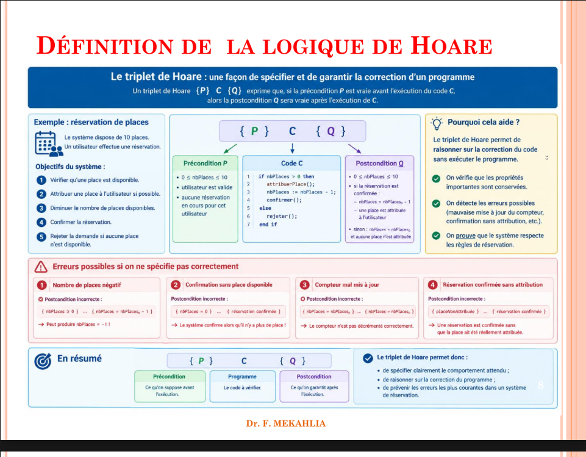

**Note de lecture / correction :** La lecture « après l'exécution » doit être précisée : en correction partielle, Q est garanti si l'exécution termine normalement. La terminaison demande une preuve supplémentaire.

## Diapositive 9

**Texte du support :**

```text
LE PROGRAMME ET SON ÉTAT
• Pour raisonner formellement sur un programme,
il faut préciser les variables qui décrivent son
état.
• Un état peut être représenté par une affectation
de valeurs à ces variables,
• L'état décrit donc les valeurs des variables à un
instant donné de l'exécution.
• Une instruction transforme généralement un état
en un autre état.
• Par exemple : x := x + 2
• À partir de l'état x=3, l'exécution produit
l'état x=5.
9
,,
Dr. F. MEKAHLIA
```

## Diapositive 10

**Texte du support :**

```text
LES ASSERTIONS
10,,
Dr. F. MEKAHLIA
```

**Transcription complémentaire des éléments visuels :**

Les assertions peuvent utiliser :
1. Les comparaisons =, ≠, <, ≤, >, ≥. Exemples : nbPlaces = 0 ; nbPlaces ≠ 10 ; nbPlaces < 5 ; nbPlaces ≤ 10 ; nbPlaces > 0 ; nbPlaces ≥ 0.
2. Les connecteurs logiques ∧, ∨, ¬, qui combinent ou inversent des propositions. Exemples : nbPlaces > 0 ∧ utilisateurValide ; nbPlaces = 0 ∨ nbPlaces < 0 ; ¬(nbPlaces = 0).
3. L'implication logique ⇒, qui exprime qu'une condition en entraîne une autre. Exemples affichés : nbPlaces > 0 ⇒ réservationPossible ; (nbPlaces = 0 ∧ réservationConfirmée) ⇒ rejetDemande.
4. Les quantificateurs : ∀, « pour tout » ; ∃, « il existe ».
Exemples universels : ∀u ∈ utilisateurs, u.valide = vrai ; ∀p ∈ places, 0 ≤ p ≤ 10.
Exemples existentiels : ∃u ∈ utilisateurs, u.reservationActive = vrai ; ∃p ∈ places, p.disponible = vrai.
En résumé : les assertions combinent comparaisons, connecteurs, implication et éventuellement quantificateurs pour exprimer précisément les conditions et propriétés à vérifier.

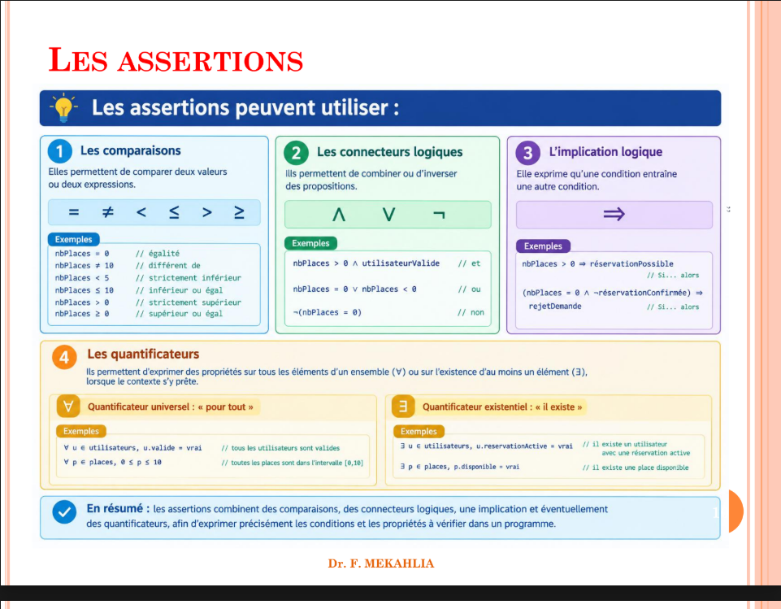

**Note de lecture / correction :** Ces exemples sont reproduits comme illustrations syntaxiques du support ; ils ne constituent pas à eux seuls une spécification complète et cohérente du système.

## Diapositive 11

**Texte du support :**

```text
LOGIQUE PROPOSITIONNELLE ET PRÉDICATS
11,,
Dr. F. MEKAHLIA
```

**Transcription complémentaire des éléments visuels :**

Connecteurs logiques : combiner des propositions pour former de nouvelles assertions.
Négation : ¬P, négation de P. Exemple : x ≤ 0 si P est x > 0.
Conjonction : P ∧ Q, P et Q. Exemple : x > 0 ∧ y > 0.
Disjonction : P ∨ Q, P ou Q. Exemple : x = 0 ∨ x = 1.
Implication : P ⇒ Q, si P alors Q. Exemple : x > 1 ⇒ x > 0.
Équivalence : P ⇔ Q ; P et Q ont la même valeur logique.
À retenir : construire des assertions plus complexes à partir de propositions simples ; exprimer des conditions, relations et règles dans les spécifications ; utiliser ces connecteurs dans les préconditions, postconditions et invariants.

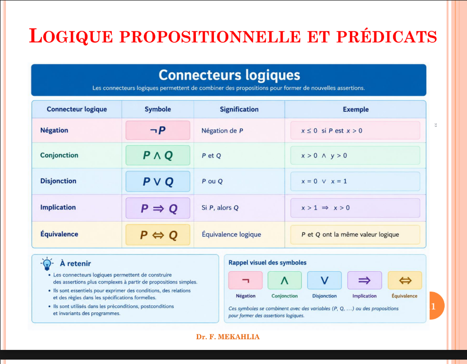

## Diapositive 12

**Texte du support :**

```text
PRÉDICATS ET VARIABLES
• Un prédicat est une expression logique dont la
valeur de vérité dépend des valeurs des variables.
• Les préconditions et postconditions sont
généralement des prédicats sur l'état du
programme.
12,,
Dr. F. MEKAHLIA
```

## Diapositive 13

**Texte du support :**

```text
LES RÈGLES FONDAMENTALES DE LA LOGIQUE DE
HOARE
• Règle de l’affectation: La règle de l’affectation
permet de déterminer la condition qui doit être
vraie avant l’exécution pour obtenir le résultat
souhaité après l’exécution.
• Exemple :
• On considère l’instruction x:=x+2 et on souhaite
obtenir x=10 à la fin.
• Avant l’exécution : x=8.
• Instruction exécutée : x:=x+2
• Après l’exécution : x=10
• On obtient le triplet de Hoare :
13,,
Dr. F. MEKAHLIA
```

**Transcription complémentaire des éléments visuels :**

Triplet affiché : {x = 8} x := x + 2 {x = 10}.

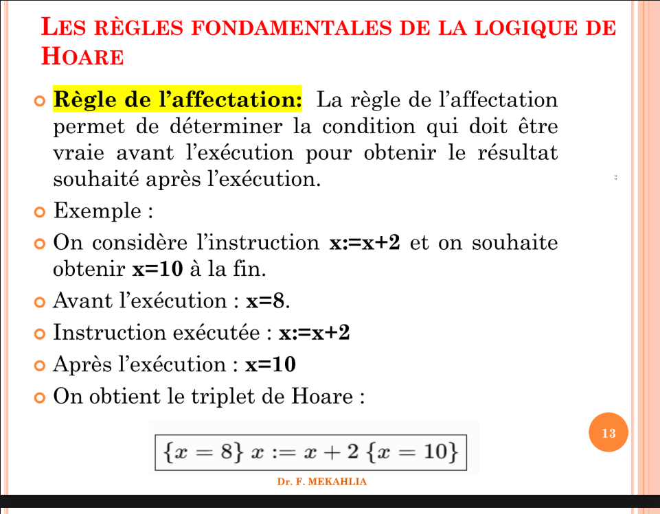

## Diapositive 14

**Texte du support :**

```text
LES RÈGLES FONDAMENTALES DE LA
LOGIQUE DE HOARE
• La règle de la séquence permet de vérifier un
programme composé de plusieurs instructions
exécutées l’une après l’autre. Le résultat de la
première instruction devient le point de départ de
la deuxième.
• Exemple :
• On considère le programme :
x := x + 1;
y := x * 2;
14,,
Dr. F. MEKAHLIA
```

## Diapositive 15

**Texte du support :**

```text
LES RÈGLES FONDAMENTALES DE LA LOGIQUE DE
HOARE
• On suppose initialement que x=2.
Première instruction (C1) : x:=x+1, donc x=3.
Deuxième instruction (C2): y:=x*2, donc y=6.
• On obtient le triplet de Hoare :
15,,
Dr. F. MEKAHLIA
```

**Transcription complémentaire des éléments visuels :**

Triplet affiché : {x = 2} C1 ; C2 {x = 3 ∧ y = 6}, avec C1 : x := x + 1 et C2 : y := x * 2.

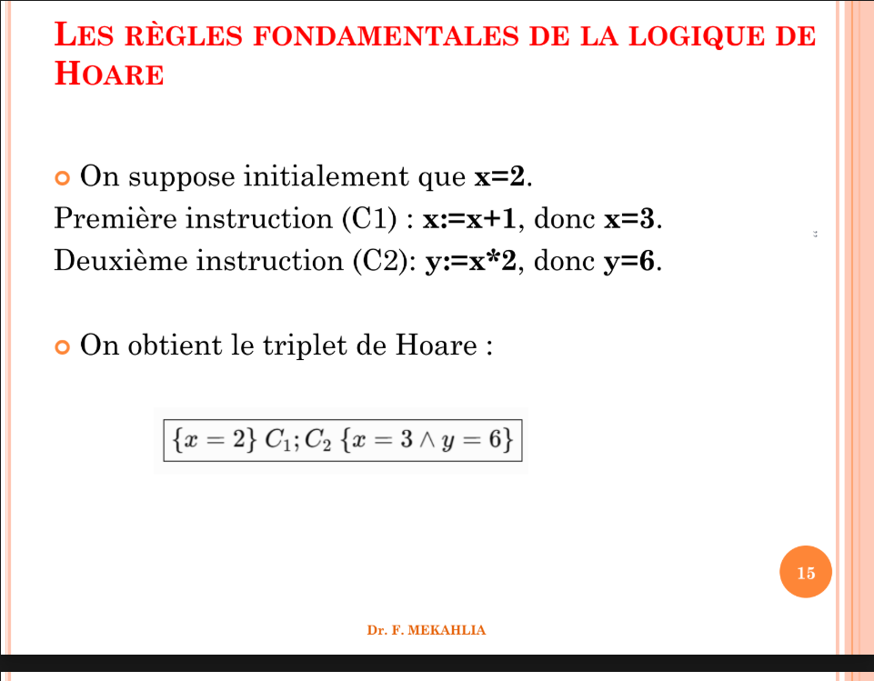

## Diapositive 16

**Texte du support :**

```text
LES RÈGLES FONDAMENTALES DE LA
LOGIQUE DE HOARE
• La règle de la condition permet de vérifier un
programme qui contient un choix entre deux
branches. Il faut vérifier que chaque branche
garantit le résultat souhaité.
• Exemple : On considère le programme :
• si x >= 0 alors
• y := x
• sinon
• y := -x
• On veut garantir que y >=0.
• Première branche : si x >= 0, alors y:=x, donc y>0.
• Deuxième branche : si x<0, alors y:=-x, donc y>0. 16,,
Dr. F. MEKAHLIA
```

**Note de lecture / correction :** Le support écrit « donc y > 0 » dans la première branche. Si x = 0, y = 0 ; la conclusion correcte est y >= 0. Le résultat global annoncé aux pages 16–17 est bien y >= 0.

## Diapositive 17

**Texte du support :**

```text
LES RÈGLES FONDAMENTALES DE LA
LOGIQUE DE HOARE
• Les deux branches garantissent que y >= 0. On
obtient donc :
17,,
Dr. F. MEKAHLIA
```

**Transcription complémentaire des éléments visuels :**

Triplet affiché : {true} C {y ≥ 0}, où C est la conditionnelle calculant y := x si x ≥ 0, sinon y := -x.

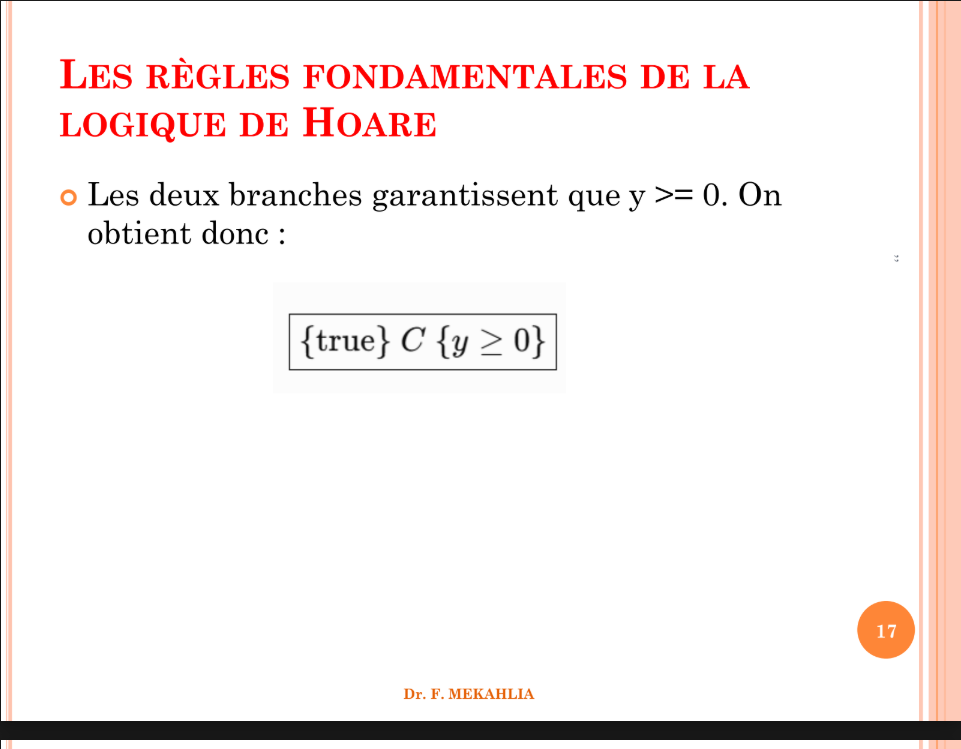

## Diapositive 18

**Texte du support :**

```text
LES RÈGLES FONDAMENTALES DE LA
LOGIQUE DE HOARE
• La règle de conséquence permet d’adapter une
preuve existante en imposant une condition
initiale plus stricte ou en acceptant un résultat
final moins exigeant.
• Exemple : On considère l’instruction :
x:=x+1
• On sait que :
• Or, si x=6, alors x >= 0. On peut donc remplacer
la postcondition x=6 par une condition moins
stricte, x >= 0. 18,,
Dr. F. MEKAHLIA
```

**Transcription complémentaire des éléments visuels :**

Triplet connu affiché : {x = 5} x := x + 1 {x = 6}.

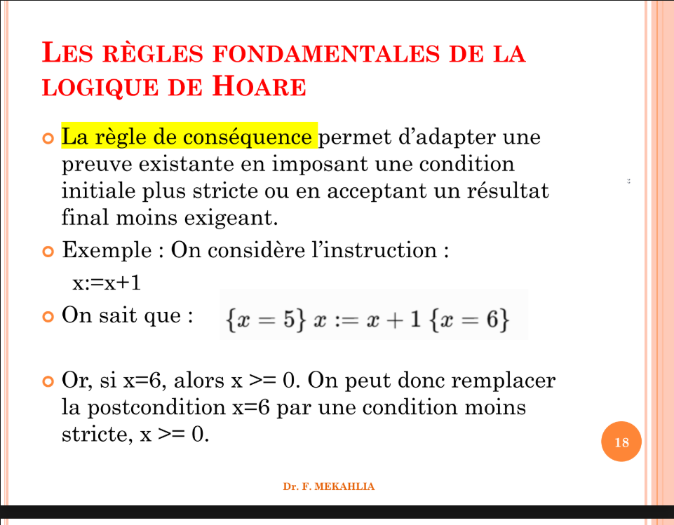

## Diapositive 19

**Texte du support :**

```text
LES RÈGLES FONDAMENTALES DE LA
LOGIQUE DE HOARE
• On obtient :
19,,
Dr. F. MEKAHLIA
```

**Transcription complémentaire des éléments visuels :**

Triplet obtenu : {x = 5} x := x + 1 {x ≥ 0}.

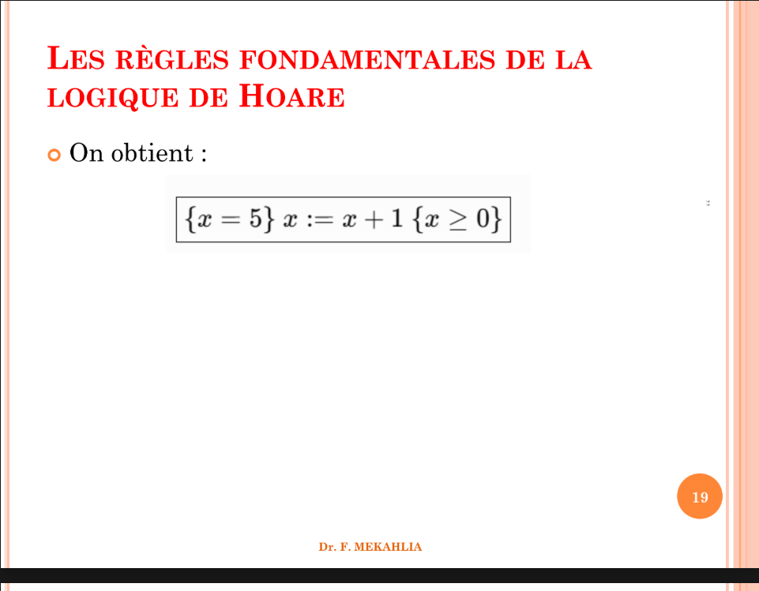

## Diapositive 20

**Texte du support :**

```text
PRÉCONDITION LA PLUS FAIBLE
• La précondition la plus faible permet de
déterminer la condition minimale qui doit être
vraie avant l’exécution d’un programme pour
garantir le résultat souhaité après son exécution.
• La précondition la plus faible d’un programme C,
pour une postcondition Q, est notée :
20,,
Dr. F. MEKAHLIA
```

**Transcription complémentaire des éléments visuels :**

Notation affichée : wp(C, Q).

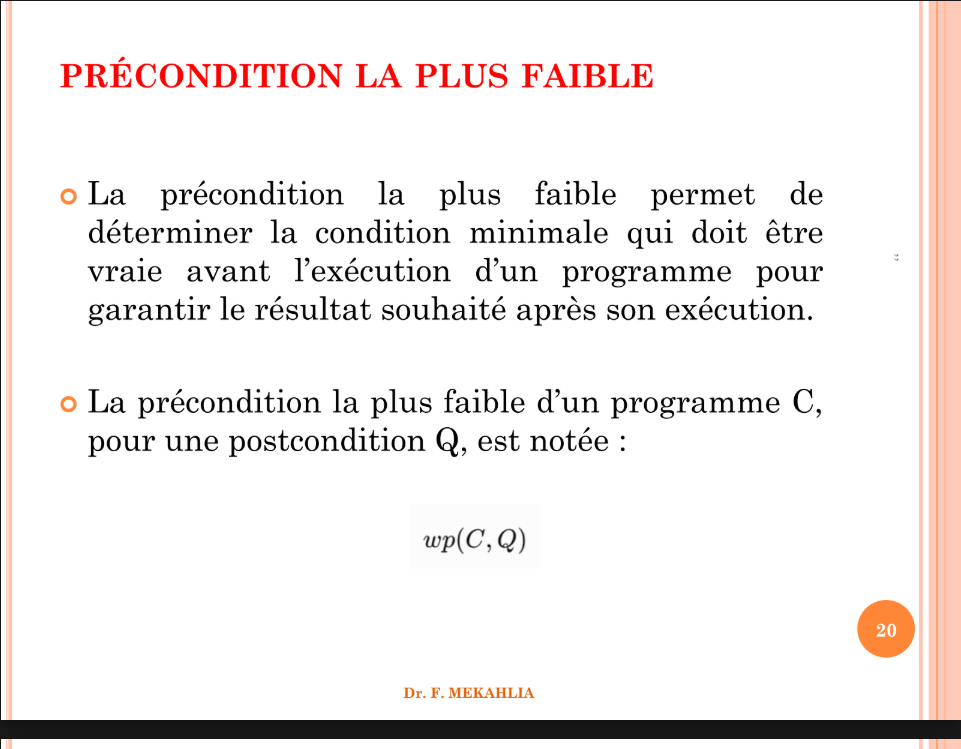

## Diapositive 21

**Texte du support :**

```text
PRÉCONDITION LA PLUS FAIBLE
• Elle représente la condition la moins restrictive
qui garantit que, si le programme termine, le
résultat obtenu satisfait la postcondition Q.
• On parle de précondition la plus faible parce
qu’elle impose le moins de contraintes possible.
Toute autre précondition suffisante pour garantir
Q doit impliquer cette précondition.
• Exemple: Considérons le programme :
x := x + 3
• On souhaite obtenir après l’exécution :
21,,
Dr. F. MEKAHLIA
```

**Transcription complémentaire des éléments visuels :**

Postcondition de l'exemple : Q : x > 7, pour le programme x := x + 3.

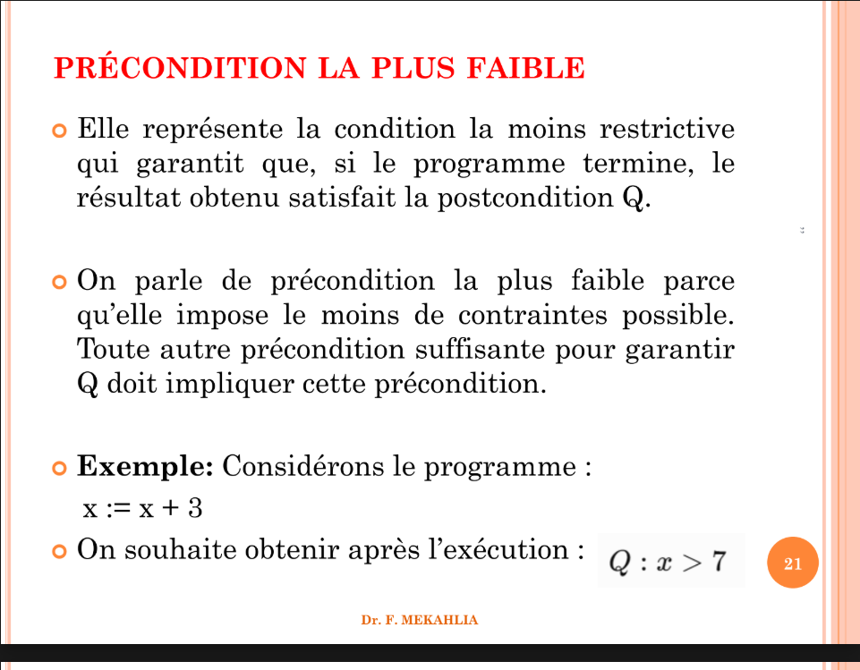

**Note de lecture / correction :** Cette page décrit une garantie « si le programme termine », donc une lecture de correction partielle. Dans une convention fréquente, wlp désigne la plus faible précondition libérale (correction partielle) et wp inclut la terminaison. Les exemples d'affectations et de compositions sans boucle du support ne posent pas ce problème de terminaison.

## Diapositive 22

**Texte du support :**

```text
PRÉCONDITION LA PLUS FAIBLE
• Pour trouver la précondition la plus faible, on
remplace x par x+3 dans la postcondition :
• On obtient :
• Donc :
22,,
Dr. F. MEKAHLIA
```

**Transcription complémentaire des éléments visuels :**

wp(x := x + 3, x > 7)
On obtient : x + 3 > 7.
Donc : wp(x := x + 3, x > 7) = x > 4.

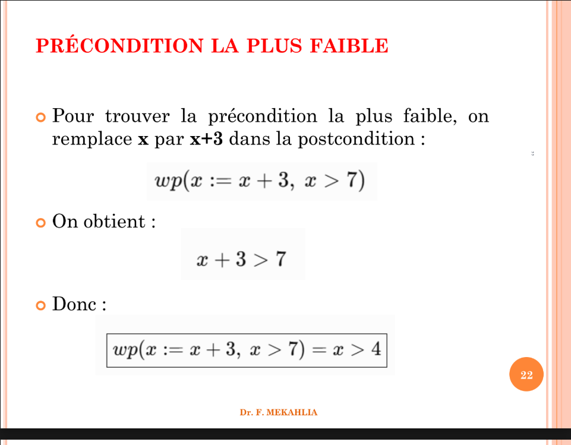

## Diapositive 23

**Texte du support :**

```text
PRÉCONDITION LA PLUS FAIBLE
• La précondition la plus faible se calcule selon la
structure du programme.
- Affectation : on remplace la variable modifiée par
son expression dans la postcondition.
*Séquence : on calcule d’abord la précondition de
la deuxième instruction, puis celle de la première.
23,,
```

**Transcription complémentaire des éléments visuels :**

Affectation : wp(x := E, Q) = Q[E/x].
Séquence : wp(C1 ; C2, Q) = wp(C1, wp(C2, Q)).

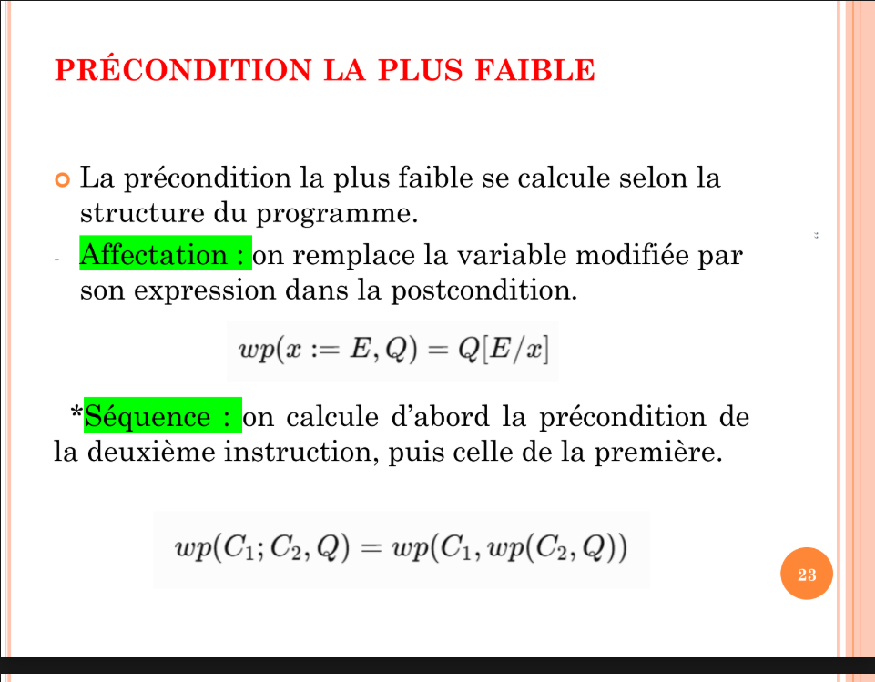

## Diapositive 24

**Texte du support :**

```text
PRÉCONDITION LA PLUS FAIBLE
• Condition : on vérifie les deux branches en tenant
compte de la condition qui déclenche chacune
d’elles.
24,,
Dr. F. MEKAHLIA
```

**Transcription complémentaire des éléments visuels :**

Conditionnelle :
wp(if B then C1 else C2, Q)
  = (B ⇒ wp(C1, Q)) ∧ (¬B ⇒ wp(C2, Q)).

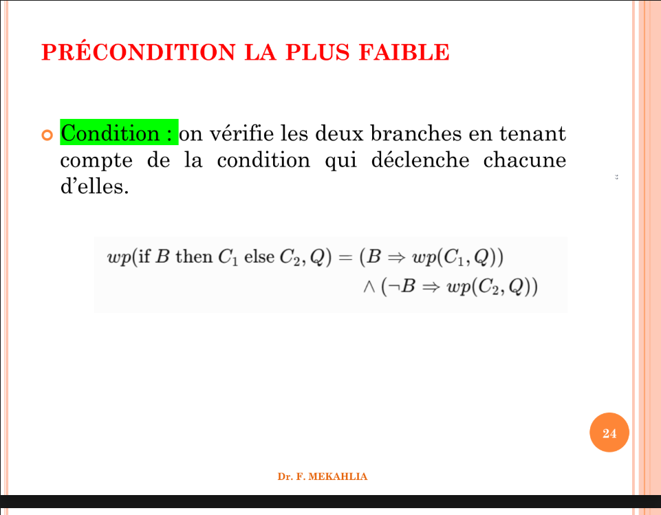

## Diapositive 25

**Texte du support :**

```text
LES NOTIONS ESSENTIELLES SONT LES SUIVANTES :
Notion Rôle
Assertion Exprimer une propriété logique de l'état du programme.
Précondition Définir les conditions initiales nécessaires.
Postcondition Décrire le résultat attendu.
Triplet de Hoare Relier une précondition, un programme et une
postcondition.
Règle d'affectation Déterminer les conditions nécessaires avant une
affectation.
Règle de séquence Composer les preuves de plusieurs instructions.
Règle de condition Vérifier les différentes branches d'une structure
conditionnelle.
Règle de conséquence Renforcer une précondition ou affaiblir une
postcondition.
Précondition la plus faible Calculer la condition minimale suffisante pour obtenir
un résultat.
Invariant de boucle Démontrer une propriété préservée au cours des
itérations.
Variante de boucle Justifier la terminaison.
Correction partielle Garantir le résultat si le programme termine
normalement.
Correction totale Garantir le résultat et la terminaison.
25,,
Dr. F. MEKAHLIA
```

## Diapositive 26

**Texte du support :**

```text
Merci ☺
26,,
```

## Diapositive 27

**Texte du support :**

```text
Merci ☺
27,,
```

## Diapositive 28

**Texte du support :**

```text
Merci ☺
28,,
```

## Diapositive 29

**Texte du support :**

```text
Merci ☺
29,,
```
