# Chapitre 4 — Automates et systèmes de transitions

Support : Chapitre 04 Automates et systèmes de transitions.pptx.pdf
Source : https://drive.google.com/file/d/1eDuuUoHNey9UokR1LVwAaAjRLksolvmT/view?usp=classroom_web&authuser=0
Nombre de diapositives : 42

Le bloc « Texte du support » conserve la formulation de la diapositive. Les puces de police ont été remplacées par • et les notifications du lecteur ont été retirées. Les blocs complémentaires rendent les images/formules en texte ; les notes pédagogiques sont signalées séparément.

## Diapositive 1

**Texte du support :**

```text
UNIVERSITY OF SCIENCE AND TECHNOLOGY HOUARI BOUMEDIENE
FACULTY OF COMPUTER SCIENCE
Course
Méthodes formelles pour GL
ING 5 en Soft.Eng
Dr MEKAHLIA Fatma Zohra
Associate Professor
Laboratoire de Modélisation, Vérification et Evaluation des Performances des systèmes
complexes (MOVEP)
Bureau 123
1
,,
Chapter 4:
Automates et systèmes de transitions
```

## Diapositive 2

**Texte du support :**

```text
INTRODUCTION
Lors du développement d’un logiciel, il ne suffit
pas de définir les données qu’il manipule et les
opérations qu’il réalise. Il faut également
comprendre comment son comportement évolue
au cours du temps, quelles actions sont
autorisées, dans quelles conditions un état peut
être atteint et quels comportements doivent être
interdits.
2
,,
Dr. F. MEKAHLIA
```

## Diapositive 3

**Texte du support :**

```text
INTRODUCTION
Prenons l’exemple d’un système de réservation
de places en ligne.
➔ Une demande de réservation peut être en
attente, confirmée ou rejetée.
➔ Une demande confirmée ne devrait pas être
confirmée une seconde fois
➔ et une demande rejetée ne devrait pas devenir
confirmée sans une nouvelle opération
explicitement prévue.
3
,,
Dr. F. MEKAHLIA
```

## Diapositive 4

**Texte du support :**

```text
INTRODUCTION
Comment représenter ces comportements de
manière précise ? Comment vérifier qu’une
transition est autorisée ? Comment détecter un
état qui ne devrait jamais être atteint ?
Les automates finis et les systèmes de
transitions permettent de répondre à ces
questions en représentant le système à travers
ses états et les transitions qui les relient.
4
,,
Dr. F. MEKAHLIA
```

## Diapositive 5

**Texte du support :**

```text
Modèles Formels à Base
d’automates
5
```

## Diapositive 6

**Texte du support :**

```text
AUTOMATE
Un automate est une machine abstraite utilisée
dans l’étude des langages formels. Le Terme
automate est un terme générique qui désigne de
nombreuses variantes :
1- Systèmes de transitions (étiquetées)
2- Structures de Kripke (étiquetés), ....
● Le comportement d’un automate est dirigé par
un mot fourni en entrée.
● un mot est une séquence ou suite de symboles
appelés alphabet.
6
```

## Diapositive 7

**Texte du support :**

```text
AUTOMATE
Le comportement d’un automate est dirigé par un
mot fourni en entrée.
un mot est une séquence ou suite de symboles
appelés alphabet.
L’automate prend un mot en entrée et démarre de
son état initial. Il parcourt le mot en utilisant les
transitions afin de déterminer, pour chaque lettre,
le prochain état à visiter.
Si, à la fin de la lecture, la machine est dans un
état accepteur ou final, on dit qu’elle accepte
l’entrée. Autrement, on dit qu’elle la rejette.
L’ensemble des entrées acceptées forme un
langage L, qui est le langage accepté par
l’automate.
7
```

## Diapositive 8

**Texte du support :**

```text
AUTOMATE
Un automate peut être déterministes ou non
déterministes.
Dans un automate déterministe, pour chaque état
et chaque symbole d'entrée, il existe au maximum
un seul état suivant (exactement un si l'automate
est complet). Autrement dit, il n'y a aucun choix à
faire : le comportement est déterminé.
8
```

## Diapositive 9

**Texte du support :**

```text
AUTOMATE
Dans un automate non déterministe, pour un
même état et un même symbole d'entrée, plusieurs
transitions peuvent être possibles. L'automate
peut donc avoir plusieurs états suivants possibles.
L’automate est dit fini s’il possède un nombre fini
d’états distincts.
9
```

## Diapositive 10

**Texte du support :**

```text
QU’EST-CE QU’UN ÉTAT ?
Un état décrit une situation possible d’un système
à un instant donné. Il caractérise les informations
pertinentes pour comprendre le comportement du
système et déterminer quelles actions peuvent être
exécutées.
Un état n’est donc pas nécessairement une seule
variable : il peut représenter une combinaison de
plusieurs valeurs.
10
```

## Diapositive 11

**Texte du support :**

```text
UN ÉTAT
Exemple : système de réservation
Considérons une demande de réservation. Son état peut
être représenté par une variable statut :
● EnAttente : la demande a été reçue, mais elle n’a
pas encore été traitée ;
● Confirmee : une place a été attribuée à la demande ;
● Rejetee : la demande n’a pas pu être acceptée
Ces états constituent une abstraction : on ne représente
pas ici tous les détails techniques du système, comme
l’identifiant de l’utilisateur, l’heure de la demande ou les
informations de paiement. 11
```

## Diapositive 12

**Texte du support :**

```text
ÉVÉNEMENT
Un événement est une occurrence qui peut déclencher une évolution du
système.
Dans notre application, les événements peuvent être :
● soumettre : l’utilisateur envoie une demande ;
● verifierDisponibilite : le système vérifie les places disponibles ;
● confirmer : le système confirme la réservation ;
● rejeter : le système refuse la demande ;
● annuler : une réservation confirmée est annulée, si cette fonctionnalité est
prévue.
Il faut distinguer l’état de l’événement : l’état décrit une situation, tandis que l’
événement correspond à une action ou à une occurrence susceptible de
provoquer un changement.
Par exemple, EnAttente est un état, alors que confirmer est un événement
12
```

## Diapositive 13

**Texte du support :**

```text
TRANSITION
Une transition représente le passage d’un état à un
autre, éventuellement à la suite d’un événement et
sous certaines conditions.
On peut la représenter ainsi :
Exemple :
Cette transition n’est autorisée que si une place est
disponible.
Une autre transition est possible lorsque toutes les
places sont déjà attribuées :
13
```

**Transcription complémentaire des éléments visuels :**

Notation : État courant — événement → Nouvel état.
Exemple : EnAttente — place disponible → Confirmee.
La transition de rejet est explicitée à la page 28.

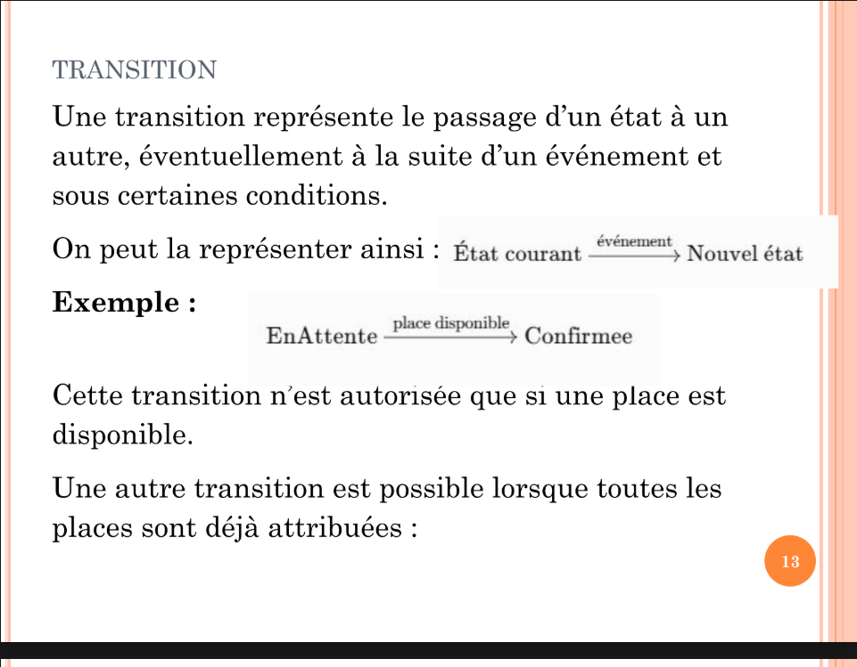

## Diapositive 14

**Texte du support :**

```text
TRANSITION
Ainsi, une transition peut être associée à une
condition, appelée aussi garde, qui doit être
satisfaite pour que le changement d’état puisse
avoir lieu
14
```

## Diapositive 15

**Texte du support :**

```text
ÉTAT, ÉVÉNEMENT ET TRANSITION
15
Notion Signification Exemple
État Situation du système EnAttente
Événement Action ou occurrence confirmer
Condition (garde) Condition à satisfaire placesDisponibles > 0
Transition Changement d’état autorisé EnAttente → Confirmee
```

## Diapositive 16

**Texte du support :**

```text
SYSTÈME DE TRANSITIONS ÉTIQUETÉS (STE)
Un système de transitions étiquetées A est un
quadruplet A = <S; S0; E; R> où :
- S est un ensemble fini d’états,
- S0 S est l’ensemble des états initiaux,
- E est un ensemble fini d’étiquettes (noms
d’actions ou d’événements),
- R S x E x S est l’ensemble de transitions
étiquetées,
16
```

**Transcription complémentaire des éléments visuels :**

A = ⟨S, S0, E, R⟩
S0 ⊂ S.
R ⊂ S × E × S.

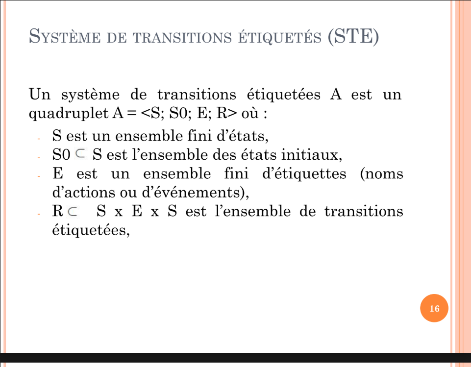

**Note de lecture / correction :** Le support utilise le signe ⊂ pour exprimer l'inclusion. On rencontre aussi la convention ⊆ ; l'idée essentielle est que les états initiaux sont des états du système et que les transitions sont des triplets état/action/état.

## Diapositive 17

**Texte du support :**

```text
AUTOMATES FINIS : DÉFINITION ET REPRÉSENTATION
Un automate fini est un modèle mathématique qui
représente un système possédant un nombre fini d’
états et des transitions entre ces états.
Dans sa forme classique, un automate fini
déterministe est défini par le tuple :
17
```

**Transcription complémentaire des éléments visuels :**

Tuple affiché : A = (Q, Σ, δ, q0, F).

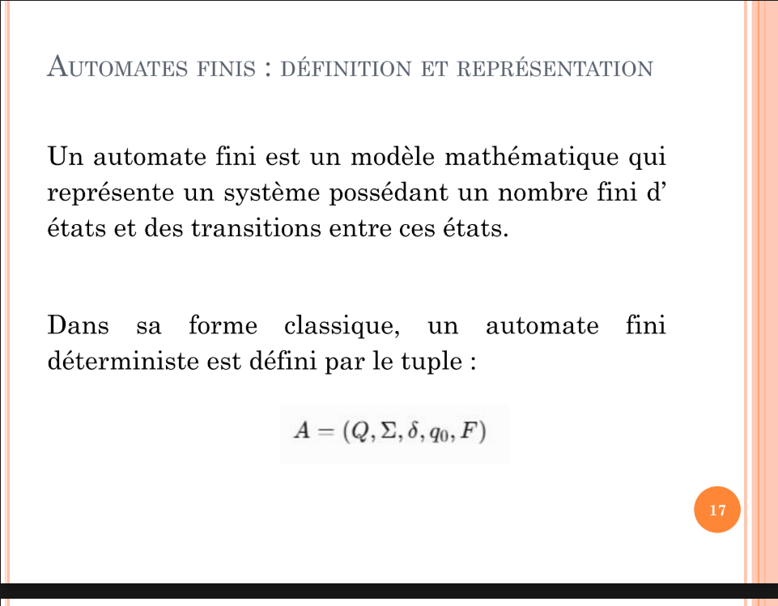

## Diapositive 18

**Texte du support :**

```text
AUTOMATES FINIS : DÉFINITION ET REPRÉSENTATION
où :
● Q : ensemble fini des états ;
● Σ: alphabet des événements ou symboles
d’entrée ;
● δ: fonction de transition ;
● q_0 : état initial ;
● F : ensemble des états finaux.
Pour un automate déterministe classique, la
fonction de transition est :
18
```

**Transcription complémentaire des éléments visuels :**

Fonction de transition affichée : δ : Q × Σ → Q.

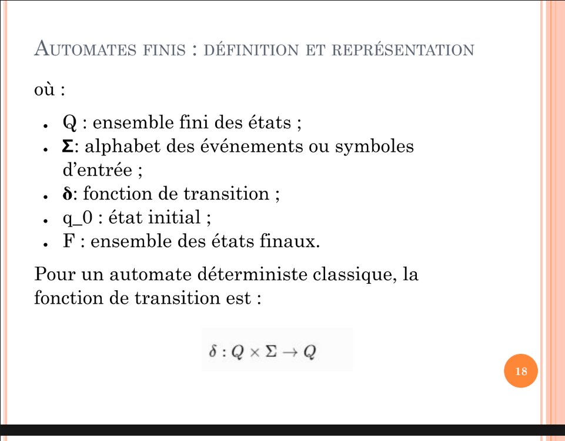

**Note de lecture / correction :** Cette fonction totale correspond au cas déterministe complet. La page 8 distingue justement l'automate déterministe éventuellement incomplet, où au plus une transition est définie par couple état/symbole.

## Diapositive 19

**Texte du support :**

```text
AUTOMATES FINIS : DÉFINITION ET REPRÉSENTATION
Elle associe à chaque état et à chaque symbole
d’entrée un état suivant.
Cette définition classique est utile pour
comprendre les automates finis. Pour la
modélisation de logiciels, on utilise également des
automates d’états avec des transitions
conditionnelles et des systèmes de transitions plus
généraux.
19
```

## Diapositive 20

**Texte du support :**

```text
REPRÉSENTATION GRAPHIQUE
Un automate est généralement représenté par un
graphe orienté :
● les sommets représentent les états ;
● les flèches représentent les transitions ;
● les étiquettes des flèches indiquent les
événements ou conditions ;
● une flèche entrante sans origine visible désigne
l’état initial ;
● les états finaux sont généralement représentés
par un double cercle dans les automates
classiques.
20
```

## Diapositive 21

**Texte du support :**

```text
REPRÉSENTATION GRAPHIQUE
●
21
```

**Transcription complémentaire des éléments visuels :**

Schéma : une flèche Début entre dans l'état En attente.
En attente — Place disponible → Confirmée.
En attente — Aucune place → Rejetée.
Confirmée et Rejetée sont représentées par des doubles cercles.

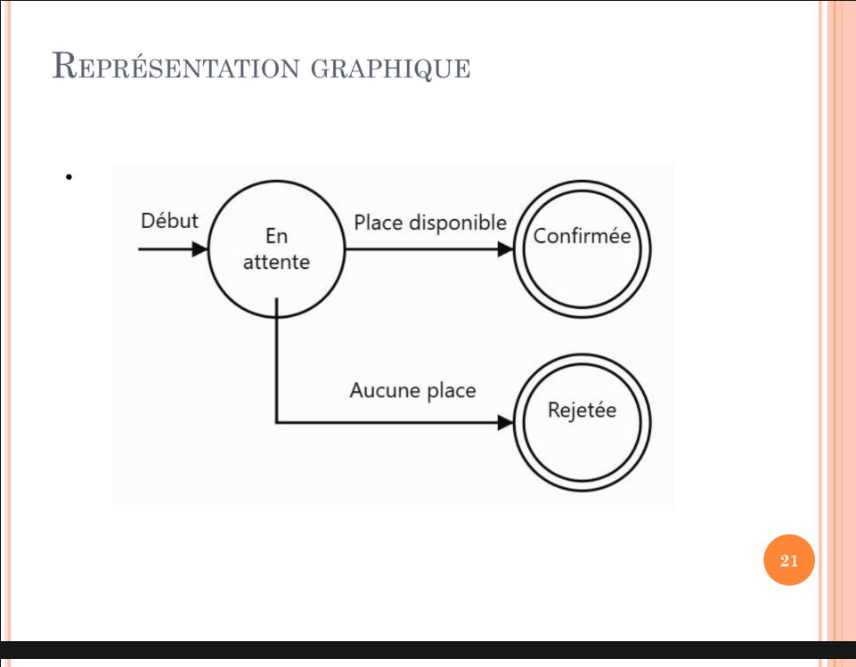

## Diapositive 22

**Texte du support :**

```text
AUTOMATE DÉTERMINISTE ET NON DÉTERMINISTE
Dans un automate déterministe, pour un état donné et un
événement donné, il existe au plus une transition possible
vers un état suivant.
Dans un automate non déterministe, plusieurs transitions
peuvent être possibles pour un même état et un même
événement. Le modèle peut alors représenter plusieurs
évolutions possibles.
Il est important de noter que le non-déterminisme ne
signifie pas automatiquement qu’il existe des probabilités. Il
indique seulement que plusieurs évolutions sont possibles.
Pour représenter la probabilité de chaque évolution, il faut
utiliser un modèle probabiliste.
22
```

## Diapositive 23

**Texte du support :**

```text
QUAND UTILISER UN AUTOMATE FINI ?
Les automates sont particulièrement utiles pour
modéliser :
● le cycle de vie d’une demande ;
● les états d’une commande dans un commerce
électronique ;
● l’authentification d’un utilisateur ;
● les états d’un protocole de communication ;
● les phases d’une tâche dans un système logiciel.
Ils sont faciles à visualiser et à simuler. Cependant,
lorsque le comportement dépend de plusieurs
composants qui évoluent simultanément, un modèle
plus général peut être nécessaire.
23
```

## Diapositive 24

**Texte du support :**

```text
ÉTATS INITIAUX, ÉTATS TERMINAUX ET TRANSITIONS
L’état initial est l’état dans lequel le système se trouve au début de son
exécution.
Dans le système de réservation, on peut distinguer deux niveaux :
● l’état initial du système global : aucune demande n’a encore été traitée ;
● l’état initial d’une demande : la demande n’a pas encore été soumise.
Pour notre modèle du cycle de vie d’une demande, nous choisissons
EnAttente comme état initial, en considérant que la demande vient d’être
soumise et enregistrée.
Le choix de l’état initial dépend donc de la frontière du système étudié. Si l’on
veut modéliser le processus depuis l’action de l’utilisateur, on peut ajouter un état
NonSoumise et une transition vers EnAttente.
24
```

## Diapositive 25

**Texte du support :**

```text
ÉTATS INITIAUX, ÉTATS TERMINAUX ET TRANSITIONS
Un état intermédiaire est un état par lequel le système peut passer
sans que le processus soit terminé.
Par exemple, une demande peut passer par les états suivants :
Soumise → EnAttente → EnCoursDeTraitement →
Confirmee
L’état EnCoursDeTraitement permet de représenter une étape
supplémentaire entre la réception de la demande et la décision
finale.
Les états intermédiaires sont utiles lorsque le processus contient
plusieurs étapes, des validations ou des interactions avec d’autres
composants.
25
```

## Diapositive 26

**Texte du support :**

```text
ÉTATS INITIAUX, ÉTATS TERMINAUX ET TRANSITIONS
Un état terminal représente un état dans lequel le processus étudié est
considéré comme terminé.
Dans notre exemple, on peut considérer que les états terminaux sont :
● Confirmee ;
● Rejetee.
Une fois la demande confirmée ou rejetée, le processus de traitement initial
est terminé.
Attention : un état terminal n’est pas nécessairement un état sans transition
dans tous les types de systèmes. Dans notre modèle simplifié, il n’a pas de
transition sortante. Dans un système plus complet, une réservation
confirmée pourrait ensuite être annulée, ce qui nécessiterait de représenter
un nouveau comportement.
26
```

## Diapositive 27

**Texte du support :**

```text
Proposition atomique
Proposition atomique est Une proposition atomique
est une variable qui prend l’une des valeurs vrai ou
faux.
27
```

## Diapositive 28

**Texte du support :**

```text
CONDITIONS DE TRANSITION
Une transition peut être soumise à une condition
logique, appelée garde.
Exemple :
La transition est autorisée si le nombre de places
disponibles est strictement positif.
À l’inverse :
28
```

**Transcription complémentaire des éléments visuels :**

Une transition peut être soumise à une condition logique, appelée garde.
EnAttente — [placesDisponibles > 0] → Confirmee.
La transition est autorisée si le nombre de places disponibles est strictement positif.
À l'inverse : EnAttente — [placesDisponibles = 0] → Rejetee.

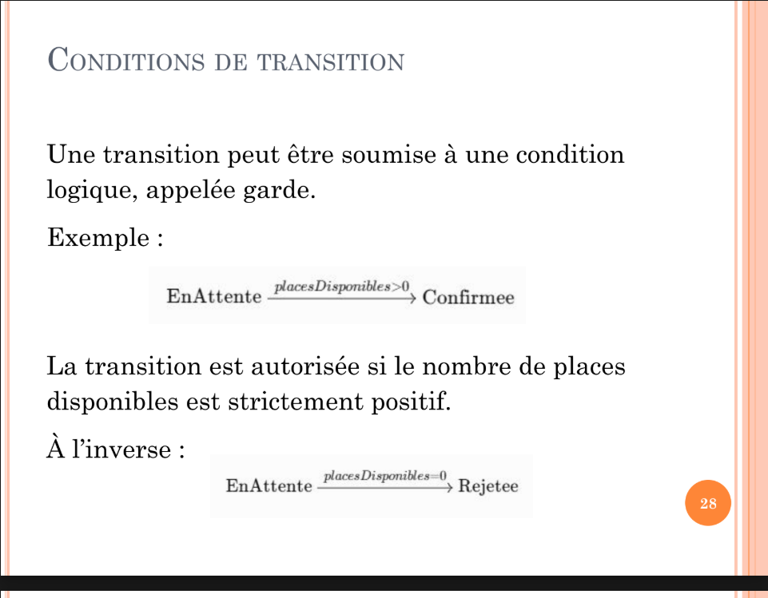

## Diapositive 29

**Texte du support :**

```text
CONDITIONS DE TRANSITION
Dans ce modèle, la disponibilité détermine la
décision.
Ces deux conditions sont complémentaires si le
nombre de places disponibles est toujours un entier
positif ou nul. Il faut néanmoins veiller à ce que le
modèle soit complet : toute situation pertinente doit
avoir une évolution définie, sauf si le blocage est
intentionnel.
29
```

## Diapositive 30

**Texte du support :**

```text
INVARIANTS ASSOCIÉS AUX ÉTATS
Un invariant est une propriété qui doit rester vraie
dans tous les états considérés comme valides du
système.
Pour la réservation, nous pouvons définir :
30
```

**Transcription complémentaire des éléments visuels :**

Invariant affiché : 0 ≤ placesDisponibles ≤ capacite.

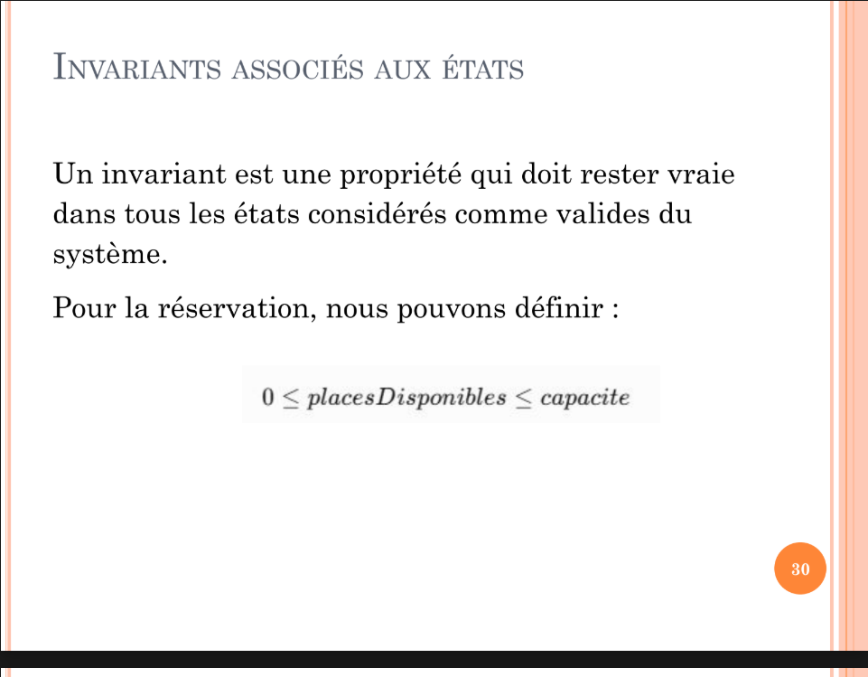

## Diapositive 31

**Texte du support :**

```text
CONDITIONS DE TRANSITION
Si chaque réservation confirmée consomme
exactement une place et qu’aucune place n’est
réservée autrement, nous pouvons également écrire
:
Cette propriété doit être adaptée si le système
comporte des annulations, des réservations
temporaires ou des places bloquées.
31
```

**Transcription complémentaire des éléments visuels :**

Invariant de conservation affiché : placesDisponibles + reservationsConfirmees = capacite.

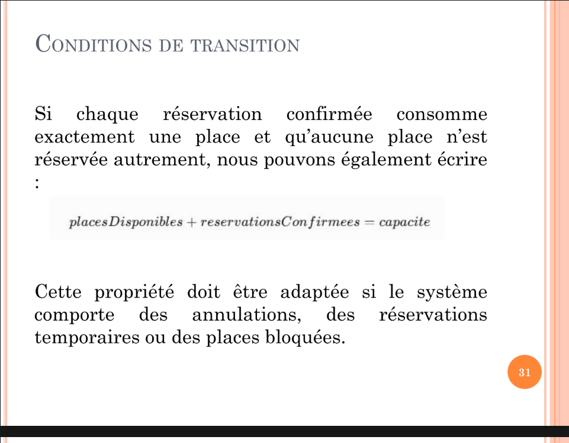

## Diapositive 32

**Texte du support :**

```text
Systèmes de Transitions
32
```

## Diapositive 33

**Texte du support :**

```text
SYSTÈMES DE TRANSITIONS ET TRACES D’EXÉCUTION
Les automates classiques sont utiles pour
représenter le cycle de vie d’un processus. Les
systèmes de transitions offrent un cadre plus
général pour décrire les évolutions possibles d’un
système logiciel.
Définition formelle: Un système de transitions peut être défini par
le triplet :
33
```

**Transcription complémentaire des éléments visuels :**

Triplet affiché : T = (S, →, S0).

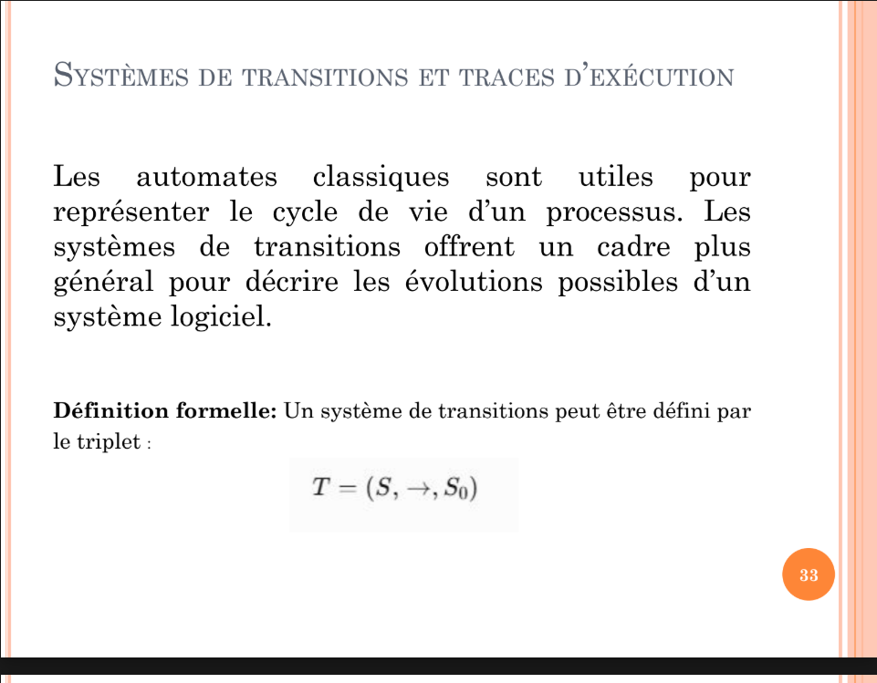

## Diapositive 34

**Texte du support :**

```text
SYSTÈMES DE TRANSITIONS ET TRACES D’EXÉCUTION
où :
● S: est l’ensemble des états possibles ;
● : est la relation de transition entre les états ;
● S_0: est l’ensemble des états initiaux.
La relation de transition peut être écrite:
Cette notation signifie que le système peut passer de l’état s à l’état s'.
Contrairement à la définition classique d’un automate fini, un système de
transitions n’exige pas nécessairement un alphabet d’entrée explicite ni une
fonction de transition déterministe. Les transitions peuvent être décrites
par des actions, des événements ou des conditions.
34
```

**Transcription complémentaire des éléments visuels :**

→ est la relation de transition entre les états.
Une transition s'écrit s → s'.

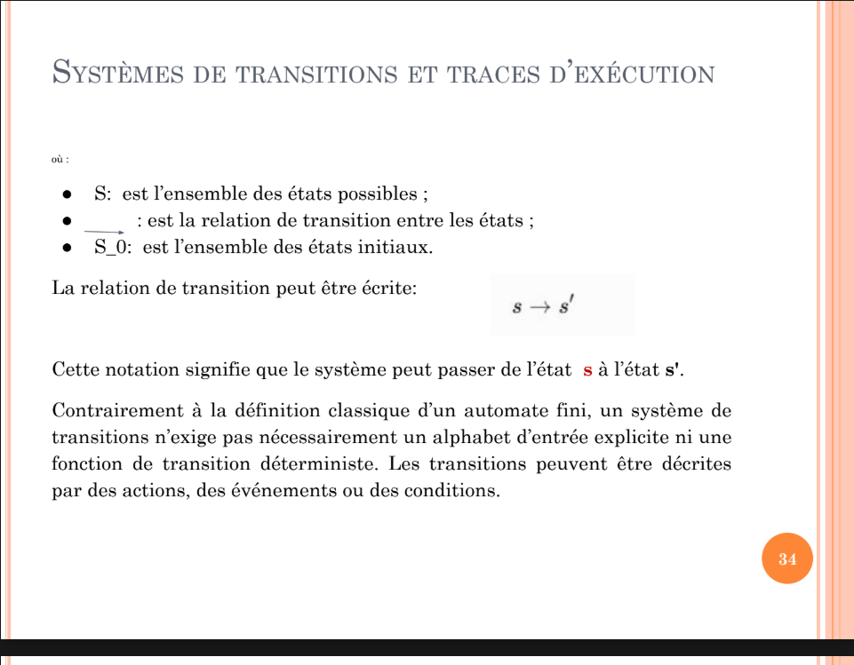

## Diapositive 35

**Texte du support :**

```text
trace d’exécution
Qu’est-ce qu’une trace d’exécution ?
Une trace d’exécution est une séquence d’états successifs reliés par des transitions autorisées.
Par exemple :
E A C
Cette trace représente une demande qui est en attente, entre en traitement, puis est confirmée.
Une autre trace possible est :
E A R
Elle représente une demande rejetée.
35
```

**Transcription complémentaire des éléments visuels :**

Traces illustrées : E → A → C et E → A → R.
E : demande en attente ; A : demande en traitement ; C : confirmée ; R : rejetée.

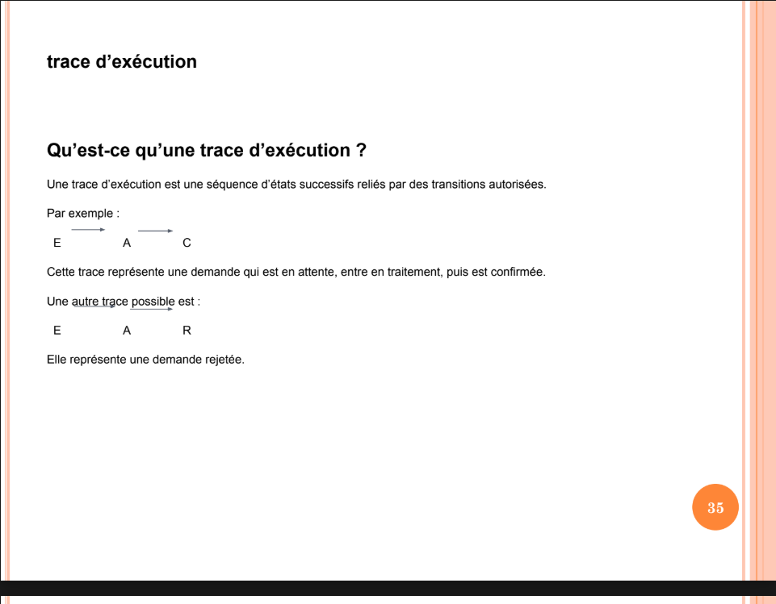

## Diapositive 36

**Texte du support :**

```text
trace d’exécution
En revanche, la séquence :
E C
1. n’est pas une trace valide du modèle précédent,
car aucune transition directe entre E et C n’a
été définie.
2. Une trace peut être finie ou infinie. Dans les
systèmes qui modélisent un logiciel en
fonctionnement continu, il est souvent utile d’
étudier les traces infinies afin de vérifier des
propriétés portant sur toute l’exécution.
36
```

**Transcription complémentaire des éléments visuels :**

Séquence illustrée comme non valide dans ce modèle : E → C.

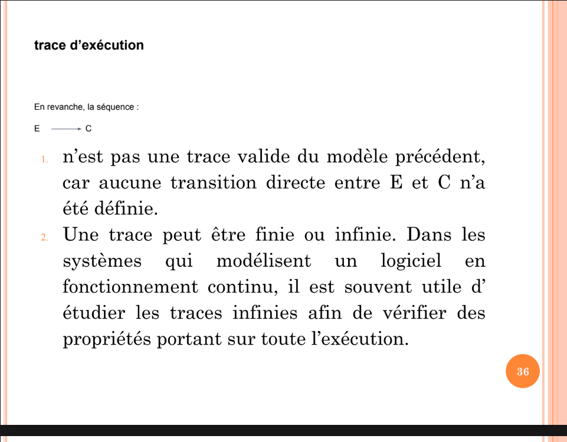

**Note de lecture / correction :** Cette invalidité dépend du modèle avec l'étape intermédiaire A. Elle ne doit pas être appliquée au modèle simplifié de la page 21, qui comporte justement une transition directe de l'attente vers la confirmation.

## Diapositive 37

**Texte du support :**

```text
Pourquoi les traces sont-elles importantes ?
Les traces permettent de :
1. comprendre les scénarios d’exécution possibles ;
2. identifier les transitions manquantes ;
3. repérer les séquences d’événements interdites ;
4. analyser le comportement d’un système avant son
implémentation ;
5. comprendre un contre-exemple produit par un outil de
vérification.
Par exemple, si une réservation est confirmée alors
qu’aucune place n’est disponible, la trace qui mène à cette
confirmation peut révéler une erreur dans les règles de
transition ou dans la gestion de la disponibilité.
37
```

## Diapositive 38

**Texte du support :**

```text
ACCESSIBILITÉ DES ÉTATS
Un état s est dit accessible depuis un état initial si
le système peut atteindre (s) en exécutant zéro, une
ou plusieurs transitions autorisées.
Autrement dit, un état est accessible s’il existe une
trace qui relie un état initial à cet état.
Si s_0 est l’état initial, on peut écrire :
Le symbole * désigne une séquence de zéro ou
plusieurs transitions. 38
```

**Transcription complémentaire des éléments visuels :**

Notation affichée : s0 →* s.
→* représente zéro, une ou plusieurs transitions.

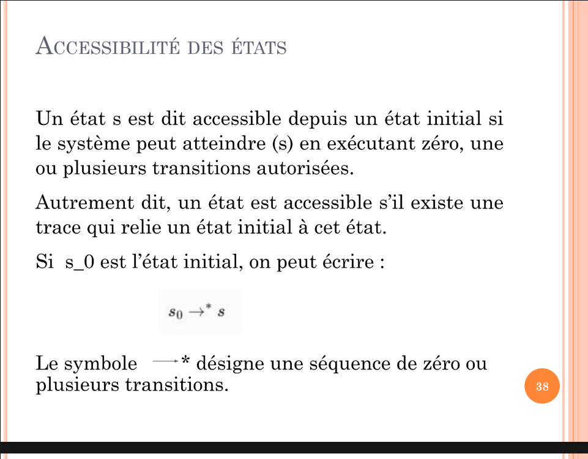

## Diapositive 39

**Texte du support :**

```text
ACCESSIBILITÉ DES ÉTATS
Un état initial est donc accessible depuis lui-même,
même si aucune transition n’a encore été exécutée.
Pourquoi rechercher les états inaccessibles ?
Un état inaccessible peut révéler :
● une erreur dans la définition des transitions ;
● une condition de garde impossible à satisfaire ;
● un état inutile dans le modèle ;
● un comportement qui a été prévu mais qui ne peut jamais
se produire.
39
```

## Diapositive 40

**Texte du support :**

```text
ACCESSIBILITÉ ET ÉTATS INTERDITS
L’analyse d’accessibilité permet de vérifier qu’un
état interdit ne peut pas être atteint.
Par exemple, définissons un état D qui représente
une double attribution de la même place.
L’objectif est de vérifier :
40
```

**Transcription complémentaire des éléments visuels :**

Propriété affichée : ∀s ∈ Reach(S0), s ≠ D.
Forme équivalente : D ∉ Reach(S0).

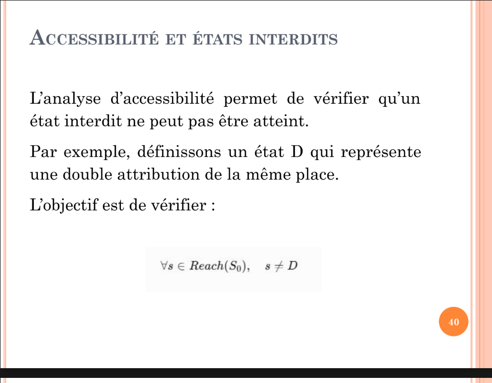

## Diapositive 41

**Texte du support :**

```text
ACCESSIBILITÉ ET ÉTATS INTERDITS
où désigne l’ensemble des états
accessibles depuis les états initiaux.
Si D est accessible, le modèle admet au moins une
exécution conduisant à une double attribution. Il
faut alors analyser le chemin qui y mène et corriger
le modèle ou les règles du système.
41
```

**Transcription complémentaire des éléments visuels :**

Notation affichée : Reach(S0), ensemble des états accessibles depuis les états initiaux.

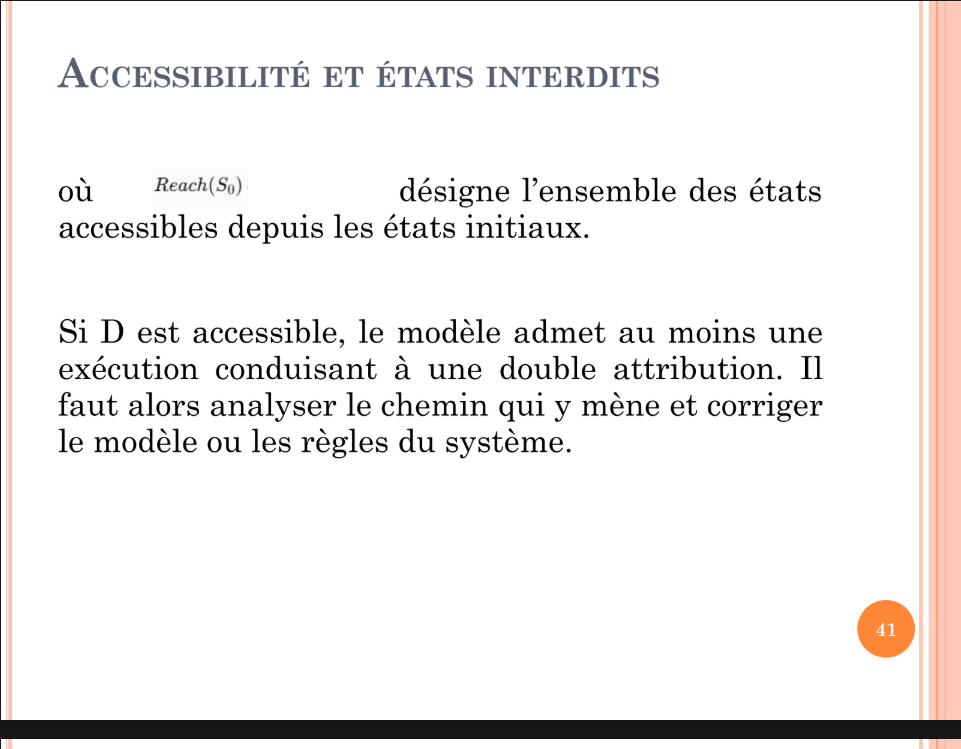

## Diapositive 42

**Texte du support :**

```text
Merci ☺
42,,
```
