# Chapitre 5 — Réseaux de Petri

Dr MEKAHLIA Fatma Zohra · Lecture du 24 novembre 2026.

Source : [Google Classroom](https://classroom.google.com/c/ODg4NjEyMTk1OTQx), document « Chapitre 05 Réseaux de Petri.pdf », 62 diapositives. Texte lu dans le lecteur Edge ; chaque capture conserve les formules et schémas que le texte accessible peut omettre. Le PDF ci-joint est une compilation des captures de lecture, pas le fichier original téléchargé.

[PDF des 62 diapositives](diapositives-captures.pdf)

## Diapositive 1

UNIVERSITY OF SCIENCE AND TECHNOLOGY HOUARI BOUMEDIENE
FACULTY OF COMPUTER SCIENCE
Course
Méthodes formelles pour GL
ING 5 en Soft.Eng
Dr MEKAHLIA Fatma Zohra
Associate Professor
Laboratoire de Modélisation, Vérification et Evaluation des Performances des systèmes
complexes (MOVEP)
Bureau 123
1
,,
Chapter 5:
Réseaux de Petri

## Diapositive 2

INTRODUCTION
🞆 Le modèle de réseaux de Petri (RdP) a été crée
en 1962, par C. A. Petri, afin de modéliser la
composition et la communication entre les
processus d'un système.
🞆 L'idée essentielle : le réseau de Petri ne
représente pas uniquement les états successifs
d'un système. Il permet également de
représenter les ressources disponibles, les
conditions nécessaires à l'exécution des
opérations et les interactions entre plusieurs
activités. 2
,,
Dr. F. MEKAHLIA

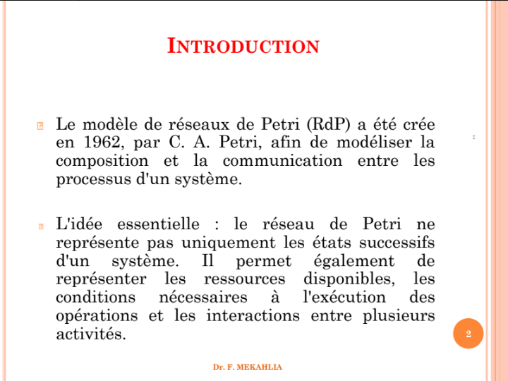

## Diapositive 3

INTRODUCTION
A l'aide des réseaux de Petri on peut représenter les concepts de:
1. Le parallélisme: Le parallélisme signifie que plusieurs activités peuvent être exécutées
indépendamment les unes des autres, sans qu'une activité ait besoin d'attendre la fin de
l'autre.
2. La synchronisation: La synchronisation signifie que plusieurs activités doivent se
coordonner pour qu'une opération puisse être exécutée.
3. Le choix non déterministe: Le choix non déterministe signifie que plusieurs transitions
peuvent être possibles à partir d'un même état, sans que le modèle impose laquelle sera
choisie et le choix dépendra de l'exécution du système.
.4. Le partage de ressources: Le partage de ressources signifie que plusieurs processus
utilisent une même ressource, qui peut être limitée ou disponible en quantité déterminée.
3
,,
Dr. F. MEKAHLIA

## Diapositive 4

INTRODUCTION
5. La communication: La communication représente l'échange d'informations ou de
messages entre plusieurs processus.
6. La causalité: La causalité représente la relation entre un événement et les événements
qu'il rend possibles. Autrement dit, un événement peut être la cause d'un autre événement.
4
,,
Dr. F. MEKAHLIA

## Diapositive 5

INTRODUCTION
Les réseaux de Petri présentent plusieurs avantages :
- Une représentation graphique intuitive : ils permettent de
visualiser les différents composants d'un système ainsi que son
fonctionnement et leurs interactions.
- La vérification de propriétés structurelles et comportementales
: ils permettent notamment de vérifier :
1- l'absence de blocage du système.
2- la possibilité de ramener le système à son état initial.
3- la disponibilité permanente des fonctionnalités du système.
- L'utilisation de différentes approches mathématiques : la
vérification de ces propriétés peut s'appuyer sur plusieurs outils
théoriques, notamment la théorie des graphes, la théorie des
langages et l'algèbre linéaire.
5
,,
Dr. F. MEKAHLIA

## Diapositive 6

SYNTAXE DES RÉSEAUX DE PETRI
Définition formelle
Un réseau de Petri classique est un graphe biparti orienté.
Il est défini par le quadruplet : RN=(P,T,Pre,Post). où :
● P : ensemble fini des places. P={P1, P2, ... , Pn}
● T : ensemble fini des transitions. T={T1, T2, ..., Tn}
● Pre : fonction de précondition qui définit les arcs entrants: TxP
● Post : fonction de postcondition qui définit les arcs sortants: TxP
Les places et les transitions sont deux ensembles disjoints :
Les arcs relient uniquement une place à une transition ou une transition à une place.
Il n'existe pas d'arc direct entre deux places ou entre deux transitions dans un réseau de
Petri classique.
Les arcs qui relient les places aux transitions (conditions nécessaires: sont les préconditions)
et les transitions aux places (résultats produits: sont les post conditions). 6
Dr. F. MEKAHLIA

## Diapositive 7

SYNTAXE DES RÉSEAUX DE PETRI
il convient aussi qu'un arc possède un poids avec la valeur entière 1; de façon
générale, le poids peut être supérieur à 1, mais dans ce cas le poids devra être
explicitement indiqué sur l'arc.
7
Dr. F. MEKAHLIA

## Diapositive 8

8
Dr. F. MEKAHLIA

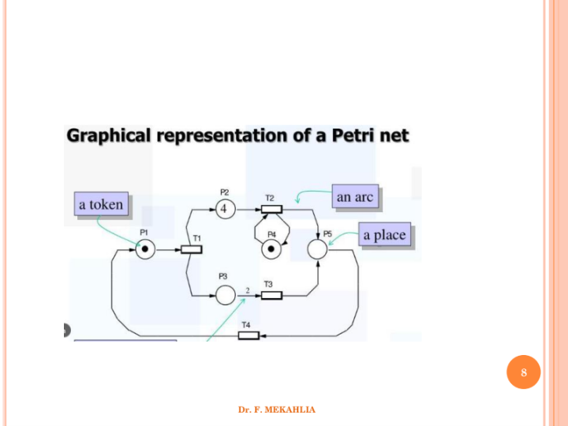

## Diapositive 9

LES ÉLÉMENTS CONSTITUTIFS D'UN RÉSEAU DE
PETRI
1-Les places: Une place est représentée par un
cercle. Elle représente une condition, une situation
ou une ressource du système.
Exemples dans notre projet :
● PlacesDisponibles
● DemandesEnAttente
● ReservationsConfirmees
● DemandesRejetees
Une place peut contenir zéro, un ou plusieurs
jetons.
9
Dr. F. MEKAHLIA

## Diapositive 10

LES ÉLÉMENTS CONSTITUTIFS D'UN RÉSEAU DE
PETRI
2- Les transitions: Une transition est représentée
par un rectangle ou une barre.
Elle représente un événement ou une opération qui
modifie le marquage du réseau.
Exemples :
● ConfirmerReservation
● RejeterDemande
● AnnulerReservation
● SoumettreDemande
Dr. F. MEKAHLIA 10

## Diapositive 11

LES ÉLÉMENTS CONSTITUTIFS D'UN RÉSEAU DE
PETRI
3- Les arcs (Arcs): Les arcs sont des flèches orientées qui
relient les places et les transitions.
Il existe deux types d'arcs :
Arc entrant : place vers transition.
Il indique une condition ou une ressource nécessaire à
l'exécution de la transition.
Arc sortant : transition vers place.
Il indique où les jetons sont produits après le franchissement.
11
Dr. F. MEKAHLIA

## Diapositive 12

LES ÉLÉMENTS CONSTITUTIFS D'UN RÉSEAU DE
PETRI
4- Les jetons (Tokens): Un jeton est représenté par un point dans une
place.
Il représente une ressource ou une condition disponible.
Dans notre projet :
● Un jeton dans PlacesDisponibles représente une place libre.
● Un jeton dans DemandesEnAttente représente une demande à
traiter.
● Un jeton dans ReservationsConfirmees représente une
réservation confirmée.
Attention : dans ce modèle, les jetons représentent des unités de
réservation et non directement des identifiants d'utilisateurs.
12
Dr. F. MEKAHLIA

## Diapositive 13

LES ÉLÉMENTS CONSTITUTIFS D'UN RÉSEAU DE
PETRI
5- Le marquage (Marking): Le marquage représente la
distribution des jetons dans les différentes places à un instant
donné.
On le note :
où M( P) représente le nombre de jetons présents dans la place
p.
Le marquage initial est noté
Le marquage peut être représenté par un vecteur:
13
Dr. F. MEKAHLIA

## Diapositive 14

LES ÉLÉMENTS CONSTITUTIFS D'UN RÉSEAU DE
PETRI
Pour une place p, M(p) représente le nombre de marques
ou de jetons dans la place p, Le marquage est représenté
par des points noirs à l'intérieur de la place.
Une place contient n jetons cela signifie par exemple la
disponibilité de n ressources, n processus attendent
d'entrer en section critique, ...
14
Dr. F. MEKAHLIA

## Diapositive 15

LES ÉLÉMENTS CONSTITUTIFS D'UN RÉSEAU DE
PETRI
Exemple :
Considérons un événement avec trois places
disponibles et deux demandes en attente.
L'ordre des composantes est :
15
Dr. F. MEKAHLIA

## Diapositive 16

MODÉLISATION PAR RÉSEAU DE PETRI
● Un réseau de Petri utilise des places et des jetons
pour représenter les conditions et les ressources.
Dans notre projet, on peut représenter :
● Une place contenant les jetons des places
disponibles.
● Une place contenant les demandes en attente.
● Une place contenant les réservations confirmées.
● Une transition qui consomme une demande et une
place disponible pour produire une réservation
confirmée.
16
Dr. F. MEKAHLIA

## Diapositive 17

MODÉLISATION PAR RÉSEAU DE PETRI
Le réseau répond à des questions supplémentaires :
● Combien de places sont disponibles ?
● Combien de demandes sont en attente ?
● Une opération dispose-t-elle des ressources
nécessaires ?
● Deux opérations peuvent-elles être exécutées
simultanément ?
● Une ressource peut-elle être consommée deux
fois ?
17
Dr. F. MEKAHLIA

## Diapositive 18

RÈGLE DE FRANCHISSEMENT D'UNE
TRANSITION
Une transition est franchissable ou sensibilisée
lorsque toutes les conditions nécessaires sont
satisfaites.
Dans un réseau de Petri classique, une transition t
est franchissable si :
Autrement dit, chaque place d'entrée doit contenir
suffisamment de jetons pour permettre le
déclenchement.
18
Dr. F. MEKAHLIA

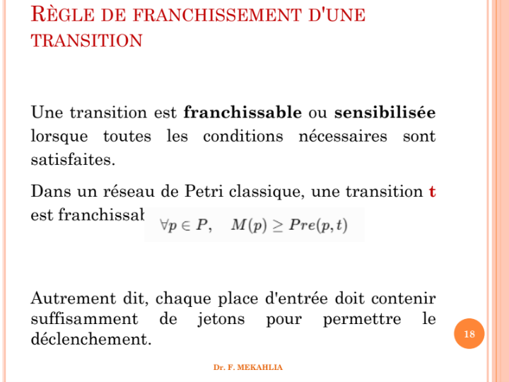

## Diapositive 19

RÈGLE DE FRANCHISSEMENT D'UNE
TRANSITION
Que se passe-t-il lors du franchissement ?
Le franchissement d'une transition entraîne deux
opérations :
1. Les jetons nécessaires sont retirés des places
d'entrée.
2. Les jetons produits sont ajoutés aux places de
sortie.
La règle de calcul du nouveau marquage est :
Le franchissement de la transition t est noté :
19
Dr. F. MEKAHLIA

## Diapositive 20

RÈGLE DE FRANCHISSEMENT D'UNE
TRANSITION
Exemple : confirmation d'une réservation
Supposons :
● Une place disponible.
● Une demande en attente.
● Aucune réservation confirmée.
Le marquage initial est :
20
Dr. F. MEKAHLIA

## Diapositive 21

RÈGLE DE FRANCHISSEMENT D'UNE
TRANSITION
La transition t2: ConfirmerReservation :
● Consomme un jeton de PlacesDisponibles.
● Consomme un jeton de DemandesEnAttente.
● Produit un jeton dans
ReservationsConfirmees.
21
Dr. F. MEKAHLIA

## Diapositive 22

RÈGLE DE FRANCHISSEMENT D'UNE
TRANSITION
● Après le franchissement :
Interprétation :
● Il ne reste aucune place disponible.
● Il ne reste aucune demande en attente.
● Une réservation est confirmée.
22
Dr. F. MEKAHLIA

## Diapositive 23

RÈGLE DE FRANCHISSEMENT D'UNE
TRANSITION
Exemple : transition non franchissable
Supposons maintenant :
Il n'existe aucune place disponible.
La transition ConfirmerReservation nécessite un jeton dans
PlacesDisponibles.
Elle ne peut donc pas être franchie.
C'est le réseau lui-même qui empêche la consommation d'une
ressource inexistante.
C'est l'un des intérêts majeurs des réseaux de Petri : les conditions
d'exécution sont représentées graphiquement et leur respect est lié à la
règle de franchissement.
23
Dr. F. MEKAHLIA

## Diapositive 24

MATRICES D’INCIDENCE AVANT ET
ARRIÈRE
- La fonction Pre peut être définie par une matrice
n × m, appelée matrice d'incidence avant,
comme suit: Pre(i, j) = Pre(pi,tj)
- La fonction Post peut être définie par une
matrice n × m, appelée matrice d'incidence
arrière, comme suit: Post(i, j) = Post(pi ,tj)
- La Matrice d'incidence C est alors définie par :
C = Post − Pre
24
Dr. F. MEKAHLIA

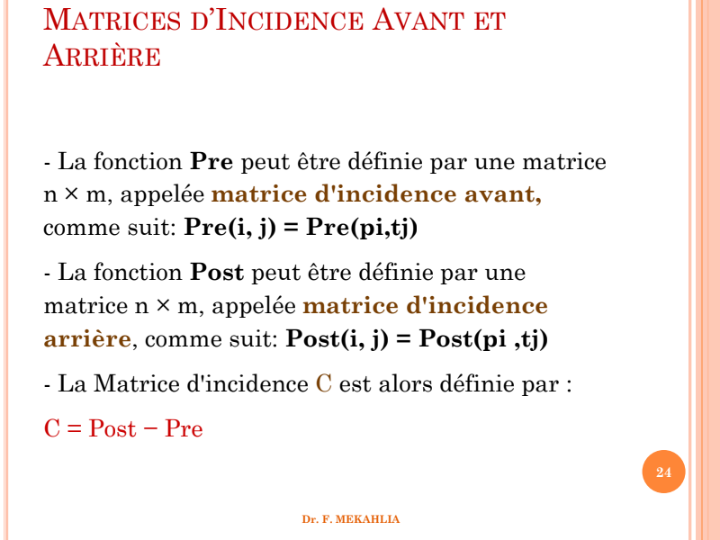

## Diapositive 25

MATRICES D’INCIDENCE AVANT ET
ARRIÈRE
25
Dr. F. MEKAHLIA

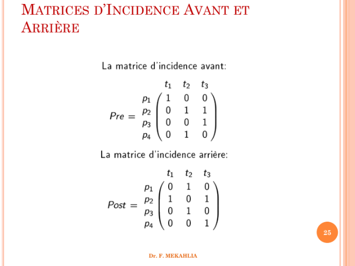

## Diapositive 26

MATRICES D’INCIDENCE AVANT ET
ARRIÈRE
26
Dr. F. MEKAHLIA

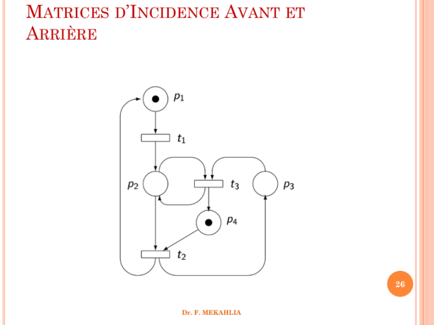

## Diapositive 27

MATRICES D’INCIDENCE AVANT ET
ARRIÈRE
C = Post − Pre
27
Dr. F. MEKAHLIA

## Diapositive 28

SÉQUENCE DE FRANCHISSEMENT
Soit σ = t1 t2 . . .tp une séquence de transitions, si
on a:
M0[t1>M1, M1[t2>M2, . . . , Mp−1[tp>Mp
alors :
t1t2 . . .tp est appelée séquence de
franchissement, qu'on note par M0[σ>Mp.
28
Dr. F. MEKAHLIA

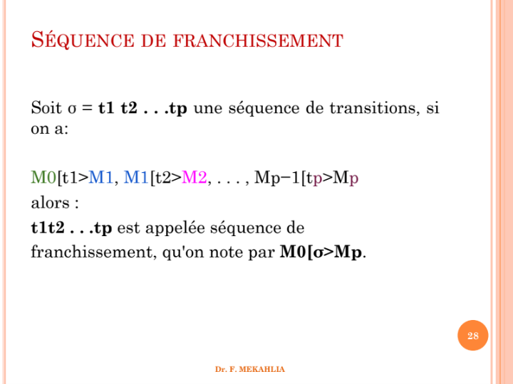

## Diapositive 29

VECTEUR CARACTÉRISTIQUE
Soit une séquence σ de franchissements réalisable
à partir d'un marquage Mi, le vecteur
caractéristique S est le vecteur colonne de
dimension m (m étant le nombre de transitions du
RdP), dont la composante i correspond au nombre
de franchissements de la transition ti dans la
séquence σ.
Pour une séquence donnée, la connaissance du
vecteur caractéristique et de la matrice d'incidence
permet de déterminer l'évolution du marquage du
RdP. Pour
la séquence de transition σ = t1t2t1 dont le vecteur
caractéristique est S = (2, 1, 0) on aura:
29
Dr. F. MEKAHLIA

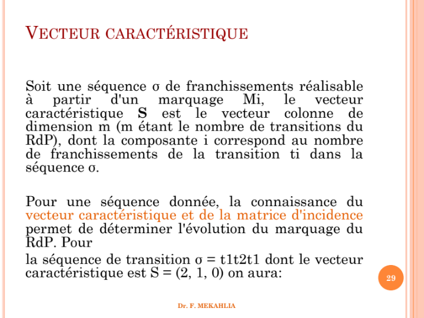

## Diapositive 30

VECTEUR CARACTÉRISTIQUE
30
Dr. F. MEKAHLIA

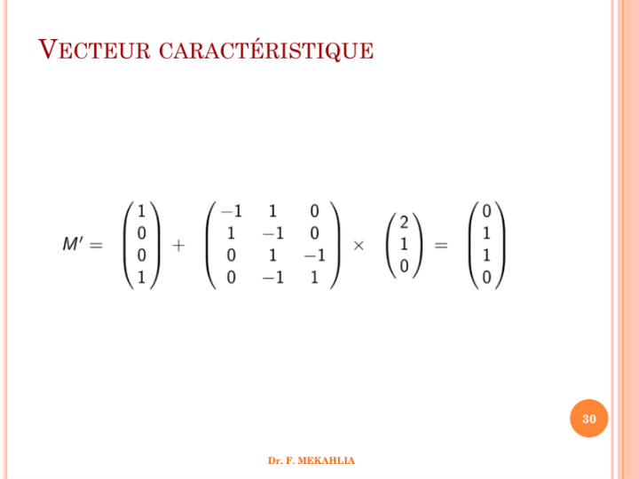

## Diapositive 31

VECTEUR CARACTÉRISTIQUE
Un Marquage est dit marquage accessible s'il
existe une séquence de franchissement σ tel que
M0[σ>M.
L'ensemble des marquages accessibles à partir du
marquage M0 est Noté M0[>
Dans l'exemple précédent, le marquage initial est
M0 = (1, 0, 0, 1). La transition t1 est sensibilisée,
les transitions t2 et t3 ne sont pas franchissables.
Le tir de la transition t1 consomme le jeton de p1 et
produira un jeton qui sera déposé dans p2.
On obtient donc le marquage M0 = (0, 1, 0, 1). 31
Dr. F. MEKAHLIA

## Diapositive 32

GRAPHE DE MARQUAGES
Le graphe de marquages permet de représenter les différentes
configurations possibles d'un réseau de Petri et leur évolution.
Il est construit à partir du marquage initial M0.
Il s'agit d'un graphe orienté dans lequel :
● Chaque sommet représente un marquage possible.
● Chaque arc représente le franchissement d'une transition.
● Les arcs sont étiquetés par les transitions qui provoquent
les changements de marquage.
On peut le noter :
Avec :
● V : ensemble des marquages accessibles.
● E : ensemble des franchissements possibles entre ces
marquages.
32
Dr. F. MEKAHLIA

## Diapositive 33

GRAPHE DE MARQUAGES
Pourquoi construire ce graphe ?
Il permet de répondre à des questions importantes :
● Quels sont les états possibles du système ?
● Une situation incorrecte peut-elle être atteinte ?
● Le système peut-il se bloquer ?
● Une ressource peut-elle être consommée
plusieurs fois ?
● Toutes les opérations nécessaires peuvent-elles
être exécutées ?
33
Dr. F. MEKAHLIA

## Diapositive 34

VECTEUR CARACTÉRISTIQUE
=
34
Dr. F. MEKAHLIA

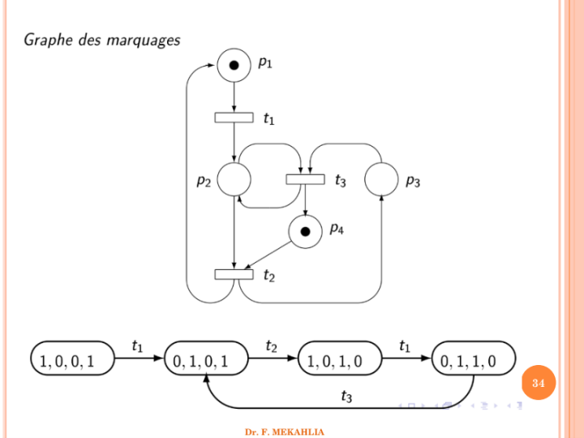

## Diapositive 35

GRAPHE DE MARQUAGES: LES PRINCIPALES
PROPRIÉTÉS DES GRAPHES DE MARQUAGES
L'analyse du graphe permet de vérifier plusieurs propriétés
importantes:
1- Accessibilité (Reachability): Un marquage M est accessible à partir
de M) s'il existe une séquence de franchissements permettant
d'atteindre ce marquage.
On note :
Intérêt : vérifier si une situation particulière, notamment
une situation incorrecte, peut se produire.
35
Dr. F. MEKAHLIA

## Diapositive 36

GRAPHE DE MARQUAGES: LES PRINCIPALES
PROPRIÉTÉS DES GRAPHES DE MARQUAGES
2- Bornitude (Boundedness) :
Un réseau est borné si le nombre de jetons dans chaque place reste
limité pour tous les marquages accessibles.
Un réseau est k-borné si :
pour toute place p.
Intérêt : garantir qu'une quantité de ressources ne peut pas
augmenter indéfiniment.
36
Dr. F. MEKAHLIA

## Diapositive 37

GRAPHE DE MARQUAGES: LES PRINCIPALES
PROPRIÉTÉS DES GRAPHES DE MARQUAGES
3- Sûreté (Safeness)
Un réseau est sûr si chaque place contient au maximum un jeton
dans tous les marquages accessibles. La sûreté correspond à un
réseau 1-borné.
Ce modèle permet de représenter l'exclusion mutuelle : une
seule activité peut posséder le verrou à un instant donné.
37
Dr. F. MEKAHLIA

## Diapositive 38

GRAPHE DE MARQUAGES: LES PRINCIPALES
PROPRIÉTÉS DES GRAPHES DE MARQUAGES
4- Conservation
La conservation signifie qu'une quantité totale de jetons reste
constante pendant les franchissements.
Dans notre projet, les places disponibles et les réservations
confirmées représentent deux catégories complémentaires d'une
même capacité.
On définit :
38
Dr. F. MEKAHLIA

## Diapositive 39

GRAPHE DE MARQUAGES: LES PRINCIPALES
PROPRIÉTÉS DES GRAPHES DE MARQUAGES
5- Vivacité (Liveness): La vivacité permet d'étudier si les
transitions du réseau peuvent continuer à être exécutées.
Un réseau est vivant si, à partir de tout marquage accessible,
chaque transition peut redevenir franchissable après une certaine
séquence de franchissements.
i.e: elle correspond à vérier qu'à tout instant le système conserve la
possibilité de reproduire toutes les actions.
Exemple :
Dans un système de gestion de ressources, une transition peut
rester définitivement bloquée si une ressource n'est jamais libérée.
Cela peut indiquer un problème de synchronisation ou un blocage. 39
Dr. F. MEKAHLIA

## Diapositive 40

GRAPHE DE MARQUAGES: LES PRINCIPALES
PROPRIÉTÉS DES GRAPHES DE MARQUAGES
6- Blocage (Deadlock)
Un blocage correspond à un marquage dans lequel aucune transition
n'est franchissable.
Formellement :
où Enabled(M,t) signifie que la transition t est franchissable dans le
marquage M.
40
Dr. F. MEKAHLIA

## Diapositive 41

GRAPHE DE MARQUAGES: LES PRINCIPALES
PROPRIÉTÉS DES GRAPHES DE MARQUAGES
7- Réversibilité
Un réseau est réversible si, à partir de chaque marquage accessible, il
est possible de revenir au marquage initial.
41
Dr. F. MEKAHLIA

## Diapositive 42

EXTENSIONS DES RÉSEAUX DE PETRI
Les réseaux de Petri classiques permettent de modéliser de
nombreux systèmes concurrents grâce aux places, aux
transitions et aux jetons.
Cependant, ils présentent certaines limites : certaines
propriétés ou opérations ne peuvent pas être représentées
directement, ou nécessitent des modèles complexes.
Pour dépasser ces limites, plusieurs extensions ont été
proposées afin de :
● Augmenter le pouvoir d'expression des réseaux de Petri.
● Représenter des comportements plus complexes.
● Simplifier et réduire la taille des modèles.
● Prendre en compte de nouvelles caractéristiques, comme
les données, le temps et les probabilités.
42
Dr. F. MEKAHLIA

## Diapositive 43

EXTENSIONS DES RÉSEAUX DE PETRI
Exemple :
Dans notre système de réservation, nous voulons réaliser deux
opérations :
● Confirmer une réservation lorsqu'une place est disponible.
● Rejeter une réservation lorsqu'il ne reste aucune place.
Le réseau de Petri classique permet facilement de représenter la
consommation d'un jeton lorsqu'une place est disponible.
Mais une difficulté apparaît : comment représenter la condition «
il ne reste aucune place disponible » ?
C'est ici qu'intervient une première extension : l'arc inhibiteur.
43
Dr. F. MEKAHLIA

## Diapositive 44

EXTENSIONS DES RÉSEAUX DE PETRI
Question : Dans notre système de réservation, nous avons deux
transitions :
● ConfirmerReservation : consomme un jeton de la place
PlacesDisponibles.
● RejeterReservation : doit être exécutée uniquement lorsqu'il
ne reste aucune place disponible.
Peut-on représenter directement cette deuxième condition avec un
réseau de Petri classique ?
44
Dr. F. MEKAHLIA

## Diapositive 45

EXTENSIONS DES RÉSEAUX DE PETRI: LES ARCS
INHIBITEURS
Dans un réseau de Petri classique, une transition est
franchissable lorsque toutes ses places d'entrée
contiennent suffisamment de jetons.
Autrement dit, le réseau permet de tester la présence
d'un certain nombre de jetons dans une place.
En revanche, il ne permet pas de tester directement
leur absence.
Cette opération est appelée test à zéro.
Le test à zéro consiste à vérifier qu'une place ne
contient aucun jeton.
45
Dr. F. MEKAHLIA

## Diapositive 46

VÉRIFIER LE CAS DE RÉSERVATION
SIMULTANÉE DE LA DERNIÈRE PLACE
Le réseau de Petri classique permet de modéliser et
de vérifier l'exclusion mutuelle lors de réservations
simultanées grâce au partage d'une ressource.
Cependant, il ne permet pas de tester directement
l'absence de jetons dans une place pour déclencher
explicitement une action de refus. Cette
fonctionnalité peut être représentée à l'aide des
arcs inhibiteurs.
l'absence de double réservation est une propriété de
sécurité que le RdP classique peut vérifier. Le test
explicite de disponibilité nulle est une
fonctionnalité supplémentaire apportée par les arcs
inhibiteurs.
46
Dr. F. MEKAHLIA

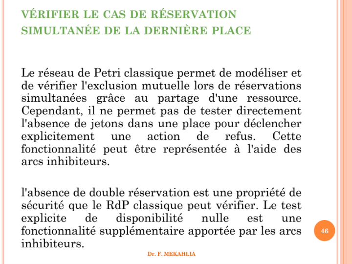

## Diapositive 47

PRINCIPE DE L'ARC INHIBITEUR
Dans un réseau classique, un arc entrant exige la
présence de jetons.
Un arc inhibiteur permet au contraire de représenter
une condition d'absence de jetons.
Il empêche le franchissement d'une transition lorsque la
place associée contient un nombre de jetons supérieur
ou égal au seuil défini, généralement un.
Ainsi :
● Si la place contient au moins un jeton : la transition
est bloquée.
● Si la place ne contient aucun jeton : la condition de
l'arc inhibiteur est satisfaite.
47
Dr. F. MEKAHLIA

## Diapositive 48

PRINCIPE DE L'ARC INHIBITEUR
48
Dr. F. MEKAHLIA

## Diapositive 49

PRINCIPE DE L'ARC INHIBITEUR
Exemple :
Considérons une place PlacesDisponibles qui représente le
nombre de places encore disponibles pour un événement.
Supposons que la capacité de l'événement soit de deux places.
Situation 1 : une place est encore disponible
Places disponibles —----------------------> 1 jeton
Confirmer (Possible)
Situation 2 : aucune place n'est disponible
Places disponibles —----------------------> 0 jeton
Rejeter (Possible)
49
Dr. F. MEKAHLIA

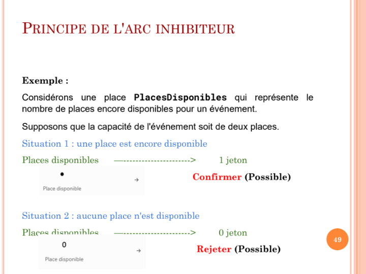

## Diapositive 50

PRINCIPE DE L'ARC INHIBITEUR
Un arc inhibiteur est représenté graphiquement par une flèche
terminée par un petit cercle. Il permet d'activer une transition
lorsque la place d'origine ne contient aucun jeton.
Il permet de représenter une condition d’absence de jetons dans une
place.
Il offre une capacité de modélisation supplémentaire par rapport aux
arcs classiques
50
Dr. F. MEKAHLIA

## Diapositive 51

PRINCIPE DE L'ARC INHIBITEUR
il autorise le franchissement d’une transition uniquement si la place
d’origine ne contient aucun jeton (ou, plus généralement, si son
marquage est inférieur à un seuil donné).
Il permet donc de modéliser des conditions qui dépendent de
l’absence d’un événement, d’une ressource ou d’un état.
Attention : l’arc inhibiteur ne consomme aucun jeton. Il
vérifie simplement une condition qui détermine si le
franchissement de la transition concernée est autorisé ou
bloqué. 51
Dr. F. MEKAHLIA

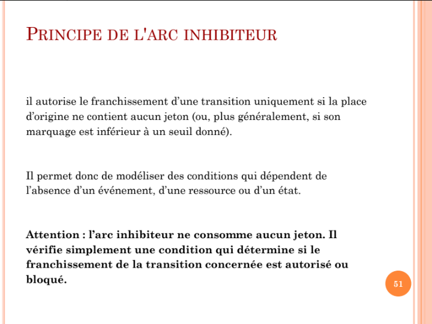

## Diapositive 52

PRINCIPE DE L'ARC INHIBITEUR
Comparaison entre réseau classique et réseau avec
arc inhibiteur :
52
Réseau classique Réseau avec arc inhibiteur
Teste la présence de jetons. Teste l'absence de jetons.
Une transition peut être activée si
les conditions d'entrée sont
satisfaites.
Une transition peut être activée si la
place reliée par l'arc inhibiteur est
vide.
Ne permet pas directement le test
à zéro.
Permet le test à zéro.
Dr. F. MEKAHLIA

## Diapositive 53

53
Besoins qui ne peuvent pas
être vérifiés par réseaux de
Petri classiques.
Limitation du réseau
classique
Extension
Rejeter une réservation si
aucune place n'est
disponible.
Impossible de tester
directement l'absence de
jetons.
Arcs inhibiteurs
Identifier les utilisateurs et les
réservations.
Les jetons sont
indistinguables dans le
modèle classique.
Réseaux colorés
Délai maximal de paiement. Le modèle classique ne
représente pas directement
les délais.
Réseaux temporisés
Étudier les délais et les
échecs de traitement.
Le modèle classique ne
représente pas directement
les durées probabilistes.
Réseaux stochastiques
Séparer réservation,
paiement et gestion des
places.
Un modèle complexe peut
devenir difficile à lire et à
maintenir
Réseaux hiérarchiques
Dr. F. MEKAHLIA

## Diapositive 54

SON RÔLE
54
Critères RDP classique RDP avec arcs
inhibiteurs
Vérifier la présence de
jetons.
oui oui
Vérifier l’absence de jetons. Pas directement oui
Tester si une place est vide. Pas directement oui
Modéliser une condition
négative.
Plus complexe Plus simple
Exprimer une condition de
blocage.
Avec des mécanismes
supplémentaires.
Directement
Dr. F. MEKAHLIA

## Diapositive 55

RÉSEAUX DE PETRI COLORÉS
(COLORED PETRI NETS)
Dans les réseaux colorés, les jetons peuvent
transporter des informations : identifiants, valeurs,
types ou données.
Exemple : Les jetons peuvent représenter les
demandes des utilisateurs :
● Demande de l'utilisateur A.
● Demande de l'utilisateur B.
● Demande de l'utilisateur C.
On peut ainsi représenter plusieurs demandes dans
une même place sans créer une place distincte pour
chaque utilisateur.
55
Dr. F. MEKAHLIA

## Diapositive 56

RÉSEAUX DE PETRI COLORÉS
(COLORED PETRI NETS)
Application : représenter les identifiants des
utilisateurs et suivre les demandes
individuellement.
Cette extension est particulièrement utile si l'on
veut aller au-delà du modèle simplifié où les jetons
représentent uniquement des quantités.
56
Dr. F. MEKAHLIA

## Diapositive 57

RÉSEAUX DE PETRI TEMPORELS (TIMED
PETRI NETS)
Les réseaux temporels ajoutent une dimension
temporelle.
Ils permettent de représenter :
● Les délais d'attente.
● La durée d'une opération.
● Les échéances.
● Les temporisations.
57
Dr. F. MEKAHLIA

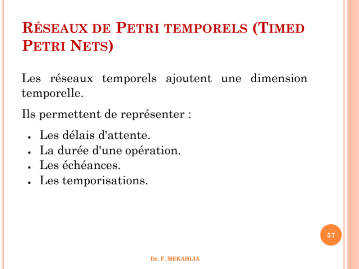

## Diapositive 58

RÉSEAUX DE PETRI TEMPORELS (TIMED
PETRI NETS)
Exemple :
● Une place peut être temporairement réservée
pendant dix minutes.
● Si l'utilisateur ne confirme pas sa demande
dans ce délai, la réservation temporaire expire
et la place est libérée.
Application : systèmes temps réel, gestion des
délais et réservations temporaires.
58
Dr. F. MEKAHLIA

## Diapositive 59

RÉSEAUX DE PETRI STOCHASTIQUES
Les réseaux stochastiques introduisent des durées ou des événements
aléatoires.
Ils permettent d'étudier :
● Le temps moyen de traitement d'une demande.
● La probabilité qu'une demande soit abandonnée.
● La probabilité d'une surcharge du système.
● Les performances et la disponibilité du service.
Application : évaluation des performances et analyse de fiabilité.
59
Dr. F. MEKAHLIA

## Diapositive 60

RÉSEAUX DE PETRI HIÉRARCHIQUES
Les réseaux hiérarchiques permettent de décomposer un grand réseau
en plusieurs sous-réseaux.
Dans notre projet, on peut distinguer :
1. Gestion des demandes.
2. Gestion des places disponibles.
3. Gestion des confirmations.
4. Gestion des annulations.
Cette décomposition permet de mieux organiser la modélisation d'un
système complexe.
60
Dr. F. MEKAHLIA

## Diapositive 61

RÉFÉRENCES
- BOUKALA, Mohand Cherif. Vérification formelle,
support de cours, 9 février 2024.
- Winskel, G., & Nielsen, M. (1995). Models for
Concurrency. In S. Abramsky, D. M. Gabbay, &
T. S. E. Maibaum (Eds.), Handbook of Logic in
Computer Science, Volume 4: Semantic
Modelling. Oxford University Press.
61

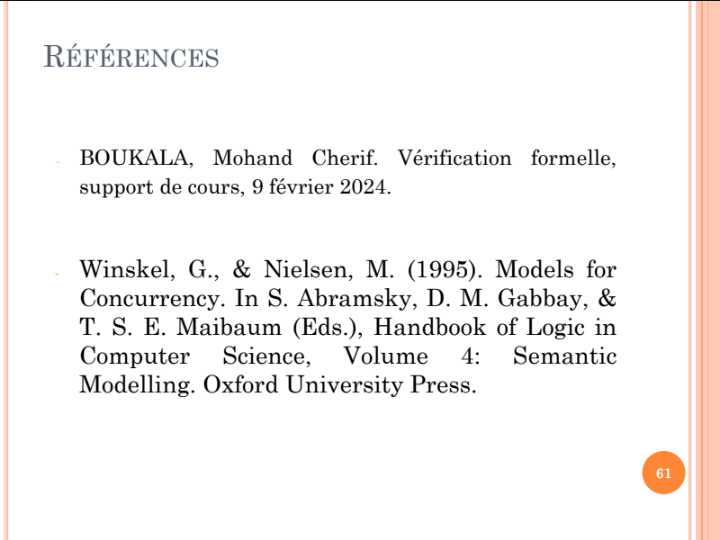

## Diapositive 62

Merci
62,,

