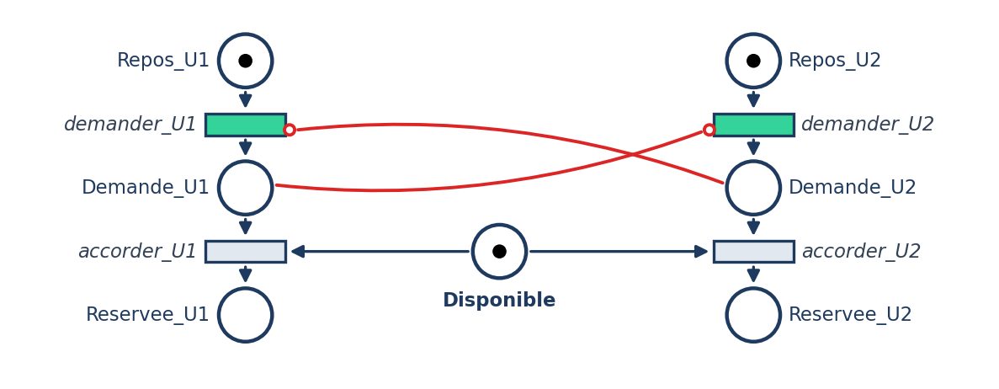
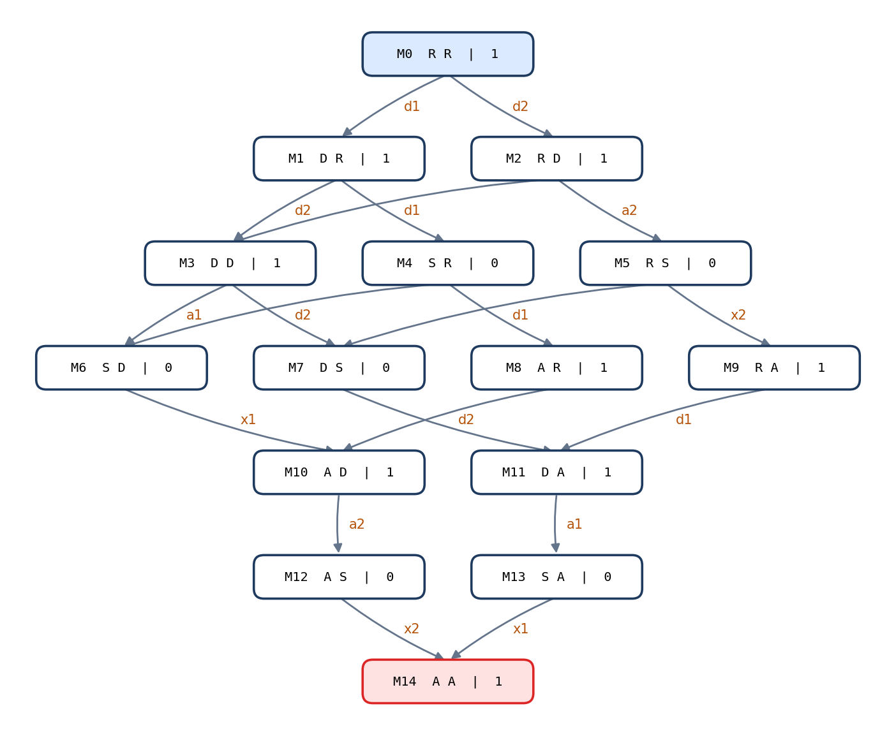

# Méthodes formelles — Résumé des TD et TP

Mise à jour du 24 novembre 2026. Méthodes de résolution, étapes pratiques et pièges des travaux dirigés et pratiques. Le [résumé des cours](resumer.md) conserve les chapitres théoriques. Les ajouts pédagogiques sont distingués des observations présentes dans les supports.

## TD/TP — Relier les quatre chapitres au système de réservation

Le sujet pratique associe contrats, programme Java, automate, concurrence,
réseau de Petri, logique temporelle et modèle probabiliste. Le corrigé complet
se trouve dans `methodes-formelles/TP/solution-mimobn.pdf` ; cette section en
rappelle les liens avec le cours.

| Question | Modèle ou raisonnement | Propriété recherchée |
| --- | --- | --- |
| Peut-on réserver ? | Préconditions et postconditions | Demande valide ; place attribuée seulement si disponible |
| Combien de places restent ? | Invariant de conservation | libres + confirmations actives = capacité |
| Quels changements sont permis ? | Automate de demande | Attente, confirmation, refus, annulation |
| Deux clients visent la dernière place | Opération atomique et ressource partagée | Pas de double attribution |
| Une demande peut-elle attendre toujours ? | Vivacité et équité | Toute attente finit par être traitée ou annulée |
| Confirmation avant D ? | DTMC et propriété bornée | Probabilité calculée sous des hypothèses explicites |

Un invariant de compteur ne suffit pas à exclure tous les défauts : deux threads
peuvent lire 1 puis écrire tous deux 0, alors que chacun a confirmé la même place.
Il faut vérifier aussi l'unicité des propriétaires et rendre atomique le contrôle
suivi de l'attribution. Un réseau de Petri représente cette ressource par un jeton.

Dans le modèle temporel, `G` signifie toujours, `F` finalement et `X` au pas
suivant. `G(attente → F traitee)` exprime une progression sur les traces retenues ;
il faut annoncer les hypothèses d'équité. Une preuve de sûreté ne fournit pas
automatiquement cette progression.

Dans le modèle probabiliste pédagogique, chaque pas en attente confirme avec
p=0,70, échoue définitivement avec f=0,05, ou reste en attente avec r=0,25.
La probabilité de confirmation au plus tard au pas D est :

```text
P_D = p × (1 − r^D) / (1 − r), pour r différent de 1
P_0 = 0
P_5 = 0,932421875 = 93,2421875 %
```

Ces valeurs sont des hypothèses d'exercice, pas des mesures. La vérification
automatique des modèles finis et les tests du Java ont des portées différentes.

## TP — Arcs inhibiteurs, concurrence et annulation

Deux utilisateurs `U1` et `U2` se disputent **une seule place**. Chacun passe par `Repos`, `Demande`, `Reservee` (et `Annulee` dans le réseau 3) ; le jeton de `Disponible` représente la place libre. Le corrigé complet (modèles PIPE, simulations, graphes) est dans `TP/solution-mimobn/arcs-inhibiteurs/`.

### Les trois réseaux

| Réseau | Principe | Transitions / arcs | États | États morts |
| --- | --- | --- | --- | --- |
| 1 — inhibiteurs | `demander_Ui` inhibée par `Demande_Uj` : une seule demande en attente à la fois | 4 / 12 dont 2 inhibiteurs | 7 | 2 |
| 2 — concurrent | même réseau sans inhibiteur ; seul le jeton de `Disponible` arbitre | 4 / 10 | 8 | 2 |
| 3 — annulation | réseau 2 + `annuler_Ui` qui rend le jeton à `Disponible` | 6 / 16 | 15 | 1 |
| Variante fautive | annulation **sans** arc de retour : la place est perdue | 6 / 14 | 12 | 2 |



### Ce que montrent les simulations

- **Réseau 1.** `U1` demande : `demander_U2` est bloquée par l'arc inhibiteur. La place est accordée à `U1`, puis `U2` peut demander mais `accorder_U2` est bloquée (`Disponible` = 0) : **état mort**.
- **Réseau 2.** Les deux demandent ; `accorder_U1` et `accorder_U2` sont en **conflit** pour le même jeton. Un seul gagne, la place n'est jamais donnée deux fois, l'autre reste en attente sans issue.
- **Réseau 3.** Après `annuler_U1`, la place revient dans `Disponible` et `accorder_U2` devient franchissable : mais U2 n'est **pas accepté automatiquement**, il faut un franchissement explicite. L'attente est sans fin tant que U1 n'annule pas (famine possible, pas de blocage définitif).



### Raisonnements à savoir refaire

- **Invariant de conservation de la place** : `Disponible + Reservee_U1 + Reservee_U2 = 1`, vrai dans les réseaux 1, 2 et 3, **faux** dans la variante fautive. Il se prouve avec la matrice d'incidence : la somme pondérée est un P-invariant si `yᵀ·C = 0`. Les arcs inhibiteurs n'apparaissent pas dans `C` car ils ne déplacent aucun jeton.
- **Un état par utilisateur** : `Repos + Demande + Reservee (+ Annulee) = 1` pour chaque `Ui`.
- **Sûreté vient du jeton, pas de l'inhibiteur** : sans inhibiteur (réseau 2), la double attribution reste impossible. L'inhibiteur ne contrôle que l'**entrée** des demandes.
- **Choix du réseau 2** : plus réaliste (plusieurs clients visent la dernière place) et sans inhibiteur ; les inhibiteurs donnent aux RdP la puissance d'une machine de Turing, ce qui rend l'accessibilité non décidable en général.

### Passage à l'échelle (états accessibles, états morts entre parenthèses)

| Utilisateurs / places | Réseau 1 | Réseau 2 | Réseau 3 |
| --- | --- | --- | --- |
| 2 / 1 | 7 (2) | 8 (2) | 15 (1) |
| 3 / 1 | 13 (6) | 20 (3) | 54 (1) |
| 4 / 1 | 21 (12) | 48 (4) | 189 (1) |
| 4 / 2 | 39 (12) | 72 (6) | 243 (1) |

L'inhibiteur réduit le nombre d'états mais **multiplie les états morts** quand les utilisateurs augmentent : un utilisateur sans place bloque tous ceux qui n'ont pas encore pu demander. Le réseau 3 n'a qu'un état mort, la fin normale où tout le monde a annulé.

## Révision active — Pratique

1. **Pourquoi `Disponible` garantit-il la sûreté ?** Une seule place libre = un seul jeton : `accorder_U1` et `accorder_U2` se disputent ce jeton, le premier tiré le consomme.
2. **L'arc inhibiteur empêche-t-il la double réservation ?** Non, c'est le jeton ; l'inhibiteur ne fait que limiter l'entrée des demandes.
3. **Que perd-on en oubliant l'arc `annuler_Ui → Disponible` ?** La place : le jeton se retrouve dans `Annulee_Ui`, l'invariant de conservation est violé et l'autre utilisateur reste bloqué.
4. **U2 est-il servi automatiquement après l'annulation de U1 ?** Non : `accorder_U2` devient franchissable, il faut la déclencher ; un RdP ne force jamais un franchissement.
5. **Pourquoi le réseau 1 a-t-il moins d'états que le réseau 2 ?** L'état « les deux utilisateurs attendent » est interdit par l'inhibiteur.
