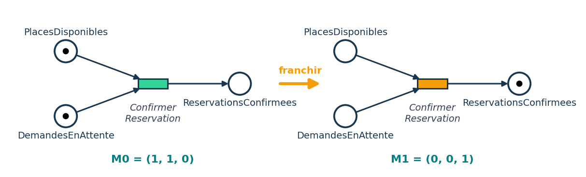
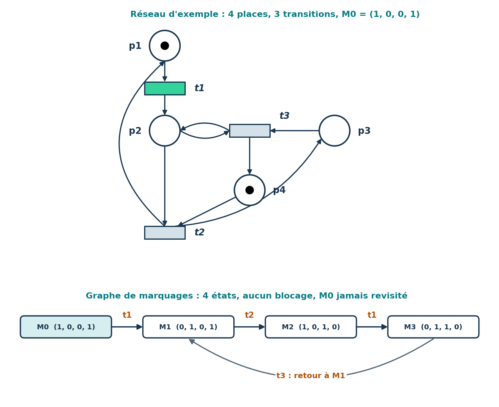
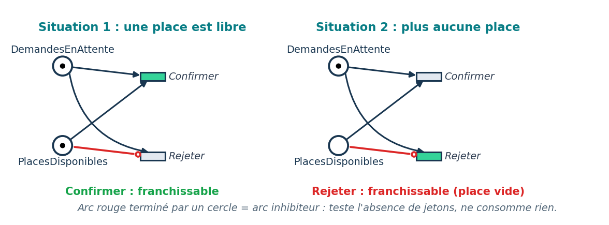

# Méthodes formelles — Résumé des cours

Mise à jour du 24 novembre 2026. Définitions, raisonnements et exemples des cours. Les exercices, commandes et comptes rendus pratiques sont réunis dans [le résumé TD/TP](resumer-tp.md).

## Chapitre 1 — Introduction aux méthodes formelles

### 1. Pourquoi les tests ne suffisent pas

Un programme peut réussir tous les tests réalisés et conserver un défaut dans un scénario qui n'a pas été testé. Dans l'exemple de réservation, deux utilisateurs peuvent demander simultanément la dernière place : une exécution normale testée isolément ne garantit pas l'absence de double attribution.

Les méthodes formelles utilisent des modèles mathématiques et des raisonnements logiques pour exprimer précisément les exigences et étudier des propriétés du système. Elles complètent les tests. Une preuve portant sur un modèle ne dispense pas de vérifier le lien entre ce modèle, l'implémentation et l'environnement réel.

### 2. Test, vérification et validation

| Notion | Question | Exemple de réservation |
| --- | --- | --- |
| Test | Quel résultat obtient-on pour un scénario déterminé ? | Essayer de réserver une place disponible |
| Vérification | Le système respecte-t-il sa spécification ? | Une place réservée n'est pas attribuée deux fois |
| Validation | Le système répond-il au besoin réel ? | Les utilisateurs peuvent-ils effectuer les opérations nécessaires ? |

Un logiciel conforme à une spécification peut rester inadapté si la spécification oublie un besoin important. La vérification et la validation répondent donc à des questions différentes.

### 3. Du besoin à l'implémentation

- **Besoin** : objectif de l'utilisateur, par exemple réserver un billet.
- **Exigence** : comportement ou contrainte attendue, par exemple empêcher la double réservation.
- **Spécification** : description structurée de ce que le système doit faire.
- **Modèle** : représentation abstraite des états, données, actions et transitions pertinentes.
- **Implémentation** : programme réellement développé.

Une démarche cohérente relie ces éléments : besoin → exigences → spécification → modèle → vérification des propriétés → conception/implémentation → tests et autres vérifications → validation.

### 4. Spécifier avec un contrat

Une précondition indique ce qui doit être vrai avant l'opération. Une postcondition décrit ce qui doit être vrai après l'opération, dans les conditions annoncées.

Pour retirer un montant `m` d'un solde `s`, sans découvert :

```text
Précondition : s ≥ 0 ∧ m > 0 ∧ m ≤ s
Opération : retrait(m)
Postcondition : s' = s − m
```

Le contrat décrit le résultat attendu sans imposer un algorithme particulier. Il faut spécifier séparément le traitement des demandes invalides si leur comportement doit aussi être garanti. La page 32 contient une inversion du signe `m ≥ s` ; la page 33 donne correctement `m ≤ s`.

### 5. Abstraction et limites d'une preuve

L'abstraction conserve les informations utiles à la propriété étudiée et ignore les autres. Pour vérifier que deux directions ne sont jamais simultanément au vert, les états des feux sont pertinents ; la forme du boîtier ne l'est généralement pas.

Une abstraction trop pauvre peut oublier un comportement essentiel. Une conclusion sur le modèle vaut sous ses hypothèses et selon la relation établie avec le système réel. Il faut donc préciser les états, les actions autorisées, les propriétés, les hypothèses environnementales et le lien avec l'implémentation.

### 6. Les propriétés à connaître

| Propriété | Idée | Exemple |
| --- | --- | --- |
| Accessibilité | Un état peut-il être atteint depuis un état initial ? | Peut-on atteindre l'état confirmé ? |
| Invariance | Une propriété reste vraie dans tous les états atteignables | Le solde reste ≥ 0 |
| Sûreté — Safety | Un comportement indésirable n'arrive jamais | Aucune double attribution |
| Vivacité — Liveness | Un événement attendu finit par se produire | Une demande persistante finit par être traitée |
| Équité — Fairness | Une action ou un processus éligible n'est pas indéfiniment négligé | Un processus attendant une imprimante obtient son tour sous les hypothèses prévues |

La sûreté évite les erreurs ; la vivacité concerne la progression. Un système qui refuse toutes les demandes peut éviter la double réservation tout en ne rendant aucun service. L'équité peut soutenir une preuve de progression, mais ne garantit pas seule la terminaison de toutes les opérations.

**À retenir :** écrire une règle précise, construire un modèle adapté et vérifier une propriété clairement définie, en conservant les tests et la validation.

## Chapitre 2 — Les principales familles de méthodes formelles

### 1. Choisir en fonction du problème

Un programme séquentiel, un protocole distribué et un système probabiliste ne posent pas les mêmes questions. Le choix d'une méthode suit quatre étapes : identifier la nature du système ; identifier la propriété recherchée ; choisir le modèle adapté ; choisir une technique de vérification.

| Famille / technique | Utilité principale | Exemple |
| --- | --- | --- |
| Automates et systèmes de transitions | Décrire les états et changements autorisés | Disponible → Réservé |
| Automates communicants | Décrire des composants qui échangent/synchronisent | Client et serveur |
| Réseaux de Petri | Concurrence, synchronisation, partage de ressources | Un jeton représente une place disponible |
| Algèbres de processus | Composer et comparer des comportements concurrents | Communication entre processus |
| Logique de Hoare | Relier préconditions et postconditions d'un programme | `{x=5} x:=x+1 {x=6}` |
| LTL / CTL | Exprimer des propriétés sur les évolutions possibles | Une demande finit par recevoir une réponse |
| Model checking | Vérifier automatiquement un modèle contre une propriété | Rechercher une double attribution |
| Types abstraits et Z | Spécifier données, opérations et invariants | Solde bancaire non négatif |
| Modèles probabilistes / Markov | Étudier probabilités, fiabilité ou performances | Probabilité d'atteindre une panne |

### 2. LTL, CTL et model checking

LTL exprime des propriétés sur des traces d'exécution linéaires. CTL exprime des propriétés sur un arbre d'évolutions en utilisant des quantifications sur les chemins. Cette différence ne signifie pas qu'un système étudié en LTL doit être déterministe. Une logique temporelle décrit l'ordre/l'évolution des situations ; elle ne mesure pas automatiquement des durées physiques.

Le model checking associe un modèle `M` à une propriété formelle `φ` :

```text
Modèle M + propriété φ → outil de vérification
M ⊨ φ : la propriété est satisfaite dans le modèle.
M ⊭ φ : elle n'est pas satisfaite.
```

Un contre-exemple explique une violation par une exécution ou une structure appropriée à la propriété et à l'outil. Les supports mettent l'accent sur les suites de transitions qui montrent l'erreur. Il faut distinguer le langage dans lequel on écrit une propriété de la technique employée pour la vérifier.

### 3. Intégration au cycle de vie

Les activités habituelles restent nécessaires : besoins, exigences, conception, implémentation, tests, validation, déploiement et maintenance. Les méthodes formelles renforcent certaines étapes : cohérence des exigences, précision de la spécification, vérification du modèle ou preuve d'une partie du programme.

Leurs avantages sont la réduction des ambiguïtés, la détection précoce d'erreurs et des garanties explicites sur les propriétés étudiées. Leurs limites incluent l'effort de modélisation, les compétences nécessaires, le risque d'un modèle inadapté et l'explosion du nombre d'états.

**À retenir :** une méthode se choisit pour un système et une propriété précis ; aucune famille ne résout automatiquement tous les problèmes.

## Chapitre 3 — Logique de Hoare

### 1. État, assertion et triplet

L'état d'un programme est décrit par les valeurs de ses variables. Une assertion est une propriété logique de cet état. Un prédicat peut dépendre de variables, comme `x > 0` ou `0 ≤ nbPlaces ≤ 10`.

Les assertions utilisent comparaisons, connecteurs `¬`, `∧`, `∨`, `⇒`, `⇔` et, selon le besoin, quantificateurs `∀` et `∃`.

```text
{P} C {Q}
P : précondition
C : commande/programme
Q : postcondition
```

En correction partielle : si `P` est vrai et si `C` termine normalement, alors `Q` est vrai dans l'état final. La correction totale ajoute la terminaison. Cette précision évite de lire un triplet comme une promesse automatique de fin d'exécution.

### 2. Affectation : raisonner à rebours

Pour obtenir `Q` après `x := E`, on remplace les occurrences libres de `x` dans `Q` par `E`, en respectant les règles de substitution.

```text
{ Q[E/x] } x := E { Q }
wp(x := E, Q) = Q[E/x]
```

Exemple du support : pour obtenir `x = 10` après `x := x + 2`, il faut initialement `x = 8`.

```text
{x = 8} x := x + 2 {x = 10}
```

Attention : on remplace dans la postcondition avec la valeur **avant** l'affectation. On ne suppose pas déjà le résultat final pendant le calcul de la précondition.

### 3. Séquence

On relie deux instructions par une assertion intermédiaire :

```text
{P} C1 {R}    et    {R} C2 {Q}
donc {P} C1 ; C2 {Q}
```

Exemple : avec `x = 2`, `x := x + 1` donne `x = 3`, puis `y := 2*x` donne `y = 6`.

```text
{x = 2} x := x + 1 ; y := x*2 {x = 3 ∧ y = 6}
wp(C1 ; C2, Q) = wp(C1, wp(C2, Q))
```

Le calcul de la précondition se fait donc de la dernière instruction vers la première.

### 4. Conditionnelle

Les deux branches doivent assurer la postcondition, en tenant compte de la garde :

```text
{P ∧ B} C1 {Q}    et    {P ∧ ¬B} C2 {Q}
donc {P} if B then C1 else C2 {Q}
```

Exemple : `if x >= 0 then y := x else y := -x` garantit `y >= 0` dans les deux branches, sans condition initiale supplémentaire sur `x` dans le domaine mathématique considéré.

```text
{true} C {y ≥ 0}
wp(if B then C1 else C2, Q)
  = (B ⇒ wp(C1,Q)) ∧ (¬B ⇒ wp(C2,Q))
```

La page 16 écrit `y > 0` dans l'explication de la première branche ; si `x = 0`, le résultat est `y = 0`. Il faut lire `y ≥ 0`.

### 5. Conséquence

On peut renforcer la précondition ou affaiblir la postcondition d'un triplet déjà établi :

```text
P' ⇒ P,    {P} C {Q},    Q ⇒ Q'
donc {P'} C {Q'}
```

Le support utilise `{x=5} x:=x+1 {x=6}`. Puisque `x=6 ⇒ x≥0`, on obtient `{x=5} x:=x+1 {x≥0}`. La nouvelle postcondition est moins précise, mais reste garantie.

### 6. Précondition la plus faible

La précondition la plus faible impose le moins de contraintes possible tout en garantissant le résultat selon la convention de correction choisie. Toute autre précondition suffisante doit l'impliquer.

Exemple du support :

```text
Programme : x := x + 3
Postcondition : x > 7
Substitution : x + 3 > 7
Simplification : x > 4
Donc wp(x := x + 3, x > 7) = x > 4.
```

Les exemples d'affectations sont lus sur des valeurs mathématiques appropriées, sans introduire d'erreur d'exécution ou de débordement non modélisé. La page 21 présente une garantie « si le programme termine » tout en la nommant `wp`. Une convention fréquente réserve `wlp` à la correction partielle et `wp` à une garantie comprenant la terminaison ; il faut annoncer la convention utilisée.

### 7. Réservation et invariants

Le système d'exemple dispose de 10 places. Les propriétés importantes sont `0 ≤ nbPlaces ≤ 10`, l'attribution effective d'une place avant confirmation et la mise à jour correcte du compteur. Une précondition doit aussi préciser la validité de l'utilisateur et l'absence d'une réservation incompatible déjà en cours.

L'état initial d'un compteur est souvent noté `nbPlaces_0`. Après une réservation réussie, on attend `nbPlaces = nbPlaces_0 - 1`. Après rejet, il doit rester inchangé et aucune place ne doit être attribuée. Les actions abstraites comme `attribuerPlace` doivent avoir leurs propres effets/spécifications pour qu'une preuve soit complète.

Le tableau récapitulatif du chapitre mentionne l'invariant de boucle, propriété préservée par les itérations, et la variante, utilisée pour justifier la terminaison. Les diapositives fournies ne développent pas une démonstration complète de boucle : cette mention ne remplace pas une preuve de conservation et de terminaison.

**À retenir :** identifier `P`, `C`, `Q` ; calculer à rebours ; vérifier chaque branche ; distinguer résultat conditionnel et terminaison.

## Chapitre 4 — Automates et systèmes de transitions

### 1. État, événement, garde et transition

Un état décrit une situation pertinente du système. Il peut regrouper plusieurs valeurs de variables. Un événement est une occurrence/action susceptible de provoquer une évolution. Une garde est une condition logique autorisant une transition.

```text
EnAttente — [placesDisponibles > 0] → Confirmee
EnAttente — [placesDisponibles = 0] → Rejetee
```

Si le nombre de places est toujours un entier non négatif, les deux gardes couvrent les possibilités. Un état négatif ne doit pas être oublié : il doit être exclu par un invariant ou traité explicitement dans un autre modèle.

### 2. Automate fini

La forme déterministe classique du support est :

```text
A = (Q, Σ, δ, q0, F)
Q : ensemble fini d'états
Σ : alphabet d'entrée
δ : fonction de transition
q0 : état initial
F : ensemble d'états finaux
```

Dans un automate déterministe, il existe **au plus une** transition pour un couple état/symbole. S'il est complet, il y en a exactement une et `δ : Q × Σ → Q` est totale. Dans un automate non déterministe, plusieurs évolutions peuvent être possibles pour le même état et le même symbole. Ce choix n'est pas une probabilité.

Un mot est une suite de symboles de l'alphabet. La machine commence dans l'état initial, lit le mot et suit les transitions. Dans le cas non déterministe, l'acceptation repose sur l'existence d'une exécution acceptante. L'ensemble des mots acceptés est le langage de l'automate. Ce rappel précise la lecture de l'acceptation, sans confondre fin d'un mot et terminaison d'un système logiciel.

### 3. Représentation graphique et frontières du modèle

Les sommets représentent les états ; les flèches, les transitions ; leurs étiquettes, les actions ou conditions. Une flèche entrante sans état d'origine indique l'initialisation. Les états finaux d'un automate classique sont souvent dessinés avec un double cercle.

Le choix de l'état initial dépend de ce que l'on modélise. Pour une demande déjà enregistrée, `EnAttente` convient. Si l'on souhaite représenter sa soumission, on ajoute un état `NonSoumise`. Une étape `EnCoursDeTraitement` peut être utile dans un modèle plus détaillé.

Un état déclaré terminal dans un modèle simplifié n'est pas nécessairement dépourvu de toute évolution dans un modèle étendu. Par exemple, une réservation confirmée peut ensuite être annulée si cette opération entre dans le périmètre étudié.

### 4. Système de transitions

Le support présente deux notations :

```text
Système étiqueté : A = ⟨S, S0, E, R⟩
S0 inclus dans S ; R inclus dans S × E × S.

Système plus général : T = (S, →, S0)
Une transition s'écrit s → s'.
```

Les transitions peuvent être non déterministes, décrites par des actions, événements ou conditions. On ne doit pas imposer automatiquement la fonction déterministe totale d'un automate classique à tout système de transitions.

### 5. Traces d'exécution

Une trace est une suite d'états reliés par des transitions autorisées. Dans le modèle avec traitement intermédiaire :

```text
E → A → C : attente → traitement → confirmation
E → A → R : attente → traitement → rejet
```

`E → C` n'est pas valide **dans ce modèle** si l'arête directe n'existe pas. Cela ne contredit pas la possibilité d'une transition directe dans un modèle plus abstrait. Les traces servent à comprendre les scénarios, repérer les transitions manquantes et analyser les contre-exemples.

### 6. Accessibilité et états interdits

Un état `s` est accessible s'il existe un état initial et une suite de zéro, une ou plusieurs transitions qui mène à `s` :

```text
s0 →* s
```

L'état initial est accessible depuis lui-même grâce au cas zéro transition. Un état inaccessible peut signaler une garde impossible, une transition manquante ou un élément inutile du modèle.

Si `D` représente une double attribution, l'objectif est :

```text
D ∉ Reach(S0)
équivalent à : ∀s ∈ Reach(S0), s ≠ D.
```

S'il est accessible, un chemin menant à `D` fournit un scénario à analyser pour corriger les règles de transition ou la gestion des données.

### 7. Invariants de réservation

```text
0 ≤ placesDisponibles ≤ capacite
placesDisponibles + reservationsConfirmees = capacite
```

La seconde relation suppose qu'une réservation confirmée consomme exactement une place et qu'aucune autre catégorie n'en immobilise. Des annulations, réservations temporaires ou places bloquées exigent d'adapter l'état et l'invariant.

**À retenir :** définir le périmètre du modèle, les états initiaux, les transitions/gardes, les traces autorisées et la propriété recherchée ; vérifier tous les états atteignables pertinents.

## Chapitre 5 — Réseaux de Petri : syntaxe et franchissement

### 1. Origine et intérêt

Le réseau de Petri (RdP) a été créé en 1962 par C. A. Petri pour modéliser la **composition et la communication entre processus**. Il ne décrit pas seulement les états successifs : il représente aussi les **ressources disponibles**, les **conditions** d'exécution et les **interactions** entre activités.

| Concept | Signification |
| --- | --- |
| Parallélisme | plusieurs activités s'exécutent indépendamment, sans attendre la fin des autres |
| Synchronisation | plusieurs activités doivent se coordonner pour qu'une opération ait lieu |
| Choix non déterministe | plusieurs transitions possibles depuis un même état, sans que le modèle impose laquelle |
| Partage de ressources | plusieurs processus utilisent une même ressource en quantité limitée |
| Communication | échange d'informations entre processus |
| Causalité | un événement rend possibles d'autres événements |

Avantages : représentation graphique intuitive ; vérification de propriétés structurelles et comportementales (absence de blocage, retour à l'état initial, disponibilité permanente) ; appui sur la théorie des graphes, la théorie des langages et l'**algèbre linéaire**.

### 2. Définition formelle

Un RdP classique est un **graphe biparti orienté** défini par le quadruplet `RN = (P, T, Pre, Post)` :

- `P` : ensemble fini de **places** (cercles) ;
- `T` : ensemble fini de **transitions** (rectangles ou barres), disjoint de `P` ;
- `Pre` : arcs entrants (place vers transition), les **préconditions** ;
- `Post` : arcs sortants (transition vers place), les **postconditions**.

Un arc relie toujours une place à une transition ou une transition à une place, jamais deux éléments de même nature. Un arc sans indication a le poids 1 ; un poids supérieur doit être écrit sur l'arc.

| Élément | Représentation | Rôle dans le système de réservation |
| --- | --- | --- |
| Place | cercle | condition ou ressource : `PlacesDisponibles`, `DemandesEnAttente`, `ReservationsConfirmees`, `DemandesRejetees` |
| Transition | rectangle | événement : `SoumettreDemande`, `ConfirmerReservation`, `RejeterDemande`, `AnnulerReservation` |
| Arc | flèche | condition nécessaire (entrant) ou résultat produit (sortant) |
| Jeton | point dans une place | une unité de ressource ou de condition disponible |
| Marquage | `M(p)` = nombre de jetons de `p` | photographie du système à un instant |

Dans ce modèle un jeton représente une **unité** de réservation, pas un utilisateur précis. Le marquage s'écrit comme un vecteur dont l'ordre des composantes est fixé : avec trois places disponibles et deux demandes en attente, `M0 = (3, 2, 0)` pour `(PlacesDisponibles, DemandesEnAttente, ReservationsConfirmees)`.

### 3. Règle de franchissement

Une transition `t` est **franchissable** (ou sensibilisée) dans `M` si chaque place d'entrée contient assez de jetons :

```text
M(p) >= Pre(p, t)   pour toute place p
```

Le franchissement fait deux choses : il retire les jetons des places d'entrée et en dépose dans les places de sortie.

```text
M'(p) = M(p) - Pre(p, t) + Post(p, t)        noté  M [t> M'
```



Exemple : avec `M0 = (1, 1, 0)`, `ConfirmerReservation` consomme un jeton de `PlacesDisponibles` et un de `DemandesEnAttente`, et produit un jeton dans `ReservationsConfirmees` : on obtient `M1 = (0, 0, 1)`. S'il n'y a **aucune place disponible**, la transition n'est pas franchissable : le réseau lui-même empêche de consommer une ressource inexistante.

**Un RdP n'oblige jamais à franchir.** Une transition franchissable *peut* l'être ; ce n'est pas un ordre. Quand plusieurs transitions sont franchissables, le choix est non déterministe.

### 4. Matrices d'incidence, séquences et équation d'état

Avec `n` places et `m` transitions, `Pre` et `Post` sont des matrices `n × m` (incidence avant et arrière). La **matrice d'incidence** est :

```text
C = Post - Pre
```

Exemple du cours (4 places, 3 transitions) : `t1` déplace un jeton de `p1` vers `p2` ; `t2` consomme `p2` et `p4` pour produire `p1` et `p3` ; `t3` consomme `p2` et `p3` et produit `p2` et `p4`.

| Place | t1 | t2 | t3 |
| --- | --- | --- | --- |
| p1 | -1 | +1 | 0 |
| p2 | +1 | -1 | 0 |
| p3 | 0 | +1 | -1 |
| p4 | 0 | -1 | +1 |

Une **séquence de franchissement** `σ = t1 t2 … tp` vérifie `M0 [t1> M1, M1 [t2> M2, …`, notée `M0 [σ> Mp`. Son **vecteur caractéristique** `S` est le vecteur colonne (une composante par transition) qui compte combien de fois chaque transition est franchie dans `σ`. Si la séquence est réalisable :

```text
M' = M0 + C · S
```

Pour `σ = t1 t2 t1`, donc `S = (2, 1, 0)`, et `M0 = (1, 0, 0, 1)` :

```text
C · S = 2·(-1, 1, 0, 0) + 1·(1, -1, 1, -1) + 0·(0, 0, -1, 1) = (-1, 1, 1, -1)
M'    = (1, 0, 0, 1) + (-1, 1, 1, -1) = (0, 1, 1, 0)
```

On retrouve le marquage obtenu en franchissant `t1`, puis `t2`, puis `t1`. **Attention :** l'équation d'état ne vérifie pas qu'une séquence est franchissable ; elle donne seulement le marquage *si* elle l'est. Un marquage `M` est **accessible** s'il existe `σ` avec `M0 [σ> M` ; l'ensemble des marquages accessibles se note `M0 [>`.

### 5. Graphe de marquages

Le **graphe de marquages** (ou d'accessibilité) a pour sommets les marquages accessibles depuis `M0` et pour arcs les franchissements, étiquetés par la transition tirée. Il répond à : quels états sont possibles ? une situation incorrecte est-elle atteignable ? le système peut-il se bloquer ? une ressource peut-elle être consommée deux fois ?



Dans l'exemple, `M0 = (1,0,0,1)` donne quatre marquages : `t1` mène à `(0,1,0,1)`, puis `t2` à `(1,0,1,0)`, `t1` à `(0,1,1,0)` et `t3` revient à `(0,1,0,1)`.

### 6. Propriétés à vérifier

| Propriété | Définition | Intérêt |
| --- | --- | --- |
| Accessibilité | `M` est accessible s'il existe `σ` tel que `M0 [σ> M` | savoir si une situation incorrecte peut se produire |
| Bornitude | réseau **k-borné** : `M(p) <= k` dans tout marquage accessible | une quantité de ressources ne croît pas indéfiniment |
| Sûreté | réseau 1-borné : au plus un jeton par place | représenter l'exclusion mutuelle (un seul détenteur du verrou) |
| Conservation | une somme pondérée de jetons reste constante | `PlacesDisponibles + ReservationsConfirmees = capacité` |
| Vivacité | de tout marquage accessible, chaque transition peut redevenir franchissable | aucune action n'est définitivement perdue |
| Blocage (deadlock) | marquage où aucune transition n'est franchissable | détecter un problème de synchronisation |
| Réversibilité | de tout marquage accessible, on peut revenir à `M0` | le système peut se réinitialiser |

Vérification de l'exemple : réseau **sûr** (1-borné), **sans blocage**, **vivant** (chaque transition redevient franchissable), mais **non réversible** car `M0` n'est plus jamais atteint ; la somme `M(p3) + M(p4) = 1` est conservée.

### 7. Extensions des réseaux de Petri

Un RdP classique teste la **présence** de jetons mais pas leur **absence** (le *test à zéro*). Pour rejeter une demande quand il ne reste aucune place, il faut une extension.

**Arc inhibiteur.** Flèche terminée par un petit **cercle**. La transition n'est franchissable que si la place source contient **moins de jetons que le seuil** (généralement 1, c'est-à-dire qu'elle est vide). L'arc inhibiteur ne consomme aucun jeton : il teste seulement une condition.



| Critère | RdP classique | RdP avec arcs inhibiteurs |
| --- | --- | --- |
| Vérifier la présence de jetons | oui | oui |
| Vérifier l'absence de jetons | pas directement | oui |
| Tester si une place est vide | pas directement | oui |
| Modéliser une condition négative | plus complexe | plus simple |
| Exprimer une condition de blocage | mécanismes supplémentaires | directement |

Le RdP classique suffit à **prouver l'absence de double réservation** (propriété de sûreté). L'arc inhibiteur n'est utile que pour le **test explicite** de disponibilité nulle (refus).

| Besoin | Limite du RdP classique | Extension |
| --- | --- | --- |
| Rejeter si aucune place n'est disponible | impossible de tester l'absence de jetons | **arcs inhibiteurs** |
| Identifier utilisateurs et réservations | les jetons sont indistinguables | **réseaux colorés** (jetons porteurs de données : identifiants, types, valeurs) |
| Délai maximal de paiement | pas de notion de délai | **réseaux temporels** (délais, durées, échéances, temporisations) |
| Étudier délais et échecs | pas de durées probabilistes | **réseaux stochastiques** (temps moyen de traitement, probabilité d'abandon ou de surcharge) |
| Séparer réservation, paiement et gestion des places | modèle vite illisible | **réseaux hiérarchiques** (décomposition en sous-réseaux) |

Exemple temporel : une place est réservée provisoirement dix minutes ; sans confirmation, la réservation expire et la place est libérée.

**À retenir :** un RdP est un graphe biparti de places et transitions ; le marquage donne l'état ; une transition se franchit si toutes ses places d'entrée sont assez marquées ; `C = Post - Pre` et `M' = M0 + C·S` donnent l'évolution ; le graphe de marquages sert à tester accessibilité, bornitude, blocage et vivacité ; l'arc inhibiteur apporte le test à zéro.

## Synthèse générale et méthode de révision

Les cinq chapitres suivent une même progression : **définir ce qui est correct → choisir un formalisme → exprimer une propriété → vérifier cette propriété**.

Pour un exercice :

1. Déterminer les données, les états et les hypothèses du système.
2. Écrire ce qui doit être vrai : précondition, postcondition, invariant, propriété de sûreté ou de progression.
3. Choisir la technique : preuve de programme, automate, système de transitions, réseau de Petri ou autre famille adaptée.
4. Examiner toutes les branches/transitions concernées, pas seulement un scénario favorable.
5. Présenter les étapes de raisonnement ou un contre-exemple concret.
6. Dire précisément ce qui est garanti : sur quel modèle, sous quelles hypothèses, et avec ou sans terminaison.

Erreurs fréquentes à éviter : confondre test et preuve ; vérifier le modèle sans justifier son lien avec le programme ; inverser une implication dans la règle de conséquence ; calculer les préconditions d'une séquence dans l'ordre direct ; confondre état et événement ; confondre non-déterminisme et hasard ; supposer qu'un invariant de sûreté garantit la progression ; confondre transition *franchissable* (elle peut être tirée) et transition *franchie* ; croire que l'équation d'état `M' = M0 + C·S` prouve qu'une séquence est réalisable.

## Notes de lecture du support

- Chapitre 1, page 19 : l'action du schéma est étiquetée « Réservé » alors que le texte la nomme « Réserver ».
- Chapitre 1, pages 32–33 : pour le retrait sans découvert, utiliser `m ≤ s`, et non l'inégalité inversée de la page 32.
- Chapitre 3, page 16 : le cas `x = 0` impose `y ≥ 0`, pas `y > 0`.
- Chapitre 3, pages 20–24 : préciser la convention `wp`/`wlp` et la place de la terminaison.
- Chapitre 4, pages 21 et 35–36 : les traces autorisées dépendent du niveau de détail du modèle ; une transition absente dans l'un peut être présente dans un autre.

Ces remarques sont des notes pédagogiques séparées. La transcription conserve le texte original pour permettre la comparaison.

## Révision active — Cours

1. **Correction partielle ou totale ?** La totale ajoute la terminaison.
2. **Pour x := x+2 et Q : x=10, quelle précondition ?** x=8 dans le domaine mathématique considéré.
3. **Comment calculer une précondition de séquence ?** En remontant de la dernière instruction vers la première.
4. **Sûreté ou vivacité pour « jamais de double réservation » ?** Sûreté.
5. **Le non-déterminisme signifie-t-il équiprobabilité ?** Non, aucune probabilité n'est imposée.
6. **Que prouve un contre-exemple ?** Qu'une propriété est violée dans le modèle, sous les hypothèses de vérification.
7. **Une demande refusée viole-t-elle forcément la vivacité ?** Non : elle a reçu une issue, même sans confirmation.
8. **Quand une transition est-elle franchissable ?** Quand chaque place d'entrée contient au moins `Pre(p, t)` jetons ; avec un arc inhibiteur, la place concernée doit en plus contenir moins de jetons que le seuil.
9. **Comment calcule-t-on le nouveau marquage ?** `M' = M - Pre(., t) + Post(., t)`, ou pour une séquence `M' = M0 + C·S` avec `C = Post - Pre`.
10. **Que mesure la bornitude, que garantit la sûreté ?** La bornitude limite le nombre de jetons par place ; la sûreté est la 1-bornitude (exclusion mutuelle possible).
11. **Un réseau sans blocage est-il vivant ?** Non : il peut ne jamais être bloqué tout en perdant définitivement une transition.
12. **À quoi sert un arc inhibiteur, et que ne fait-il pas ?** Il teste l'absence de jetons (test à zéro) ; il ne consomme aucun jeton.
13. **Que faut-il pour distinguer les utilisateurs dans un réseau ?** Des jetons porteurs de données : les réseaux colorés.
