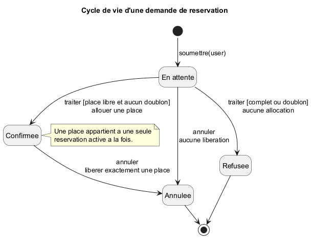
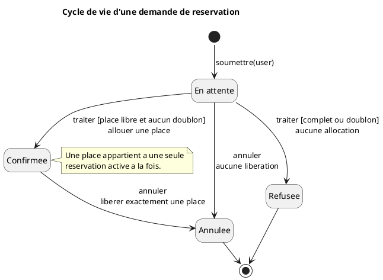
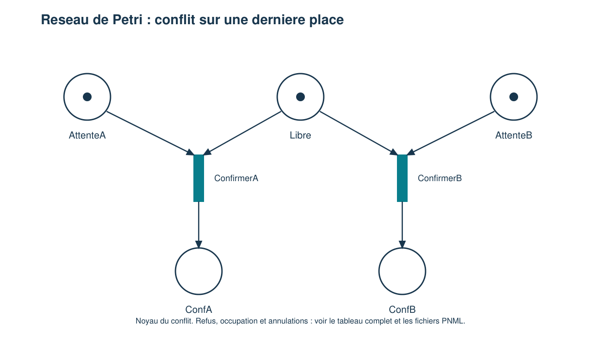
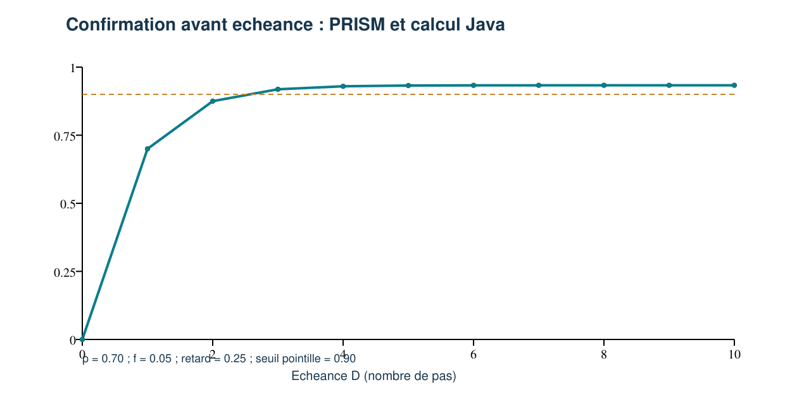

# solution tdtp

USTHB — Faculté d'informatique — Laboratoire MOVEP

Méthodes formelles pour le génie logiciel · Ingénieur 5 en Software Engineering

Sujet : Dr MEKAHLIA Fatma Zohra · Étudiant : ____________________

Date de réalisation et de vérification : 4 novembre 2026

## 1. Lecture du sujet et choix de modélisation

Le sujet `TD-TP-MFGL.pdf` demande de spécifier, programmer, modéliser et vérifier un système de réservation dont la capacité est fixée. Le point critique est la compétition de deux utilisateurs pour la dernière place. Ce corrigé traite les douze travaux demandés, avec une application Java 17, un automate PlantUML, des réseaux de Petri, des modèles NuSMV et une étude probabiliste PRISM.

Le programme, les tests, l'exploration des marquages et le calcul de contrôle des probabilités sont écrits en Java. Les fichiers SMV, PRISM, PNML et PlantUML sont les formats de modélisation nécessaires aux outils du sujet. Les résultats numériques et les sorties de vérification rapportés ici ont réellement été obtenus sur les fichiers fournis ; les probabilités d'entrée sont des hypothèses pédagogiques, pas des mesures d'un service réel.

### 1.1 Hypothèses explicites

- Un événement possède une capacité entière constante C ≥ 0. La valeur nulle sert aussi de cas limite.
- Une demande concerne une seule place. Les places sont identifiées de 1 à C.
- Un utilisateur ne peut avoir qu'une réservation active pour cet événement. Après annulation, une nouvelle demande est autorisée.
- Plusieurs demandes en attente d'un même utilisateur sont possibles ; la première confirmation empêche les suivantes d'être confirmées tant qu'elle reste active.
- Une demande commence En attente, puis devient Confirmée, Refusée ou Annulée. Une demande confirmée peut être annulée ; Refusée et Annulée sont terminales pour cette demande.
- Les appels répétés de traitement ou d'annulation sont sans double effet sur les ressources. L'annulation d'une attente ne libère pas de place puisqu'aucune n'avait été allouée.
- Les erreurs d'argument sont détectées avant les mutations correspondantes. La preuve manuelle suppose des allocations mémoire réussies et l'absence de panne du processus pendant une opération.

La capacité du programme Java est paramétrable. Les modèles de concurrence NuSMV et Petri isolent volontairement le cas C = 1 avec deux demandes, A et B. Une vérification de cette abstraction ne constitue pas, à elle seule, une preuve automatique de tout le programme Java pour toutes les capacités.

### 1.2 Correspondance avec le travail demandé

| Travail du sujet | Réponse dans le document | Fichiers principaux |
| --- | --- | --- |
| Préconditions, postconditions et invariants | Section 2 | ReservationSystem.java |
| Réservation séquentielle Java et vérifications | Section 3 et annexe A | ReservationSystem.java, ReservationTests.java |
| États de réservation | Section 4 | reservation.puml |
| Transitions et simulation | Section 4 | reservation.png, tests Java |
| Deux utilisateurs sur la dernière place | Section 5 | BrokenReservationRace.java |
| Disponibilité, transitions et conflits Petri | Section 6 | reservation.pnml, reservation-pipe.xml |
| Sûreté et vivacité | Section 7 | Propriétés et hypothèses explicites |
| Propriétés temporelles | Section 8 | reservation-correcte.smv |
| Scénario incorrect | Section 9 | reservation-incorrecte.smv |
| Vérification et contre-exemples NuSMV | Section 10 | resultats/nusmv-*.txt |
| Défaillance ou retard probabiliste | Section 11 | reservation-probabiliste.pm |
| Confirmation avant échéance avec PRISM | Section 12 | reservation-probabiliste.pctl |

## 2. Travail 1 — Contrats de réservation et invariants

### 2.1 État abstrait

On note U = {1,...,C} l'ensemble des places, L l'ensemble des places libres et A l'ensemble des demandes actuellement confirmées. Chaque demande active r possède un utilisateur user(r) et une place seat(r). H contient l'historique de toutes les demandes, y compris celles qui sont refusées ou annulées. On pose F = |L| et R = |A|.

Les demandes en attente, refusées ou annulées ne possèdent aucune place. Une place peut être réutilisée après une annulation : l'unicité concerne les réservations simultanément actives, et non toute l'histoire de l'événement.

### 2.2 Invariants

```text
I1 : 0 ≤ F ≤ C
I2 : F + R = C
I3 : ∀r ∈ A, seat(r) ∈ U
I4 : ∀r1,r2 ∈ A, r1 ≠ r2 ⇒ seat(r1) ≠ seat(r2)
I5 : ∀r1,r2 ∈ A, r1 ≠ r2 ⇒ user(r1) ≠ user(r2)
I6 : L et les places occupées forment une partition de U
I7 : une demande non confirmée ne détient pas de place
I8 : l'index activeByUser correspond exactement aux demandes confirmées
```

I2 exprime la conservation. I4 empêche de donner la même place à deux réservations actives. I5 évite qu'un même utilisateur ait plusieurs réservations actives. I8 garantit la cohérence des deux représentations utilisées dans le code. La vérification du seul compteur F serait insuffisante : une double réservation peut exister avec F = 0, donc sans compteur négatif.

### 2.3 Précondition de reserve(user)

L'invariant I est vrai et l'identifiant utilisateur est non nul et non vide après suppression des espaces aux extrémités. Les identifiants restent sensibles à la casse. L'opération ne demande pas F > 0 comme précondition globale : elle doit aussi gérer normalement un événement complet.

```text
P ≡ I ∧ user valide
```

Un identifiant nul/vide provoque une exception, sans réservation ajoutée. Le dépassement du compteur d'identifiants est également détecté avant insertion. Les méthodes process(id) et cancel(id) exigent, en plus, un identifiant de demande existant.

### 2.4 Postconditions de réserve

On note F0, L0 et A0 les valeurs à l'entrée de l'opération, et d la nouvelle demande. Les cas sont évalués dans l'ordre suivant :

| Cas à l'entrée | Résultat | Effet sur les ressources |
| --- | --- | --- |
| user possède déjà une réservation active | REFUSEE / DEJA_RESERVE | F' = F0, A' = A0 |
| Pas de doublon et F0 = 0 | REFUSEE / COMPLET | F' = F0, A' = A0 |
| Pas de doublon et F0 > 0 | CONFIRMEE, avec une place s de L0 | F' = F0 − 1, L' = L0 privé de s, A' = A0 augmenté de d |

Dans le cas confirmé, la place choisie est la plus petite place libre, afin d'obtenir un comportement séquentiel reproductible. Dans tous les cas normaux, I reste vrai et H enregistre la nouvelle demande. Lors d'un refus, les ressources restent identiques, mais l'historique et le compteur de demandes évoluent : il serait incorrect d'affirmer que tout l'état du système est inchangé.

Le contrat de Hoare s'écrit :

```text
{ I ∧ user valide } reserve(user)
{ I ∧ une nouvelle demande enregistrée ∧ postcondition du cas applicable }
```

### 2.5 Annulation et idempotence

- Si la demande est Confirmée : sa place est rendue, elle sort de A, puis devient Annulée ; F' = F0 + 1 et R' = R0 − 1.
- Si elle est En attente : elle devient Annulée, sans modifier F ni A.
- Si elle est déjà Refusée ou Annulée : cancel retourne false et ne modifie pas les ressources.
- Si process est rappelé sur une demande qui n'est plus En attente : le résultat courant est renvoyé, sans nouvelle allocation.

Ces règles empêchent une double décrémentation à la confirmation et une double libération à l'annulation.

### 2.6 Preuve manuelle de préservation

**Initialisation.** A est vide, L = U, F = C, R = 0. La conservation et l'unicité sont donc satisfaites.

**Soumission.** Une demande sans place est ajoutée à H en état En attente. A et L restent identiques, donc les invariants de ressources sont conservés.

**Confirmation.** La garde garantit F0 > 0 et l'absence de réservation active pour user. On retire exactement s de L et on ajoute une demande possédant s à A. Comme L était disjoint des places occupées, s n'était attribuée à personne. Les places et utilisateurs actifs restent distincts. Enfin : (F0 − 1) + (R0 + 1) = C.

**Refus.** A et L ne changent pas ; une demande sans place passe dans l'historique des refus. Les invariants restent vrais.

**Annulation d'une confirmation.** La place occupée n'était pas libre ; l'ajouter à L et retirer la demande de A rend exactement une place. La conservation devient (F0 + 1) + (R0 − 1) = C. Un appel suivant voit l'état Annulée et n'effectue aucune seconde libération.

Cette preuve raisonne sur les états cohérents aux frontières des opérations. Les mutations internes qui allouent la place et mettent à jour les index sont protégées du regard des autres threads par le même verrou.

## 3. Travail 2 — Réservation séquentielle en Java

### 3.1 Structure retenue

ReservationSystem contient un TreeSet de places libres, une Map des demandes et une Map des réservations actives par utilisateur. Les décisions retournées sont des records immuables ; snapshot renvoie une copie non modifiable de la liste des décisions. Les structures mutables internes ne sont pas exposées.

Le code complet est en annexe A. Les opérations submit, process, reserve, cancel et snapshot sont synchronized. Le même code convient donc au scénario séquentiel et au scénario concurrent ; aucune deuxième implémentation divergente n'est nécessaire.

Exemple d'utilisation Java :

```java
ReservationSystem system = new ReservationSystem(2);
var a = system.reserve("A");    // CONFIRMEE, place 1
var b = system.reserve("B");    // CONFIRMEE, place 2
var c = system.reserve("C");    // REFUSEE : COMPLET
system.cancel(a.id());         // rend la place 1
var d = system.reserve("D");    // CONFIRMEE, place 1
```

### 3.2 Trace séquentielle

| Étape | Places libres | Réservations actives | Vérification |
| --- | --- | --- | --- |
| Initialisation, C = 2 | {1,2} | Aucune | 2 + 0 = 2 |
| A réserve | {2} | A → 1 | 1 + 1 = 2 |
| B réserve | Aucune | A → 1, B → 2 | 0 + 2 = 2 |
| C demande | Aucune | Identiques ; C refusée | Aucun compteur modifié |
| A annule | {1} | B → 2 | 1 + 1 = 2 |
| A annule encore | {1} | B → 2 | Aucun double retour de place |
| D réserve | Aucune | B → 2, D → 1 | Réutilisation autorisée |

### 3.3 Vérifications exécutées

ReservationTests vérifie les quatre états, le refus lorsque l'événement est complet, les doublons d'utilisateur, l'annulation en attente et après confirmation, l'idempotence, les identifiants inconnus et les arguments invalides. Le cas C = 0 est aussi vérifié. Les conditions utilisent des vérifications explicites qui lèvent AssertionError ; elles ne dépendent pas de l'option Java -ea.

La suite réalise également 100 compétitions pour une dernière place et 100 compétitions du même utilisateur sur un événement de capacité 2. Au total, **830 vérifications explicites ont réussi**. Les détails sont dans resultats/tests-java.txt. Ces tests confirment les scénarios exécutés ; ils ne sont pas présentés comme une exploration de tous les ordonnancements possibles du programme Java.

## 4. Travaux 3 et 4 — Automate et simulation des états

### 4.1 États et transitions

| État de départ | Événement / garde | État d'arrivée | Effet |
| --- | --- | --- | --- |
| Création | soumettre un utilisateur valide | En attente | Aucune place détenue |
| En attente | traiter ; place libre et aucun doublon | Confirmée | Allouer exactement une place |
| En attente | traiter ; complet ou doublon | Refusée | Ne pas allouer de place |
| En attente | annuler | Annulée | Ne pas libérer de place |
| Confirmée | annuler | Annulée | Rendre exactement la place détenue |

Refusée et Annulée sont terminales pour une demande donnée. Confirmée ne signifie pas que toute évolution est impossible : l'annulation reste autorisée. Refaire une réservation après annulation crée une nouvelle demande avec un nouvel identifiant.



### 4.2 Source PlantUML



La syntaxe du fichier suit la [documentation des diagrammes d'états PlantUML](https://plantuml.com/state-diagram). Le diagramme PNG fourni a été généré localement avec le jar PlantUML. PlantUML représente les transitions ; la simulation fonctionnelle du cycle est effectuée par la suite Java et les traces ci-dessous.

### 4.3 Scénarios simulés

```text
Demande A : En attente → Confirmée → Annulée
Demande B, événement complet : En attente → Refusée
Demande C annulée avant traitement : En attente → Annulée
Demande A après annulation : process renvoie encore Annulée
```

Chaque étape correspond aux méthodes réellement testées. Une tentative de transition Refusée → Confirmée n'est pas permise pour la même demande ; il faut en créer une autre si l'utilisateur souhaite réessayer.

## 5. Travail 5 — Deux utilisateurs demandent simultanément la dernière place

### 5.1 Risque de la vérification séparée

Le schéma « lire le compteur ; vérifier qu'il est positif ; attribuer ; écrire le compteur » n'est pas atomique. Deux threads peuvent lire la même valeur avant que l'un d'eux ne la modifie.

| Ordre | Utilisateur A | Utilisateur B | État visible |
| --- | --- | --- | --- |
| 0 | — | — | libre = 1 |
| 1 | lit libre = 1 | — | A mémorise 1 |
| 2 | — | lit libre = 1 | B mémorise 1 |
| 3 | attribue la place 1 ; écrit 0 | — | A confirmée |
| 4 | — | attribue la place 1 ; écrit 0 | A et B confirmées |

Le compteur final vaut 0, mais deux confirmations concernent la même place. I1 est respecté alors qu'I2 et I4 sont violés. Ce cas montre pourquoi les invariants doivent porter aussi sur les attributions.

### 5.2 Contre-exemple Java reproductible

BrokenReservationRace utilise volontairement deux lectures séparées et une barrière CountDownLatch. La barrière garantit que les deux lectures ont lieu avant les écritures. Les variables individuelles sont atomiques, mais la suite d'opérations ne l'est pas. Le résultat effectivement observé est :

```text
available=0, confirmations=2, distinctSeats=1
```

Le code intentionnellement incorrect est en annexe B. La barrière sert à reproduire le scénario, pas à corriger la réservation.

### 5.3 Correction Java

Dans ReservationSystem, un même moniteur protège la vérification de disponibilité, le contrôle de doublon, l'allocation, la mise à jour des index et l'enregistrement de la décision. Deux threads n'exécutent donc pas simultanément ces opérations sur la même instance. Le verrou est réentrant : reserve peut appeler submit puis process sans se bloquer lui-même. Voir la [spécification Java 17 sur les moniteurs](https://docs.oracle.com/javase/specs/jls/se17/html/jls-17.html#jls-17.1).

Si A obtient le verrou en premier, il confirme sa réservation et consomme la place. B observe ensuite l'état mis à jour et reçoit un refus. L'ordre inverse donne une confirmation pour B et un refus pour A. L'identité du gagnant n'est pas imposée ; le nombre de confirmations actives doit être exactement un.

La publication de la décision dans requests peut servir de point de linéarisation de l'opération. Aucun autre appel utilisant le moniteur ne voit les mutations intermédiaires. Le moniteur garantit l'exclusion mutuelle ; la progression d'un thread dépend encore de son ordonnancement, et aucune équité stricte du moniteur Java n'est supposée démontrée.

## 6. Travail 6 — Réseau de Petri et conflits

### 6.1 Marquage initial

Le réseau représente C = 1, deux utilisateurs distincts et une seule demande initiale pour chacun. Les dix places sont Libre, Occupee, AttenteA, ConfA, RefusA, AnnuleeA et les quatre places correspondantes pour B.

```text
M0(Libre) = 1
M0(AttenteA) = 1
M0(AttenteB) = 1
Toutes les autres places sont vides.
```

Un jeton dans Libre représente la dernière place disponible. Un jeton dans ConfA ou ConfB représente une réservation active. Occupee permet d'exprimer le refus lorsque l'unique place est occupée, sans arc inhibiteur.



La figure isole le noyau du conflit. Le réseau complet ajoute l'occupation, les refus et les annulations détaillés dans le tableau suivant.

### 6.2 Transitions complètes, arcs de poids 1

| Transition | Jetons consommés | Jetons produits |
| --- | --- | --- |
| ConfirmerA | Libre + AttenteA | ConfA + Occupee |
| ConfirmerB | Libre + AttenteB | ConfB + Occupee |
| RefuserA | AttenteA + Occupee | RefusA + Occupee |
| RefuserB | AttenteB + Occupee | RefusB + Occupee |
| AnnulerA | ConfA + Occupee | AnnuleeA + Libre |
| AnnulerB | ConfB + Occupee | AnnuleeB + Libre |
| AnnulerAttenteA | AttenteA | AnnuleeA |
| AnnulerAttenteB | AttenteB | AnnuleeB |

Dans RefuserA/B, Occupee est consommée puis reproduite : le jeton est testé mais conservé. Cette construction représente correctement le cas C = 1. Elle ne doit pas être généralisée telle quelle à C > 1, car « une place occupée » ne signifie alors pas que l'événement est complet.

Au marquage initial, ConfirmerA et ConfirmerB sont toutes deux sensibilisées mais en conflit structurel, car elles demandent le même jeton Libre. Le tir de l'une désensibilise l'autre tant que la place n'a pas été libérée. Si A annule avant le traitement de B, B peut ensuite confirmer : deux confirmations successives séparées par une annulation sont autorisées.

### 6.3 Invariants de places

```text
M(Libre) + M(Occupee) = 1
M(AttenteA) + M(ConfA) + M(RefusA) + M(AnnuleeA) = 1
M(AttenteB) + M(ConfB) + M(RefusB) + M(AnnuleeB) = 1
M(Occupee) = M(ConfA) + M(ConfB)
```

Chaque transition conserve ces égalités. Les marquages sont non négatifs ; il en découle M(ConfA) + M(ConfB) ≤ 1. Le réseau protège donc l'unique place. Pour chaque demande, un jeton reste exactement dans l'un de ses quatre états.

### 6.4 Fichiers et simulation exécutée

Le réseau complet est fourni en PNML P/T dans modeles/reservation.pnml, et dans le dialecte XML de PIPE dans modeles/reservation-pipe.xml. PNML est un format d'échange de réseaux de Petri ; voir [le site de référence PNML](https://www.pnml.org/).

Pour une manipulation graphique, ouvrir le fichier PIPE, passer en mode animation, puis comparer les séquences ConfirmerA → RefuserB et ConfirmerA → AnnulerA → ConfirmerB. Le tir initial de ConfirmerB doit devenir impossible immédiatement après ConfirmerA, sauf libération intermédiaire.

La simulation et l'exploration livrées dans ce corrigé ont été exécutées par PetriExplorer.java, qui lit les arcs et marquages des fichiers XML et explore tous les successeurs sensibilisés. Les deux formats produisent **12 marquages accessibles**, au maximum **un jeton par place**, avec conservation et exclusion vérifiées. Les journaux petri-correct.txt et petri-pipe.txt proviennent de cet explorateur Java ; l'importation dans l'interface graphique de PIPE n'a pas été exécutée ici.

Trois marquages n'ont aucune transition sensibilisée ; dans chacun, aucune demande n'est encore en attente. Ils correspondent à des demandes terminées, et non à un blocage avec une demande oubliée. Une confirmation peut encore autoriser une annulation : tous les états de demandes déjà traitées ne sont donc pas nécessairement des marquages sans transition.

## 7. Travail 7 — Sûreté et vivacité

### 7.1 Propriétés de sûreté

1. Le nombre de places libres reste entre 0 et C.
2. La somme des places libres et des réservations actives vaut C.
3. Une place ne possède jamais deux propriétaires actifs.
4. Un utilisateur ne possède jamais deux réservations actives pour cet événement.
5. Une demande refusée ou annulée ne conserve pas de place.
6. Une annulation ne rend pas deux fois la même place.

Ces propriétés interdisent des états ou des effets incorrects. Un système qui ne traite aucune demande peut les respecter ; elles ne garantissent donc pas, à elles seules, un service utile.

### 7.2 Propriétés de vivacité et hypothèses

Toute demande en attente doit finir par quitter cet état : elle est confirmée, refusée ou annulée. Cette progression suppose qu'une demande ne soit pas indéfiniment privée de traitement, ou qu'elle soit annulée. Elle ne signifie pas que toutes les demandes seront confirmées : avec une seule place, une demande peut légitimement être refusée.

Les modèles NuSMV imposent des contraintes d'équité pour les actions de décision. Une variante sans ces contraintes montre qu'un ordonnanceur restant au repos peut préserver la sûreté tout en violant la vivacité. L'équité est une hypothèse sur les exécutions considérées, et non une propriété ajoutant artificiellement une place disponible.

## 8. Travail 8 — Formalisation temporelle avec NuSMV

### 8.1 État et relation de transition

Le modèle corrigé possède les états locaux a et b, la variable libre dans 0..1 et une action parmi decider_a, decider_b, annuler_a, annuler_b, repos. Une seule action est appliquée à chaque pas ; c'est l'abstraction d'un entrelacement d'opérations atomiques sous verrou.

La définition actifs compte les demandes confirmées. Une décision positive met simultanément la demande à Confirmée et libre à 0. L'annulation d'une confirmation remet libre à 1. L'action repos permet les pas sans effet. L'état initial fixe action = repos avant les choix suivants, ce qui donne un état initial unique.

### 8.2 Propriétés écrites

| Nom | Formule / syntaxe | Sens |
| --- | --- | --- |
| bornes | INVARSPEC libre >= 0 & libre <= 1 | Compteur dans son domaine |
| conservation | INVARSPEC libre + actifs = 1 | Aucune place créée ou perdue |
| exclusion | INVARSPEC !(a=confirmee & b=confirmee) | Pas de double attribution active |
| issue_possible | CTLSPEC EF(a=confirmee & b=refusee) | Le modèle permet un scénario de réservation/refus |
| traitement_a | LTLSPEC G(a=attente -> F(a!=attente)) | Toute attente de A finit |
| traitement_b | Même formule pour B | Toute attente de B finit |
| annulation_terminale | LTLSPEC G(a=annulee -> X(a=annulee)) | Pas de réactivation de la même demande |

Dans ces formules, G signifie toujours, F finalement, X au pas suivant, et EF « il existe un chemin menant à ». La propriété issue_possible évite de se satisfaire uniquement d'un système sûr parce qu'il ne confirmerait jamais rien.

### 8.3 Équité

```text
JUSTICE action = decider_a
JUSTICE action = decider_b
```

Chaque action de décision est rencontrée infiniment souvent sur les chemins équitables, y compris sous forme de pas sans effet après la fin de la demande. Une demande qui reste en attente ne peut alors être indéfiniment oubliée. Ces contraintes restreignent les chemins considérés pour les propriétés temporelles. Les invariants de sûreté sont contrôlés sur les états atteignables ; leur validité ne repose pas sur le filtrage des chemins équitables. Référence : [manuel NuSMV](https://nusmv.fbk.eu/userman/v27/nusmv.pdf).

Le modèle complet est en annexe C. La variante reservation-sans-equite.smv conserve les mêmes transitions mais retire les deux clauses JUSTICE.

## 9. Travail 9 — Analyse du scénario incorrect

Le modèle incorrect sépare la lecture et l'écriture de chaque utilisateur. Les variables vu_a et vu_b mémorisent le résultat « la place était libre » ; une phase ultérieure confirme à partir de cette lecture ancienne. Le compteur est écrit à 0 sans nouvelle vérification atomique.

```text
État initial : libre=1 ; aucun utilisateur confirmé
A lit libre=1 ; vu_a=TRUE
B lit libre=1 ; vu_b=TRUE
B écrit libre=0 et se confirme
A utilise encore vu_a=TRUE et se confirme aussi
Résultat : libre=0 ; confirme_a=TRUE ; confirme_b=TRUE
```

Cette trace correspond au contre-exemple réellement produit par NuSMV. Le défaut est une décision fondée sur un état partagé devenu périmé. La solution consiste à rendre atomique la suite contrôle-attribution-mise à jour, comme dans le moniteur Java, ou à utiliser un mécanisme transactionnel équivalent dans une autre architecture.

Le réseau reservation-incorrecte.pnml illustre une autre erreur pédagogique : la confirmation reproduit le jeton Libre au lieu de le consommer définitivement. L'explorateur atteint ConfirmerA → ConfirmerB, puis deux confirmations actives. Cette version Petri n'a pas exactement le même compteur final que le programme à lecture ancienne ; elle expose le même défaut d'admission concurrente par une mauvaise gestion du jeton de ressource.

## 10. Travail 10 — Résultats NuSMV et contre-exemples

Les fichiers ont été exécutés avec NuSMV 2.7.1. Les journaux bruts, avec retours à la ligne normalisés, sont conservés dans resultats/.

| Modèle | Propriété | Résultat réellement obtenu |
| --- | --- | --- |
| Corrigé | Les trois invariants de sûreté | true |
| Corrigé | EF(a confirmée et b refusée) | true |
| Corrigé avec équité | Traitement de A et B | true pour les deux |
| Corrigé | Annulation terminale | true |
| Incorrect | Exclusion | false, avec trace de double réservation |
| Incorrect | Conservation | false, avec contre-exemple |
| Incorrect | Accessibilité d'une double confirmation | true |
| Corrigé sans équité | Traitement de A et B | false pour les deux |
| Corrigé sans équité | Les invariants de sûreté | true |

Le modèle corrigé satisfait donc ses **sept propriétés**. Le contre-exemple de vivacité sans équité est une boucle au repos : les deux demandes restent En attente avec libre = 1. Il n'y a aucune double réservation, mais aucune progression. Cela distingue concrètement sûreté et vivacité.

La vérification porte sur le modèle fini à deux demandes et une place. La préservation générale des invariants Java est argumentée manuellement en section 2, puis appuyée par des tests ; aucun outil de preuve de tout le langage Java n'est prétendu avoir été exécuté.

## 11. Travail 11 — Modèle probabiliste de défaillance ou de retard

### 11.1 Abstraction choisie

On étudie une demande isolée disposant de la place nécessaire, sans concurrence d'autres clients dans ce modèle. L'objectif est de quantifier le traitement et le retard ; l'exclusion des utilisateurs concurrents est traitée dans les modèles précédents.

La DTMC possède trois états : 0 En attente, 1 Confirmée et 2 Défaillance terminale. Les états 1 et 2 sont absorbants. À chaque pas depuis l'attente :

```text
p = 0,70 : confirmation
f = 0,05 : défaillance terminale
r = 1 − p − f = 0,25 : retard, retour à l'attente
```

Les choix probabilistes sont identiques à chaque pas. Les paramètres vérifient p ≥ 0, f ≥ 0 et p + f ≤ 1. Ils sont choisis pour l'exercice ; ils ne proviennent d'aucune campagne de mesure. Une panne récupérable ou des probabilités dépendant du temps demanderaient un autre modèle.

L'état initial est directement En attente au pas 0 : il n'y a pas de transition supplémentaire d'initialisation à compter dans l'échéance. Un pas est une unité discrète abstraite. Si l'on décide qu'un pas représente 100 ms, D = 5 représente 500 ms ; cette correspondance temporelle est une hypothèse supplémentaire, pas un résultat de mesure.

### 11.2 Fichier PRISM

```text
dtmc

// Parametres pedagogiques : p >= 0, f >= 0, p+f <= 1.
const double p = 0.70;
const double f = 0.05;

module reservation
  // 0 : en attente ; 1 : confirmee ; 2 : defaillance terminale
  s : [0..2] init 0;
  [] s=0 -> p:(s'=1) + f:(s'=2) + (1-p-f):(s'=0);
  [] s=1 -> (s'=1);
  [] s=2 -> (s'=2);
endmodule

label "confirmee" = s=1;
label "defaillance" = s=2;
label "attente" = s=0;
```

Le fichier déclare une DTMC. Il contient trois états accessibles et cinq transitions, ce qui a été confirmé lors de son exécution par PRISM. Les labels identifient les ensembles d'états utilisés dans les propriétés ; voir [formules et labels PRISM](https://www.prismmodelchecker.org/manual/ThePRISMLanguage/FormulasAndLabels).

## 12. Travail 12 — Confirmation avant une échéance avec PRISM

### 12.1 Propriété et convention de délai

```text
P=? [ F<=D "confirmee" ]
```

On calcule la probabilité d'être confirmé **au plus tard au pas D**, borne comprise. Pour une échéance strictement avant D dans ce modèle discret, il faudrait utiliser D − 1. D est exprimé en pas ; ce n'est pas automatiquement une durée physique continue. Référence : [spécification des propriétés PRISM](https://www.prismmodelchecker.org/manual/PropertySpecification/AllOnOnePage).

Les propriétés du fichier fourni sont :

```text
const int D;

"avant_echeance": P=? [ F<=D "confirmee" ];
"confirmation_eventuelle": P=? [ F "confirmee" ];
"defaillance_eventuelle": P=? [ F "defaillance" ];
"seuil_90_pourcent": P>=0.90 [ F<=D "confirmee" ];
```

### 12.2 Calcul analytique

Une confirmation au pas k exige k − 1 retards, puis une confirmation. Sa probabilité vaut r^(k−1) p. En additionnant les cas disjoints :

```text
P_D = p × (1 + r + ... + r^(D−1))
    = p × (1 − r^D) / (1 − r), si r ≠ 1.
P_0 = 0.
```

De même, la défaillance avant D vaut f(1 − r^D)/(1 − r), et la probabilité de rester en attente vaut r^D. Les trois masses totalisent 1. Si p = f = 0, alors r = 1 : l'attente est permanente et la probabilité de confirmation est 0.

Pour D = 5 :

```text
P_5 = 0,70 × (1 − 0,25^5) / 0,75
    = 0,932421875
    = 93,2421875 %.
```

La limite de confirmation vaut p/(p+f) = 14/15, soit environ 93,3333 %. La probabilité de défaillance éventuelle vaut 1/15. Un objectif de 95 % est donc impossible avec ces paramètres, quelle que soit l'échéance.

### 12.3 Résultats exécutés et contrôle Java indépendant

| Échéance D | Confirmation calculée par PRISM | Pourcentage |
| --- | --- | --- |
| 0 | 0 | 0 % |
| 1 | 0,70 | 70 % |
| 2 | 0,875 | 87,5 % |
| 3 | 0,91875 | 91,875 % |
| 4 | 0,9296875 | 92,96875 % |
| 5 | 0,932421875 | 93,2421875 % |
| 10 | 0,9333324432373047 | 93,33324432373047 % |

Le premier horizon entier qui dépasse 90 % est D = 3. La propriété P>=0.90 [F<=5 "confirmee"] est vraie.



PRISM **4.11**, moteur explicit, a été exécuté pour D = 5 sur les quatre propriétés, puis pour toutes les valeurs D = 0,...,10 sur la propriété bornée. ProbabilityAnalysis.java calcule indépendamment la récurrence des masses avec BigDecimal et la compare à la formule fermée. Les onze résultats PRISM et Java concordent à 10^−14 près. Les valeurs affichées par PRISM restent des calculs en virgule flottante ; elles ne sont pas assimilées à une preuve numérique exacte pour tous les paramètres.

Le code Java du calcul est en annexe D. Les sorties complètes sont dans resultats/prism-D5.txt, prism-echeances.txt et probabilites-java.txt. L'expérience par plage de constantes utilise l'option -const documentée par [PRISM](https://www.prismmodelchecker.org/manual/RunningPRISM/Experiments).

## 13. Reproduction et bilan des livrables

### 13.1 Compilation et exécution Java

Depuis le dossier solution-mimobn, avec un JDK 17 ou supérieur :

```text
javac --release 17 -encoding UTF-8 -d out java/*.java
java -cp out ReservationTests
java -cp out PetriExplorer modeles/reservation.pnml
java -cp out PetriExplorer modeles/reservation-pipe.xml
java -cp out PetriExplorer modeles/reservation-incorrecte.pnml --expect-unsafe
java -cp out ProbabilityAnalysis
```

Le script verifier-java.cmd automatise ces commandes sous Windows. Les classes compilées restent dans out/ ; les fichiers .java sont les sources à remettre.

### 13.2 Modèles formels

```text
NuSMV modeles/reservation-correcte.smv
NuSMV modeles/reservation-incorrecte.smv
NuSMV modeles/reservation-sans-equite.smv
prism modeles/reservation-probabiliste.pm modeles/reservation-probabiliste.pctl -explicit -const D=5
prism modeles/reservation-probabiliste.pm modeles/reservation-probabiliste.pctl -explicit -const D=0:10 -prop 1
java -jar plantuml.jar -tpng modeles/reservation.puml -o ../figures
```

Adapter uniquement les chemins des exécutables installés. Les fichiers modeles/ sont autonomes. Les outils NuSMV et PRISM doivent être lancés en ligne de commande ; une installation graphique n'est pas une preuve qu'un modèle a été vérifié.

### 13.3 Ce qui a été vérifié

| Élément | Vérification réellement réalisée |
| --- | --- |
| Java | Compilation Java 17 ; 830 contrôles explicites ; 200 essais concurrents |
| Automate | Génération PlantUML ; transitions exercées par les tests du domaine |
| Petri corrigé | Exploration Java exhaustive des fichiers : 12 marquages accessibles, réseau 1-borné |
| Petri incorrect | 19 marquages accessibles ; contre-exemple ConfirmerA → ConfirmerB |
| NuSMV corrigé | 7 propriétés vraies |
| NuSMV incorrect | 2 invariants réfutés et double réservation accessible |
| NuSMV sans équité | Sûreté maintenue, 2 propriétés de progression réfutées |
| PRISM | Calcul des 4 propriétés pour D=5 ; expérience D=0 à 10 ; accord avec Java |

Le fichier resultats/verification.json récapitule ces résultats et les empreintes SHA-256 des sources utilisées. La preuve manuelle et les tests portent sur le programme ; la vérification automatique exhaustive porte sur les abstractions finies définies. Les différents niveaux de garantie sont ainsi distingués.

## Annexe A — Implémentation Java complète

Fichier java/ReservationSystem.java. Les records de décision et d'instantané sont immuables ; les structures de réservation restent privées.

```java
import java.util.*;

/** Modele Java 17 : chaque operation publique observe un etat coherent. */
public final class ReservationSystem {
    public enum Status { EN_ATTENTE, CONFIRMEE, REFUSEE, ANNULEE }
    public enum Reason { AUCUNE, COMPLET, DEJA_RESERVE }
    public record Decision(long id, String user, Status status,
                           Integer seat, Reason reason) {}
    public record Snapshot(int capacity, int available, List<Decision> requests) {
        public long confirmed() {
            return requests.stream().filter(r -> r.status() == Status.CONFIRMEE).count();
        }
    }

    private final int capacity;
    private final NavigableSet<Integer> freeSeats = new TreeSet<>();
    private final Map<Long, Decision> requests = new LinkedHashMap<>();
    private final Map<String, Long> activeByUser = new HashMap<>();
    private long nextId;

    public ReservationSystem(int capacity) {
        if (capacity < 0) throw new IllegalArgumentException("Capacite negative");
        this.capacity = capacity;
        for (int i = 0; i < capacity; i++) freeSeats.add(i + 1);
        checkInvariants();
    }

    public synchronized Decision submit(String user) {
        Objects.requireNonNull(user, "Utilisateur absent");
        user = user.strip();
        if (user.isEmpty()) throw new IllegalArgumentException("Utilisateur vide");
        long id = Math.incrementExact(nextId);
        Decision request = new Decision(id, user, Status.EN_ATTENTE, null, Reason.AUCUNE);
        requests.put(id, request);
        nextId = id;
        checkInvariants();
        return request;
    }

    public synchronized Decision process(long id) {
        Decision old = requireRequest(id);
        if (old.status() != Status.EN_ATTENTE) return old;
        Decision result;
        if (activeByUser.containsKey(old.user())) {
            result = new Decision(id, old.user(), Status.REFUSEE, null, Reason.DEJA_RESERVE);
        } else if (freeSeats.isEmpty()) {
            result = new Decision(id, old.user(), Status.REFUSEE, null, Reason.COMPLET);
        } else {
            int seat = freeSeats.pollFirst();
            result = new Decision(id, old.user(), Status.CONFIRMEE, seat, Reason.AUCUNE);
            activeByUser.put(old.user(), id);
        }
        requests.put(id, result);
        checkInvariants();
        return result;
    }

    /** Le verrou est reentrant : soumission et decision forment une operation atomique. */
    public synchronized Decision reserve(String user) {
        return process(submit(user).id());
    }

    public synchronized boolean cancel(long id) {
        Decision old = requireRequest(id);
        if (old.status() == Status.ANNULEE || old.status() == Status.REFUSEE) return false;
        if (old.status() == Status.CONFIRMEE) {
            freeSeats.add(old.seat());
            activeByUser.remove(old.user(), id);
        }
        requests.put(id, new Decision(id, old.user(), Status.ANNULEE, null, Reason.AUCUNE));
        checkInvariants();
        return true;
    }

    public synchronized Snapshot snapshot() {
        return new Snapshot(capacity, freeSeats.size(), List.copyOf(requests.values()));
    }

    private Decision requireRequest(long id) {
        Decision value = requests.get(id);
        if (value == null) throw new IllegalArgumentException("Demande inconnue : " + id);
        return value;
    }

    private void checkInvariants() {
        Set<Integer> occupied = new HashSet<>();
        Set<String> users = new HashSet<>();
        int count = 0;
        for (Decision request : requests.values()) {
            if (request.status() == Status.CONFIRMEE) {
                count++;
                require(request.seat() != null && request.seat() >= 1 && request.seat() <= capacity);
                require(occupied.add(request.seat()) && users.add(request.user()));
                require(!freeSeats.contains(request.seat()));
                require(Objects.equals(activeByUser.get(request.user()), request.id()));
            } else require(request.seat() == null);
        }
        require(count == activeByUser.size());
        require(freeSeats.size() + count == capacity);
        require(freeSeats.stream().allMatch(s -> s >= 1 && s <= capacity));
    }

    private static void require(boolean condition) {
        if (!condition) throw new IllegalStateException("Invariant de reservation viole");
    }
}
```

## Annexe B — Course incorrecte reproductible en Java

Fichier java/BrokenReservationRace.java, volontairement incorrect. ReservationTests l'exécute pour constater le défaut attendu.

```java
import java.util.concurrent.*;
import java.util.concurrent.atomic.AtomicInteger;

/** Contre-exemple intentionnel : ne pas utiliser cette classe en production. */
public final class BrokenReservationRace {
    public record Result(int available, int confirmations, int distinctSeats) {}

    public static Result run() throws Exception {
        AtomicInteger available = new AtomicInteger(1);
        AtomicInteger confirmations = new AtomicInteger();
        ConcurrentMap<String, Integer> assigned = new ConcurrentHashMap<>();
        CountDownLatch bothRead = new CountDownLatch(2);
        ExecutorService workers = Executors.newFixedThreadPool(2);
        try {
            Future<?> first = workers.submit(() -> book("A", available, confirmations, assigned, bothRead));
            Future<?> second = workers.submit(() -> book("B", available, confirmations, assigned, bothRead));
            first.get(5, TimeUnit.SECONDS);
            second.get(5, TimeUnit.SECONDS);
            return new Result(available.get(), confirmations.get(),
                              (int) assigned.values().stream().distinct().count());
        } finally { workers.shutdownNow(); }
    }

    private static void book(String user, AtomicInteger available, AtomicInteger confirmations,
                             ConcurrentMap<String, Integer> assigned, CountDownLatch bothRead) {
        int observed = available.get(); // lecture separee de la decision/attribution
        bothRead.countDown();
        try {
            if (!bothRead.await(5, TimeUnit.SECONDS)) throw new IllegalStateException("Timeout");
        } catch (InterruptedException e) {
            Thread.currentThread().interrupt();
            throw new IllegalStateException(e);
        }
        if (observed > 0) {
            assigned.put(user, 1); // meme derniere place pour A et B
            available.set(observed - 1); // deux ecritures de 0, et non un decrementation atomique
            confirmations.incrementAndGet();
        }
    }
}
```

## Annexe C — Modèles NuSMV complets

### C.1 Modèle corrigé avec équité

```text
MODULE main
VAR
  a : {attente, confirmee, refusee, annulee};
  b : {attente, confirmee, refusee, annulee};
  libre : 0..1;
  action : {decider_a, decider_b, annuler_a, annuler_b, repos};
DEFINE
  actifs := (case a = confirmee : 1; TRUE : 0; esac)
          + (case b = confirmee : 1; TRUE : 0; esac);
ASSIGN
  init(a) := attente;
  init(b) := attente;
  init(libre) := 1;
  init(action) := repos;
  next(action) := {decider_a, decider_b, annuler_a, annuler_b, repos};
  next(a) := case
    action = annuler_a & (a = attente | a = confirmee) : annulee;
    action = decider_a & a = attente & libre = 1 : confirmee;
    action = decider_a & a = attente & libre = 0 : refusee;
    TRUE : a;
  esac;
  next(b) := case
    action = annuler_b & (b = attente | b = confirmee) : annulee;
    action = decider_b & b = attente & libre = 1 : confirmee;
    action = decider_b & b = attente & libre = 0 : refusee;
    TRUE : b;
  esac;
  next(libre) := case
    action = decider_a & a = attente & libre = 1 : 0;
    action = decider_b & b = attente & libre = 1 : 0;
    action = annuler_a & a = confirmee : 1;
    action = annuler_b & b = confirmee : 1;
    TRUE : libre;
  esac;

-- Hypotheses d'ordonnancement pour les proprietes de vivacite.
JUSTICE action = decider_a
JUSTICE action = decider_b

INVARSPEC NAME bornes := libre >= 0 & libre <= 1;
INVARSPEC NAME conservation := libre + actifs = 1;
INVARSPEC NAME exclusion := !(a = confirmee & b = confirmee);
CTLSPEC NAME issue_possible := EF (a = confirmee & b = refusee);
LTLSPEC NAME traitement_a := G (a = attente -> F (a != attente));
LTLSPEC NAME traitement_b := G (b = attente -> F (b != attente));
LTLSPEC NAME annulation_terminale := G (a = annulee -> X (a = annulee));
```

### C.2 Modèle incorrect à lecture puis écriture

```text
MODULE main
VAR
  phase_a : {lecture, ecriture, fin};
  phase_b : {lecture, ecriture, fin};
  vu_a : boolean;
  vu_b : boolean;
  confirme_a : boolean;
  confirme_b : boolean;
  libre : 0..1;
  acteur : {a, b, repos};
ASSIGN
  init(phase_a) := lecture;
  init(phase_b) := lecture;
  init(vu_a) := FALSE;
  init(vu_b) := FALSE;
  init(confirme_a) := FALSE;
  init(confirme_b) := FALSE;
  init(libre) := 1;
  init(acteur) := {a, b, repos};
  next(acteur) := {a, b, repos};
  next(phase_a) := case
    acteur = a & phase_a = lecture : ecriture;
    acteur = a & phase_a = ecriture : fin;
    TRUE : phase_a;
  esac;
  next(phase_b) := case
    acteur = b & phase_b = lecture : ecriture;
    acteur = b & phase_b = ecriture : fin;
    TRUE : phase_b;
  esac;
  next(vu_a) := case acteur = a & phase_a = lecture : libre = 1; TRUE : vu_a; esac;
  next(vu_b) := case acteur = b & phase_b = lecture : libre = 1; TRUE : vu_b; esac;
  next(confirme_a) := case acteur = a & phase_a = ecriture & vu_a : TRUE; TRUE : confirme_a; esac;
  next(confirme_b) := case acteur = b & phase_b = ecriture & vu_b : TRUE; TRUE : confirme_b; esac;
  next(libre) := case
    acteur = a & phase_a = ecriture & vu_a : 0;
    acteur = b & phase_b = ecriture & vu_b : 0;
    TRUE : libre;
  esac;
INVARSPEC NAME exclusion := !(confirme_a & confirme_b);
INVARSPEC NAME conservation := libre
    + (case confirme_a : 1; TRUE : 0; esac)
    + (case confirme_b : 1; TRUE : 0; esac) = 1;
CTLSPEC NAME double_reservation_accessible := EF (confirme_a & confirme_b);
```

## Annexe D — Calcul probabiliste Java

Fichier java/ProbabilityAnalysis.java. Les multiplications et additions de la récurrence sont effectuées avec BigDecimal ; la formule fermée emploie DECIMAL128 pour les divisions.

```java
import java.math.*;

/** Calcul exact, en Java, de la DTMC a trois etats du fichier PRISM. */
public final class ProbabilityAnalysis {
    public static void main(String[] args) {
        BigDecimal p = new BigDecimal("0.70");
        BigDecimal f = new BigDecimal("0.05");
        BigDecimal r = BigDecimal.ONE.subtract(p).subtract(f);
        BigDecimal pending = BigDecimal.ONE, confirmed = BigDecimal.ZERO, failed = BigDecimal.ZERO;
        System.out.println("D,confirmation,defaillance,attente");
        for (int d = 0; d <= 10; d++) {
            BigDecimal closed = p.multiply(BigDecimal.ONE.subtract(r.pow(d)))
                .divide(BigDecimal.ONE.subtract(r), MathContext.DECIMAL128);
            if (closed.subtract(confirmed).abs().compareTo(new BigDecimal("1e-30")) > 0)
                throw new AssertionError("Desaccord recurrence / formule fermee");
            if (confirmed.add(failed).add(pending).compareTo(BigDecimal.ONE) != 0)
                throw new AssertionError("Masse probabiliste non conservee");
            System.out.println(d + "," + confirmed.toPlainString() + ","
                + failed.toPlainString() + "," + pending.toPlainString());
            confirmed = confirmed.add(pending.multiply(p));
            failed = failed.add(pending.multiply(f));
            pending = pending.multiply(r);
        }
        System.out.println("Limite confirmation=" + p.divide(p.add(f), MathContext.DECIMAL128));
        System.out.println("Limite defaillance=" + f.divide(p.add(f), MathContext.DECIMAL128));
    }
}
```

Les sources ReservationTests.java et PetriExplorer.java sont également fournies dans java/, avec tous les cas de validation et l'explorateur lisant les fichiers PNML. Les journaux et graphiques proviennent des exécutions décrites dans les sections précédentes.
