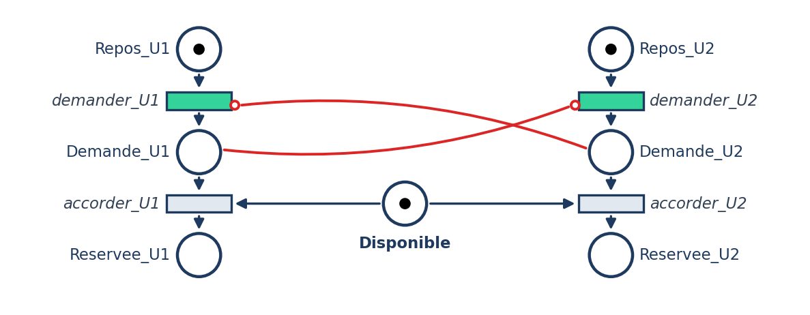
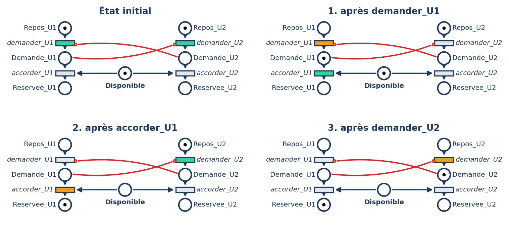
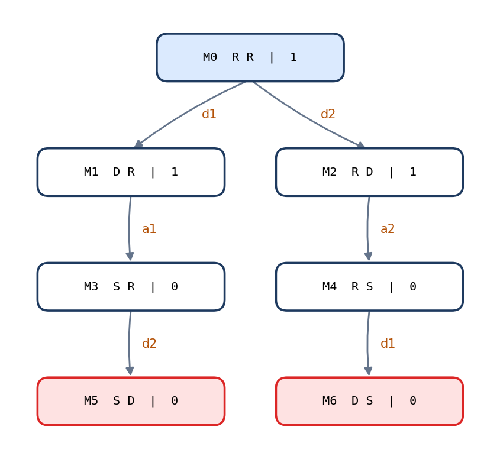
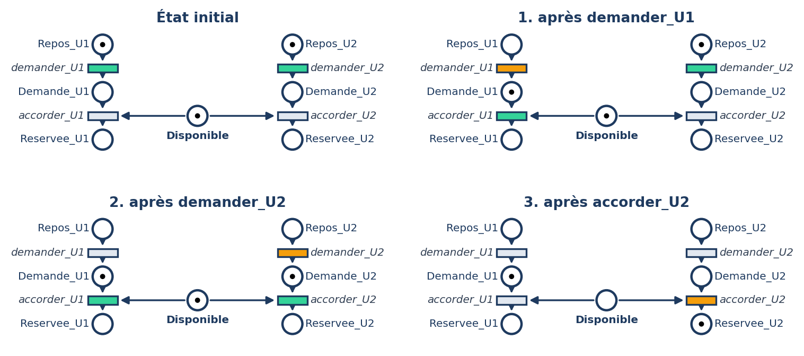
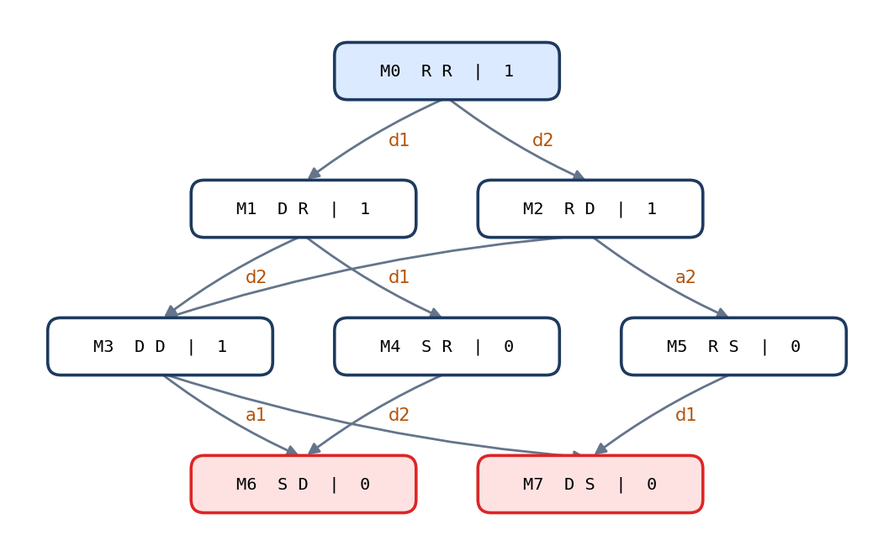
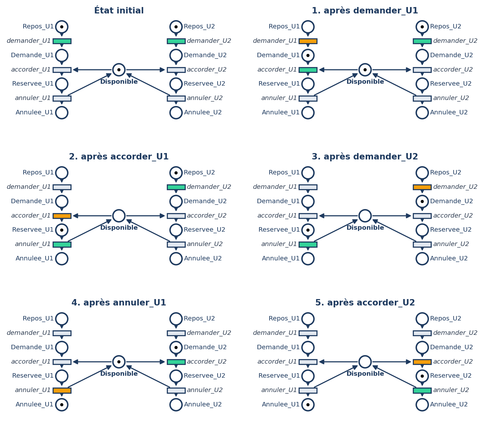
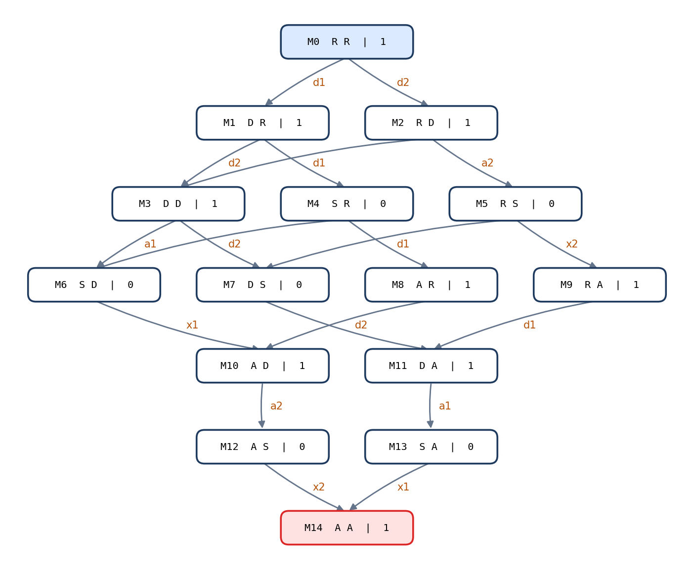
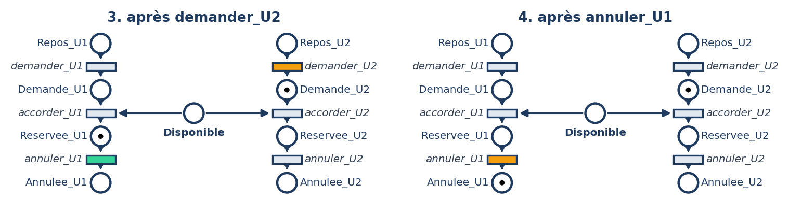

# Arcs inhibiteurs, concurrence et annulation

Modélisation d'un système de réservation par réseaux de Petri

<b>Étudiant :</b> Mohamed BENALIA &nbsp;·&nbsp; <b>Module :</b> Méthodes formelles &nbsp;·&nbsp; <b>Enseignant :</b> M. Mekahlia &nbsp;·&nbsp; Novembre 2026

## 1. Hypothèses et modélisation

Deux utilisateurs, `U1` et `U2`, veulent réserver **une seule place**. Chaque utilisateur suit le même cycle et la place libre est représentée par un jeton partagé.

| Place | Signification | Marquage initial |
|---|---|---|
| `Repos_Ui` | l'utilisateur n'a encore rien demandé | 1 |
| `Demande_Ui` | demande soumise, en attente de réponse | 0 |
| `Reservee_Ui` | la place est attribuée à l'utilisateur | 0 |
| `Annulee_Ui` | réservation annulée (réseau 3 uniquement) | 0 |
| `Disponible` | nombre de places encore libres | 1 |

| Transition | Rôle |
|---|---|
| `demander_Ui` | l'utilisateur soumet sa demande |
| `accorder_Ui` | le système lui attribue la place (consomme le jeton de `Disponible`) |
| `annuler_Ui` | l'utilisateur annule sa réservation (réseau 3) |

**Sémantique de l'arc inhibiteur.** Un arc inhibiteur `p ⊸ t` de poids 1 rend `t` franchissable seulement si `p` est **vide**. Il teste une absence de jeton et ne consomme rien.

**Outils.** Chaque réseau est fourni au format PIPE 5 (`pipe/*.pnml`). Les figures de simulation, les graphes d'accessibilité et tous les chiffres du rapport sont produits par le programme du dossier (`petri.py`, `construire.py`). Ce programme applique la même règle de franchissement que PIPE.

<b>Lecture des figures :</b>  transition qui vient d'être franchie,  transition franchissable,  transition bloquée, <b>arc rouge terminé par un cercle</b> : arc inhibiteur. Dans les graphes d'accessibilité, un état s'écrit « état de U1, état de U2 | jetons de Disponible » avec R = repos, D = demande, S = réservée, A = annulée. Les arcs sont notés d = demander, a = accorder, x = annuler. Un cadre rouge signale un état mort.

## 2. Partie 1

### 2.1 Réseau 1 : admission contrôlée par arcs inhibiteurs

L'arc inhibiteur sert à n'accepter qu'**une demande en attente à la fois** : `demander_U1` est bloquée tant que `Demande_U2` contient un jeton, et inversement.

| Transition | Consomme | Produit | Arc inhibiteur depuis |
|---|---|---|---|
| `demander_U1` | `Repos_U1` | `Demande_U1` | `Demande_U2` |
| `demander_U2` | `Repos_U2` | `Demande_U2` | `Demande_U1` |
| `accorder_U1` | `Demande_U1`, `Disponible` | `Reservee_U1` | aucun |
| `accorder_U2` | `Demande_U2`, `Disponible` | `Reservee_U2` | aucun |

<figure><figcaption>Figure 1 : réseau 1 dans son état initial. Les deux demandes sont possibles.</figcaption></figure>

<figure><figcaption>Figure 2 : simulation du réseau 1.</figcaption></figure>

- **Étape 1.** `U1` demande. L'arc inhibiteur depuis `Demande_U1` **bloque `demander_U2`** (grise) : `U2` ne peut même pas déposer sa demande.
- **Étape 2.** La place est accordée à `U1` (`Disponible` = 0). `Demande_U1` est vide, donc `demander_U2` redevient franchissable.
- **Étape 3.** `U2` demande, mais `accorder_U2` est bloquée faute de jeton dans `Disponible`. Plus aucune transition n'est franchissable : c'est un **état mort**.

<figure><figcaption>Figure 3 : graphe d'accessibilité du réseau 1 (7 états, 6 arcs).</figcaption></figure>

Le graphe ne contient jamais l'état « D D » où les deux utilisateurs attendent en même temps. Les 2 états morts sont symétriques : U1 place réservée, U2 en attente, Disponible = 0 ; et U1 en attente, U2 place réservée, Disponible = 0.

### 2.2 Réseau 2 : demandes concurrentes

Même réseau **sans arc inhibiteur** : chaque utilisateur peut demander à tout moment. Seul le jeton de `Disponible` arbitre l'attribution.

<figure><figcaption>Figure 4 : simulation du réseau 2.</figcaption></figure>

- **Étape 1.** `U1` demande. Contrairement au réseau 1, `demander_U2` reste franchissable.
- **Étape 2.** Les deux utilisateurs attendent. `accorder_U1` et `accorder_U2` sont franchissables ensemble mais se disputent le même jeton : c'est un **conflit**.
- **Étape 3.** Le système choisit `U2`. Le jeton est consommé et `accorder_U1` est aussitôt désactivée : la place ne peut pas être donnée deux fois. `U1` reste en attente sans issue.

<figure><figcaption>Figure 5 : graphe d'accessibilité du réseau 2 (8 états, 10 arcs).</figcaption></figure>

L'état supplémentaire « D D | 1 » (les deux en attente) est le point de conflit : deux arcs en sortent, un par gagnant possible. On retrouve les deux mêmes états morts que dans le réseau 1.

### 2.3 Comparaison des deux réseaux

| Critère | Réseau 1 (arcs inhibiteurs) | Réseau 2 (concurrent) |
|---|---|---|
| Traitement des demandes | une seule demande en attente à la fois ; les autres ne peuvent pas être déposées | toutes les demandes sont acceptées en attente |
| Condition d'acceptation | `Demande_Ui` = 1 et `Disponible` ≥ 1 | identique |
| Rôle de l'arc inhibiteur | contrôle l'**entrée** et évite que deux demandes coexistent | aucun |
| Conflit pour la place | jamais (au plus 1 demande en attente) | oui, jusqu'à 2 demandes en attente |
| Situations de blocage | 2 états morts : l'utilisateur non servi attend sans fin | 2 états morts, mêmes situations |
| Transitions / arcs du réseau | 4 / 12 dont 2 inhibiteurs | 4 / 10 |
| États accessibles / arcs du graphe | 7 / 6 | 8 / 10 |
| Double attribution | impossible (au plus 1 réservation) | impossible (au plus 1 réservation) |
| Avantages | pas de conflit, moins d'états, ordre de service clair | plus fidèle à la réalité, les demandes ne sont pas refusées à l'entrée |
| Inconvénients | restrictif : un utilisateur en attente bloque l'entrée des autres | choix non déterministe du gagnant, aucune équité garantie |

**Analyse.** Dans les deux réseaux, la sûreté (une seule réservation) vient du **jeton unique de `Disponible`**, pas de l'arc inhibiteur. Le réseau 1 a moins d'états : l'inhibiteur supprime l'entrelacement où les deux demandes sont déposées. Mais il ne supprime pas le blocage : l'utilisateur non servi reste coincé dans les deux cas, car rien ne libère la place.

**Choix : le réseau 2.** Il décrit fidèlement un système de réservation où plusieurs clients demandent en même temps la dernière place. Le conflit y est bien résolu (un seul gagnant) et il n'a pas besoin d'arc inhibiteur. Or les arcs inhibiteurs donnent aux réseaux de Petri la puissance d'une machine de Turing, si bien que l'accessibilité n'y est plus décidable en général. Le réseau 1 reste utile si l'on veut une admission strictement une par une.

## 3. Partie 2 : réseau 3, annulation

On part du réseau 2 et on ajoute pour chaque utilisateur :

| Transition | Consomme | Produit |
|---|---|---|
| `annuler_U1` | `Reservee_U1` | `Annulee_U1`, **`Disponible`** |
| `annuler_U2` | `Reservee_U2` | `Annulee_U2`, **`Disponible`** |

<figure><figcaption>Figure 6 : simulation du réseau 3. U1 réserve, U2 attend, U1 annule, U2 obtient la place.</figcaption></figure>

<figure><figcaption>Figure 7 : graphe d'accessibilité du réseau 3 (15 états, 20 arcs).</figcaption></figure>

**La place redevient-elle disponible ?** Oui. L'arc `annuler_U1 → Disponible` remet un jeton dans `Disponible` (étape 4). L'invariant « `Disponible` + `Reservee_U1` + `Reservee_U2` = 1 » reste vrai : à tout moment la place est soit libre, soit réservée par exactement un utilisateur.

**U2 est-il accepté automatiquement ?** Non. Après l'annulation, `accorder_U2` devient **franchissable** (verte à l'étape 4), mais un réseau de Petri n'oblige jamais à franchir une transition. Il faut un franchissement explicite (étape 5) : le réseau dit ce qui *peut* arriver, pas ce qui arrive forcément.

**Conditions pour confirmer U2.** `accorder_U2` exige `Demande_U2` = 1 (U2 a demandé) **et** `Disponible` ≥ 1 (la place a été libérée). S'il y avait d'autres demandeurs, U2 devrait aussi gagner le conflit sur ce jeton, sans aucune priorité.

**Situation de blocage ou de perte ?** Aucune perte de place : l'invariant le garantit. Le seul état mort (U1 a annulé, U2 a annulé, Disponible = 1) est la fin normale du scénario, où la place est revenue libre. Il reste un risque de **famine** : dans l'état « S D | 0 », U2 attend tant que U1 n'annule pas. Cet état n'est pas mort, car `annuler_U1` reste franchissable, mais rien n'oblige U1 à annuler.

**Contre-exemple : annulation sans retour de la place.** Si l'on oublie l'arc `annuler_Ui → Disponible`, la place est **perdue**. Le réseau a alors 12 états et 2 états morts (U1 a annulé, U2 en attente, Disponible = 0). L'invariant de conservation de la place est violé, et le jeton disparaît dans `Annulee_U1`.

<figure><figcaption>Figure 8 : variante fautive. Après l'annulation, Disponible reste vide et U2 est bloqué.</figcaption></figure>

## 4. Vérifications complémentaires

### 4.1 Invariants de place (matrice d'incidence)

La matrice d'incidence `C = Post − Pre` du réseau 3 est donnée ci-dessous. Les arcs inhibiteurs n'y figurent pas, car ils ne déplacent aucun jeton. Un vecteur de poids `y` est un P-invariant si `yᵀ·C = 0` : la somme pondérée des jetons ne change par aucun franchissement.

| Place | demander\_U1 | demander\_U2 | accorder\_U1 | accorder\_U2 | annuler\_U1 | annuler\_U2 |
|---|---|---|---|---|---|---|
| Repos\_U1 | -1 | 0 | 0 | 0 | 0 | 0 |
| Demande\_U1 | +1 | 0 | -1 | 0 | 0 | 0 |
| Reservee\_U1 | 0 | 0 | +1 | 0 | -1 | 0 |
| Annulee\_U1 | 0 | 0 | 0 | 0 | +1 | 0 |
| Repos\_U2 | 0 | -1 | 0 | 0 | 0 | 0 |
| Demande\_U2 | 0 | +1 | 0 | -1 | 0 | 0 |
| Reservee\_U2 | 0 | 0 | 0 | +1 | 0 | -1 |
| Annulee\_U2 | 0 | 0 | 0 | 0 | 0 | +1 |
| Disponible | 0 | 0 | -1 | -1 | +1 | +1 |

| Invariant vérifié | Réseau 1 | Réseau 2 | Réseau 3 | Variante fautive |
|---|---|---|---|---|
| `Disponible + Reservee_U1 + Reservee_U2 = 1` (conservation de la place) | oui | oui | oui | **non** |
| `Disponible + Σ Reservee + Σ Annulee = 1` | sans objet | sans objet | **non** | oui |
| `Repos_Ui + Demande_Ui + Reservee_Ui (+ Annulee_Ui) = 1` (un état par utilisateur) | oui | oui | oui | oui |

Dans le réseau 3, la deuxième somme n'est pas un invariant, et c'est voulu : `annuler_Ui` rend la place **et** garde une trace dans `Annulee_Ui`. Dans la variante fautive c'est l'inverse : seule la deuxième somme se conserve, car le jeton de la place est passé dans `Annulee_Ui` au lieu de revenir dans `Disponible`.

### 4.2 Passage à l'échelle

Nombre d'états accessibles (et d'états morts entre parenthèses) pour `n` utilisateurs et `k` places, calculé avec les mêmes modèles généralisés :

| n | k | Réseau 1 | Réseau 2 | Réseau 3 |
|---|---|---|---|---|
| 2 | 1 | 7 (2) | 8 (2) | 15 (1) |
| 3 | 1 | 13 (6) | 20 (3) | 54 (1) |
| 3 | 2 | 19 (3) | 26 (3) | 63 (1) |
| 4 | 1 | 21 (12) | 48 (4) | 189 (1) |
| 4 | 2 | 39 (12) | 72 (6) | 243 (1) |

L'arc inhibiteur limite fortement la croissance de l'espace d'états, puisqu'une seule demande peut attendre. En revanche, il **multiplie les états morts** quand le nombre d'utilisateurs augmente : un utilisateur en attente sans place bloque aussi tous ceux qui n'ont pas encore pu demander. Le réseau 3 n'a toujours qu'un seul état mort, la fin normale où tout le monde a annulé. Dans tous ces cas, aucune configuration ne dépasse `k` réservations simultanées (vérifié pour toutes les tailles).

## 5. Conclusion

| | Réseau 1 | Réseau 2 | Réseau 3 |
|---|---|---|---|
| Admission des demandes | une à la fois | libre | libre |
| Conflit sur la place | non | oui | oui |
| États accessibles (2 utilisateurs, 1 place) | 7 | 8 | 15 |
| Double attribution | impossible | impossible | impossible |
| Utilisateur bloqué sans issue | oui | oui | non (attente tant que l'autre n'annule pas) |

L'arc inhibiteur règle l'**accès** aux demandes, pas l'**exclusion** sur la place : celle-ci est assurée par le jeton de `Disponible` dans les trois réseaux. Le réseau concurrent est le plus réaliste. L'annulation avec retour du jeton supprime les blocages définitifs, à condition de ne pas oublier l'arc qui rend la place.

**Fichiers du dossier**

- `pipe/r1.pnml`, `pipe/r2.pnml`, `pipe/r3.pnml`, `pipe/r3_perte.pnml` : les réseaux à ouvrir dans PIPE 5 (*File → Open*), puis à simuler en mode *Animation*.
- `petri.py` : moteur de réseaux de Petri avec arcs inhibiteurs (franchissement, graphe d'accessibilité, invariants).
- `modeles.py`, `figures.py`, `construire.py` : construction des réseaux, figures et rapport. La commande `python construire.py` régénère tout.
- `resultats.json` : tous les chiffres utilisés dans ce rapport.

