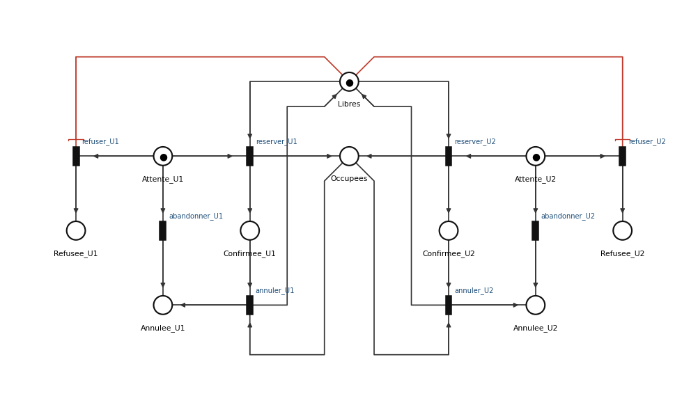
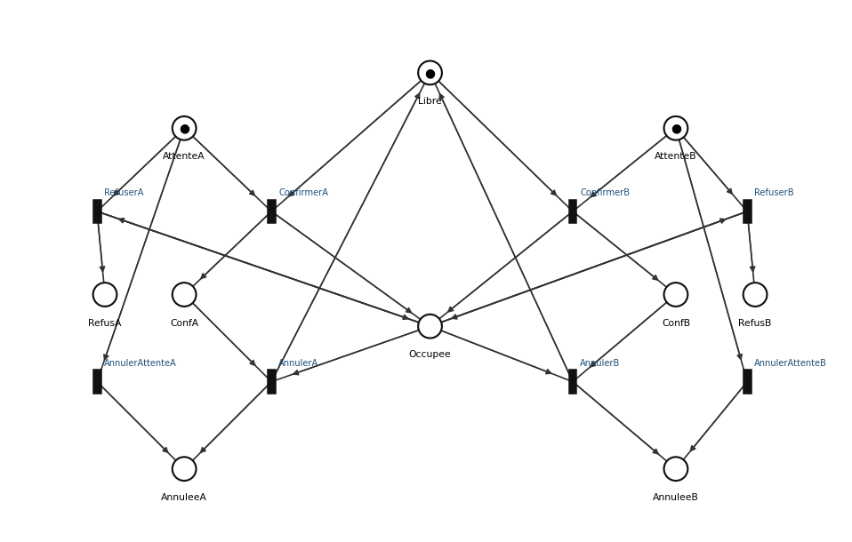
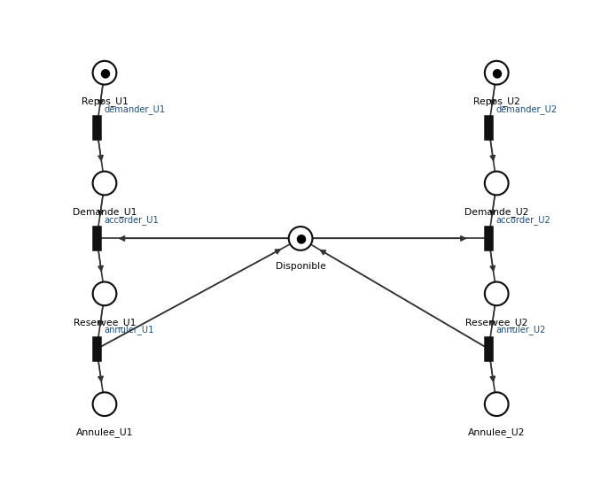
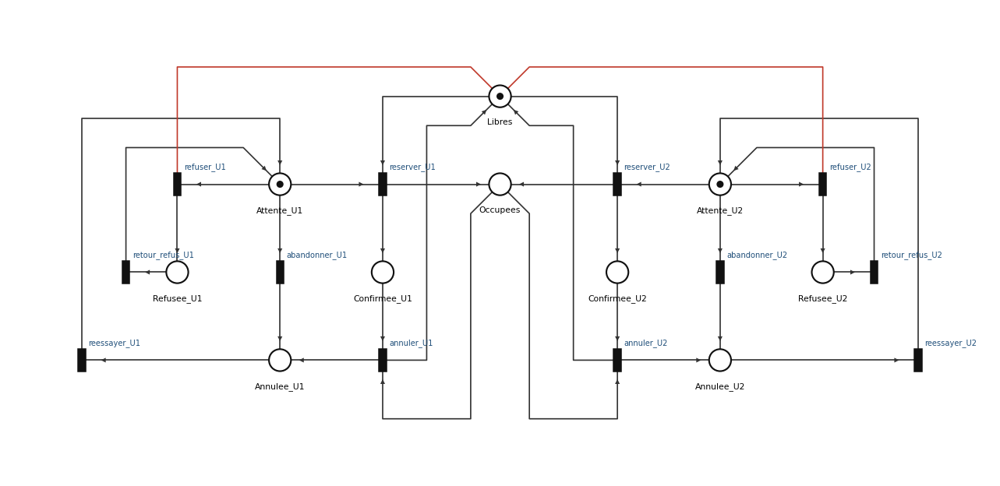
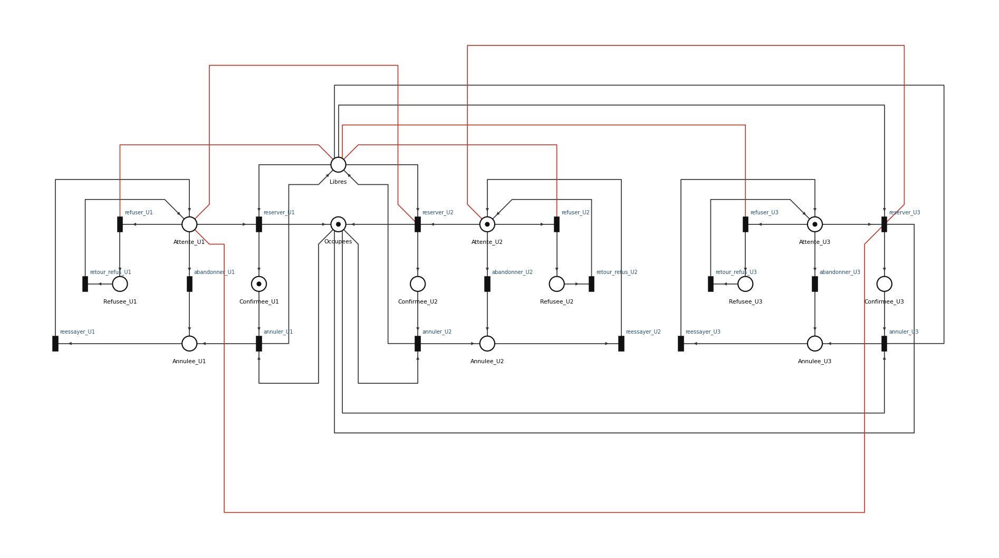
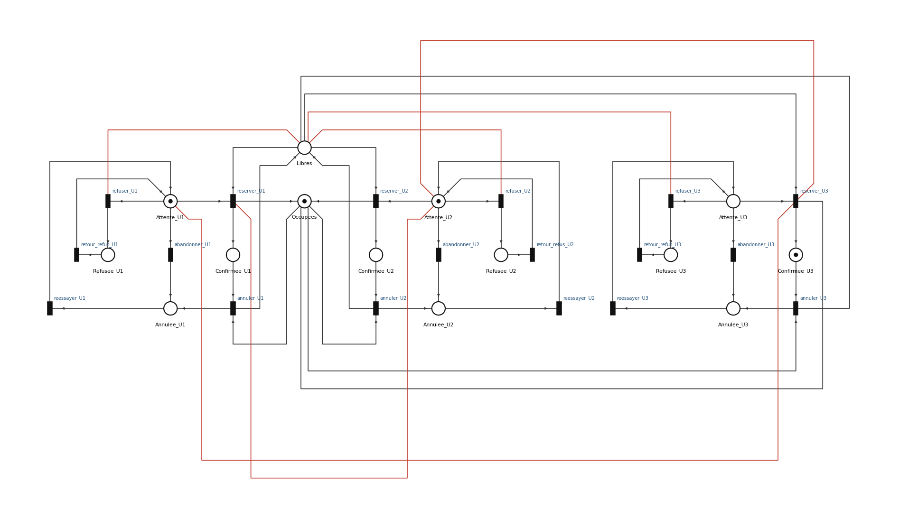
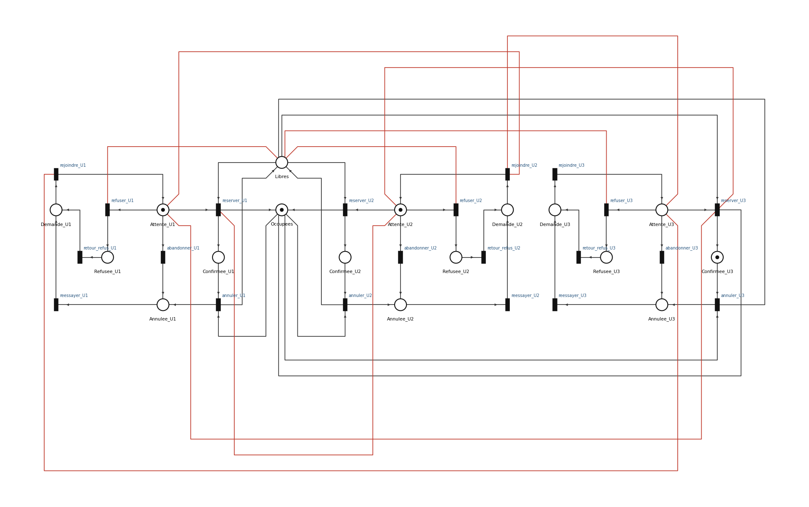

# Historique des réseaux de Petri — réservation de la dernière place

Ce document retrace, dans l'ordre chronologique, chaque version de nos réseaux, **le problème qui a motivé
chaque amélioration** et ce que la version suivante a corrigé. Tous les chiffres viennent de
`python analyse.py <fichier>.pnml` (graphe des marquages exploré par programme, sémantique de PIPE).

Légende des figures : cercle = place (● = jeton), barre noire = transition, flèche = arc normal,
**trait rouge terminé par une barre = arc inhibiteur** (la transition n'est franchissable que si la place est vide).

## Vue d'ensemble

| Date | Version | Fichier(s) | Marquages | Blocages | Réversible | Problème qui a mené à la version suivante |
|---|---|---|---|---|---|---|
| 04–05/11 | V1 Walid | `solution-bechar-walid/3-petri/reservation.pnml` | 12 | 3 | non | refus et annulation sont des états finaux |
| 04–05/11 | V1 nous | `1/reservation.pnml` | 12 | 3 | non | même limite ; format non lu par PIPE |
| 04–05/11 | V1 défaut volontaire | `1/reservation-incorrecte.pnml` | 19 | 5 | non | sert de contre-exemple : 2 confirmations possibles |
| 21–23/11 | V2 arcs inhibiteurs | `1/r1`, `1/r2`, `1/r3`, `1/r3_perte` | 7 / 8 / 15 / 12 | 2 / 2 / 1 / 2 | non | rapport ciblé, pas de retour ni de priorité |
| 25/11 | Correctif PIPE | dossier `1/` | — | — | — | les fichiers ne s'ouvraient pas dans PIPE |
| 25/11 | V3 retour | `2/*/reservation-retour-2-utilisateurs.pnml` | 14 | 0 | oui | qui obtient la place quand plusieurs attendent ? |
| 25/11 | V4 priorité U1 > U2 > U3 | `2/*/reservation-priorite-3-utilisateurs.pnml` | 53 | 0 | oui | mise en page illisible (arcs en diagonale) |
| 25/11 | V4 bis, format Walid | mêmes fichiers, redessinés | 53 | 0 | oui | il faut aussi le cas « U3 confirmé » |
| 25/11 | V5 U3 confirmé, U2 > U1 > U3 | `2/*/reservation-priorite-3-utilisateurs-U3-confirme.pnml` | 53 | 0 | oui | **un utilisateur qui abandonne puis revient regagne sa priorité** |
| 25/11 | V6 état Demande | `2/*/reservation-priorite-3-utilisateurs-demande.pnml` | 111 | 0 | oui | — (version actuelle) |

Dans toutes les versions correctes : chaque place contient au plus 1 jeton, `Libres + Occupees = 1`
et **jamais deux utilisateurs confirmés en même temps**.

---

## V1 — Réservation de la dernière place (04–05 novembre)

**Besoin (énoncé du TP).** Deux utilisateurs veulent la dernière place : un seul doit l'obtenir, l'autre est refusé ;
une réservation confirmée peut être annulée.

**Deux interprétations du refus**, équivalentes en comportement (12 marquages, 3 états finaux) :

| | Walid | Nous |
|---|---|---|
| Refus possible si… | aucune place libre : **arc inhibiteur** depuis `Libres` | la place est occupée : **arc de lecture** sur `Occupee` |
| Type de réseau | réseau avec arcs inhibiteurs | réseau P/T pur (analysable par tous les modules de PIPE) |





Le modèle `reservation-incorrecte` retire volontairement la protection : 19 marquages, une place qui peut contenir
3 jetons et **deux confirmations simultanées** — c'est le contre-exemple qui montre pourquoi le jeton partagé est nécessaire.

**Problème constaté.** `Refusee` et `Annulee` sont des **puits** : 3 marquages bloquants. Un utilisateur refusé ou
qui a annulé ne peut plus jamais réessayer, et le réseau n'est pas réversible.

## V2 — Arcs inhibiteurs, concurrence et annulation (21–23 novembre)

Rapport dédié (`../arcs-inhibiteurs/rapport.pdf`) : réseau 1 (admission par arc inhibiteur, 7 marquages),
réseau 2 (demandes concurrentes, 8), réseau 3 (annulation, 15), et `r3_perte` (variante où la place est perdue, 12).



**Problème constaté.** Ces réseaux étudient l'arc inhibiteur isolément : toujours pas de retour après refus,
ni de règle de priorité entre utilisateurs.

## Correctif — les fichiers ne s'ouvraient pas dans PIPE (25 novembre)

- Nos fichiers `.pnml` contenaient `<graphics/>` et `<tagged>` dans chaque `<arc>` : le lecteur de PIPE 5 les
  rejette (« élément inattendu graphics »). Correction dans `modeles.py` et dans les fichiers.
- `reservation.pnml` était au format **ISO PNML** (espace de noms `pnml.org`) que PIPE ne lit pas : conversion par
  `modeles/vers-pipe.py` vers `modeles/pipe/`, copiée dans `1/`.
- PIPE 5 a besoin de JAXB, retiré de Java 17 : bibliothèques ajoutées au lanceur.

## V3 — Retour après refus ou annulation (25 novembre)

**Solution.** Deux transitions par utilisateur : `retour_refus` (Refusee → Attente) et `reessayer`
(Annulee → Attente).

**Résultat.** 14 marquages, **0 blocage**, réseau **réversible** : on peut toujours revenir à l'état initial.



**Problème constaté.** Avec plus de deux utilisateurs, rien ne dit **qui** obtient la place libérée.

## V4 — Trois utilisateurs et priorité U1 > U2 > U3 (25 novembre)

**Scénario.** U1 a déjà confirmé, U2 attend, U3 arrive. **Solution.** Arcs inhibiteurs `Attente_U1 ⊸ reserver_U2`,
`Attente_U1 ⊸ reserver_U3`, `Attente_U2 ⊸ reserver_U3` : on ne réserve pas tant qu'un utilisateur prioritaire attend.
53 marquages, 0 blocage, réversible, aucune violation de priorité.

**Problème constaté.** La première mise en page plaçait les arcs en diagonale à travers tout le schéma
(« les arcs sont partout »), contrairement au modèle de Walid.

**Correction (V4 bis).** Générateur réécrit au format exact de Walid : même grille, arcs orthogonaux avec points
de passage, identifiants `source TO cible`. Comportement inchangé (53 marquages).



## V5 — U3 confirmé, U1 attend après U2 (25 novembre)

**Scénario.** U3 a confirmé, U1 et U2 attendent, U1 passe après U2 : priorité **U2 > U1 > U3**. On remplace
l'arc `Attente_U1 ⊸ reserver_U2` par `Attente_U2 ⊸ reserver_U1` et on garde les deux arcs vers `reserver_U3`.
53 marquages, 0 blocage, réversible.



**Problème constaté — perte d'équité.** Rejeu dans V5 (`python analyse.py --scenario …`) :

```
abandonner_U2 -> reessayer_U2 -> annuler_U3   |   réservations possibles : reserver_U2
```

U2 abandonne et revient **directement dans `Attente_U2`** : il retrouve sa priorité et passe devant U1, qui
attendait depuis plus longtemps. La priorité est attachée à la personne, pas à son ancienneté dans la file.

## V6 — Un état « Demande » avant l'attente (25 novembre, version actuelle)

**Solution.** Un utilisateur qui revient (après refus, abandon ou annulation) entre d'abord dans `Demande_Ui`,
puis rejoint l'attente par `rejoindre_Ui`. Cette transition est **bloquée tant qu'un utilisateur qu'il dépasserait
attend déjà** :

| Transition | Arcs inhibiteurs | Sens |
|---|---|---|
| `rejoindre_U2` | `Attente_U1`, `Attente_U3` | U2 ne repasse devant personne qui attend |
| `rejoindre_U1` | `Attente_U3` | U1 ne repasse pas devant U3 (U2 passe déjà avant U1) |
| `rejoindre_U3` | — | U3 est le dernier : il ne dépasse personne |

**Vérification.** Même rejeu :

```
abandonner_U2 -> reessayer_U2 -> annuler_U3   |   réservations possibles : reserver_U1
```

C'est bien **U1** qui obtient la place. Le réseau garde ses propriétés : 111 marquages, 0 blocage, réversible,
au plus un confirmé, `Libres + Occupees = 1`. Les deux interprétations (Walid / nous) donnent les mêmes résultats.



**Limite restante.** La priorité reste fixe entre utilisateurs déjà en attente, mais l'attente est désormais
**bornée** : pendant qu'il attend, U1 peut être dépassé au plus 1 fois, U2 jamais et U3 au plus 2 fois. Aucune
famine par dépassement n'est possible (voir `rapport-evolution/rapport.pdf`, section 9). Une vraie file FIFO
demanderait un réseau coloré ou un compteur d'ancienneté.

## Reproduire

```
python generer-modeles.py --png     # régénère le dossier 2 et ses aperçus
python analyse.py 2/walid/*.pnml    # marquages, blocages, réversibilité, invariants
python analyse.py --scenario 2/walid/reservation-priorite-3-utilisateurs-U3-confirme.pnml 2/walid/reservation-priorite-3-utilisateurs-demande.pnml
```
