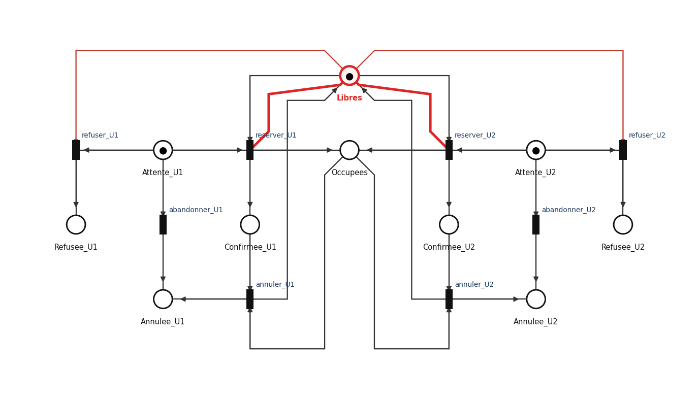
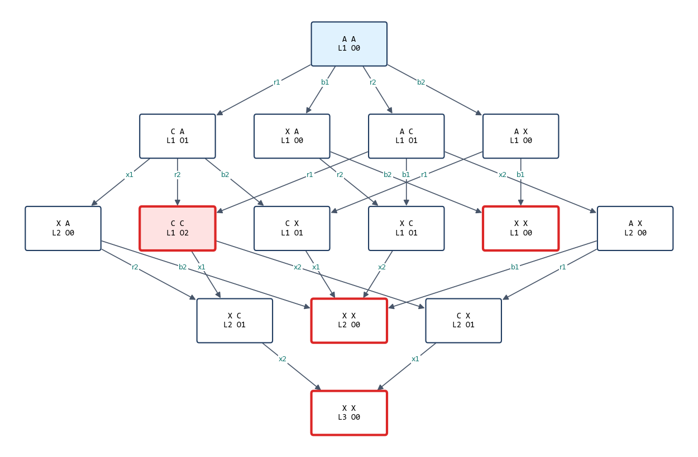
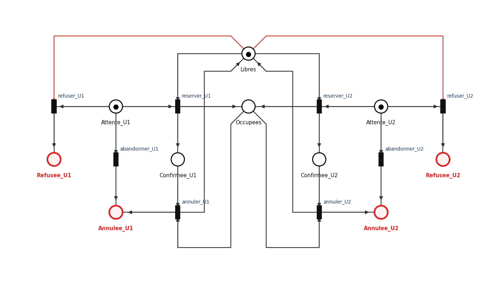
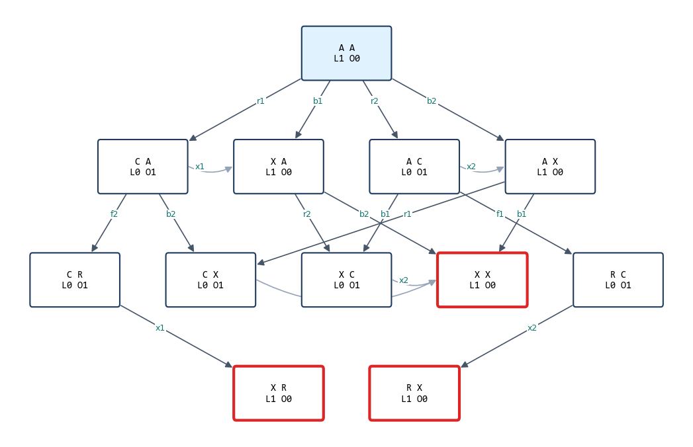
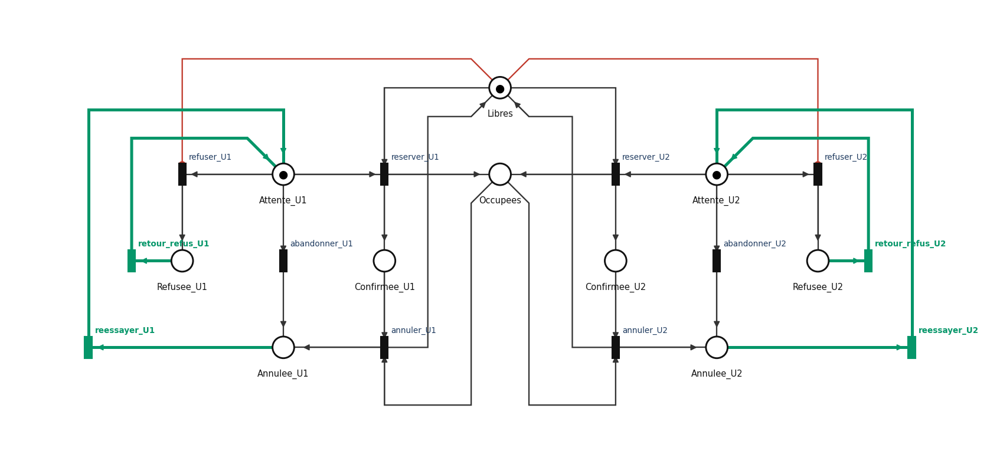
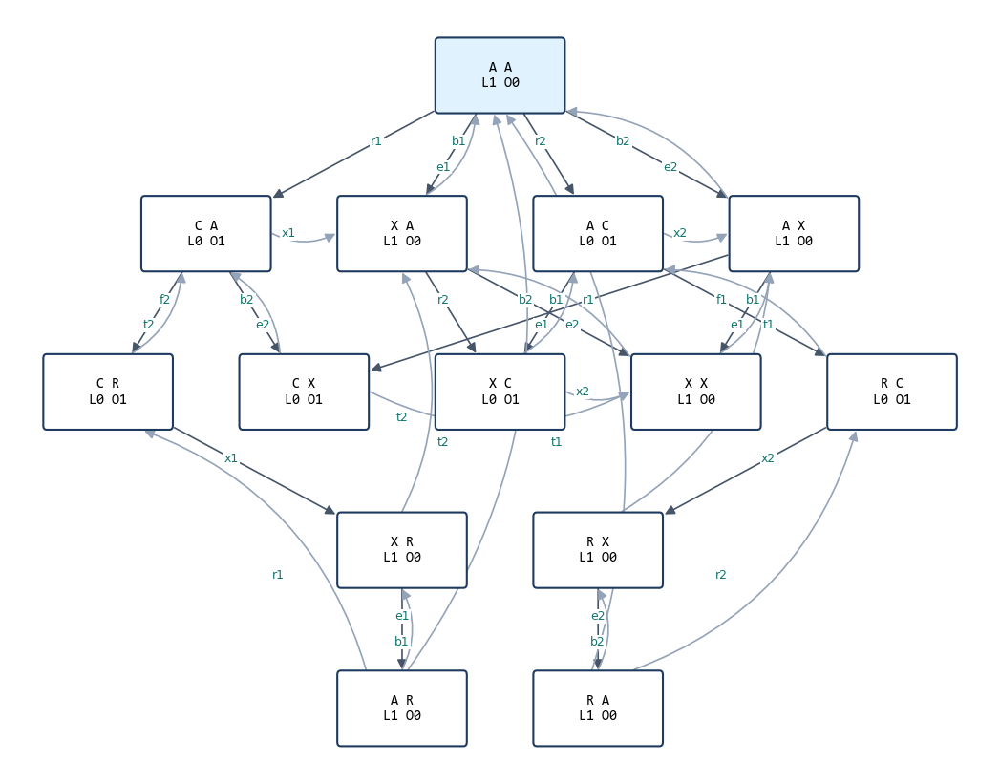
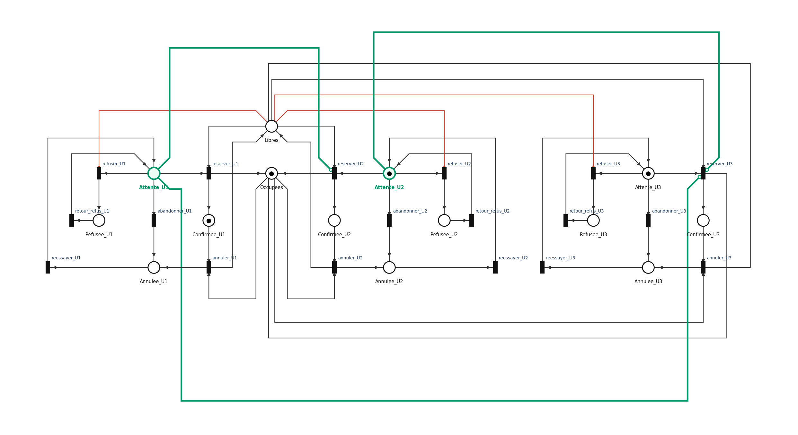
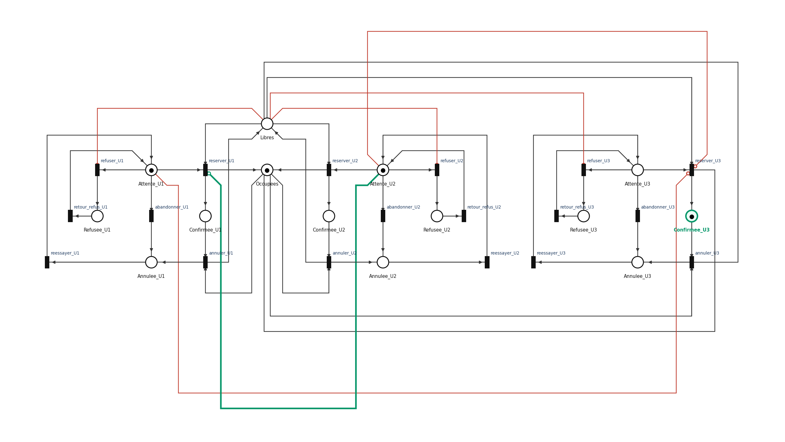
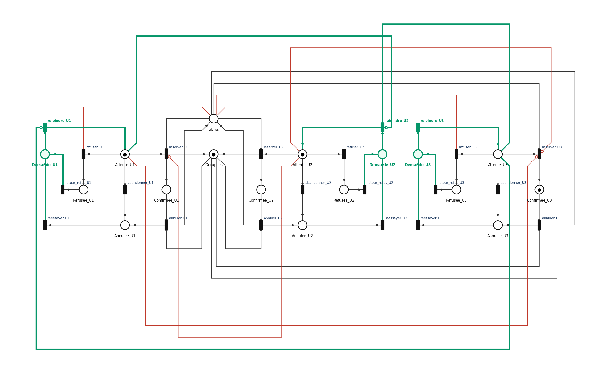

# Évolution d'un réseau de Petri : de la première modélisation à la version actuelle

Réservation de la dernière place — chaque modification et le problème qui l'a rendue nécessaire

<b>Étudiant :</b> Mohamed BENALIA &nbsp;·&nbsp; <b>Réseau de départ :</b> Walid BECHAR &nbsp;·&nbsp; <b>Module :</b> Méthodes formelles &nbsp;·&nbsp; <b>Enseignant :</b> M. Mekahlia &nbsp;·&nbsp; Novembre 2026

## 1. Objet du rapport

Le système étudié est la réservation de **la dernière place disponible** : plusieurs utilisateurs la demandent,
un seul doit l'obtenir, les autres sont refusés, et une réservation confirmée peut être annulée. Nous l'avons
modélisé par un réseau de Petri sous **PIPE 5**, puis nous avons modifié ce réseau à plusieurs reprises.
Chaque version a été écrite pour corriger un défaut que l'analyse de la version précédente avait révélé.

Le rapport suit cette évolution dans l'ordre. Pour chaque étape, il présente le réseau, ses propriétés, puis
**le problème qui a imposé l'étape suivante**. Le point de départ est le réseau de Walid BECHAR
(`solution-bechar-walid/3-petri/reservation.pnml`). Toutes les versions suivantes reprennent sa mise en page et
ses noms. Elles sont précédées d'un modèle naïf (étape 0) qui justifie sa construction.

**Méthode.** Chaque version est un fichier PIPE (`modeles/*.pnml`). Le programme `construire.py` lit ces fichiers,
construit le **graphe des marquages accessibles** avec la règle de franchissement de PIPE, puis calcule toutes les
propriétés et tous les chiffres du rapport. Les figures reprennent les positions enregistrées dans les fichiers.

<b>Lecture des figures de réseaux :</b> cercle = place (● = jeton) ; rectangle noir = transition ;
flèche = arc ordinaire ; <b>trait rouge terminé par un petit cercle</b> = arc
inhibiteur. <b>En vert épais</b> : éléments ajoutés à l'étape ;
<b>en rouge épais</b> : éléments responsables du problème décrit.

## 2. Notions utilisées

| Notion | Définition retenue | Comment elle est vérifiée |
|---|---|---|
| Marquage, franchissement | État du réseau = nombre de jetons par place. Une transition est **franchissable** si chaque place d'entrée contient assez de jetons et si chaque place reliée par un **arc inhibiteur** est vide. | Règle de PIPE |
| Arc inhibiteur | Test à zéro : `p ⊸ t` autorise `t` seulement si `p` est vide. Il ne consomme aucun jeton. | — |
| Graphe des marquages | Ensemble des marquages accessibles depuis M0, reliés par les franchissements. | Exploration en largeur |
| Réseau **borné**, **sauf** | Borné : le nombre de jetons de chaque place reste fini (k-borné : au plus k jetons). Sauf : 1-borné. | Maximum sur le graphe |
| **Blocage** (marquage mort) | Marquage où aucune transition n'est franchissable. | Nœud sans successeur |
| **Quasi-vivacité** | Chaque transition peut être franchie au moins une fois depuis M0. | Transitions présentes sur le graphe |
| **Vivacité** | Depuis **tout** marquage accessible, chaque transition peut encore être franchie plus tard. Plus forte que l'absence de blocage. | Pour chaque marquage, transitions atteignables |
| **Réversibilité** | M0 est accessible depuis tout marquage accessible : M0 est un **état d'accueil**. | Accessibilité inverse |
| **P-invariant** | Vecteur `y` tel que `y · C = 0`, avec `C = Post − Pre` la matrice d'incidence. La somme pondérée `y · M` reste constante. | Calcul symbolique sur `C` |
| **Conflit** | Deux transitions franchissables qui partagent une place d'entrée : en franchir une peut désactiver l'autre. | Places d'entrée communes |
| **Exclusion mutuelle** | Jamais deux utilisateurs confirmés en même temps. | Sur chaque marquage |
| **Équité**, **famine** | Famine : un utilisateur en attente peut être dépassé indéfiniment, car il existe un cycle où il reste en attente pendant que d'autres réservent. Attente **bornée** : il est dépassé au plus *k* fois. | Cycles et plus longs chemins dans le graphe |

## 3. Vue d'ensemble de l'évolution

| Étape | Marquages | Borne | Sauf | Blocages | Quasi-vivant | Vivant | Réversible | Exclusion | Problème qui mène à l'étape suivante |
|---|---|---|---|---|---|---|---|---|---|
| E0 modèle naïf | 15 | 3 | **non** | 3 | **non** | **non** | **non** | **non** | deux utilisateurs confirmés à la fois |
| E1 réseau de Walid | 12 | 1 | oui | 3 | oui | **non** | **non** | oui | états puits : refus et annulation définitifs |
| E2 retour | 14 | 1 | oui | 0 | oui | oui | oui | oui | à 3 utilisateurs, conflit non arbitré, famine |
| E3 priorité U1>U2>U3 | 53 | 1 | oui | 0 | oui | oui | oui | oui | nouveau scénario : U3 confirmé, U2 avant U1 |
| E4 U3 confirmé, U2>U1>U3 | 53 | 1 | oui | 0 | oui | oui | oui | oui | l'utilisateur qui revient regagne sa priorité |
| E5 état Demande | 111 | 1 | oui | 0 | oui | oui | oui | oui | — (version actuelle) |

Taille des réseaux : E0 et E1 ont 10 places et 8 transitions, E2 en a 10 et
12, E3 et E4 en ont 14 et 18, et E5 en a 17 et
21.

## 4. Étape 0 — Modèle naïf : tester la place sans la prendre

**Modélisation.** Une première idée consiste à vérifier qu'une place est libre, puis à confirmer. Dans le réseau,
`reserver_Ui` lit le jeton de `Libres` et **le remet aussitôt** (arc retour, en rouge). La vérification et la prise
de la place ne sont donc pas atomiques.

<figure><figcaption>Figure 1 — E0 : réseau de Walid dont la réservation rend le jeton à
Libres (arcs rouges). Le test de disponibilité ne réserve rien.</figcaption></figure>

**Analyse.** Le graphe compte 15 marquages. Le réseau **n'est pas sauf** : `Libres` monte jusqu'à
3 jetons. Il est seulement 3-borné. La somme `Libres + Occupees` n'est plus un invariant,
et l'**exclusion mutuelle est violée**. La séquence la plus courte qui la viole a deux franchissements :

| Marquage | Transition franchie | U1 | U2 | Libres |
|---|---|---|---|---|
| M0 | `—` | attente | attente | 1 |
| M1 | `reserver_U1` | **confirmé** | attente | 1 |
| M2 | `reserver_U2` | **confirmé** | **confirmé** | 1 |

<figure><figcaption>Figure 2 — Graphe des marquages de E0. Un état
s'écrit « U1 U2 / jetons de Libres et Occupees », avec A = attente, C = confirmé, R = refusé, X = annulé. Le
marquage « C C » sur fond rouge viole l'exclusion mutuelle. Les cadres rouges sont des blocages.</figcaption></figure>

Les transitions `refuser_U1` et `refuser_U2` ne sont **jamais** franchies : `Libres` n'est jamais vide. Le réseau
n'est donc même pas quasi-vivant, et le refus prévu par le cahier des charges ne se produit pas.

> **Problème → étape 1.** La place doit être **consommée au moment même où elle est attribuée**. Il faut une
> ressource partagée dont le jeton disparaît à la réservation.

## 5. Étape 1 — Le réseau de Walid : une ressource partagée

**Modélisation.** Le jeton de `Libres` représente la place. `reserver_Ui` le **consomme** et dépose un jeton dans
`Occupees`. `annuler_Ui` le rend. Le refus est gardé par un **arc inhibiteur** `Libres ⊸ refuser_Ui` : on ne refuse
que lorsqu'il ne reste aucune place. Chaque utilisateur suit le cycle `Attente → Confirmee / Refusee / Annulee`.

<figure><figcaption>Figure 3 — E1 : réseau de Walid BECHAR. Les places en rouge
(Refusee, Annulee) n'ont aucune transition de sortie.</figcaption></figure>

**Propriétés obtenues.**

- **Sauf** : chaque place contient au plus 1 jeton ; 12 marquages accessibles.
- **P-invariants** (l'espace des invariants est de dimension 4) :
  `Libres + Occupees = 1`, `Attente_Ui + Confirmee_Ui + Refusee_Ui + Annulee_Ui = 1` pour chaque utilisateur, et
  `Occupees − Confirmee_U1 − Confirmee_U2 = 0`.
  Avec le premier invariant, le dernier donne `Confirmee_U1 + Confirmee_U2 = Occupees ≤ 1` : **l'exclusion
  mutuelle est démontrée structurellement**, sans parcourir le graphe.
- **Conflit** : `reserver_U1` / `reserver_U2` partagent la place `Libres`. C'est le
  conflit voulu : un seul obtient le jeton, et l'autre ne peut plus que refuser ou abandonner.
- **Quasi-vivant** : toutes les transitions peuvent être franchies au moins une fois.

<figure><figcaption>Figure 4 — Graphe des marquages de E1 :
12 marquages, dont 3 blocages (cadres rouges).</figcaption></figure>

**Problème constaté.** Le graphe se termine par **3 marquages morts**, où les deux utilisateurs sont
refusés ou ont annulé. Le réseau **n'est pas vivant**. Dans ces marquages, **aucune** des 8 transitions ne
peut plus jamais être franchie. Depuis ces marquages, M0 n'est plus accessible : le réseau **n'est pas réversible**.
`Refusee_Ui` et `Annulee_Ui` sont des **puits**. Un utilisateur refusé ou qui a annulé ne peut jamais
redemander la place, même si elle se libère, ce qui ne correspond pas à un vrai système de réservation.

> **Remarque — deux interprétations du refus.** Notre version d'origine garde `refuser_Ui` par un **arc de lecture**
> sur `Occupees` (boucle `Occupees → refuser_Ui → Occupees`) au lieu de l'arc inhibiteur sur `Libres`. Comme
> `Libres + Occupees = 1`, « Libres vide » équivaut à « Occupees marquée » : les deux réseaux ont le même graphe de
> marquages. La version à arc de lecture reste un réseau P/T ordinaire. Le dossier `../2/mimobn/` contient cette
> variante pour chaque étape, avec les mêmes résultats.

> **Problème → étape 2.** Il faut permettre de **revenir en attente** après un refus ou une annulation, afin de
> supprimer les blocages et de rendre le réseau vivant et réversible.

## 6. Étape 2 — Retour après refus ou annulation

**Modélisation.** Deux transitions sont ajoutées par utilisateur (en vert) : `retour_refus_Ui`
(`Refusee_Ui → Attente_Ui`) et `reessayer_Ui` (`Annulee_Ui → Attente_Ui`). L'abandon d'une attente mène aussi à
`Annulee_Ui`, ce qui permet de réessayer après un abandon.

<figure><figcaption>Figure 5 — E2 : les transitions de retour (en vert) referment le cycle
de chaque utilisateur.</figcaption></figure>

**Propriétés obtenues.** 14 marquages et **aucun blocage**. Le réseau est **vivant** : depuis
n'importe quel marquage, chacune des 12 transitions peut encore être franchie. Il est
**réversible**, M0 étant un état d'accueil. Les invariants de l'étape 1 sont conservés : les transitions de retour
déplacent le jeton de l'utilisateur sans toucher à la ressource. Le réseau reste donc **sauf**, avec exclusion
mutuelle.

<figure><figcaption>Figure 6 — Graphe des marquages de E2 : plus
aucun cadre rouge. Les arcs gris remontent vers des marquages antérieurs (b = abandonner, e = réessayer,
t = retour après refus, f = refuser, x = annuler, r = réserver).</figcaption></figure>

**Problème constaté.** Avec deux utilisateurs, un seul peut attendre pendant que l'autre détient la place. Avec
**trois utilisateurs** (réseau E2b : même structure étendue à U3, avec U1 confirmé et U2, U3 en attente),
l'annulation de U1 rend la place alors que deux utilisateurs attendent :

| Marquage | Transition franchie | U1 | U2 | U3 | Libres |
|---|---|---|---|---|---|
| M0 | `—` | **confirmé** | attente | attente | 0 |
| M1 | `annuler_U1` | annulé | attente | attente | 1 |

Les transitions `reserver_U2` et `reserver_U3` sont alors **en conflit** sur l'unique jeton de `Libres`.
Le réseau ne dit pas laquelle doit l'emporter : le choix est **non déterministe**. E2b est vivant et réversible
(53 marquages), mais il n'est **pas équitable**. Pour chacun des trois utilisateurs, il existe un
cycle où il reste en attente pendant que les autres réservent, annulent et reviennent : **famine possible**
pour U1, U2 et U3.

> **Problème → étape 3.** Il faut une **règle d'arbitrage** qui résout le conflit : une priorité entre utilisateurs.

## 7. Étape 3 — Trois utilisateurs et priorité U1 > U2 > U3

**Scénario.** U1 a déjà confirmé, U2 attend et U3 arrive. **Modélisation.** Trois **arcs inhibiteurs** (en vert)
expriment la priorité : `Attente_U1 ⊸ reserver_U2`, `Attente_U1 ⊸ reserver_U3` et `Attente_U2 ⊸ reserver_U3`.
Un utilisateur ne peut réserver que si aucun utilisateur plus prioritaire n'attend. Seul le test à zéro de l'arc
inhibiteur permet d'exprimer « personne n'attend » sans consommer de jeton.

<figure><figcaption>Figure 7 — E3 : arcs de priorité en vert. Ils partent des places
d'attente des utilisateurs prioritaires.</figcaption></figure>

**Propriétés obtenues.** 53 marquages, aucun blocage, vivant, réversible, sauf, exclusion mutuelle.
**Priorité respectée** : aucun franchissement de `reserver_X` n'a lieu alors qu'un utilisateur plus prioritaire
attend (0 violation sur les 196 arcs du graphe). Le conflit de l'étape 2 est résolu : U1 n'est
plus jamais dépassé (famine impossible pour U1). En revanche, **famine possible** pour U2 et U3 : une priorité
fixe laisse les moins prioritaires attendre tant que les plus prioritaires reviennent.

**Problème constaté.** Le cahier des charges a ensuite précisé un autre scénario : **U3 détient la place**, U1 et U2
attendent, et **U1 doit passer après U2**. L'ordre U1 > U2 > U3 ne convient plus.

> **Problème → étape 4.** Il faut adapter les arcs de priorité au nouvel ordre U2 > U1 > U3.

## 8. Étape 4 — U3 confirmé, priorité U2 > U1 > U3

**Modélisation.** Le marquage initial devient `Confirmee_U3 = Occupees = 1`, avec U1 et U2 en attente. L'arc
`Attente_U1 ⊸ reserver_U2` est remplacé par `Attente_U2 ⊸ reserver_U1` (en vert). Les deux arcs vers `reserver_U3`
sont conservés.

<figure><figcaption>Figure 8 — E4 : le nouvel arc de priorité (en vert) fait passer U2
avant U1.</figcaption></figure>

**Propriétés obtenues.** 53 marquages, aucun blocage, vivant, réversible, sauf, exclusion mutuelle,
et la priorité U2 > U1 > U3 est respectée (0 violation).

**Problème constaté — perte d'équité.** En simulant le réseau, nous avons rejoué le scénario suivant : U2 abandonne,
puis réessaie, puis U3 libère la place.

| Marquage | Transition franchie | U1 | U2 | U3 | Libres |
|---|---|---|---|---|---|
| M0 | `—` | attente | attente | **confirmé** | 0 |
| M1 | `abandonner_U2` | attente | annulé | **confirmé** | 0 |
| M2 | `reessayer_U2` | attente | attente | **confirmé** | 0 |
| M3 | `annuler_U3` | attente | attente | annulé | 1 |

Dans M3, la seule réservation possible est `reserver_U2`. U2 est revenu **directement dans
`Attente_U2`** et a **retrouvé sa priorité**. Il passe donc devant U1, qui attendait depuis le début. La priorité
est attachée à la personne et non à sa position dans la file : quitter puis revenir permet de doubler les autres.
Le graphe le confirme : **famine possible** pour U1 et U3, car un cycle « U2 réserve, annule, revient » peut se
répéter indéfiniment pendant qu'ils attendent.

> **Problème → étape 5.** Un utilisateur qui revient ne doit pas retrouver sa place devant ceux qui attendent déjà.
> Il faut distinguer « revenir » de « attendre ».

## 9. Étape 5 — Un état Demande avant l'attente (version actuelle)

**Modélisation.** Une place `Demande_Ui` (en vert) est ajoutée **avant** `Attente_Ui`. Les retours (`retour_refus_Ui`,
`reessayer_Ui`) mènent désormais à `Demande_Ui`. La nouvelle transition `rejoindre_Ui` fait passer de
`Demande_Ui` à `Attente_Ui`. Elle est gardée par des arcs inhibiteurs : un utilisateur ne rejoint l'attente que
s'il ne dépasse personne qui attend déjà.

| Transition | Arcs inhibiteurs | Justification |
|---|---|---|
| `rejoindre_U2` | `Attente_U1`, `Attente_U3` | U2, le plus prioritaire, dépasserait tous ceux qui attendent |
| `rejoindre_U1` | `Attente_U3` | U1 ne dépasse que U3 (U2 passe déjà avant U1) |
| `rejoindre_U3` | — | U3, le moins prioritaire, ne dépasse personne |

<figure><figcaption>Figure 9 — E5 : états Demande, transitions rejoindre et arcs qui
empêchent de doubler (en vert).</figcaption></figure>

**Vérification du correctif.** Même scénario que dans E4 :

| Marquage | Transition franchie | U1 | U2 | U3 | Libres |
|---|---|---|---|---|---|
| M0 | `—` | attente | attente | **confirmé** | 0 |
| M1 | `abandonner_U2` | attente | annulé | **confirmé** | 0 |
| M2 | `reessayer_U2` | attente | demande | **confirmé** | 0 |
| M3 | `annuler_U3` | attente | demande | annulé | 1 |

Dans M3, U2 est retenu dans `Demande_U2`, car U1 attend toujours. La seule réservation possible est
`reserver_U1` : **c'est bien U1 qui obtient la place.**

**Propriétés obtenues.**

- 111 marquages, **aucun blocage**, **vivant**, **réversible**, **sauf**.
- **P-invariants** (dimension 5) : `Libres + Occupees = 1`, `Occupees = Σ Confirmee_Ui`, et
  `Demande_Ui + Attente_Ui + Confirmee_Ui + Refusee_Ui + Annulee_Ui = 1` pour chaque utilisateur. L'exclusion
  mutuelle reste démontrée structurellement.
- **Priorité U2 > U1 > U3 respectée** : 0 violation.
- **Plus de famine par dépassement** : aucun cycle ne permet de dépasser indéfiniment un utilisateur en attente.
  Le nombre maximal de réservations faites par d'autres pendant qu'un utilisateur attend est **borné** :

| Utilisateur en attente | E2b (sans priorité) | E4 (avant correctif) | E5 (après correctif) |
|---|---|---|---|
| U1 | illimité | illimité | **1** |
| U2 | illimité | 0 | **0** |
| U3 | illimité | illimité | **2** |

U1 peut être doublé au plus une fois (par U2, prioritaire). U3 peut l'être au plus deux fois (par U2 et U1, s'ils
attendaient déjà). Personne ne peut l'être indéfiniment : l'attente est **bornée**.

## 10. Bilan

| Propriété | E0 | E1 | E2 | E3 | E4 | E5 |
|---|---|---|---|---|---|---|
| Sauf (1-borné) | **non** (3-borné) | oui | oui | oui | oui | oui |
| Exclusion mutuelle | **non** | oui | oui | oui | oui | oui |
| Invariant `Libres + Occupees = 1` | **non** | oui | oui | oui | oui | oui |
| Sans blocage | **non** | **non** | oui | oui | oui | oui |
| Quasi-vivant | **non** | oui | oui | oui | oui | oui |
| Vivant | **non** | **non** | oui | oui | oui | oui |
| Réversible | **non** | **non** | oui | oui | oui | oui |
| Arbitrage du conflit | — | — | **non** | oui | oui | oui |
| Sans famine par dépassement | — | — | **non** | **non** | **non** | oui |

Chaque étape conserve les acquis de la précédente et corrige un défaut précis :

1. **E0 → E1** : la sûreté et l'exclusion mutuelle ont été obtenues en consommant la ressource au moment de
   l'attribution. Elles sont démontrées par P-invariants.
2. **E1 → E2** : les blocages ont été supprimés par les transitions de retour, ce qui donne un réseau vivant et
   réversible.
3. **E2 → E3** : le conflit entre utilisateurs a été arbitré par des arcs inhibiteurs de priorité.
4. **E3 → E4** : l'ordre de priorité a été adapté au scénario « U3 confirmé, U2 avant U1 ».
5. **E4 → E5** : la reprise de priorité a été supprimée par l'état `Demande`. Ce changement élimine la famine
   par dépassement et donne une attente bornée.

**Limites et prolongements.** La priorité reste fixe entre utilisateurs qui attendent en même temps. Une vraie
file FIFO, qui sert les utilisateurs dans l'ordre d'arrivée, demanderait de mémoriser l'ordre d'arrivée. Cela
passe par un réseau **coloré** (jetons portant un numéro) ou par un compteur d'ancienneté. Le temps d'attente
réel pourrait ensuite être étudié avec un réseau **temporisé** ou **stochastique**.

<b>Annexe — reproduire les résultats.</b> Dans <code>pipe/rapport-evolution/</code> :
<code>python construire.py</code> reconstruit <code>modeles/</code>, les figures, <code>rapport.md</code>,
<code>rapport.pdf</code> et <code>resultats.json</code>. Les fichiers <code>modeles/E*.pnml</code> s'ouvrent dans
PIPE 5 (Fichier &gt; Ouvrir). Les variantes à arc de lecture se trouvent dans <code>../2/mimobn/</code>. Pour
ouvrir directement un fichier, utiliser <code>PIPE-ouvrir.bat fichier.pnml</code>. Les fichiers d'origine ne
s'ouvraient pas dans PIPE 5, qui refusait les balises <code>&lt;graphics/&gt;</code> et <code>&lt;tagged&gt;</code>
dans les arcs ainsi que le format ISO PNML avec espace de noms. Ils ont été corrigés avant cette étude.

