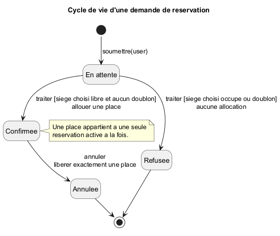

# Verification du programme simple avec les outils du TD/TP

## 1. Etat, contrat et invariants

Dans Java, `places[i] = 0` signifie libre ; une valeur positive designe le
reservant. L'utilisateur choisit le siege, numerote a partir de 1. Le tableau
est prive et les operations partagees sont synchronisees sur la meme salle.

Pour `reserver(client, siege)`, on suppose une salle construite correctement.
Le resultat est vrai exactement si le client est positif, le siege existe,
ce siege est libre et le client ne possede pas deja une place. Un autre siege
libre ne suffit pas si le siege choisi est occupe.

- Succes : seule la case `siege - 1` passe de 0 au client ; libres diminue de 1.
- Refus : le tableau reste identique, y compris pour des arguments invalides.
- Annulation : si le client possede une place, sa case repasse a 0 ; sinon
  aucun changement. Une seconde annulation ne libere aucune place supplementaire.

Invariants : chaque case vaut 0 ou un numero positif ; chaque client apparait
au plus une fois ; chaque siege possede au plus un proprietaire ; le nombre
de places libres plus le nombre de places occupees vaut la capacite.
L'absence d'ecrasement d'une place occupee fait aussi partie du contrat.

Argument de conservation : initialement tout vaut 0. Un refus ne modifie rien.
Un succes remplace une unique case libre par un client absent du tableau.
Une annulation remplace une unique case occupee par 0. Ces operations
preservent donc les invariants. Le verrou empeche d'observer une verification
ancienne suivie d'une attribution concurrente sur la meme instance.

## 2. Etats et transitions — PlantUML

`modeles/reservation.puml` represente une demande : En attente -> Confirmee
si son siege est libre et le client admissible ; En attente -> Refusee sinon ;
Confirmee -> Annulee lorsqu'une reservation existante est annulee.



Pour garder Java simple, ces etats ne sont pas une hierarchie de classes.
En attente designe une tentative pas encore traitee ; le retour vrai/faux
donne confirmation/refus. L'annulation libere la place sans conserver
d'historique. Une nouvelle tentative constitue une nouvelle demande.
PlantUML dessine le modele ; l'execution des operations est illustree par Java.

## 3. Concurrence et reseau de Petri — PIPE

Le modele isole la derniere place : deux clients distincts, une demande chacun,
visent le meme siege initialement libre. Les places deja attribuees du test Java
restent constantes et sont exclues de cette abstraction.

Un jeton dans Libre represente le siege. Un jeton dans AttenteA/B represente
une demande non traitee. ConfirmerA et ConfirmerB consomment le meme jeton
Libre : elles sont en conflit. Refuser teste Occupee avec une boucle ; Annuler
consomme la confirmation et Occupee puis restitue Libre.

| Transition | Consomme | Produit |
| --- | --- | --- |
| ConfirmerA | AttenteA + Libre | ConfA + Occupee |
| ConfirmerB | AttenteB + Libre | ConfB + Occupee |
| RefuserA | AttenteA + Occupee | RefusA + Occupee |
| RefuserB | AttenteB + Occupee | RefusB + Occupee |
| AnnulerA | ConfA + Occupee | AnnuleeA + Libre |
| AnnulerB | ConfB + Occupee | AnnuleeB + Libre |

Les invariants de places sont Libre + Occupee = 1,
Occupee = ConfA + ConfB et, pour chaque client, la somme des jetons de ses
quatre etats vaut 1. Il en decoule ConfA + ConfB <= 1.

Le fichier PIPE est `modeles/reservation-pipe.xml`. La version d'echange
standard est `modeles/reservation.pnml`. Les sorties `resultats/petri-*`
proviennent de l'explorateur externe du corrige complet ; l'interface graphique
PIPE n'a pas ete executee ici. La procedure d'animation est dans le README.

## 4. Proprietes temporelles et verification — NuSMV

Le modele `reservation-correcte.smv` utilise les etats de A et B, `libre` dans
0..1 et une action par pas. Une decision regroupe controle et allocation en
une transition, comme la section `synchronized` de Java. Le modele permet
l'annulation apres confirmation, mais pas l'annulation d'une attente.

| Propriete | Formule | Resultat NuSMV |
| --- | --- | --- |
| Bornes | INVARSPEC libre >= 0 & libre <= 1 | true |
| Conservation | INVARSPEC libre + actifs = 1 | true |
| Exclusion | INVARSPEC !(a=confirmee & b=confirmee) | true |
| Scenario utile accessible | CTLSPEC EF(a=confirmee & b=refusee) | true |
| Progression de A | LTLSPEC G(a=attente -> F(a!=attente)) | true, sous equite |
| Progression de B | Meme formule pour B | true, sous equite |
| Annulation terminale de la demande A | LTLSPEC G(a=annulee -> X(a=annulee)) | true |

G signifie toujours, F finalement, X au pas suivant, EF existence d'un chemin
menant a l'etat. Les contraintes JUSTICE imposent que chaque action de
decision soit selectionnee infiniment souvent, avec des pas sans effet apres
traitement. Ce sont des hypotheses d'ordonnancement, pas une garantie d'equite
du moniteur Java.

La variante sans equite garde les memes transitions : NuSMV refute les deux
progressions en montrant des demandes laissees au repos indefiniment.
La surete reste verifiee. Cela distingue surete et vivacite.

## 5. Scenario incorrect et contre-exemples — NuSMV

`reservation-incorrecte.smv` separe lecture et attribution. A lit libre=1,
B lit libre=1, puis chacun peut confirmer a partir de sa lecture ancienne.
Le compteur termine a 0 mais deux confirmations ont ete accordees.
NuSMV trouve une double confirmation accessible et refute les deux invariants
d'exclusion et de conservation, avec traces dans `resultats/nusmv-incorrecte.txt`.

Ce modele represente les deux accords donnes aux clients, pas uniquement la
derniere valeur ecrite dans un tableau. Dans Java, le moniteur unique ferme
cette possibilite en protegeant ensemble les gardes et l'affectation.

## 6. Defaillance, retard et echeance — PRISM

Le modele DTMC `reservation-probabiliste.pm` etudie une demande isolee eligible,
pour laquelle le siege necessaire est disponible. Il ajoute des hypotheses
de traitement probabiliste : confirmation 0,70 ; defaillance terminale 0,05 ;
retard 0,25. Confirmation et defaillance sont absorbantes.

Ces probabilites ne sont ni des mesures ni des comportements aleatoires
implementes dans le CLI Java. C'est l'extension probabiliste demandee dans
le sujet, distincte de l'abstraction concurrente precedente.

```text
P=? [ F<=D "confirmee" ]
```

La formule calcule une confirmation au plus tard au pas D, borne comprise.
Avec D=5, PRISM donne 0,932421875, soit 93,2421875 %. Un pas est abstrait :
il ne vaut pas automatiquement une seconde.

Verification analytique : P_D = 0,70 * (1 - 0,25^D) / (1 - 0,25).
La confirmation eventuelle vaut environ 0,9333333333 ; la defaillance
eventuelle environ 0,0666666667. La propriete de confirmation a 90 % au plus
tard au pas 5 est vraie. Les quatre sorties figurent dans `resultats/prism.txt`.

## 7. Portee et fichiers a remettre

Remettre les deux sources Java, les modeles, ce document, le README, le
diagramme et les journaux `resultats/`. Aucun fichier `.class` n'est necessaire.

NuSMV verifie exhaustivement le modele fini declare, pas directement le texte
Java. La correspondance repose sur une operation atomique, deux clients
distincts, une demande par client et le meme dernier siege libre. Les entrees
invalides, doublons d'identifiant et autres sieges restent couverts par les
gardes Java et l'argument de contrat, pas par ce modele a deux clients.

Les etats annules/refuses sont terminaux pour une demande du modele ; le CLI
autorise d'autres tentatives ensuite. Aucun historique n'est conserve en Java.
La preuve de vivacite suppose des demandes effectivement soumises et un
ordonnancement equitable ; elle ne force pas une personne a saisir une demande.
