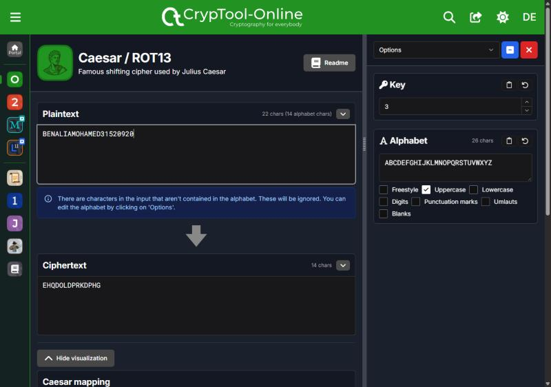
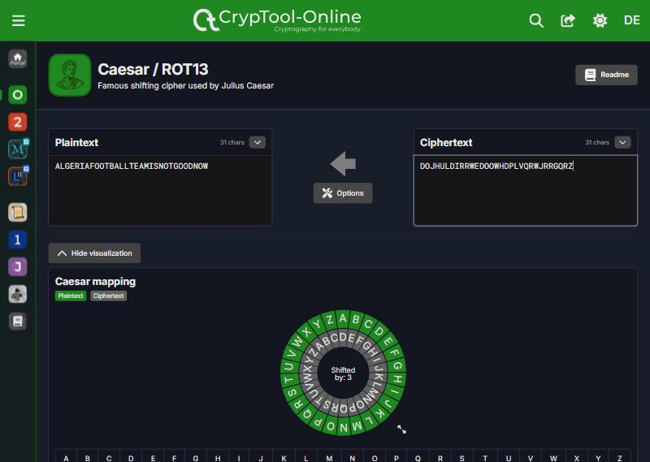
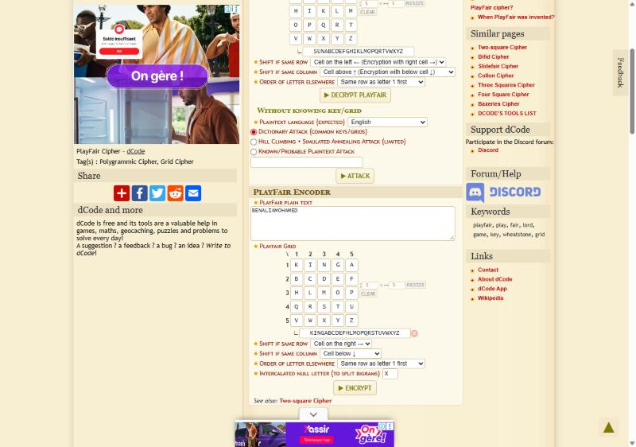
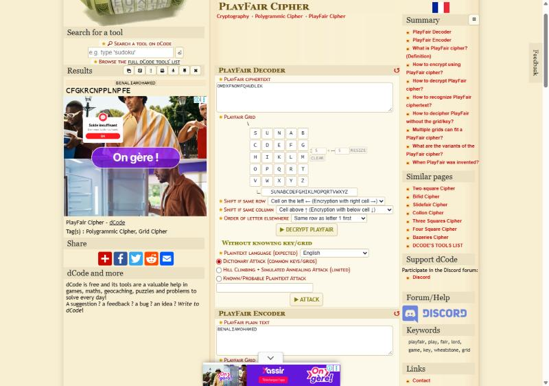
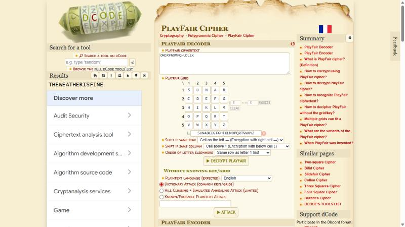

# Practical Lab 1: Classical Ciphers

**Course:** Securite de Logiciel, USTHB  
**Student:** Benalia Mohamed, ID 31520920

## Objective

Practice three classical ciphers (Caesar, Playfair, Vigenere) with an online tool and check each result by hand.

**Tools used**

- CrypTool-Online (cryptool.org/en/cto) for Caesar and Vigenere.
- dCode (dcode.fr/playfair-cipher) for Playfair, because CrypTool-Online has no Playfair page.

**Notes**

- Only the 26 letters are encrypted. Spaces and digits are not part of the alphabet: the tools do not show them in their output, so in the results below they are put back from the input (same format as the lab's results table).
- Messages are written in capital letters.
- In Playfair, J is merged with I.

---

## 1. Caesar cipher (key = 3)

Rule: each letter is moved 3 places forward in the alphabet to encrypt, and 3 places back to decrypt.

### a) Encrypt `BENALIA MOHAMED 31520920`

| Plain | B | E | N | A | L | I | A | M | O | H | A | M | E | D |
|---|---|---|---|---|---|---|---|---|---|---|---|---|---|---|
| Cipher | E | H | Q | D | O | L | D | P | R | K | D | P | H | G |

**Result: `EHQDOLD PRKDPHG 31520920`** (the digits stay unchanged)

### b) Decrypt `DOJHULD IRRWEDOO WHDP LV QRW JRRG QRZ`

Each letter is moved 3 places back: D to A, O to L, J to G, H to E, U to R, L to I, D to A, and so on.

**Result: `ALGERIA FOOTBALL TEAM IS NOT GOOD NOW`**

The manual result and the tool result are the same.

---

## 2. Playfair cipher

### Rules

1. Build a 5x5 grid: the key first (no repeated letters), then the rest of the alphabet. I and J share a cell.
2. Cut the message into pairs of letters. If a pair has twice the same letter, insert X between them.
3. Same row: take the letter on the right (to encrypt) or on the left (to decrypt).
4. Same column: take the letter below (to encrypt) or above (to decrypt).
5. Otherwise (rectangle): each letter is replaced by the one in its own row and in the column of the other letter.

### a) Encrypt `BENALIA MOHAMED` with the key `KING`

Grid:

| K | I/J | N | G | A |
|---|---|---|---|---|
| B | C | D | E | F |
| H | L | M | O | P |
| Q | R | S | T | U |
| V | W | X | Y | Z |

Pairs: `BE NA LI AM OH AM ED`

| Pair | Case | Result |
|---|---|---|
| BE | same row | CF |
| NA | same row | GK |
| LI | same column | RC |
| AM | rectangle | NP |
| OH | same row | PL |
| AM | rectangle | NP |
| ED | same row | FE |

**Result: `CFGKRCNPPLNPFE`**

### b) Decrypt `OMDXFNOMFQHUDLEK` with the key `SUN`

Grid:

| S | U | N | A | B |
|---|---|---|---|---|
| C | D | E | F | G |
| H | I/J | K | L | M |
| O | P | Q | R | T |
| V | W | X | Y | Z |

Pairs: `OM DX FN OM FQ HU DL EK`, decrypted with the reverse rules (left and above):

| Pair | Case | Result |
|---|---|---|
| OM | rectangle | TH |
| DX | rectangle | EW |
| FN | rectangle | EA |
| OM | rectangle | TH |
| FQ | rectangle | ER |
| HU | rectangle | IS |
| DL | rectangle | FI |
| EK | rectangle | NE |

**Result: `THE WEATHER IS FINE`** (the tool shows `THEWEATHERISFINE`, the spaces are put back).

The manual result and the tool result are the same.

---

## 3. Vigenere cipher

### a) Encrypt `BENALIA MOHAMED 31520920` with the key `USTHB`

Rule: each letter is shifted by the matching letter of the key (A = 0, B = 1, ..., Z = 25). The key `USTHB` is repeated along the letters of the message (spaces and digits do not use up a key letter).

| Plain | B | E | N | A | L | I | A | M | O | H | A | M | E | D |
|---|---|---|---|---|---|---|---|---|---|---|---|---|---|---|
| Key | U | S | T | H | B | U | S | T | H | B | U | S | T | H |
| Shift | 20 | 18 | 19 | 7 | 1 | 20 | 18 | 19 | 7 | 1 | 20 | 18 | 19 | 7 |
| Cipher | V | W | G | H | M | C | S | F | V | I | U | E | X | K |

Example: B (1) + U (20) = 21 = V. N (13) + T (19) = 32, minus 26 = 6 = G.

**Result: `VWGHMCS FVIUEXK 31520920`** (the digits stay unchanged)

The manual result and the tool result are the same.

---

## Summary

| Exercise | Key | Verified output |
|---|---|---|
| Caesar encryption | 3 | EHQDOLD PRKDPHG 31520920 |
| Caesar decryption | 3 | ALGERIA FOOTBALL TEAM IS NOT GOOD NOW |
| Playfair encryption | KING | CFGKRCNPPLNPFE |
| Playfair decryption | SUN | THE WEATHER IS FINE |
| Vigenere encryption | USTHB | VWGHMCS FVIUEXK 31520920 |

In every case the manual calculation matches the tool output.
