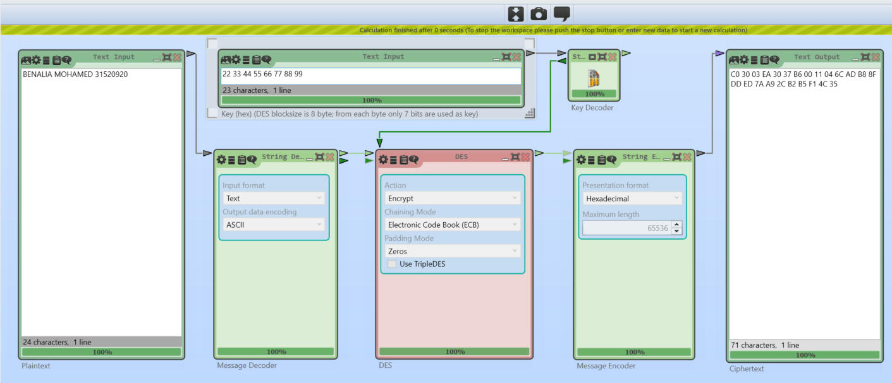
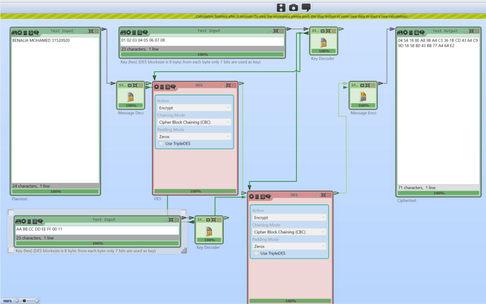
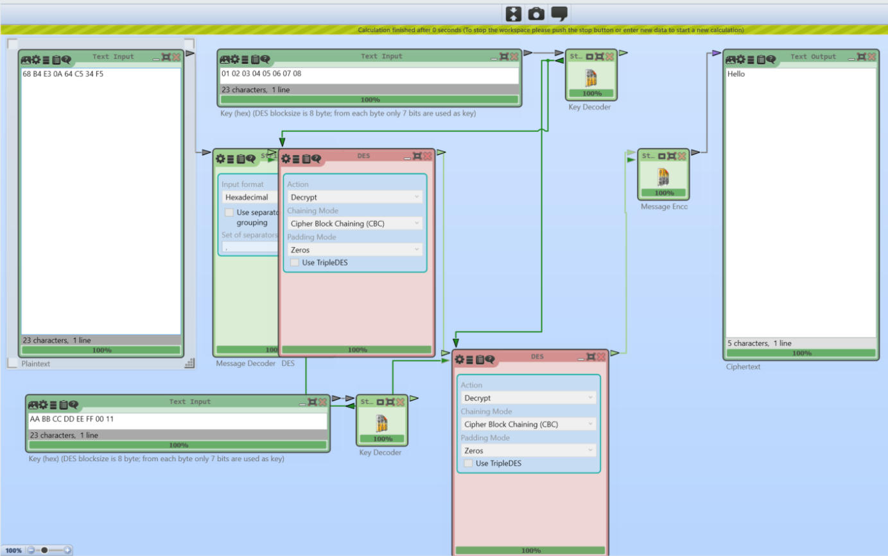

# Practical Lab 2: DES with CrypTool 2

**Course:** Securite de Logiciel, USTHB  
**Student:** Benalia Mohamed, ID 31520920

## Objective

Use CrypTool 2 to encrypt and decrypt with DES in two modes: ECB (Electronic Code Book) and CBC (Cipher Block Chaining).

## Tool and workflow

**Tool:** CrypTool 2.1 (Stable Build 9778.2), downloaded from cryptool.org. All three exercises start from its template *Cryptography > Modern > Symmetric > DES Cipher*.

The workflow has five steps:

1. **Text Input** holds the message (plaintext, or the ciphertext when decrypting).
2. **String Decoder** (Message Decoder) turns the text into bytes: as ASCII text when encrypting, or by reading hexadecimal when decrypting.
3. **DES** encrypts or decrypts the bytes. Its settings are the Action, the Chaining Mode and the Padding Mode. The key arrives through a second Text Input and its own String Decoder (Key Decoder).
4. **String Encoder** (Message Encoder) shows the resulting bytes, in hexadecimal for a ciphertext or as ASCII text for a plaintext.
5. **Text Output** displays the result.

**Notes**

- **Message:** `BENALIA MOHAMED 31520920` is exactly 24 ASCII characters, so it fills 3 DES blocks of 8 bytes. The *Zeros* padding mode therefore adds nothing.
- **Key size:** a DES key is 8 bytes, but only 7 bits of each byte are used, which gives a 56-bit key.
- **"2 DES":** I chained two DES components, DES1 then DES2, using the same key and the same IV. This is double DES: the output of DES1 is the input of DES2.
- **Independent check:** every result was also computed with OpenSSL (`openssl enc -des-ecb` / `-des-cbc -nopad`), and all of them match CrypTool 2.

---

## 1. Encrypt with DES in ECB mode

| Setting | Value |
|---|---|
| Plaintext | `BENALIA MOHAMED 31520920` (ASCII) |
| Key | `22 33 44 55 66 77 88 99` |
| Action / Mode / Padding | Encrypt / ECB / Zeros |

**How ECB works:** each 8-byte block is encrypted on its own, C_i = E_K(P_i), so the same plaintext block always gives the same ciphertext block.

| Block | Plaintext | Ciphertext |
|---|---|---|
| 1 | `BENALIA ` (42 45 4E 41 4C 49 41 20) | `C0 30 03 EA 30 37 B6 00` |
| 2 | `MOHAMED ` (4D 4F 48 41 4D 45 44 20) | `11 04 6C AD B8 8F DD ED` |
| 3 | `31520920` (33 31 35 32 30 39 32 30) | `7A A9 2C B2 B5 F1 4C 35` |

**Ciphertext:**

```
C0 30 03 EA 30 37 B6 00 11 04 6C AD B8 8F DD ED 7A A9 2C B2 B5 F1 4C 35
```



---

## 2. Encrypt with DES in CBC mode (2 DES)

| Setting | Value |
|---|---|
| Plaintext | `BENALIA MOHAMED 31520920` (ASCII) |
| Key | `01 02 03 04 05 06 07 08` |
| IV | `AA BB CC DD EE FF 00 11` |
| Action / Mode / Padding | Encrypt / CBC / Zeros, on both DES components |

**How CBC works:** before encryption, each block is XORed with the previous ciphertext block; the first block is XORed with the IV. In formulas: C_0 = IV and C_i = E_K(P_i ⊕ C_(i-1)). Identical plaintext blocks therefore give different ciphertext blocks.

**Workflow changes compared with the template:**

- Both DES components were set to *Cipher Block Chaining (CBC)*.
- I added a second Text Input with a String Decoder for the IV (bottom left of the screenshot). It is connected to the *Initialization vector* input of both DES components.
- A second DES component was added. The *Output stream* of DES1 goes into the *Input* of DES2, and DES2 sends its output to the Message Encoder. The Key Decoder feeds the key of both components.

**Results:**

| Stage | Ciphertext |
|---|---|
| After DES1 (single DES-CBC, intermediate value) | `36 C3 B5 01 D0 72 5F 2D 9B 37 7F 41 5A 9B 2E 81 C7 E6 AA 7D 77 D8 C4 4C` |
| **After DES2 (final output)** | **`04 54 18 8E A8 98 A4 C3 36 1B CD 43 64 C9 9D 18 58 B0 43 BB 77 A4 64 E2`** |

**Ciphertext (2 DES, CBC):**

```
04 54 18 8E A8 98 A4 C3 36 1B CD 43 64 C9 9D 18 58 B0 43 BB 77 A4 64 E2
```



---

## 3. Decrypt with DES in CBC mode (2 DES)

| Setting | Value |
|---|---|
| Ciphertext (hex) | `68 B4 E3 0A 64 C5 34 F5` |
| Key | `01 02 03 04 05 06 07 08` (as above) |
| IV | `AA BB CC DD EE FF 00 11` (as above) |
| Action / Mode / Padding | Decrypt / CBC / Zeros, on both DES components |

**Changes compared with exercise 2** (same two-DES workflow):

- The Message Decoder reads its input as *Hexadecimal*.
- Both DES components are set to *Decrypt*.
- The Message Encoder shows its output as *Text* (ASCII).

**How CBC decryption works:** P_i = D_K(C_i) ⊕ C_(i-1), with C_0 = IV. Each DES component removes one encryption layer. Both layers use the same key and IV, so the two components apply the same operation.

| Stage | Bytes |
|---|---|
| Input | `68 B4 E3 0A 64 C5 34 F5` |
| After DES1 | `4A CA 3D 0E 60 F6 82 DF` (not readable: one DES layer is still left) |
| After DES2 | `48 65 6C 6C 6F 00 00 00` |

The last three bytes `00` are the *Zeros* padding.

**Plaintext: `Hello`**



Decrypting with a single DES gives `4A CA 3D 0E 60 F6 82 DF`, which is not readable text. This shows that the ciphertext was produced with two DES layers, which is why the lab asks to use 2 DES.

---

## Summary

| Exercise | Answer |
|---|---|
| 1. DES ECB encryption, key `2233445566778899` | `C0 30 03 EA 30 37 B6 00 11 04 6C AD B8 8F DD ED 7A A9 2C B2 B5 F1 4C 35` |
| 2. DES CBC encryption with 2 DES, key `0102030405060708`, IV `AABBCCDDEEFF0011` | `04 54 18 8E A8 98 A4 C3 36 1B CD 43 64 C9 9D 18 58 B0 43 BB 77 A4 64 E2` |
| 3. DES CBC decryption with 2 DES of `68 B4 E3 0A 64 C5 34 F5` | `Hello` |
